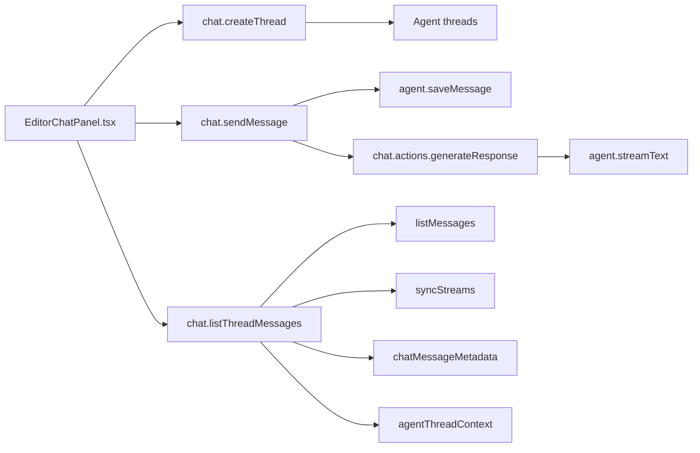

# Convex Backend Overview

This directory contains Noter's backend: schema, auth, repository workflows,
collaboration logic, chat orchestration, and infrastructure provisioning.

## Start Here

1. `schema.ts` - full data model and indexes
2. `vaultActions.ts` - repository connect/create/delete + infra retry actions
3. `infraProvisioning.ts` - async Convex/Cloudflare provisioning flow
4. `chat/index.ts` + `chat/actions.ts` - AI Fab chat lifecycle + approvals
5. `codespaces.ts` + `vaultCodespaceIntegration.ts` - Codespaces lifecycle
   integration

## AI Fab / Agent Flow



## Agent Data Model

- `agentThreadContext` - per-thread vault/repo/file context.
- `chatMessageMetadata` - commit/prod-read/tool activity payloads keyed by agent
  message ID.
- `aiProdAccessRequests` + `aiProdAccessAudit` - approval-first production read
  workflow.

## Chat Module Map

- `chat/index.ts` - `api.chat.index.*` queries/mutations (threads, messages,
  approvals).
- `chat/actions.ts` - `internal.chat.actions.*` actions (agent run + prod-read
  execution).
- `chat/metadata.ts` - metadata schemas + parse/build helpers.
- `chat/prodAccess.ts` - prod-read access helpers (admin + vault checks).
- `chat/threads.ts` - thread access helpers.
- `agent/` - LLM graph, tools, and system prompt builders.

## Key Workflows

### Vault Creation Paths

- `createRepository` (`vaultActions.ts`): creates a noter-managed GitHub repo,
  creates vault, and starts the infra provisioning Workflow.
- `connectRepository` (`vaultActions.ts`): connects an existing GitHub repo and
  creates vault without infra auto-provisioning.

### Infrastructure Provisioning

- Entrypoint:
  `internal.appProvisioningWorkflow.startVaultInfrastructureProvisioning`
- State tracking: `vaults.infraState` and `vaultInfrastructure` table
- Domain tracking: `vaultDomains` table
- Retry path: `vaultActions.retryInfrastructureProvisioning`

### Chat Approval Flows

- Commit proposals in chat
- Production read proposals (Convex/Cloudflare/logs/data)
- Explicit approve/reject with audit trails (`aiProdAccessRequests`,
  `aiProdAccessAudit`)

## Useful Local Commands

From `apps/noter`:

```bash
npm run dev
npm run lint
npx convex logs
npx convex logs --prod --history 50
npx convex env list
```
