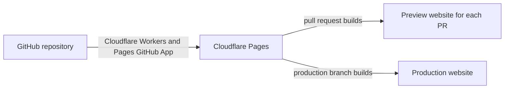

# Deploy a production-ready, real-time web-app in ~10 min with no account 0$/month

**0: TLDR**

The web-app is deployed Cloudflare Pages and uses Convex as database. Stack:
Vite+, Tanstack Router, Tailwind, ShadCN (BaseUI)

"notermd" organization name was choose with "-" because default Android keyboard
makes it hard typing a "-".

We need just 1 `CONVEX_DEPLOY_KEY` for **Production** and one for **Preview**,
That way each PR has it's own link and database different from a Production/Dev
databases.

Then we use OpenAI Codex Cloud to make some changes; But you can use anything
you want, there are instructions for running it locally and in git worktrees
since Codex supports that from the start. Since you already have Cloudflare you
can use Cloudflare Tunnels instead of grok so you can share even server running
on personal machine. This implies that it's easily extendable to support
external server that can be accessed by exposing a single port (we can expose
Convex through Vite so no need for 2 ports).

## 1: Create Github, Convex, Cloudflare & OpenAI accounts

Start with **a Google or an Apple** account on a **phone or desktop**

- [ ] **1: Create Github using Google/Apple** GitHub by Microsoft is the place
      where engineers store their code.
- [ ] **2: Create Convex using Github** Convex is the best database I have
      personally used. The simplicity of my stack proves how good it is.
- [ ] **3: Create CloudFlare using Github** Ensures the safety of your app and
      users
- [ ] **4: Create an OpenAI using Google/Apple** We'll rely on Codex Cloud to
      make changes to the code.

It's fine if you signed up differently, as long as you have these 4 accounts you
can deploy an app.

## 2: Copy the app code to your GitHub account

Visit https://github.com/notermd/app

- [ ] click big green "Use this template"
- [ ] make it private or leave it public

"Fork" if you want to preserver the git history

Check the full Git History here: https://github.com/notermd/app/commits/main/

It is manually made so it's as small, clear and simple as possible.

"Use this template" is nicer because the button is green but it squashes the
whole history inside a single commit, so it makes it a bit harder for AI to
understand it.

## 3: Connect Cloudflare Pages to Github

Cloudflare Pages will automatically deploy your app whenever the code changes on
GitHub

- [ ] Access _Cloudflare Pages_ from the sidebar "Compute > Workers & Pages"
- [ ] Click "Create Application"
- [ ] Click "Connect to GitHub" to
      `Install & Authorize Cloudflare Workers & Pages` you'll have to do this
      connection step just once at the beginning
- [ ]

Connecting CloudFlare Pages to Github issues

Cloudflare Workers & Pages sometimes has issues after installing, you can wait a
bit. You can also go to github "Settings > Applications > Authorized GitHub
Apps" to remove or revoke the installed apps, and try doing it again from
Cloudflare.

## 3: Create Convex Project

- [ ] Visit https://dashboard.convex.dev/
- [ ] Click "+ Create Project"
- [ ] Click the colored "pill" at the top to switch to "Production" from
      "Development". You might need to click it twice since convex has some
      issues.

## 4: Connect Cloudflare to GitHub and start creating the Pages project

Cloudflare needs permission to read your GitHub repository and deploy it every
time you push code. The dashboard does this by installing the **Cloudflare
Workers and Pages** GitHub App.

You might see GitHub say "Authorize" or "Install". For this guide, think of it
as: **GitHub lets Cloudflare see your repositories, and Cloudflare builds the
one you choose into a website.**

- [ ] Visit https://dash.cloudflare.com/
- [ ] Open **Workers & Pages**
- [ ] Click **Create application**
- [ ] Choose **Pages**
- [ ] Choose **Connect to Git**
- [ ] Choose **GitHub**
- [ ] If Cloudflare asks for access, click **Install & Authorize**
- [ ] Allow access to **All repositories**
- [ ] Back in Cloudflare, select that repository and click **Begin setup**

After this connection exists, you do not need to upload files manually. GitHub
is the source of truth, and Cloudflare watches the selected repository for
changes. If you prefer stricter permissions, you can choose **Only select
repositories** instead and pick just this app's repository.
