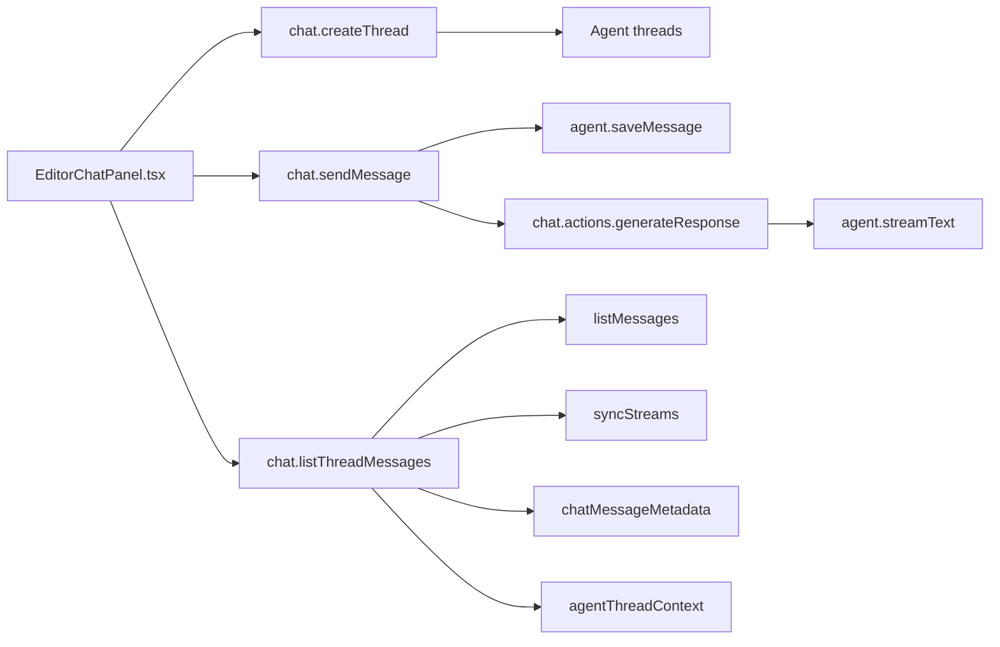

# Convex Backend Overview

This directory contains Samebase's backend: schema, auth, repository workflows, collaboration logic,
chat orchestration, and infrastructure provisioning.

## Start Here

1. `schema.ts` - full data model and indexes
2. `vault/dashboard.ts` - vault dashboard queries and infrastructure summary
3. `vault/actions.ts` - repository connect/create/delete + infra retry actions
4. `infraProvisioning.ts` - async Convex/Cloudflare provisioning flow
5. `chat/index.ts` + `chat/actions.ts` - AI Fab chat lifecycle + approvals
6. `codespaces/index.ts` + `codespaces/vaultIntegration.ts` - Codespaces lifecycle integration

## AI Fab / Agent Flow



## Agent Data Model

- `agentThreadContext` - per-thread vault/repo/file context.
- `chatMessageMetadata` - commit/prod-read/tool activity payloads keyed by agent message ID.
- `operations_aiProdAccessRequests` + `audit_aiProdAccessEvents` - approval-first production read
  workflow.

## Chat Module Map

- `chat/index.ts` - `api.chat.index.*` queries/mutations (threads, messages, approvals).
- `chat/actions.ts` - `internal.chat.actions.*` actions (agent run + prod-read execution).
- `chat/metadata.ts` - metadata schemas + parse/build helpers.
- `chat/prodAccess.ts` - prod-read access helpers (admin + vault checks).
- `chat/threads.ts` - thread access helpers.
- `agent/` - LLM graph, tools, and system prompt builders.

## Vault Module Map

- `vault/actions.ts` - public actions for GitHub repository ownership, connect/create, provisioning
  retry, and deletion retry.
- `vault/dashboard.ts` - public dashboard queries for vault cards, branch filters, and
  infrastructure/domain summaries.
- `vault/records.ts` - vault row creation, lookup, readiness, and GitHub connection mutations.
- `vault/branches.ts` - remote branch sync, branch-tree cache, tree refresh claims, and branch
  selection helpers.
- `vault/model.ts` + `vault/state.ts` - validators and runtime guards.
- `vault/deletion/` - deletion eligibility, runs, events, local cleanup, workflow orchestration, and
  provider actions.

## Key Workflows

### Vault Creation Paths

- `createRepository` (`vault/actions.ts`): creates an app provisioning run and starts the full
  create-app Workflow.
- `connectRepository` (`vault/actions.ts`): connects an existing GitHub repo and creates vault
  without infra auto-provisioning.

### Infrastructure Provisioning

- Entrypoint: `internal.appProvisioningWorkflow.startVaultInfrastructureProvisioning`
- State tracking: `operations_vaultInfrastructureTargets`,
  `operations_vaultInfrastructureOwnership`, `vaultConvexDeployments`, and `vaultCloudflareWorkers`
- Domain tracking: `vaultDomains` table
- Retry path: `api.vault.actions.retryInfrastructureProvisioning`

### Chat Approval Flows

- Commit proposals in chat
- Production read proposals (Convex/Cloudflare/logs/data)
- Explicit approve/reject with audit trails (`operations_aiProdAccessRequests`,
  `audit_aiProdAccessEvents`)

## Useful Local Commands

From the repo root in a worktree, use the Samebase workflow instead of raw Convex dev commands:

```bash
pnpm dev --once
pnpm dev
pnpm check
```

For production Convex reads, follow the root `AGENTS.md` production-read safety rule: run from the
primary checkout, derive `CONVEX_DEPLOYMENT` from that checkout, and clear `CONVEX_DEPLOY_KEY` in
the same command environment before using `npx convex ... --prod`.
