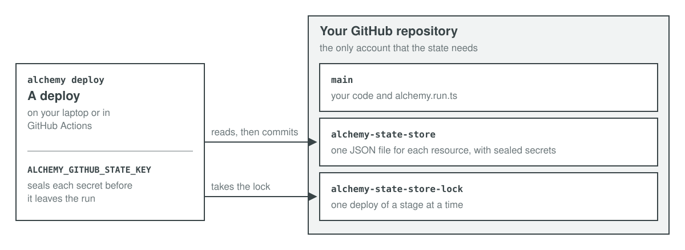

# @samebase/alchemy-kit

[](https://www.npmjs.com/package/@samebase/alchemy-kit)
[](https://github.com/samebase/samebase/blob/main/packages/alchemy-kit/LICENSE)

Parts for [Alchemy v2](https://alchemy.run). Each part is its own entry, so your stack loads only
the part that it imports.

| Part                                      | Entry                                | What it is                                                                 |
| ----------------------------------------- | ------------------------------------ | -------------------------------------------------------------------------- |
| [GitHub state store](#github-state-store) | `@samebase/alchemy-kit/github-state` | The state of a stack on a branch of its GitHub repository, secrets sealed. |
| [Run record](#run-record)                 | `@samebase/alchemy-kit/run-record`   | A record of the run in each stage output, over any state layer.            |
| [Resource type UI](#resource-type-ui)     | `@samebase/alchemy-kit/ui`           | A name, a Lucide icon, a colour and a category for each resource type.     |
| [Stack diagram](#stack-diagram)           | `@samebase/alchemy-kit/stack`        | The main resources of a stage as boxes, with the lines between them.       |

> The source is in
> [`packages/alchemy-kit`](https://github.com/samebase/samebase/tree/main/packages/alchemy-kit) of
> the Samebase monorepo. Use [GitHub Issues](https://github.com/samebase/samebase/issues) to report
> a problem or request a change.

## GitHub state store

<picture>
  <source media="(prefers-color-scheme: dark)" srcset="https://raw.githubusercontent.com/samebase/samebase/main/packages/alchemy-kit/docs/github-state-dark.svg">
  
</picture>

Alchemy keeps a record of each resource that it deployed. This store keeps that record on a branch
of the repository that the stack deploys from. The state needs no cloud account and no server: the
repository and its `GITHUB_TOKEN` are enough.

- **One JSON file for each resource.** You read the state on github.com, and each deploy is a commit
  that names what it changed.
- **Sealed secrets.** Each secret is sealed with AES-256-GCM before it leaves the run. The key is a
  repository secret.
- **One deploy of a stage at a time.** A second deploy of the same stage fails at once.

### Quick start

**1. Install.**

```sh
pnpm add -D @samebase/alchemy-kit alchemy@2.0.0-beta.87 effect
```

**2. Give the store to your stack**, in `alchemy.run.ts`:

```ts
import * as GitHubState from "@samebase/alchemy-kit/github-state";
import * as Alchemy from "alchemy";

export default Alchemy.Stack(
  "my-app",
  {
    providers,
    state: GitHubState.state(),
  },
  program,
);
```

**3. Make the key**, once, and keep it as a repository secret:

```sh
openssl rand -base64 32 | gh secret set ALCHEMY_GITHUB_STATE_KEY
```

**4. Deploy from GitHub Actions.** The job needs write access to the contents of the repository:

```yaml
permissions:
  contents: write

jobs:
  deploy:
    runs-on: ubuntu-latest
    steps:
      - uses: actions/checkout@v7
      # ... set up Node and install
      - run: pnpm exec alchemy deploy --stage prod --yes --no-input
        env:
          GITHUB_TOKEN: ${{ github.token }}
          ALCHEMY_GITHUB_STATE_KEY: ${{ secrets.ALCHEMY_GITHUB_STATE_KEY }}
```

The first deploy makes the two branches.

### Options

`GitHubState.state()` takes one object. Each field is optional.

| Option       | Default                                             | What it is                                                   |
| ------------ | --------------------------------------------------- | ------------------------------------------------------------ |
| `repository` | `GITHUB_REPOSITORY`, else the `origin` remote       | The repository, as `owner/name`.                             |
| `branch`     | `alchemy-state-store`                               | The state branch. The lock branch is this name with `-lock`. |
| `key`        | The environment variable `ALCHEMY_GITHUB_STATE_KEY` | The key, as a `Redacted` string.                             |

The token is `GITHUB_TOKEN`, else `GH_TOKEN`.

### The key

The key is 32 random bytes in base64. Each deploy of the repository uses the same key.

- Without the key, the store stops before it reads or writes anything.
- With a different key, the store stops at the first secret that does not open.
- If you lose the key, you cannot open the secrets on the branch.

The sealing is the package's own until Alchemy releases state encryption
([alchemy-run/alchemy#3167](https://github.com/alchemy-run/alchemy/pull/3167)).

### From your laptop

The store reads the token and the key from the environment of the process. A `.env` file does not
set them. Keep the key in a file that git ignores, here `.state-key`.

```sh
export GITHUB_TOKEN="$(gh auth token)"
export ALCHEMY_GITHUB_STATE_KEY="$(cat .state-key)"
pnpm exec alchemy deploy --stage dev-me
```

For a `dev-` stage that only you use, Alchemy's local state is simpler.

### What is on the branches

```
alchemy-state-store                 the state
  README.md
  {stack}/{stage}/{resource}.json
  {stack}/{stage}/__stack_output__.json
alchemy-state-store-lock            the deploy lock of each stage
  README.md
  {stack}/{stage}/__lease__.json
```

Both are orphan branches: they share no history with your code. A resource file is plain JSON,
except its secrets. This is `my-app/prod/ApiKey.json`, shortened:

```json
{
  "status": "created",
  "resourceType": "Alchemy.Random",
  "props": { "bytes": 16 },
  "attr": {
    "text": {
      "__redacted__": { "__sealed__": "v1.<iv>.<ciphertext>" }
    }
  }
}
```

A sealed value opens only in the file that it was sealed for. A copy in a different file does not
open.

### How a deploy writes

- The deploy takes the lock of its stage and renews it while it runs. If the deploy stops without a
  release, the lock ends after 60 seconds.
- All the writes that are waiting go into one commit, with a message such as
  `my-app prod: set Worker, Bucket`.
- When another deploy moved the branch first, the store reads the new head and tries again.

### Limits

- Each write is a commit, about 2 seconds.
- Each read asks GitHub for the head of the branch, one API call, and a record that the run did not
  read before is one more. A destroy of 40 resources is about 350 calls. The `GITHUB_TOKEN` of
  GitHub Actions allows 1,000 requests per hour per repository.
- A run always sees its own writes. Just after a write of another run, GitHub can still answer with
  the branch from before that write, and the store cannot see that.
- In a public repository, the state is public, except the sealed secrets.
- A ruleset that requires pull requests on all branches, or a tool that deletes stale branches,
  breaks the store. Keep both branches out of such rules.
- There is no key rotation. A new key cannot open the secrets that the old key sealed.

## Run record

Alchemy state holds no time, commit, branch, or run. `withRunRecord` adds them to each stage output
that the state writes, under the key `samebase.run`:

```json
{
  "url": "https://my-app.example.workers.dev",
  "samebase.run": {
    "version": 2,
    "source": "github-actions",
    "repositoryId": "123456789",
    "repositoryOwnerId": "987654321",
    "repositoryName": "my-org/my-app",
    "stackFile": "alchemy.run.ts",
    "branch": "feature",
    "pullRequest": 42,
    "headCommit": "8af3c5b7932c528939cbc7aa0597b1fc36c8dc83",
    "runUrl": "https://github.com/my-org/my-app/actions/runs/12345678901/attempts/1",
    "recordedAt": "2026-10-21T10:00:00.000Z"
  }
}
```

Put it over the state layer of your stack, in `alchemy.run.ts`:

```ts
import * as GitHubState from "@samebase/alchemy-kit/github-state";
import { withRunRecord } from "@samebase/alchemy-kit/run-record";
import * as Alchemy from "alchemy";

export default Alchemy.Stack(
  "my-app",
  { providers, state: withRunRecord(GitHubState.state()) },
  program,
);
```

It works over any state layer, such as the Cloudflare state store of Alchemy. Every other call goes
to that layer as it is.

- **Where the values come from.** On GitHub Actions, from the variables of the run and the event
  payload: on a pull request, the head branch and the head commit. Else from git in the checkout,
  which needs a branch and a github.com `origin` remote. `source` says which. Only github.com is
  supported.
- **The repository** is its GitHub id, which a rename keeps, the id of its owner, and its name
  `owner/name` for display. On GitHub Actions they are `GITHUB_REPOSITORY_ID`,
  `GITHUB_REPOSITORY_OWNER_ID`, and `GITHUB_REPOSITORY`. A checkout gets them with one request
  `GET https://api.github.com/repos/{owner}/{name}` for the `origin` remote, which gives the current
  name after a rename. The request uses `GITHUB_TOKEN`, else `GH_TOKEN`, else the token of
  `gh auth login`, else no token, which is sufficient for a public repository.
- **The stack file** is the working directory of the run, from the repository root, plus
  `alchemy.run.ts`.
- **A new stack of a repository that has a stack stops.** At the first deploy of a stack that has no
  stage, the run stops when the `prod` output of another stack has a version 2 record with the same
  `repositoryId` and `stackFile`, such as after a rename of the repository. The error names the
  other stack: write that name as the stack name in the stack file.
- **A run that gives no record still deploys.** A tarball without git, a checkout without a
  github.com `origin`, a detached HEAD, or a failed GitHub request still reads, plans, and destroys.
  Its outputs are written without the record, and the log says why.
- **Version 1 records** come from earlier releases. They have `repository` (`owner/name`) and no
  ids.
- **An output with no place for the key**, such as a string, an array, or a Date, is stored as it
  is, with a warning in the log. A value that the stack itself put under the key stays.
- Alchemy writes the output only after a full successful apply, so the record names the last full
  successful deploy of the stage. It holds no secret.

## Resource type UI

`resourceTypeUI(type)` gives the `name`, `icon`, `color` and `category` of a resource type tag such
as `Cloudflare.R2.Bucket`. The icon is the Lucide drawing as `[tag, attributes]` pairs for a 24 by
24 stroked SVG, so any UI framework can draw it. The entry imports no Alchemy, Effect or React. A
type with no entry of its own gets the segments of its tag after the provider as its name, and the
`box` icon. `resourceTypeTags` lists every tag with an entry.

```tsx
import { resourceTypeUI } from "@samebase/alchemy-kit/ui";
import { createElement } from "react";

function ResourceTypeIcon({ type }: { type: string }) {
  const { name, icon, color } = resourceTypeUI(type);
  return (
    <svg viewBox="0 0 24 24" fill="none" stroke={color ?? "currentColor"} strokeWidth={2}>
      <title>{name}</title>
      {icon.map(([tag, attributes], index) => createElement(tag, { key: index, ...attributes }))}
    </svg>
  );
}
```

`pnpm run ui:check` reads the Alchemy source at the tag of the pinned `alchemy` version, lists each
type that `Resource(...)` or `Platform(...)` declares there and in our own packages, and fails with
the list of types that have no entry. A weekly workflow runs it against the latest `alchemy` on npm
and opens an issue with the new types.

When it fails, add each type to `scripts/ui/resourceTypes.input.ts`: an entry in
`resourceTypeEntries` with a name, a Lucide icon, a colour and a category, one entry per line, or
its tag in `defaultResourceTypes` to use the default. Then run `pnpm run ui:generate`.
`scripts/ui/resourceTypes.haiku.input.ts` holds the entries that Claude Haiku picked for the types
that had no entry before.

## Stack diagram

`stageDiagram(rows)` takes the state rows of one stage, each as `{ fqn, state }` with the state
parsed from JSON, and gives:

- `boxes`: the main resources (compute, storage, databases, queues, email, AI, media and CDN). Each
  box has its name, type name, category, Lucide icon, link and URLs. Convex deployments with the
  same URL are one box.
- `folded` on each box: the other rows that connect to it through `downstream`, such as a
  `Convex.Project` under its deployment.
- `bindings` on each box: the resource bindings of its Workers, as the Cloudflare dashboard lists
  them: the `env` name, the kind (such as `Durable Object`), a Lucide icon, the target (such as the
  class `PageStore`), and the other box that the binding names, if one does. Plain text, secret and
  JSON bindings are left out.
- `lines`: the boxes that use each other. A line names the Worker bindings between its boxes, and a
  folded row that connects two boxes, such as an `Alchemy.Random` that both use, is a label on it.

`stageTree(diagram)` gives the same boxes as a tree: each box under the box that uses it, with the
labels of their line, from the boxes that no box uses. A list or a comment draws the hierarchy from
it.

A row keeps only the fields that the diagram shows. Alchemy state holds secrets in clear text, so
the result never holds a row's whole `attr` or `props`.

```ts
import { stageDiagram } from "@samebase/alchemy-kit/stack";

const { boxes, lines } = stageDiagram(rows.map((row) => ({ fqn: row.fqn, state: row })));
for (const { a, b, from, labels } of lines) {
  const other = from === a ? b : a;
  console.log(from ? `${from.name} uses ${other.name}` : `${a.name} and ${b.name}`, labels);
}
```
