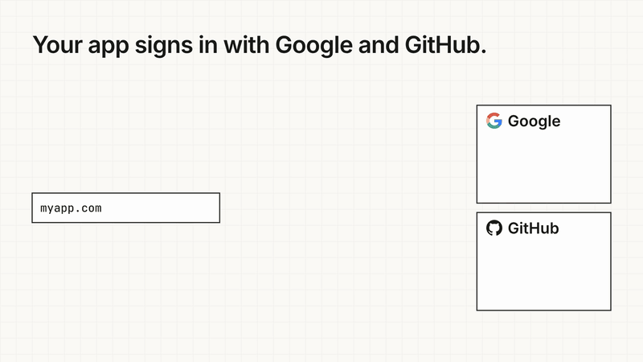
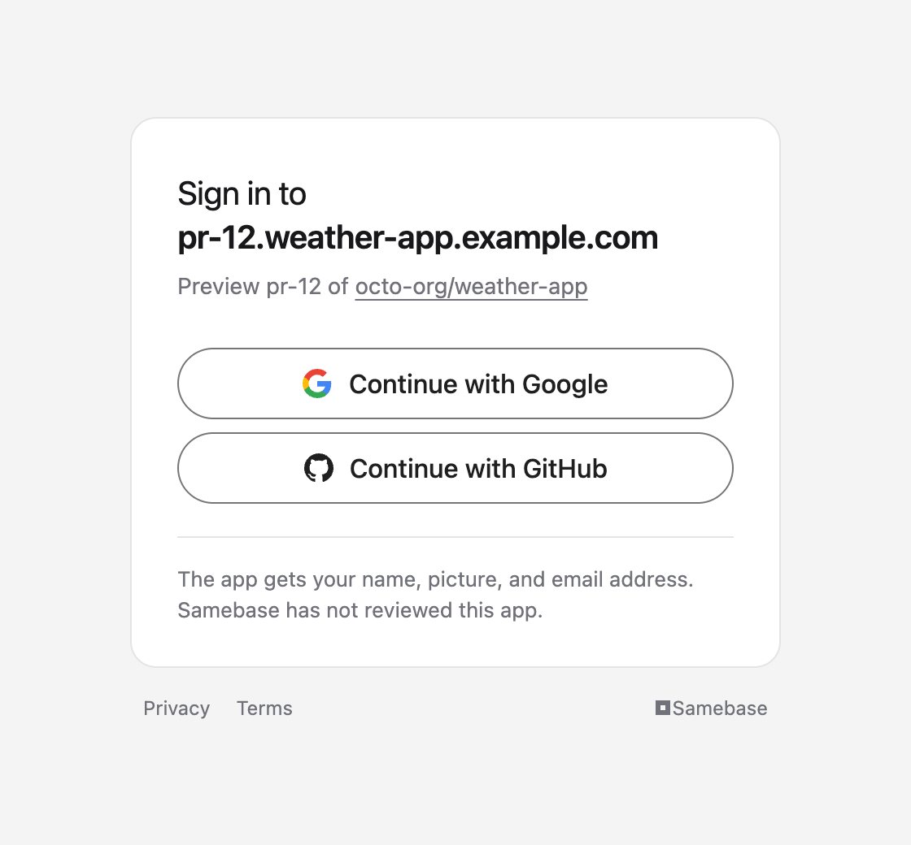

# identity-broker

[](https://www.convex.dev/components/samebase/identity-broker)
[](https://www.npmjs.com/package/@samebase/identity-broker)
[](./LICENSE)

**Google and GitHub sign-in that works on every deployment, pull request previews included.**

Google signs a user in only when the redirect URL is on a list that you edit by hand in its console,
and the list takes no wildcards. Every pull request preview has a new URL, so sign-in there fails
with `redirect_uri_mismatch`.

identity-broker is a [Convex](https://convex.dev) component that sits between your apps and the
providers. Google and GitHub each get one redirect URL, the broker's, and you add it once. Each
deployment of each app sends the broker its own URL when it deploys, and gets a client ID and secret
back. To the app, the broker is an ordinary OpenID Connect provider.



## How it works

A Convex deployment that runs this component is called a **hub** in this document.

1. **At deploy**, the app's GitHub Actions workflow sends its callback URL to the hub. The hub
   checks that the request comes from the repository that controls that URL
   ([how](#what-the-hub-checks)), and answers with a client ID and secret for that one deployment.
2. **At sign-in**, the app sends the user to the hub's `/authorize`, as it would to any OpenID
   Connect provider.
3. The hub shows a page that names the app, and the user picks Google or GitHub.
4. The provider sends the user back to the hub, which is the one URL it knows. The hub sends the
   user back to the app, and the app exchanges the code at `/token` for an `id_token`.

<p align="center">
  <picture>
    <source media="(prefers-color-scheme: dark)" srcset="https://raw.githubusercontent.com/samebase/samebase/main/packages/identity-broker/docs/sign-in-page-dark.png">
    
  </picture>
</p>

The app receives this `id_token`:

```json
{
  "iss": "https://id.samebase.com",
  "aud": "<the client ID of the deployment>",
  "sub": "google:104325678901234567890",
  "connector": "google",
  "email": "ada@example.com",
  "email_verified": true,
  "name": "Ada Lovelace",
  "picture": "https://lh3.googleusercontent.com/a/photo",
  "auth_time": 1794412800,
  "iat": 1794412800,
  "exp": 1794413100
}
```

`sub` is the provider's own ID of the user, with the provider's name in front. It is the same in
every app and at every hub, so an app can move to another hub and keep its users. The broker has no
user table and no sessions. Your app creates the user and keeps the session.

## Pick a setup

- **Use the public hub.** Samebase runs a hub at `https://id.samebase.com` that any GitHub
  repository can use under [Samebase's terms](https://samebase.com/terms), with no account and
  nothing to run. Google's and GitHub's own screens name "Samebase" as the app, and the hub's page
  before them names yours. Read [Use a hub from your app](#use-a-hub-from-your-app). The
  [samebase/base](https://github.com/samebase/base) starter does all of it from its first deploy.
- **Run your own hub.** You get your name on Google's screen, your own Google project, and your own
  rules about which repositories may register.
  [samebase/identity-hub](https://github.com/samebase/identity-hub) is a template of a hub: this
  component and its settings. Its README has the steps, which take about 15 minutes.
- **Mount the component** in a Convex app that you write yourself. Read [Mount it](#mount-it).

## Use a hub from your app

The examples use the public hub. For another hub, replace `https://id.samebase.com` with its issuer.

Your app needs three things.

### 1. Serve the verification file

At the root of the site that holds your callback URL, serve `/samebase-verification.json`:

```json
{ "repository": "123456789" }
```

The value is the numeric ID of your GitHub repository: `GITHUB_REPOSITORY_ID` in a workflow, or the
output of `gh api repos/<owner>/<name> --jq .id`. The hub reads this file before it registers a
callback URL on that site, so the site must be live first. The answer must be a `200` from the site
itself: the hub follows no redirect.

### 2. Register each deployment when it deploys

Register from a GitHub Actions workflow that has `permissions: id-token: write`. A run on a pull
request gets a preview client. A run of `main` gets a production client.

With [Alchemy](https://alchemy.run), it is one resource of
[`@samebase/alchemy-convex`](https://github.com/samebase/samebase/tree/main/packages/alchemy-convex#resources):

```ts
IdentityHub.Client("IdentityHubClient", {
  hub: { issuer: "https://id.samebase.com" },
  connectors: ["google", "github"],
  redirectUris: [Output.interpolate`${deployment.siteUrl}/auth/hub/callback`],
  deploymentType: stage === "prod" ? "production" : "preview",
});
```

Without Alchemy, it is two requests. The first asks GitHub for a token that names this hub as its
audience. The second sends that token to the hub:

```sh
token=$(curl -sS -H "Authorization: Bearer $ACTIONS_ID_TOKEN_REQUEST_TOKEN" \
  "$ACTIONS_ID_TOKEN_REQUEST_URL&audience=https://id.samebase.com" | jq -r .value)

curl -sS https://id.samebase.com/hub-clients -o client.json \
  -H "Authorization: Bearer $token" \
  -H "Content-Type: application/json" \
  -d '{
    "app": "weather-app",
    "redirectUris": ["https://pr-12.weather-app.example.com/auth/hub/callback"],
    "connectors": ["google", "github"],
    "softwareVersion": "1.4.0"
  }'
```

| Field             | Value                                                                                            |
| ----------------- | ------------------------------------------------------------------------------------------------ |
| `app`             | Your name for the app, 1 to 64 characters. One repository can hold several apps.                 |
| `redirectUris`    | 1 to 8 callback URLs of this deployment. The hub matches each exactly at `/authorize`.           |
| `connectors`      | The providers this client signs in through. Discovery lists the hub's in `connectors_supported`. |
| `softwareVersion` | Any text up to 256 characters, such as the commit. The hub stores it with the client.            |

The answer has status `201`. It holds the client's secrets, so write it to a file or to your
deployment's variables, and never to the log:

```json
{
  "issuer": "https://id.samebase.com",
  "client_id": "...",
  "client_secret": "...",
  "redirect_uris": ["https://pr-12.weather-app.example.com/auth/hub/callback"],
  "connectors": ["github", "google"],
  "registration_access_token": "...",
  "registration_client_uri": "https://id.samebase.com/register/<client_id>",
  "terms": "https://samebase.com/terms"
}
```

Register once for each deployment, and keep the answer. At each later deploy, send a `GET` to
`registration_client_uri` with `registration_access_token` as the Bearer. That read tells the hub
that the deployment is still in use ([A client's lifetime](#a-clients-lifetime)). A `401` means the
client is gone, so register again. `IdentityHub.Client` does all of this.

A client cannot change its callback URLs or its connectors. A deployment that needs another set
registers a new client.

### 3. Point your sign-in at the hub

Use any OpenID Connect client library. The hub's settings are at
`https://id.samebase.com/.well-known/openid-configuration`.

- Flow: authorization code with PKCE. `S256` is required.
- Scopes: `openid email profile`.
- Client authentication at `/token`: `client_secret_post` or `client_secret_basic`.
- `connector=google` on the `/authorize` URL offers only that provider. With no `connector`, the
  page offers every provider of the client.

For Convex Auth, the
[consumer guide](https://github.com/samebase/samebase/blob/main/packages/identity-broker/docs/consumers.md)
has the code.

Key each account by `sub`, and read `email` only when `email_verified` is `true`.

### On a development machine

A development server has no GitHub Actions run, so it cannot get GitHub's token. The answer to a
production registration has one more field for this, `initial_access_token`. Send it to
`POST /hub-clients` as the Bearer, in place of GitHub's token, with the same `app`. The client it
gets may use loopback callbacks such as `http://localhost:3000/auth/hub/callback`, and those need no
verification file.

Treat the token as a secret of the team: any holder can register development clients for the app.
Each new production registration of the app replaces it. With Alchemy,
`IdentityHub.Client.read("IdentityHubClient", { stage: "prod" })` reads it from the production
stage's state.

### What the hub checks

The token proves which repository asks. The file proves that this repository controls the site that
users return to. The hub's page then shows both to the user.

The hub refuses a registration at the first check that fails:

| Check                                                                                                    | Refusal                                                                                                 |
| -------------------------------------------------------------------------------------------------------- | ------------------------------------------------------------------------------------------------------- |
| GitHub signed the token for a workflow run, and its audience is this hub's issuer                        | `401 invalid_token`                                                                                     |
| The run is a `pull_request`, or a `push` or `workflow_dispatch` on `main`                                | `403 run_not_allowed`                                                                                   |
| The body has the four fields, and each callback URL is `https` on a DNS name, with no fragment           | `400 invalid_request`                                                                                   |
| The hub's policy has not paused the app                                                                  | `403 paused`                                                                                            |
| The hub's rules give this repository each connector that it asks for                                     | `400 invalid_connectors`, with the names that are `allowed`                                             |
| The hub's administrator has not blocked the repository or its owner                                      | `403 blocked`                                                                                           |
| The repository and its owner are inside their hourly limits                                              | `429 rate_limited`                                                                                      |
| Each site in `redirectUris` serves the verification file, and the file names the repository of the token | `403 verification_file_missing`, `host_unreachable`, `verification_file_invalid`, `repository_mismatch` |

A `403` has the body `{ "error": "not_allowed", "reason": "<the name above>" }`.

The token's audience is one hub's issuer, so a token that a deploy made for one hub is of no use at
another hub.

## Mount it

You need a Convex app, and an OAuth client at each provider that you offer.

1. Install the package.

   ```sh
   npm install @samebase/identity-broker
   ```

2. Add the component.

   ```ts
   // convex/convex.config.ts
   import { defineApp } from "convex/server";
   import identityBroker from "@samebase/identity-broker/convex.config";

   const app = defineApp();
   app.use(identityBroker);
   export default app;
   ```

3. Write the hub's config. This file is the whole hub.

   ```ts
   // convex/broker.ts
   import { defineIdentityBroker, github, google } from "@samebase/identity-broker";
   import { components } from "./_generated/api";

   export const broker = defineIdentityBroker({
     component: components.identityBroker,
     issuer: process.env.ISSUER ?? process.env.CONVEX_SITE_URL!,
     keys: () => process.env.IDENTITY_BROKER_KEYS,
     connectors: [
       github({
         clientId: () => process.env.GITHUB_CLIENT_ID!,
         clientSecret: () => process.env.GITHUB_CLIENT_SECRET!,
         selectAccount: true,
       }),
       google({
         clientId: () => process.env.GOOGLE_CLIENT_ID!,
         clientSecret: () => process.env.GOOGLE_CLIENT_SECRET!,
         selectAccount: true,
       }),
     ],
     registration: {
       // The name on the sign-in page, and the two links under it.
       name: "Example",
       terms: "https://example.com/terms",
       privacy: "https://example.com/privacy",
       // The Bearer of the administrator's API.
       moderationKey: () => process.env.IDENTITY_HUB_MODERATION_KEY,
       // What each registration may do. See "The policy" below.
       policy: () => ({
         connectors: ["github", "google"],
         resources: [],
         paused: process.env.APPS_PAUSED === "true",
       }),
     },
   });

   // For `npx convex run broker:<name>`, and for the cron below.
   export const { deleteClient, deleteApp, listApps, listClients, cleanup } = broker.admin();
   ```

4. Add the routes and the daily cleanup. Convex reads them only from these two files.

   ```ts
   // convex/http.ts
   import { httpRouter } from "convex/server";
   import { broker } from "./broker";

   const http = httpRouter();
   broker.addHttpRoutes(http);
   export default http;
   ```

   ```ts
   // convex/crons.ts
   import { cronJobs } from "convex/server";
   import { internal } from "./_generated/api";

   const crons = cronJobs();
   crons.daily(
     "identity broker cleanup",
     { hourUTC: 4, minuteUTC: 17 },
     internal.broker.cleanup,
     {},
   );
   export default crons;
   ```

5. Make the signing keys. `npx identity-broker keys` prints the value of the variable
   `IDENTITY_BROKER_KEYS`.
6. At each provider, set the redirect URL of your OAuth client to the hub's callback:
   `<issuer>/connectors/google/callback` and `<issuer>/connectors/github/callback`. This is the one
   time you add a URL by hand.

The issuer is a URL with no path, such as `https://auth.example.com`. The hub's routes, such as
`/authorize` and `/token`, are at the root of that host.

More that you can use:

- **Other providers.** `google()` and `github()` are included. Any OpenID Connect provider is a
  plain object in `connectors`. An OAuth 2.0 provider that publishes RFC 8414 metadata is one too,
  with a function that reads the user's identity from its API.
- **Key rotation.** `npx identity-broker keys --rotate` reads the current value on stdin and prints
  the next one. Add `--no-overlap` after a key leak, so that the old key stops at once. The key set
  holds nothing about users, so you replace a lost one with a new one.
- **Key checks before a deploy.** `parseKeySet` checks the shape of a value. `assertKeySetUsable`
  signs a test token with it and verifies that token.
- **Tests.** `register` from `@samebase/identity-broker/test` adds the component to a `convex-test`
  backend.
- **Your own registration.** Leave `registration` out, and the hub has no `/hub-clients`, no
  `/register`, and no `/moderation`. You then create each client in a mutation of your own, with
  `newClientCredentials` and `component.registration.register`, after your own check of who asks.

## Operate a hub

### The policy

`registration.policy` is a function that you write. The broker calls it with facts that it checked
itself, and the function answers what that app may do.

```ts
policy: ({ ownerId }) => ({
  // Google for the repositories of one organization, GitHub for every repository.
  connectors: ownerId === "9919" ? ["github", "google"] : ["github"],
  resources: [],
  paused: false,
}),
```

| Fact             | Value                                                                |
| ---------------- | -------------------------------------------------------------------- |
| `repositoryId`   | GitHub's numeric ID of the repository                                |
| `repository`     | `owner/name` at registration                                         |
| `ownerId`        | GitHub's numeric ID of the account that owns the repository          |
| `app`            | The app's name                                                       |
| `deploymentType` | `production`, `preview`, or `development`                            |
| `redirectUris`   | The client's callback URLs                                           |
| `proof`          | `github-actions`, or `initial-access-token` for a development client |

| Answer       | Meaning                                                                                       |
| ------------ | --------------------------------------------------------------------------------------------- |
| `connectors` | The connectors that the client may register for and sign in through                           |
| `resources`  | The provider APIs that the client may authorize ([Provider API access](#provider-api-access)) |
| `paused`     | `true` stops registration, sign-in, code exchange, and refresh for the client                 |

The broker calls the policy at registration and again at each step of each sign-in, with the facts
that the client's row holds. A change of the policy thus applies to existing clients at the next
request. TypeScript rejects a connector or resource name that the hub does not have. If the function
throws or gives a malformed answer, the broker refuses the request.

### The administrator's API

These endpoints change what the hub allows with no deploy. Each request needs the moderation key as
the Bearer.

| Endpoint                                   | Use                                                                                                    |
| ------------------------------------------ | ------------------------------------------------------------------------------------------------------ |
| `GET`, `POST /moderation/blocks`           | Block a repository or an owner. A block stops every request at once, whatever the policy says.         |
| `GET`, `POST /moderation/connector-grants` | Give one repository a connector that the policy does not give it.                                      |
| `GET`, `POST /moderation/sign-in-page`     | Let one repository, or every app, skip the hub's page. The browser then goes straight to the provider. |
| `GET /moderation/clients?owner=<id>`       | List every client, or with `?owner=<id>` the clients of one GitHub account's repositories.             |
| `DELETE /moderation/clients/<client id>`   | Delete one client.                                                                                     |
| `GET /moderation/counts`                   | Read the registration counts.                                                                          |

A grant and a skip cover every app and deployment of the repository. Each is bound to the
repository's owner at the time you set it, so a repository that moves to another owner loses them.

### A client's lifetime

A production client stays until you delete it.

A preview or development client is deleted 14 days after its last use. A use is a sign-in, a read of
`/register/<client id>`, a provider API authorization, or a provider token refresh. So a deployment
that still deploys or still has users keeps its client, and an abandoned preview cleans itself up.

A preview or development client can delete itself with `DELETE /register/<client id>` and its
registration access token. `deleteClient` of `broker.admin()` deletes any client.

### Logs

The broker writes one console line for each completed sign-in, each refused sign-in, and each answer
to a registration:

```
hub_event {"event":"sign_in","repository":"octo-org/weather-app","app":"weather-app","deployment":"preview","connector":"google","reason":null}
```

`event` is `sign_in`, `sign_in_refused`, `registration`, or `registration_refused`. `reason` says
why a request was refused. The line never names a user, a token, or a callback URL. A Convex log
stream sends the lines to your log service.

### What is stored

| Row                                      | Kept for                              |
| ---------------------------------------- | ------------------------------------- |
| Apps and clients                         | Until deleted, as above               |
| Authorization requests                   | 10 minutes                            |
| Authorization codes                      | 60 seconds, one use                   |
| One audit row for each issued `id_token` | 90 days                               |
| Provider refresh tokens                  | Until revoked, or 90 days with no use |

The audit row holds the app, the client, the connector, the `sub`, and the time. Nothing else about
a user stays after the sign-in request ends. There are no accounts, no sessions, and no passwords.
[docs/design.md](https://github.com/samebase/samebase/blob/main/packages/identity-broker/docs/design.md)
describes each table and each decision.

## Provider API access

A hub can also get an app an access token for a provider's API on behalf of a user, with no sign-in.
An app that deploys to its user's Convex team or Cloudflare account uses this. Its previews get it
the same way as sign-in: through the client that they registered.

Add `resources` beside `connectors` in `defineIdentityBroker`. Each credential is a function that
reads a secret of the hub:

```ts
import {
  cloudflareConnection,
  convexConnection,
  githubConnection,
} from "@samebase/identity-broker";

const resources = [
  convexConnection({ clientId: convexClientId, clientSecret: convexClientSecret }),
  cloudflareConnection({ clientId: cloudflareClientId, clientSecret: cloudflareClientSecret }),
  githubConnection({ clientId: githubAppClientId, clientSecret: githubAppClientSecret }),
];
```

| Provider   | The `resource` an app asks for          | Redirect URL to set at the provider        | Token endpoint method of your client there |
| ---------- | --------------------------------------- | ------------------------------------------ | ------------------------------------------ |
| Convex     | `https://api.convex.dev`                | `<issuer>/connections/convex/callback`     | `client_secret_post`                       |
| Cloudflare | `https://api.cloudflare.com/client/v4/` | `<issuer>/connections/cloudflare/callback` | `client_secret_basic`                      |
| GitHub App | `https://api.github.com`                | `<issuer>/connections/github/callback`     | `client_secret_post`                       |

The policy's `resources` names the providers that a client may use.

The app's side:

1. Add the callback URL that receives the answer to the client's `redirectUris`, beside the sign-in
   callback.
2. Send the user to `/authorize` with PKCE (`S256`), one `resource` from the table, and no `openid`
   scope. The broker asks the provider for the scope that the hub configured.
3. Exchange the code at `/token` with the client's credentials, `redirect_uri`, and `code_verifier`.
   The answer is an OAuth bearer token response for that provider's API. It has no `id_token`.
4. Where the answer has a `refresh_token`, use the standard `refresh_token` grant at `/token`, and
   `/revoke` when the user disconnects.

Cloudflare gives a refresh token. The broker keeps it in the component and gives the app an opaque
token of its own, bound to the client. Convex's team token has no refresh grant and no stated
expiry. `/revoke` stops later refreshes. It does not revoke an access token that the provider
already issued.
[docs/design.md](https://github.com/samebase/samebase/blob/main/packages/identity-broker/docs/design.md#api-authorization)
describes how long grants stay and what happens when a refresh fails.

## Standards

The broker follows OAuth 2.0 and the OAuth 2.1 draft (code flow, PKCE `S256`, exact redirect URLs,
`iss` on responses), OpenID Connect Core and Discovery, and RFC 8414, 8707, 7009, 9207, and 9700. A
client reads and deletes its own record at `/register/<client id>` as RFC 7592 describes.
`POST /hub-clients` follows no standard: RFC 6749 section 2 leaves open how a client gets its
credentials.

The broker is not OpenID Certified.
[docs/standards.md](https://github.com/samebase/samebase/blob/main/packages/identity-broker/docs/standards.md)
lists each standard with its sections, its status, and the results of the OpenID conformance suite.
[docs/design.md](https://github.com/samebase/samebase/blob/main/packages/identity-broker/docs/design.md)
names each departure.

## License

Apache-2.0.
