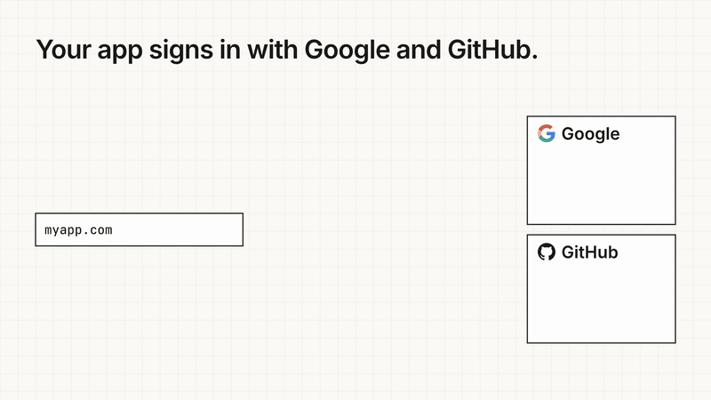

# @samebase/identity-broker

[](https://www.convex.dev/components/samebase/identity-broker)
[](https://www.npmjs.com/package/@samebase/identity-broker)
[](./LICENSE)

An OpenID Provider (a **hub**) that holds one OAuth client at Google and GitHub for all your apps
and for each of their preview and development deploys. Each deploy registers its exact callback URL
at the hub ([RFC 7591](https://www.rfc-editor.org/rfc/rfc7591.html)), and its users sign in with the
OpenID Connect code flow and PKCE. The hub keeps no user accounts: `sub` is the provider's name and
the provider's id of the user, such as `google:104325678901234567890`.

The hub runs on any platform that can answer a `Request` with a `Response`, over storage that you
bring. The package has two ready hosts: Convex, as a component of your app, and Cloudflare, as a
Worker with one Durable Object.



0.35.0 replaces the implementation of 0.34.0 and earlier. Their tables and the
`identity-broker keys` command are gone, and no data moves: each client registers again on its next
deploy. The moderation API is back since 0.37.0 ([Moderation](#moderation)), with the same requests
and answers, and the errors of RFC 6750.

## Registration

A hub mounts one registration layer, which decides who may register a client:

- `github(allowList, options)`: a GitHub Actions workflow registers with its OIDC token. The
  allow-list is `"any"`, or entries `{ ownerId, repositoryId? }` of GitHub's numeric ids: an entry
  without `repositoryId` covers every repository of that owner. A repository it covers gets every
  connector of the hub; another one gets only what a connector grant gives it
  ([Moderation](#moderation)). `options.paused`, a `Config<boolean>` read in each request, refuses
  every registration and every sign-in step while it is `true`.
- `stack({ keys })`: a client registers with one of the hub's keys, as `IdentityHub.Client` of
  [`@samebase/alchemy-convex`](https://www.npmjs.com/package/@samebase/alchemy-convex) does. A key
  with `permanent: true` may make production clients; the clients of other keys get a removal date.

Both are exports of `@samebase/identity-broker`.

## On Convex

```sh
npm install @samebase/identity-broker convex effect
```

```ts
// convex/convex.config.ts
import { defineApp } from "convex/server";
import identityBroker from "@samebase/identity-broker/convex.config";

const app = defineApp();
app.use(identityBroker);
export default app;
```

```ts
// convex/hub.ts
import { Config } from "effect";
import { github, hub as identityHub } from "@samebase/identity-broker";
import * as Connectors from "@samebase/identity-broker/connectors";
import { convexHub } from "@samebase/identity-broker/convex";
import { components } from "./_generated/api";

export const hub = convexHub(
  components.identityBroker,
  identityHub({
    // The deployment's site URL, or a custom domain in front of it.
    issuer: "https://happy-animal-123.convex.site",
    connectors: [
      Connectors.google({
        clientId: Config.Redacted("GOOGLE_CLIENT_ID"),
        clientSecret: Config.Redacted("GOOGLE_CLIENT_SECRET"),
      }),
    ],
    registration: github([{ repositoryId: "123456789", ownerId: "987654321" }]),
    service: {
      name: "Example",
      terms: "https://example.com/terms",
      privacy: "https://example.com/privacy",
    },
  }),
);

export const cleanup = hub.cleanup;
```

```ts
// convex/http.ts
import { httpRouter } from "convex/server";
import { hub } from "./hub";

const http = httpRouter();
hub.addHttpRoutes(http);
export default http;
```

```ts
// convex/crons.ts
import { cronJobs } from "convex/server";
import { internal } from "./_generated/api";

const crons = cronJobs();
crons.cron("identity hub cleanup", "17 4 * * *", internal.hub.cleanup, {});
export default crons;
```

The hub answers every path of the site that the app's own routes do not.

Each command of the hub is its own function of the component, such as `authRequests:exchangeCode`.

## On Cloudflare

```sh
npm install @samebase/identity-broker effect alchemy @alchemy.run/cloudflare
```

```ts
// src/hub.ts
import * as Cloudflare from "@alchemy.run/cloudflare";
import { Config, Effect } from "effect";
import { hub, stack } from "@samebase/identity-broker";
import { DurableObjectStore, hubWorkerProps } from "@samebase/identity-broker/cloudflare";
import * as Connectors from "@samebase/identity-broker/connectors";

export default class Hub extends Cloudflare.Worker<Hub>()(
  "Hub",
  {
    ...hubWorkerProps,
    main: import.meta.url,
    name: "example-identity-hub",
    // A domain in a Cloudflare zone of the account. Without it, the workers.dev address.
    domain: "auth.example.com",
    workersDev: false,
  },
  hub({
    issuer: "https://auth.example.com",
    connectors: [
      Connectors.google({
        clientId: Config.Redacted("GOOGLE_CLIENT_ID"),
        clientSecret: Config.Redacted("GOOGLE_CLIENT_SECRET"),
      }),
    ],
    registration: stack({
      keys: {
        preview: { key: Config.Redacted("HUB_PREVIEW_KEY") },
        production: { key: Config.Redacted("HUB_PRODUCTION_KEY"), permanent: true },
      },
    }),
  }).pipe(Effect.provide(DurableObjectStore)),
) {}
```

```ts
// alchemy.run.ts
import * as Cloudflare from "@alchemy.run/cloudflare";
import * as Alchemy from "alchemy";
import { Config, Effect } from "effect";
import Hub from "./src/hub.ts";

export default Alchemy.Stack(
  "example-identity-hub",
  { providers: Cloudflare.providers() },
  Effect.gen(function* () {
    const hub = yield* Hub;
    // The hub reads `stack`'s keys in each request, so the stack binds them.
    yield* hub.bind("RegistrationKeys", {
      env: {
        HUB_PREVIEW_KEY: yield* Config.Redacted("HUB_PREVIEW_KEY"),
        HUB_PRODUCTION_KEY: yield* Config.Redacted("HUB_PRODUCTION_KEY"),
      },
    });
    return { url: hub.url };
  }),
);
```

`alchemy deploy` deploys the Worker. The Worker's name, the object's class `Hub` and its one
instance are the address of all the hub's data: a new name starts with empty storage.

A secret can also be another Effect, such as a Secrets Store secret through
`Cloudflare.SecretsStore.ReadSecret`. The hub then builds at its first request.

## Connectors and connections

`connectors` are the providers that users sign in with, in the order that the sign-in page and
discovery name them. `@samebase/identity-broker/connectors` has `google` and `github`, `oidc` for
any OpenID Connect provider found through discovery, and `oauth` for a plain OAuth 2.0 provider with
your own `identity` function. Each connector's callback is `<issuer>/connectors/<name>/callback`.

```ts
import * as Connectors from "@samebase/identity-broker/connectors";

Connectors.oidc({
  name: "okta",
  label: "Okta",
  issuer: "https://example.okta.com",
  clientId: Config.Redacted("OKTA_CLIENT_ID"),
  clientSecret: Config.Redacted("OKTA_CLIENT_SECRET"),
});
```

`connections` are optional. Each one lets a client get the provider's own tokens for an API, with
the `resource` of RFC 8707. `@samebase/identity-broker/connections` has `convex`, `cloudflare` and
`github`, and `oauth` for another OAuth 2.0 server. Each connection's callback is
`<issuer>/connections/<name>/callback`.

```ts
import * as Connections from "@samebase/identity-broker/connections";

const connections = [
  Connections.cloudflare({
    clientId: Config.Redacted("CLOUDFLARE_CLIENT_ID"),
    clientSecret: Config.Redacted("CLOUDFLARE_CLIENT_SECRET"),
    scopes: ["workers-scripts.read"],
  }),
  Connections.oauth({
    name: "example",
    resource: "https://api.example.com",
    // The provider's `iss` (RFC 9207), or else the origin of its token endpoint.
    issuer: "https://auth.example.com",
    authorizationEndpoint: "https://auth.example.com/authorize",
    tokenEndpoint: "https://auth.example.com/token",
    scopes: ["read"],
    clientId: Config.Redacted("EXAMPLE_CLIENT_ID"),
    clientSecret: Config.Redacted("EXAMPLE_CLIENT_SECRET"),
  }),
];
```

`oauth` sends the client secret with HTTP Basic authentication unless `tokenEndpointAuthMethod` is
`client_secret_post`.

Give them to `hub(options)` as `connections`. The hub checks the names, providers, issuers and
resources of both lists at its start.

## Moderation

The GitHub layer can mount the moderation API, for the hub's administrator page. Every request needs
the moderation key as a Bearer token.

```ts
import { Config } from "effect";
import { github } from "@samebase/identity-broker";
import { moderation } from "@samebase/identity-broker/moderation";

const registration = github("any", {
  moderation: moderation({ key: Config.Redacted("IDENTITY_HUB_MODERATION_KEY") }),
});
```

Give `registration` to `hub(options)`. A hub without `moderation` has no `/moderation` route. The
hub reads the key in each request, and refuses every request while it is unset or empty. On
Cloudflare, bind it to the Worker in your stack, as `stack`'s keys are bound.

| Request                                    | Answer                                                               |
| ------------------------------------------ | -------------------------------------------------------------------- |
| `GET /moderation/counts`                   | The registrations of the last day and of the last week               |
| `GET`, `POST /moderation/blocks`           | The blocks and their history; block or unblock a repository or owner |
| `GET`, `POST /moderation/sign-in-page`     | The exemptions from the sign-in page; set or remove one              |
| `GET`, `POST /moderation/connector-grants` | The connector grants; grant or revoke one                            |
| `GET /moderation/clients`                  | The newest clients, or with `?owner=` those of one GitHub owner      |
| `DELETE /moderation/clients/<client id>`   | Deletes one client                                                   |

A change applies at once: a block refuses the next step of each sign-in, and a grant or an exemption
rewrites the clients it covers.

`@samebase/identity-broker/moderation/api` declares the API with `HttpApi` of `effect/http-api` and
imports no server code, so a browser or a Convex action can import it alone. The same declaration
gives a typed client and the OpenAPI document:

```ts
import { Effect } from "effect";
import { FetchHttpClient, HttpClientRequest } from "effect/http";
import { HttpApiClient, HttpApiMiddleware, OpenApi } from "effect/http-api";
import { ModerationApi, ModerationKey } from "@samebase/identity-broker/moderation/api";

const blockRepository = (key: string, repositoryId: string) =>
  Effect.gen(function* () {
    const { moderation } = yield* HttpApiClient.make(ModerationApi, {
      baseUrl: "https://auth.example.com",
    });
    return yield* moderation.changeBlock({
      payload: {
        action: "block",
        kind: "repository",
        githubId: repositoryId,
        reason: "Spam",
        adminEmail: "admin@example.com",
      },
    });
  }).pipe(
    Effect.provide(
      HttpApiMiddleware.layerClient(ModerationKey, ({ next, request }) =>
        next(HttpClientRequest.bearerToken(request, key)),
      ),
    ),
    Effect.provide(FetchHttpClient.layer),
  );

const openApi = OpenApi.fromApi(ModerationApi);
```

An error answer is a JSON object with `error` and `error_description`
([RFC 6749 section 5.2](https://www.rfc-editor.org/rfc/rfc6749.html#section-5.2)), and every answer
has `Cache-Control: no-store`. The typed client fails with the error's class.

| Status | `error`             | When                                                                                       |
| ------ | ------------------- | ------------------------------------------------------------------------------------------ |
| 401    |                     | No Bearer token: no body, and `WWW-Authenticate: Bearer realm="moderation"`                |
| 401    | `invalid_token`     | Not the key, with `WWW-Authenticate: Bearer error="invalid_token"` (RFC 6750 section 3.1)  |
| 400    | `invalid_request`   | A path, query or body that does not decode                                                 |
| 400    | `unknown_connector` | A grant of a connector that the hub does not have                                          |
| 409    | `owner_changed`     | A grant or an exemption for an owner while the hub records another owner of the repository |

## Write your own host

`makeHandle(registration)` of `@samebase/identity-broker` is the whole hub: an Effect program from a
`Request` to a `Response`. It never fails; an error answers 500. A host provides its services:

- `Store`: your storage (below).
- `hubSettings(settings)`: the issuer, the connectors, the service (optional) and the signing keys
  (`keys`, by default `IDENTITY_BROKER_KEYS` read with Effect's `Config`).
- `Random.layer`, `Fetch.layer` and `hubLogger`: `crypto.getRandomValues`, `fetch` with no
  redirects, and one JSON log line per entry. Time is Effect's `Clock`.

For connections, give `makeHandle` the part that `makeConnections(connections)` of
`@samebase/identity-broker/connections` makes.

The `Store` has one method, `run(name, args)`: one command of a closed list, with its arguments and
its result as JSON values. The host decodes it with `decodeCommand(name, args)` and runs it as one
transaction:

- `command.run(now, tx)` runs it over `tx`, a `TxShape<Tables>` of your storage, and returns the
  result. `now` is Effect's `Clock` when the command arrives. A throw means the transaction must
  roll back. `command.runAsync` is the same for a `Tx` whose calls are async.
- One command sees one consistent state and its own writes, and nothing else writes meanwhile. When
  `command.readOnly` is true, the `Tx` may refuse writes.
- The database may retry a transaction after a write conflict, as Convex does. The `Store` never
  sends a command again after a lost answer, because it may have committed: it fails with
  `StoreUnavailable`, and the hub answers 500.
- For SQLite, `sqlTx(exec, isOpen, readOnly)` is the `Tx`, and `ensureLayout(exec)` makes the
  tables. Other storage implements `TxShape` over `tables`, each table's schema and indexes.

Run `cleanupBatch(cutoff)` once a day through the `Store` until it answers `false`. It deletes
expired rows, each batch its own commands.

A host on Node with `node:sqlite`:

```ts
// hub.ts
import type { DatabaseSync } from "node:sqlite";
import { Clock, Config, Effect, Layer } from "effect";
import {
  cleanupBatch,
  decodeCommand,
  ensureLayout,
  Fetch,
  hubLogger,
  hubSettings,
  makeHandle,
  Random,
  sqlTx,
  stack,
  Store,
  type Exec,
  type Tables,
  type TxShape,
} from "@samebase/identity-broker";
import * as Connectors from "@samebase/identity-broker/connectors";

export const makeStore = (database: DatabaseSync) => {
  const exec: Exec = (sql, params) => database.prepare(sql).all(...params);
  /** Runs `body` as one transaction, over a `Tx` that closes when it ends. */
  const transaction = <A>(body: (tx: TxShape<Tables>) => A, readOnly = false): A => {
    let open = true;
    database.exec("BEGIN");
    try {
      const result = body(sqlTx(exec, () => open, readOnly));
      open = false;
      database.exec("COMMIT");
      return result;
    } catch (error) {
      open = false;
      database.exec("ROLLBACK");
      throw error;
    }
  };
  transaction(() => ensureLayout(exec));
  const store = Store.of({
    run: (name, args) =>
      Effect.map(Clock.currentTimeMillis, (now) => {
        const command = decodeCommand(name, args);
        return transaction((tx) => command.run(now, tx), command.readOnly);
      }),
  });
  return { store, transaction };
};

export const makeHub = (database: DatabaseSync) => {
  const { store } = makeStore(database);
  const handle = makeHandle(
    stack({ keys: { preview: { key: Config.Redacted("HUB_PREVIEW_KEY") } } }),
  );
  const services = Layer.mergeAll(
    hubSettings({
      issuer: "https://auth.example.com",
      connectors: [
        Connectors.google({
          clientId: Config.Redacted("GOOGLE_CLIENT_ID"),
          clientSecret: Config.Redacted("GOOGLE_CLIENT_SECRET"),
        }),
      ],
    }),
    Random.layer,
    Fetch.layer,
    Layer.succeed(Store, store),
    hubLogger,
  );
  return {
    /** A fetch handler, for `Deno.serve`, `Bun.serve` or any server of `Request` and `Response`. */
    fetch: (request: Request) => Effect.runPromise(handle(request).pipe(Effect.provide(services))),
    /** Once a day. */
    cleanup: () =>
      Effect.runPromise(
        Effect.gen(function* () {
          const cutoff = yield* Clock.currentTimeMillis;
          while (yield* cleanupBatch(cutoff)) {}
        }).pipe(Effect.provideService(Store, store)),
      ),
  };
};
```

### Test your storage

`checkStore` of `@samebase/identity-broker/testing` checks a host's storage against the package's
memory store: random inserts, replaces, deletes and index queries, rollback of a failed transaction,
and a sign-in and a connection through the `Store`. It needs `fast-check`, and runs in any test
runner. With Vitest:

```ts
// hub.test.ts
import { DatabaseSync } from "node:sqlite";
import { Effect } from "effect";
import { test } from "vitest";
import { checkStore } from "@samebase/identity-broker/testing";
import { makeStore } from "./hub.ts";

test("the hub's storage passes the host test kit", async () => {
  await checkStore(() => {
    const { store, transaction } = makeStore(new DatabaseSync(":memory:"));
    return { store, transaction: async (body) => transaction((tx) => Effect.runSync(body(tx))) };
  });
}, 60_000);
```

`make` gives a fresh, empty store on each call. `checkStore` rejects with the first difference.

## Environment variables

- `IDENTITY_BROKER_KEYS`: the signing keys. This prints a key set with one RS256 key:

  ```sh
  node -e 'crypto.subtle.generateKey({ name: "RSASSA-PKCS1-v1_5", modulusLength: 2048, publicExponent: new Uint8Array([1, 0, 1]), hash: "SHA-256" }, true, ["sign", "verify"]).then((pair) => crypto.subtle.exportKey("jwk", pair.privateKey)).then((jwk) => { const kid = crypto.randomUUID(); console.log(JSON.stringify({ version: 1, keys: [{ kid, status: "current", privateJwk: { ...jwk, kid, use: "sig" } }] })); })'
  ```

- Each name of a `Config` in your settings, such as `GOOGLE_CLIENT_ID`, `GOOGLE_CLIENT_SECRET` and
  the keys of `stack`.

On Convex, set them on the deployment, for example
`npx convex env set IDENTITY_BROKER_KEYS < keys.json`. On Cloudflare, `alchemy deploy` binds each
`Config` secret that the hub reads at its start to the Worker as a secret, with the value of the
deploying shell's variable of that name. These are the secrets of `connectors`, `connections` and
`keys` that are a bare `Config`, not one inside another Effect. The hub reads the other `Config`
values in each request: the keys of `stack`, the moderation `key` and `paused` of `github`. The
stack binds those, as `hub.bind(...)` in `alchemy.run.ts` shows ([On Cloudflare](#on-cloudflare)).

At each provider, set the redirect URL of the OAuth client to `<issuer>/connectors/<name>/callback`
for a connector, such as `<issuer>/connectors/google/callback`, and
`<issuer>/connections/<name>/callback` for a connection.
