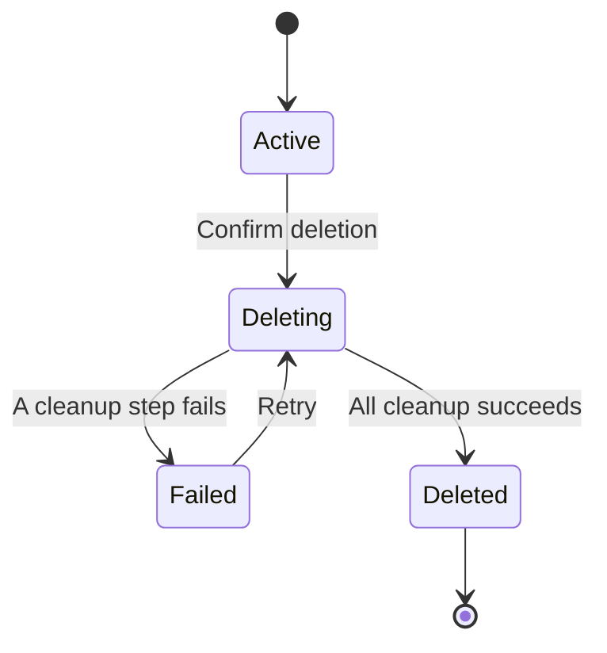

# User Settings And Account Deletion Research

> Historical exploration. The accepted implementation contract now lives in
> `rfcs/097_ACCOUNT_DELETION_RELEASE_PLAN.md`. Its Google-only sign-in and account-email discussion
> is also historical. The current account email, provider observation, and sign-in method contract
> lives in `specs/122_ACCOUNT_SIGN_IN_METHODS_SPEC.md`.

## Document Control

- Status: Superseded by RFC 097 for account deletion implementation
- Date: 2026-07-10
- Updated: 2026-07-11
- Scope: user settings, private display identity, sidebar privacy, and self-serve account deletion
- Related:
  - [Vault deletion workflow spec](../specs/098_REPOSITORY_REMOVAL_WORKFLOW_SPEC.md)
  - [Privacy policy](../apps/samebase/src/content/privacy-policy.md)
  - [Access model](../apps/samebase/shared/accessModel.ts)

## Recommendation

Add one `/settings` route with two sections: Profile and Account.

1. Add an optional `users.displayName` field and label it **Display name** in the product. Do not
   add a username system. The requested value is a private presentation label, not a unique handle.
2. Define one shared `resolveAccountPresentation({ displayName, email })` function. Its email input
   must validate as canonical for the function to return, and its result is a tagged `displayName`
   or `email` value. No provider profile field, GitHub username, or generic label participates.
3. Return that resolved value from `users.viewer` and put the same resolved value in the JWT. Remove
   raw `name`, `email`, and `githubUsername` presentation inputs from that general query. A separate
   settings query owns the required sign-in email. The hydrated UI and prehydration runtime validate
   and render the resolved value; they never choose an identity source.
4. Make a canonical email a required Samebase account invariant in the schema and supported auth
   writers. Google and password authentication require email; browser handoff reuses an existing
   valid account. Never derive email from a GitHub provider connection.
5. When a display name is set, keep the sign-in email off persistent chrome and show it only on the
   intentional Settings page. Keep Settings as the only action in authenticated right-sidebar
   account sections, and place Sign out prominently in the Settings page header.
6. Implement account deletion as a durable, retryable workflow with a user deletion gate and bounded
   cleanup. Do not implement it as one mutation.
7. Preserve GitHub repositories, Convex projects, Cloudflare Workers, Codespaces, and other
   resources in the user's provider accounts by default. Delete Samebase's local data and
   credentials. The UI should say plainly that the user's apps keep running.
8. Ship the display-name and sidebar-privacy slice first. Ship deletion after the data, billing,
   analytics, auth, audit, and processor cleanup contracts below are implemented and tested.

## Why This Is A Display Name, Not A Username

Samebase has no product behavior that needs a globally unique username. A real username would create
new requirements for uniqueness, case folding, Unicode confusables, reserved names, reuse after
deletion, URLs, and mentions. None of those should be introduced for a value whose job is to hide an
email in account chrome.

The existing `users.name` is also the wrong field. Google supplies it during sign-in in
[`auth.ts`](../apps/samebase/convex/auth.ts#L220), and Convex Auth patches provider profile fields
into the existing user on later sign-ins. A user edit to `name` can therefore be overwritten. A
separate `displayName` keeps provider identity and user presentation distinct.

Recommended contract:

- Schema: `displayName: optional(string())` on `users`
- Mutation: `setDisplayName({ displayName: string | null })`
- Access: `access_user_preferences`
- `null`: clear the customization by patching `displayName: undefined`; never store `null` or an
  empty string
- Normalization: trim outer whitespace
- Validation: reject blank and multiline values; maximum 64 Unicode code points
- Allowed content: Unicode, spaces, punctuation, and emoji
- Uniqueness: none
- Security: never use the value for ownership, authorization, billing, or audit identity

The `displayName` field itself needs no backfill. Its optionality is intentional because clearing a
customization is a supported state. Canonical email is required because every currently supported
Samebase account has one.

## Privacy Contract For Account Chrome

Before this implementation, the authenticated sidebar selected among raw user fields locally, and
the prehydration runtime independently selected an email or provider name before React loaded. That
was the privacy gap: changing only hydrated React could still expose email for the first frame.

The implementation removed those local selection expressions. Account presentation now has one
shared, exhaustive contract whose type is derived from its validator:

```ts
type AccountPresentation =
  { kind: "displayName"; label: DisplayName } | { kind: "email"; label: AccountEmail };

function resolveAccountPresentation(input: {
  displayName?: string;
  email: string;
}): AccountPresentation;
```

This is a closed two-state domain, not an open-ended fallback chain. `name`, `githubUsername`, and
`"Account"` are not accepted inputs. The resolver requires and normalizes a valid email, and it also
validates the display name before returning. A GitHub provider connection identifies which account
owns a repository credential; it does not define Samebase account identity. The removed GitHub
sign-in path and GitHub's multiple-email model are additional reasons to keep that boundary
absolute.

The `users.viewer` return validator should require an `accountPresentation` value produced by this
function. Remove `name`, `email`, and `githubUsername` from that general-purpose response unless a
non-presentation consumer proves it needs one. Components receive the presentation value and render
`label`; they cannot inspect raw profile fields. A dedicated user-settings query should return the
required `signInEmail` and optional `displayName` only to the intentional account-management
surface. Provider-specific queries remain the only source of GitHub username.

The JWT similarly carries a required `accountLabelKind` plus `accountLabel`, both produced by the
same function in `customClaims`. Prehydration validates that pair and renders it without making a
second selection decision. Loading and signed-out remain separate authentication states, not extra
presentation variants. Tokens without the complete typed pair are rejected. Legacy `email`, `name`,
GitHub identity, provider name, partial pairs, and mixed legacy and typed claims never become a
fallback. The unreferenced `UserMenu` contained an `"Unknown"` email substitute and was deleted
rather than adapted into another identity surface.

When `displayName` exists, do not also render email as a persistent secondary line in the right
sidebar. When it is absent, the resolver deliberately returns the required canonical email variant.
The Settings page may also show the read-only sign-in email because opening that page is an
intentional account-management action.

The implementation enforces the email invariant at storage, writer, and read boundaries:

1. Require a normalized Samebase sign-in email from every new interactive sign-in path. Password
   already requires one; Google sign-in should reject a profile without one. Browser handoff must
   reference an existing valid user.
2. At every viewer, Settings, MCP, and token-claim read boundary, validate the stored email and fail
   closed when presentation cannot be constructed. Do not mint a profile-less JWT or display a
   substitute.

The 2026-07-11 production verification read all six user rows through a private pipe and emitted
counts only: zero missing, blank, invalid, or non-normalized emails. The operator confirmed that
these are the only real accounts, so `users.email` is required directly without a backfill or staged
migration. If a future interactive auth provider genuinely cannot supply an email, that feature can
widen the schema when the concrete account state and presentation contract are designed. Samebase
does not model that hypothetical state now.

Saving the database field is not enough for instant prehydration: the JWT already stored in the
browser still contains the old resolved presentation. After `setDisplayName` succeeds, the client
must call `fetchAccessToken({ forceRefreshToken: true })` from `useConvexAuth()` exported by
`@convex-dev/auth/react`. The installed auth client exchanges the refresh token, mints a new JWT
through `customClaims`, rotates the refresh token, and stores both tokens before the call resolves.

Keep Save pending until the forced refresh returns a token. Only then report success. If refresh
fails, the Convex user record is still updated and the live `users.viewer` query can show the new
value, but the UI must report that this session was not refreshed and offer Retry. Otherwise an
immediate reload can prehydrate from the stale JWT and briefly show the email or previous display
name. That stale-session warning and Retry action remain visible when the input draft changes; Retry
only refreshes the token and does not rewrite the database. The live `users.viewer` query remains
the source of truth after hydration.

The MCP authentication-status tool now uses the same `accountPresentation` value for its
human-readable response. Its structured email field remains unchanged because removing it is a
separate, versioned contract decision.

## Settings Page Shape

The smallest useful page is one readable column with normal page scroll, rectangular sections, and
no cards, tabs, settings sidebar, summary header, or empty future categories.

```text
Settings

Profile
Display name
[ Nicu                                      ]
Shown in Samebase instead of your email.
[ Save ]

Account
Sign-in email
nicu@example.com
```

The display-name helper sentence is necessary because it explains the privacy result. Other
explanatory copy should wait for a concrete usability gap. Account deletion is absent until its
backend and policy contract is accepted and implemented.

Recommended placement:

- `src/lib/settingsRoute.ts`: `SETTINGS_ROUTE`
- `src/routes/settings.tsx`: TanStack route
- `src/components/UserSettingsPage.tsx`: page surface
- `routeAccessMetadata.ts`: `/settings` with `access_user_preferences` and `leftPane: "none"`

The access key already exists for both pending-access and member accounts in
[`accessModel.ts`](../apps/samebase/shared/accessModel.ts#L34). This is the correct boundary: even a
user who has not been approved for app access must be able to change their display name. Deletion
will use its own restricted access boundary.

The implementation resolves the previous approval conflict with `AuthenticatedUserRoutePage`, an
authenticated shell that preserves sign-in handling without imposing `ApprovalGate`. Settings is not
public, and approved app routes keep their existing gate.

Put Settings in each signed-in account section, including the account-only sidebar shown to pending
users. Put Sign out in the Settings page header. On mobile, selecting Settings must also return the
workspace carousel to the main pane. Otherwise navigation can succeed while the right pane remains
visible.

Future categories are credible only when they have real controls:

- Preferences: cross-device workspace preferences
- Security: sessions, machines, and authorized MCP clients
- Plan and billing: subscription state and portal actions

Do not render these categories yet. Provider connections should remain a separate route because they
manage infrastructure credentials, not the Samebase account profile.

## Account Deletion Product Contract

The action should mean:

- stop the user's access to Samebase
- cancel an active Samebase subscription before final deletion
- remove Samebase profile and auth data
- revoke Samebase sessions, machine credentials, MCP grants, and provider credentials
- delete Samebase-hosted vault, file, collaboration, chat, and preference data
- clear Samebase data cached in the current browser
- preserve the user's resources in GitHub, Convex, Cloudflare, and other external accounts

The action should not silently delete external repositories or infrastructure. Samebase already
promises that apps keep running outside Samebase, and the existing vault deletion UI has explicit
per-resource teardown choices. Account deletion should not turn those optional destructive choices
into an implicit cascade.

The confirmation dialog should use the existing Cancel and destructive-action pattern:

```text
Delete account?

This deletes your Samebase account and data. Your GitHub repositories,
Convex projects, Cloudflare Workers, and other external resources keep running.

[ Cancel ] [ Delete account ]
```

Do not require the user to type their email. That would reintroduce the value the privacy work is
trying to keep out of routine screenshots, and it does not prove identity. The signed-in session is
the identity check. A later recent-auth requirement can be added if the auth system gains a shared
reauthentication flow.

Disable dialog dismissal and both actions while the request is being accepted. After acceptance,
navigate to a dedicated `/account-deletion` route and show durable progress there. On failure, show
the failing step and Retry. On success, clear local app data and return to the signed-out landing
surface.

## Why Deletion Needs A Workflow

The accepted vault deletion design already established the relevant constraints: create a durable
run, gate new work, make bounded progress, retain retry identifiers until external work finishes,
and delete the owning row last. See
[`098_REPOSITORY_REMOVAL_WORKFLOW_SPEC.md`](../specs/098_REPOSITORY_REMOVAL_WORKFLOW_SPEC.md#L17).

Account deletion has the same failure shape at a larger scope. A user can own many vaults and large
amounts of staged content. The schema also contains user-scoped credentials, grants, machines,
threads, workflows, and audit rows. Convex mutations have transaction limits, so a synchronous scan
and delete is not safe.

Recommended state model:

- Add a new `accountDeletionRuns` table with state, current step, timestamps, user-safe failure, and
  the minimum retry material needed by the workflow.
- Add an optional `users.accountDeletion` object containing `runId` and `requestedAt`. Absence means
  active. This is intentionally optional because Convex Auth creates user rows and because adding an
  optional field avoids a user backfill.
- Add a narrow `access_account_deletion` key used only by the deletion-status query, retry action,
  and `/account-deletion` route.
- Derive a `role_account_deleting` viewer role that grants only `access_public` and
  `access_account_deletion`. It must not retain `access_user_preferences`; therefore
  `setDisplayName` and every other preference mutation are denied after the deletion gate is set.
- Render `/account-deletion` in an authenticated shell without `ApprovalGate`. Do not make the
  settings route accept either access key, because that would reopen its unrelated controls.
- Invalidate every other auth session when deletion is accepted. Keep the initiating session until
  the final step so it can observe progress and retry a failure.



Recommended ordering:

1. Insert the deletion run and gate the user in one transaction.
2. Invalidate other Samebase sessions and reject all work outside deletion status and retry.
3. Quiesce or cancel active provisioning, repository-refresh, vault-deletion, and chat work.
4. Cancel active billing, then revoke access credentials and grants.
5. Delete each vault's Samebase-local data in bounded batches, reusing the existing vault cleanup
   registry. Do not request external provider-resource deletion.
6. Delete account-level chat/component data, preferences, machines, grants, tokens, and remaining
   user-scoped rows in bounded batches.
7. Delete auth accounts and their verification data, invalidate the final session, delete the user
   row last, mark the run complete, and scrub retry-only identifiers.

Provider credential revocation should be attempted before the local secret is deleted. A failed
upstream revoke must be recorded, but it should not hold the user's local erasure request forever.
Deleting the local credential still removes Samebase's ability to use it. Billing cancellation is
different: final deletion must not succeed while Samebase can continue charging the user.

## Data Impact Map

| Data class                                                                          | Current source                                                                       | Deletion action                                                    | Important constraint                                                                                                                                |
| ----------------------------------------------------------------------------------- | ------------------------------------------------------------------------------------ | ------------------------------------------------------------------ | --------------------------------------------------------------------------------------------------------------------------------------------------- |
| User profile and billing link                                                       | [`schema.ts`](../apps/samebase/convex/schema.ts#L329)                                | Delete last                                                        | Keep the row while ownership and progress still need it.                                                                                            |
| Auth accounts, sessions, refresh tokens, verification codes, verifiers, rate limits | Convex Auth tables included at [`schema.ts`](../apps/samebase/convex/schema.ts#L323) | Invalidate and delete                                              | Convex Auth exposes session invalidation, but no complete account-deletion cascade. Delete verification rows before their account/session parents.  |
| Provider credentials                                                                | [`schema.ts`](../apps/samebase/convex/schema.ts#L354)                                | Revoke where supported, then delete                                | Current GitHub, Convex, and Cloudflare disconnect mutations mostly delete local rows. Account deletion needs explicit upstream-revocation behavior. |
| Machines and machine credentials                                                    | [`schema.ts`](../apps/samebase/convex/schema.ts#L359)                                | Revoke and delete                                                  | Registration requests, credentials, and control tokens must be included, not only visible machines.                                                 |
| Workspace preferences                                                               | [`schema.ts`](../apps/samebase/convex/schema.ts#L382)                                | Delete                                                             | Includes dashboard, workspace-sidebar, branch-filter, resource-link, folder, and graph-layout state.                                                |
| Vault and file data                                                                 | [`vault deletion cleanup`](../apps/samebase/convex/vault/deletion/cleanup.ts#L220)   | Delete in bounded batches                                          | Reuse the fail-closed registry, including Convex storage objects. External apps remain.                                                             |
| Provisioning and deletion runs                                                      | [`schema.ts`](../apps/samebase/convex/schema.ts#L631)                                | Quiesce, then delete or anonymize                                  | Component workflow state and app-owned run/event rows need an explicit terminal policy.                                                             |
| Agent threads and messages                                                          | [`chat/index.ts`](../apps/samebase/convex/chat/index.ts#L155)                        | Delete component and app rows                                      | Deleting only `chatThreadContexts` leaves Agent component messages behind. Reuse `deleteAllForThreadIdAsync`.                                       |
| Production-access requests and audit                                                | [`schema.ts`](../apps/samebase/convex/schema.ts#L852)                                | Delete requests; delete or anonymize audit                         | Vault deletion currently preserves audit. Account deletion needs an accepted retention reason or erasure.                                           |
| MCP OAuth data                                                                      | [`schema.ts`](../apps/samebase/convex/schema.ts#L943)                                | Revoke grants and delete codes/tokens                              | Some tables lack a user-prefixed index and will need one for bounded cleanup.                                                                       |
| Browser data                                                                        | [`appBootRecovery.ts`](../apps/samebase/src/lib/appBootRecovery.ts#L155)             | Clear after success                                                | Reuse the existing local-storage, session-storage, IndexedDB, cache, and service-worker reset.                                                      |
| PostHog                                                                             | [`AppRootClient.tsx`](../apps/samebase/src/components/AppRootClient.tsx#L35)         | Delete or anonymize the identified person and replay/event linkage | Browser reset only stops future use. It does not erase data already sent with the Convex user ID.                                                   |
| Polar                                                                               | [`billing.ts`](../apps/samebase/convex/billing.ts#L190)                              | Cancel subscription and remove local customer link                 | Financial records may require separate provider/legal retention. Do not claim those records are erased without a defined Polar process.             |

The cleanup implementation should add user-prefixed indexes wherever a table cannot be reached
through a bounded parent relationship. Known examples include MCP authorization codes, MCP auth
requests, agent browser handoffs, and auth verifiers. The final implementation should maintain one
fail-closed registry of every user-owned or user-referencing table so future schema additions must
declare delete, detach, anonymize, or retain behavior.

## External Resources And Credentials

There are three different actions that the UI must not conflate:

1. **Delete Samebase data:** required for account deletion.
2. **Remove Samebase's provider access:** required for account deletion. Revoke or delete the stored
   credential and revoke Samebase-issued grants.
3. **Delete resources in the user's provider account:** not part of account deletion by default.

The third action remains in the vault deletion flow, where Samebase knows which resources it created
and the user can make an explicit per-resource choice. Existing repositories and unrelated
account-level resources must never be inferred or deleted.

## Retention, Processors, And Policy

The current privacy policy accurately says that self-serve account deletion is not implemented in
[`privacy-policy.md`](../apps/samebase/src/content/privacy-policy.md#L96). That text, the
stored-data inventory, processor disclosures, and retention section must be updated before this
feature ships.

The legal product requirement depends on where Samebase operates and which laws apply, so this memo
is not legal advice. The engineering contract should still be built to support the common baseline:

- EU GDPR Article 17 provides a right to erasure without undue delay in covered cases, with defined
  exceptions.
  [Official text](https://eur-lex.europa.eu/legal-content/EN/TXT/?uri=CELEX%3A32016R0679)
- California's CCPA describes a right to delete collected personal information and to direct service
  providers to do the same, subject to exceptions.
  [California Attorney General guidance](https://oag.ca.gov/privacy/ccpa)

Before implementation, accept one row-level retention matrix for:

- production-access audit
- MCP access audit
- vault and account deletion runs/events
- billing and transaction records
- provider and application logs
- Convex backups
- PostHog events and session replay
- model-provider request retention

Default to deleting or irreversibly anonymizing personal identifiers unless a documented security,
financial, or legal requirement needs the row. Do not retain email, display name, provider secrets,
workspace content, prompts, or file paths in a deletion receipt. A short-lived receipt may contain a
random request ID, step outcomes, and timestamps only, with an automatic expiry.

PostHog and Polar need explicit processor-side actions or documented retention exceptions. Clearing
the browser and deleting the Convex user row does not erase data already sent to those systems.

## Rollout

### Slice 1: Settings And Private Display Name (Implemented)

- Require `users.email` directly. All six existing rows were verified as canonical, and current
  Google and password sign-in writers require email.
- Add the shared, typed `resolveAccountPresentation` function and remove presentation decisions from
  UI components.
- Add `/settings` with Profile and Account sections.
- Add `displayName` and its mutation.
- Return the resolved presentation from `users.viewer` and JWT custom claims.
- Force a token refresh before Save completes.
- Make the right sidebar, public account section, MCP status, and prehydration consume the resolved
  presentation value.
- Add Settings navigation and mobile pane handoff.
- Keep Delete account disabled or absent until the backend contract exists. Do not ship a control
  that only deletes the `users` row.

### Slice 2: Account Deletion Foundation

- Add the deletion gate, `access_account_deletion`, restricted deleting role, run/event model, and
  fail-closed user cleanup registry.
- Add missing indexes and bounded batch functions.
- Add auth-session invalidation and auth-table cleanup.
- Reuse vault cleanup and Agent component thread deletion.
- Add provider-revocation, billing-cancellation, PostHog, and browser-cleanup boundaries.
- Test failure and retry at every durable step.

### Slice 3: Deletion UI And Policy Cutover

- Enable the confirmation dialog and dedicated `/account-deletion` progress/retry route.
- Update privacy and retention text before enabling the action.
- Validate a real account with vaults, staged storage, chat history, machines, MCP grants, provider
  connections, and billing state.
- Prove that external apps still run after the Samebase account disappears.

## Validation Plan

Profile and privacy:

- backend tests for normalization, clearing, max length, multiline rejection, ownership, pending
  access, and reactive viewer updates
- exhaustive resolver tests proving the only outputs are the `displayName` and canonical `email`
  variants
- boundary tests proving provider name, GitHub username, and a generic label cannot enter account
  presentation
- schema and type tests proving every stored user requires email, plus runtime boundary tests for
  malformed unknown email input
- sidebar tests proving confirmed, temporary, public, and prehydrated markup render the supplied
  presentation without choosing another source
- token tests proving Save forces a refresh, the persisted JWT carries the resolved kind and label,
  and a failed refresh stays recoverable while the draft changes
- token tests proving legacy profile fields, partial pairs, provider identity, and mixed legacy and
  typed claims are rejected through both hydrated and prehydrated paths
- real-route tests proving pending access through the SPA Settings link, signed-out direct-route
  privacy, display-name save/prehydration, and clear/email prehydration
- mobile interaction test proving Settings navigation returns to the main pane
- update 288 px, 160 px, and 96 px right-sidebar screenshots
- add real `/settings` desktop and iPhone screenshots

Deletion:

- enumerate every user-owned and user-referencing table in a fail-closed test
- seed more than one cleanup batch for large tables and storage objects
- prove that new product writes are rejected after the user deletion gate is set
- prove the deleting role has exactly `access_public` and `access_account_deletion`, direct
  `setDisplayName` calls fail, and only status/retry functions remain available
- prove that all other sessions, machine credentials, MCP tokens, and browser caches stop working
- inject a failure at every external and local step, then prove retry is idempotent
- verify no auth account, verification code, component thread/message, provider secret, or PostHog
  identity remains after success
- verify active billing is canceled or the workflow remains visibly failed
- verify GitHub repositories, Convex projects, and Cloudflare Workers were not deleted
- run focused tests while iterating, then the canonical `pnpm test:visual:linux` acceptance path

## Document Lifecycle

The Settings and display-name slice was implemented after explicit operator approval. The account
deletion sections remain research while the approval boundaries below are unresolved. If those
decisions are accepted, create an RFC containing the deletion contract and rollout before deletion
implementation starts. Deletion implementation should not treat this research file itself as an
accepted source of truth.

## Approval Boundaries

These decisions should be accepted before deletion implementation starts:

1. External provider resources survive account deletion. Recommended: yes.
2. Active Samebase subscriptions are canceled automatically before final deletion. Recommended: yes.
3. Audit, billing, backup, analytics, and model-provider retention get explicit durations and
   anonymization rules. Recommended: delete or anonymize by default, with exceptions documented
   before launch.
4. Provider grant revocation failure does not indefinitely block local erasure, but remains visible
   in the deletion run. Recommended: yes.
5. Structured email in the MCP authentication-status response is handled as a separate versioned
   contract change. Recommended: yes; remove email from human-readable text in the profile slice.
