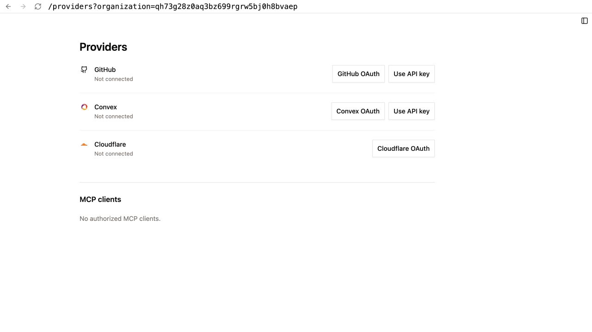
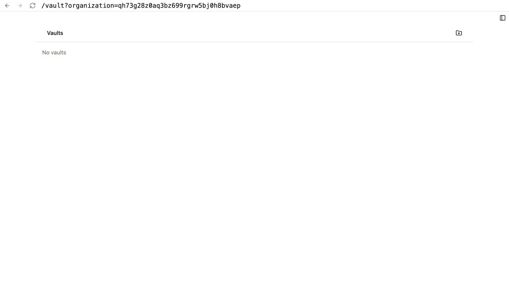
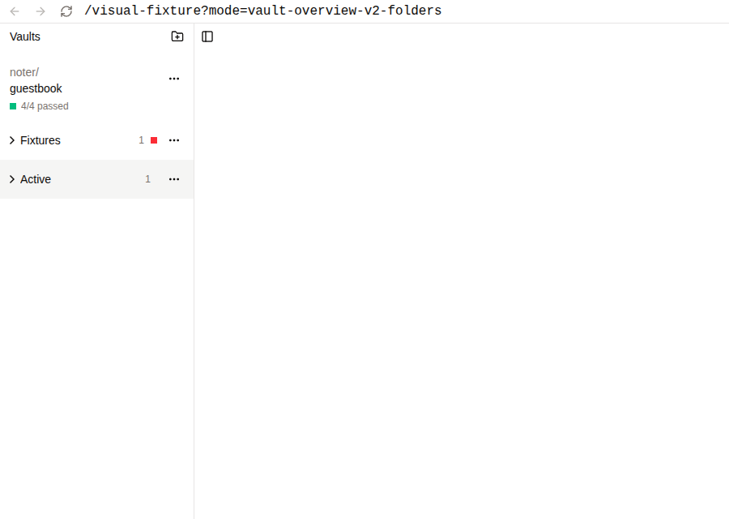
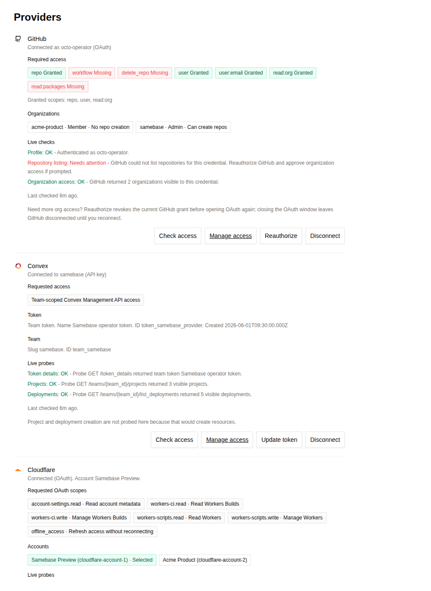

# Organization Context UX Audit

## Document Control

- Status: Research
- Date: 2026-08-05
- Audit branch base: `2bbd456e6`
- Organization implementation: `db069c026`, from
  [PR #1367](https://github.com/samebase/samebase/pull/1367)
- Accepted ownership contract:
  [`specs/120_ORGANIZATION_OWNERSHIP_SPEC.md`](../specs/120_ORGANIZATION_OWNERSHIP_SPEC.md)
- Proposed product model:
  [`rfcs/121_ORGANIZATION_CONTEXT_AND_ROUTE_MODEL.md`](../rfcs/121_ORGANIZATION_CONTEXT_AND_ROUTE_MODEL.md)
- Visual plan: [`plans/organization-context-ux/plan.mdx`](../plans/organization-context-ux/plan.mdx)

This file records observations. The RFC records the proposed behavior. The accepted organization
spec stays unchanged until the proposal is approved.

## Research Method

The audit used five sources:

1. The current route tree, access metadata, shared app shell, route pages, and tests.
2. The accepted organization and vault-folder specs.
3. The current Convex folder tables and mutations.
4. A real authenticated Samebase browser session with development data.
5. Current official product documentation for GitHub, Cloudflare, Convex, Linear, Sentry, Netlify,
   and Clerk.

Three read-only research agents checked the route model, the folder boundary, and the external
products. The main pass checked their results against the source and browser states.

### Browser audit limit

The available authenticated browser session ran revision `99b2b7aea` from the organization rollout
worktree. It was an earlier build than `db069c026`. The current worktree could not start its local
Convex backend because its worktree-local GitHub App settings were absent. The audit did not copy
credentials from another checkout.

The two live screenshots below are therefore rollout baseline evidence. They show the same page
structure that led to the current owner routes, but their opaque `organization` query parameter is
not the accepted current route contract. When browser evidence and current source differ, the
current source controls this audit.

The providers page combines organization-owned provider connections with user-owned MCP grants. The
page does not name the organization in persistent chrome.

The empty vault root shows a folder action and no organization identity. The current tracked visual
fixture makes the same folder-first hierarchy more visible:

The current connected-provider fixture also shows organization-owned provider data without an
organization label in the page chrome:

## Accepted Ownership Model

The backend model is coherent:

| Resource                          | Owner                       | Public coordinate                |
| --------------------------------- | --------------------------- | -------------------------------- |
| Samebase login and profile        | User                        | None                             |
| MCP grants                        | User                        | None                             |
| Organization                      | One GitHub repository owner | GitHub owner login               |
| Membership and role               | Organization plus user      | None                             |
| Vault                             | Organization                | GitHub owner and repository name |
| Convex and Cloudflare connections | Organization                | None                             |
| Billing account and quota         | Organization                | None                             |
| Folder and folder assignment      | User                        | None                             |

A user can belong to zero, one, or several Samebase organizations. GitHub membership does not grant
Samebase membership. Samebase authentication does not depend on GitHub authentication. These facts
do not need a new data layer.

## Current Route And Ownership Map

The current route registry is in [`routes.ts`](../apps/samebase/src/routes.ts#L24-L73), and route
access is in [`routeAccessMetadata.ts`](../apps/samebase/src/routeAccessMetadata.ts#L15-L141).

### User-global routes

| Route                | Current purpose                                  | Finding                                                                                       |
| -------------------- | ------------------------------------------------ | --------------------------------------------------------------------------------------------- |
| `/vault`             | All vaults for all current memberships           | The result is one activity-sorted list. Ownership boundaries do not control the visual order. |
| `/settings`          | Profile, billing, sign-out, and account deletion | User profile and organization billing share one page. Billing uses `?owner=<login>`.          |
| `/account-deletion`  | Account deletion progress                        | Correctly user-global. User deletion is not organization deletion.                            |
| `/oauth/mcp/consent` | User authorization for an MCP client             | Correctly user-global. A grant acts as the user across current memberships.                   |
| `/agents/connect`    | One-time browser handoff                         | Correctly user-global. The handoff creates a user session and carries no organization.        |

The vault query first lists all organization IDs for the user and then returns one merged list
([`dashboard.ts`](../apps/samebase/convex/vault/dashboard.ts#L825-L847)). The result contains an
`organizationId`, but the dashboard does not use it as a visible section boundary.

### Organization selection gateways and pages

| Route                    | Current scope | Context rule                                                | Finding                                                                                     |
| ------------------------ | ------------- | ----------------------------------------------------------- | ------------------------------------------------------------------------------------------- |
| `/providers`             | Gateway       | Select the sole organization, or wait for a local selection | The page has no stable organization context when several memberships exist.                 |
| `/providers/:owner`      | Organization  | Owner login route segment                                   | Correct public key, but the shared nav drops it.                                            |
| `/new-app`               | Gateway       | Select the sole organization, or wait for a local selection | A real ownership boundary appears as a form control.                                        |
| `/new-app/:owner`        | Organization  | Owner login route segment                                   | Correct public key, but the route family is not organization-first.                         |
| `/connect-repo`          | Gateway       | Select the sole organization, or wait for a local selection | The repository owner is also the organization owner, but the page treats it as local input. |
| `/connect-repo/:owner`   | Organization  | Owner login route segment                                   | Correct public key, but the route family is separate from the other organization pages.     |
| `/settings?owner=:owner` | Mixed         | Owner login query parameter                                 | Organization billing is inside user settings.                                               |

[`useGitHubOwnerRouteSelection`](../apps/samebase/src/components/useGitHubOwnerRouteSelection.ts#L4-L15)
selects the sole membership when the route has no owner. The selector disappears when fewer than two
memberships exist
([`GitHubOwnerSelect.tsx`](../apps/samebase/src/components/GitHubOwnerSelect.tsx#L19-L45)). A
one-organization user therefore sees organization data without a persistent organization label.

### Vault-scoped routes

| Route                                                         | Current purpose      | Scope finding                                                                                                                                            |
| ------------------------------------------------------------- | -------------------- | -------------------------------------------------------------------------------------------------------------------------------------------------------- |
| `/vault/:owner/:repo`                                         | Vault overview       | The route is clean and derives the organization from the GitHub coordinate.                                                                              |
| `/vault/:owner/:repo/settings`                                | Vault settings       | The vault coordinate remains present.                                                                                                                    |
| `/vault/:owner/:repo/db/:branch/project/:convexProjectId`     | Convex database view | The vault coordinate remains present.                                                                                                                    |
| `/vault/:owner/:repo/schema/:branch/project/:convexProjectId` | Schema view          | The vault coordinate remains present.                                                                                                                    |
| `/vault/:owner/:repo/fs/:branch/*`                            | FileView             | The catch-all route dispatches this shipped owner, repository, branch, and file shape. The editor is outside this proposal, but its shared shell is not. |

The clean vault route is not the problem. The vault detail shell is the problem. It loads all vaults
for the user, so its left sidebar can show vaults from other organizations while the main pane shows
one organization-owned vault
([`useVaultWorkspaceModel.ts`](../apps/samebase/src/components/vault-dashboard/useVaultWorkspaceModel.ts#L23-L68)).

### Operator-only routes

| Route                      | Purpose                       |
| -------------------------- | ----------------------------- |
| `/admin/account-deletions` | Account deletion operations   |
| `/indexDB`                 | Local storage inspection      |
| `/localStorage`            | Local storage inspection      |
| `/pitch`                   | Internal pitch surface        |
| `/pitch/print`             | Internal print surface        |
| `/pitch/print/mobile`      | Internal mobile print surface |
| `/test`                    | Local test surface            |

These routes do not need organization context. They must remain outside the normal product
navigation.

## Current Navigation And History Behavior

The shared right sidebar links only to `/vault`, `/providers`, `/new-app`, and `/connect-repo`
([`AppRightSidebar.tsx`](../apps/samebase/src/components/AppRightSidebar.tsx#L128-L159)). These
links have no owner. A user can select an organization on one page and lose that selection on the
next navigation action.

Owner changes on provider and creation pages create normal browser history entries. Invalid owner
routes use replacement navigation to a base route. On a removed membership, an invalid owner route
can therefore move the user to a different sole organization without explaining that the original
organization is unavailable. The provider owner route shows this behavior directly
([`providers-owner.tsx`](../apps/samebase/src/routes/providers-owner.tsx#L8-L30)).

Provider OAuth currently defaults to `/providers`
([`providerOAuthReturn.ts`](../apps/samebase/shared/providerOAuthReturn.ts#L1-L12)). Checkout and
billing-portal flows return to `/settings?owner=<login>`
([`UserSettingsPage.tsx`](../apps/samebase/src/components/UserSettingsPage.tsx#L261-L274)). These
full-page returns must move with the scoped route family. Otherwise, an external flow can drop the
organization context even after normal internal navigation is fixed.

The router has good scroll restoration for Back and Forward
([`router.tsx`](../apps/samebase/src/router.tsx#L19-L79)). It does not store organization context,
which is correct for the accepted backend contract. The route and the shared navigation must carry
that context instead.

The shared shell stores the active mobile pane for the app. Most route pages hide pane toggle
buttons on mobile because the default visibility is desktop-only
([`AppWorkspaceShell.tsx`](../apps/samebase/src/components/AppWorkspaceShell.tsx#L246-L290)). A
route change can leave the user on a navigation pane instead of the new main page. An organization
switcher that exists only in the right pane would make this problem worse.

## Main User Flows

| User state            | Current flow                                                                                                                                        | Result                                                                                                                                                                    |
| --------------------- | --------------------------------------------------------------------------------------------------------------------------------------------------- | ------------------------------------------------------------------------------------------------------------------------------------------------------------------------- |
| No organization       | `/vault` shows no vaults. Setup pages offer GitHub App installation. Settings can also show the install action near billing.                        | The empty state does not explain that an organization is the required ownership boundary. A folder action can appear before there is a vault or organization to organize. |
| One organization      | Base provider and creation routes silently select the sole membership. The owner selector is hidden.                                                | The route stays generic, and the page can show organization data without the organization name.                                                                           |
| Several organizations | Base provider and creation routes wait for a page-local selection. `/vault` combines all vaults. Shared navigation returns to unscoped base routes. | The user must repeatedly select an owner. The shell does not keep the selected boundary.                                                                                  |
| Membership removed    | A stale owner route can redirect to the base route or to the sole remaining organization. A stale vault route reports a missing vault.              | The app hides the access transition. The browser URL and the visible organization can disagree with the user's intent.                                                    |

Reload works on the current owner routes and clean vault routes. Direct links use a public GitHub
owner login, not an internal organization ID. This is a strong base for a route-first model.

A signed-out protected deep link can reach a missing-content state before Samebase sign-in has
finished on some routes. The later route work must preserve the requested owner and vault through
sign-in, then check membership. It must not replace the deep link with a global route during the
authentication transition.

## Problems Ranked By Main-Flow Impact

1. **Organization-owned resources are visually mixed.** The global vault list and the vault detail
   sidebar combine resources from all current memberships. A custom folder can make the owner
   boundary invisible.
2. **Shared navigation drops organization context.** Providers, app creation, repository connection,
   billing, and future membership work cannot form one stable user journey.
3. **A lost membership can silently select another organization.** This is a wrong-context risk. It
   is more serious than a missing-page error.
4. **User and organization settings share one page.** Profile and account deletion belong to the
   user. Billing and provider administration belong to an organization.
5. **The one-organization case hides identity.** Removing a switch control is useful, but removing
   the organization label removes ownership information.
6. **MCP grants appear under Providers.** MCP grants are user-owned, but Convex and Cloudflare
   connections are organization-owned
   ([`ProviderConnectionsPage.tsx`](../apps/samebase/src/components/ProviderConnectionsPage.tsx#L845-L902)).
7. **The mobile pane model can hide route context.** A durable organization control must remain
   available in the main pane on a small screen.

## Vault Folder Boundary Audit

### Current data shape

`ui_vaultFolders` stores `userId`, name, position, and collapse state. It has no organization field.
`ui_vaultFolderAssignments` stores `userId`, `vaultId`, and `folderId`
([`folderModel.ts`](../apps/samebase/convex/vault/folderModel.ts#L6-L25)).

`moveVaultToFolder` checks that the user can access the vault and that the user owns the folder. It
does not require the vault and folder to share an organization
([`folders.ts`](../apps/samebase/convex/vault/folders.ts#L173-L194)). This is valid under the
current personal-preference contract, but it lets one folder contain vaults from several
organizations.

The dashboard joins every current vault to this one user-wide folder map
([`VaultOverviewSidebar.tsx`](../apps/samebase/src/components/vault-dashboard/VaultOverviewSidebar.tsx#L278-L297)).
If a membership is removed, the assignment can remain stale. If membership returns, the old folder
placement returns too.

### Model assessment

The folder is not an authorization defect. It does not grant access. The product problem is visual:
the strongest list hierarchy becomes a personal name such as `Fixtures`, while the real ownership
boundary is the GitHub-backed organization.

The accepted folder spec was written before the organization ownership contract. Its rationale says
that the vault model is user-owned. That premise is no longer true. Personal UI state is still
allowed, but it must not replace the organization boundary in the primary vault navigation.

| Option                                          | Boundary clarity | Product cost                                     | Evidence                                                                                                                                                        |
| ----------------------------------------------- | ---------------- | ------------------------------------------------ | --------------------------------------------------------------------------------------------------------------------------------------------------------------- |
| Keep cross-organization folders                 | Low              | Existing cost only                               | It preserves user choice, but it continues to hide ownership.                                                                                                   |
| Scope folders to one organization               | High             | Adds folder management inside every organization | There is no current evidence that a second hierarchy is needed inside an organization. Existing cross-organization folder names have no safe automatic mapping. |
| Keep folders only in a separate personal view   | Medium           | Adds a second vault navigation model             | It can work later if Samebase needs a personal work queue, but the current feature is the primary sidebar model.                                                |
| Remove folders and derive organization sections | High             | Deletes code and data                            | The organization already supplies the stable, shared grouping. It solves the present boundary problem without a new concept.                                    |

The RFC recommends the last option. If it is approved, stop writes, delete assignment data before
folder data in each persistent deployment, and verify that both tables are absent. Do not preserve
or transform folder names. Replace the accepted folder spec with the new accepted organization UI
contract.

## External Product Observations

The products below solve different problems. A familiar pattern is not evidence by itself. The
observation bullets report the selected sources and direct inspection. Each
`Samebase interpretation` bullet is non-normative. The RFC contains the recommendation.

The visual pass also inspected current screenshots from the official product docs. The
[Convex team selector](https://docs.convex.dev/assets/images/team_selector-4f2055dd3c3513c29d2232ed7365ce1b.png)
keeps the team name beside Projects and Team Settings. The
[Linear workspace switcher](https://webassets.linear.app/images/ornj730p/production/978e5db54e597de0441d6a8cf8e6dd650a237aed-1264x673.png?auto=format&dpr=2&q=95&w=1440)
starts from the workspace name in the upper-left product chrome. The
[Netlify team switcher](https://docs.netlify.com/images/accounts-and-billing-team-management-switch-teams.png)
keeps the current team in the main navigation and opens a short team list from that label. No
private competitor account was used.

### GitHub

- **Boundary:** An organization is a shared account and a container for shared work. A person signs
  in with a personal account and can join several organizations
  ([GitHub organizations](https://docs.github.com/en/organizations/collaborating-with-groups-in-organizations/about-organizations)).
- **URL:** Direct inspection shows that repository routes use the visible owner and repository
  coordinate. Organization settings are opened from the named organization
  ([GitHub organization settings](https://docs.github.com/en/organizations/collaborating-with-groups-in-organizations/accessing-your-organizations-settings)).
- **Switching and mixing:** User work views can combine issues and pull requests across repositories
  ([GitHub issue and pull request dashboards](https://docs.github.com/en/issues/tracking-your-work-with-issues/using-issues/viewing-all-of-your-issues-and-pull-requests)).
  The selected official docs do not define one persistent active organization for all pages.
- **Settings:** Personal settings include theme, accessibility, and security
  ([GitHub user settings](https://docs.github.com/en/account-and-profile/how-tos/account-settings)).
  Organization settings manage billing, team membership, and repositories. Access depends on the
  organization role.
- **One-organization case:** Repository routes still name the owner. The selected docs do not define
  a different one-organization presentation.
- **Samebase interpretation (non-normative):** The useful part is the clean owner and repository
  coordinate and a narrow user-global work view that names each owner. The harmful part is the light
  organization context for provider, billing, provisioning, and membership work, where one ownership
  boundary must stay explicit.

### Cloudflare

- **Boundary:** An account contains users, zones, Workers, billing, members, and account settings. A
  user profile holds email, language, and communication preferences. A user can join several
  accounts
  ([Cloudflare accounts, zones, and profiles](https://developers.cloudflare.com/fundamentals/concepts/accounts-and-zones/)).
- **URL:** Direct inspection shows opaque account identifiers in dashboard routes. Cloudflare also
  exposes the account ID for API operations
  ([Cloudflare account IDs](https://developers.cloudflare.com/fundamentals/account/find-account-and-zone-ids/)).
- **Switching and mixing:** In the normal account model, the user selects an account before account
  products. Cloudflare also has an Enterprise and MSSP public-beta Organization layer. It can group
  child accounts, give administrators implicit access, and show aggregate analytics
  ([Cloudflare Organizations](https://developers.cloudflare.com/fundamentals/organizations/)).
- **Settings:** Profile settings and account settings are separate.
- **One-account case:** The selected docs do not define a special one-account presentation.
- **Samebase interpretation (non-normative):** The useful part is the split between profile and
  account settings and a visible account before account work. The harmful parts are opaque public
  IDs and a second organization-over-account layer. Samebase has one required boundary.

### Convex

- **Boundary:** A team owns projects and controls members, roles, billing, usage, and applications.
- **URL and switching:** The team name is at the top of the dashboard. Selecting it opens the
  project and team switcher ([Convex teams](https://docs.convex.dev/dashboard/teams/teams)). The
  selected docs do not specify the public route structure.
- **Mixing:** The official dashboard model does not describe one combined project list across teams.
- **Settings:** Team settings contain members, roles, billing, and usage. Profile settings are
  separate ([Convex profile](https://docs.convex.dev/dashboard/profile)).
- **One-team case:** The selected docs do not define a special one-team presentation.
- **Samebase interpretation (non-normative):** The useful part is one visible owner context for
  projects, providers, members, and billing. The harmful part is deeper team, project, and
  deployment route depth. A Samebase vault already has the useful GitHub coordinate.

### Linear

- **Boundary:** A workspace is the home for issues and interactions in one organization
  ([Linear workspaces](https://linear.app/docs/workspaces)).
- **URL and switching:** A workspace has its own URL. The upper-left workspace name opens settings
  and switching. A keyboard command can also switch.
- **Mixing:** The docs define each workspace as a resource container. They do not document a
  combined resource view across workspaces.
- **Settings:** Account deletion is separate from workspace deletion. Workspace administration holds
  members, billing, and integrations.
- **One-workspace case:** The selected docs do not define a special one-workspace presentation.
- **Samebase interpretation (non-normative):** The useful parts are a stable shell location for the
  context control and a split between the user account and workspace administration. It would be
  harmful to combine several GitHub owners into one Samebase organization only to make a larger
  workspace.

### Sentry

- **Boundary:** An authenticated user can list several organizations. The public organization shape
  includes a human slug
  ([Sentry organization API](https://docs.sentry.io/api/users/list-your-organizations/)).
- **URL and switching:** The API uses organization slugs. The selected public source does not define
  the signed-in route structure or switch control.
- **Mixing:** The selected public source does not define whether the product combines resources
  across organizations.
- **Settings:** The selected public source does not define the user-settings and organization-
  settings split.
- **One-organization case:** The selected public source does not define a special one-organization
  presentation.
- **Samebase interpretation (non-normative):** A human slug is useful as a public route key. The
  source does not support copying a Sentry switching or default-organization behavior.

### Netlify

- **Boundary:** A team owns sites, domains, members, audit data, and billing. One user can join
  several teams.
- **URL and switching:** The team name stays in navigation. A menu appears when the user has more
  than one team
  ([Netlify team management](https://docs.netlify.com/manage/accounts-and-billing/team-management/overview/)).
- **Mixing:** The docs present resources under the selected team. They do not document a combined
  resource view across teams.
- **Settings:** Personal user settings are separate from team settings
  ([Netlify user settings](https://docs.netlify.com/manage/accounts-and-billing/user-settings/)).
- **One-team case:** The docs say that the current team name stays in navigation and that the switch
  menu is available to users who have several teams. They do not define other one-team behavior.
- **Samebase interpretation (non-normative):** The useful part is the visible team name with a
  switch control only when the user has a choice. A hidden default-team preference would be
  unnecessary because a Samebase scoped route can carry the owner and `/vault` can be a safe global
  entry.

### Clerk

- **Boundary:** Clerk models an active organization in a session and lets each browser tab keep a
  different active organization
  ([Clerk organizations](https://clerk.com/docs/guides/organizations/overview)).
- **URL and switching:** Clerk can use a human organization slug in the route. Its guidance says
  slug routes are useful when users switch often and links need clear tenant context
  ([Clerk organization slugs](https://clerk.com/docs/guides/organizations/org-slugs-in-urls)).
- **Mixing:** The active organization controls organization data and permissions.
- **Settings:** User identity and organization roles are separate concepts.
- **One-organization case:** Clerk says an application can omit slug routes when most users have one
  organization. Samebase has stronger reasons to keep the slug because the slug is also the GitHub
  owner and vault coordinate.
- **Samebase interpretation (non-normative):** The useful part is an authoritative slug route that
  checks membership for that exact slug. An active-organization session layer would be harmful.
  Clerk warns that failed route activation can leave the previous active organization unchanged.
  Samebase can avoid that wrong-context state.

## Research Interpretations

These interpretations connect the observations to the separate RFC. They are not accepted behavior:

1. The GitHub owner login is the correct public organization key.
2. Organization-owned pages need one route family and one shared context control.
3. The URL must be the source of organization context for scoped pages.
4. A user-global view is safe only when it presents organization boundaries directly.
5. One-organization users still need an organization label, even when they do not need a switcher.
6. User settings and organization administration must be separate.
7. A stale or unauthorized organization route must not select another organization.
8. The current folder hierarchy conflicts with the new primary ownership hierarchy.
9. Samebase does not need a persisted active organization or an enterprise account layer.
