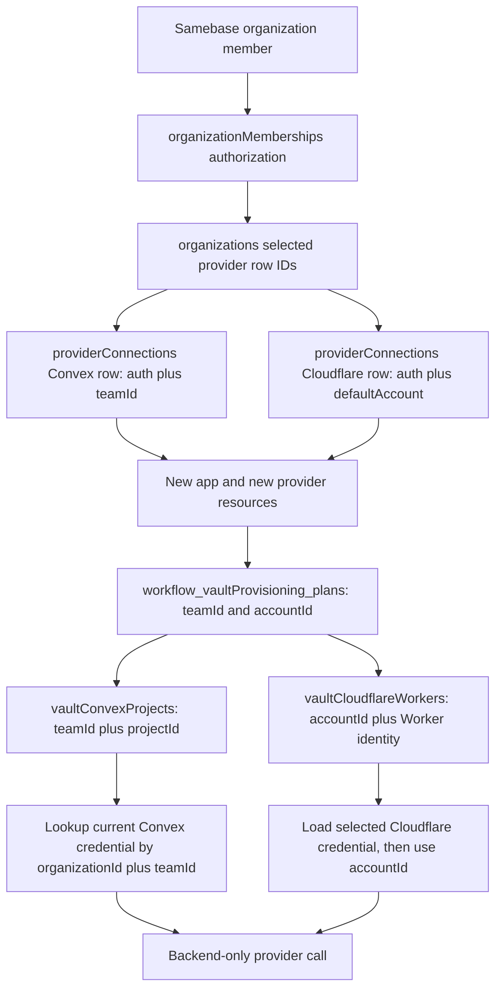

# Provider Connection Authorization And Current-State Audit

## Document Control

- Status: Current research evidence
- Date: 2026-08-06
- Official sources accessed: 2026-08-06
- Code baseline: `origin/main` at `36f554013e27e627cbce09ada5337a03958f967b`
- Organization baseline: PR [#1367](https://github.com/samebase/samebase/pull/1367), squash commit
  `db069c026`
- Accepted organization contract: `specs/120_ORGANIZATION_OWNERSHIP_SPEC.md`
- Rollout record: `rfcs/120_ORGANIZATION_OWNERSHIP_ROLLOUT.md`
- Accepted decision: `rfcs/121_PROVIDER_CONNECTION_MODEL.md`

## Scope And Evidence Rules

This audit answers two questions:

1. What does the merged provider connection system do now?
2. What do current official Convex and Cloudflare sources say about organization use of one backend
   credential?

Code and tests are the source for current Samebase behavior. Only official Convex and Cloudflare
sources support provider and policy claims. This document labels an inference when a provider does
not state the conclusion directly. It does not give a legal conclusion.

## Confirmed Product Constraint

Samebase must keep direct Cloudflare OAuth as its customer connection flow. Before Cloudflare
offered OAuth, Samebase chose Netlify instead. A manual Cloudflare token flow is not an acceptable
replacement, even though an account API token has better connector-departure behavior.

This is a Samebase product constraint. It is not a claim from Cloudflare documentation. The proposed
model must contain the user-bound OAuth lifecycle and recovery rules instead of selecting a
different credential method to avoid them.

## Main Findings

- The schema permits several Convex rows and several Cloudflare rows for one organization.
- The product UI reads and manages only one selected row for each provider.
- One Convex row is both a credential grant and one external Convex team.
- One Cloudflare row is both a credential grant and a local default-account choice. The credential
  can have access to more Cloudflare accounts than the selected account.
- Stable resource rows and retained retry data do not store `providerConnections._id`. This part of
  the model is correct.
- Existing Convex resources resolve a connection by `organizationId` and `teamId`.
- Existing Cloudflare resources use the selected Cloudflare row, then use or check that credential
  against the resource `accountId`.
- Convex team OAuth is technically suitable for a server-side integration. The token permissions
  continue to depend on the Convex member who granted access.
- Convex does not document a team-owned service principal that can create projects. Its Management
  API is Beta, and the Convex Terms restrict Beta Features to evaluation use. Written Convex
  confirmation is required before production use.
- Cloudflare account API tokens are account-owned service principals. Cloudflare recommends them for
  durable external integrations and supports them for Workers.
- Cloudflare OAuth is a user grant. One grant can authorize one, several, or all accounts. The OAuth
  grant and the deployment account are separate facts.
- Keeping direct Cloudflare OAuth is a confirmed product requirement. One exact `accountId` still
  limits the Samebase connection and all provider routing.

## Current-State Data-Flow Map

The selected row IDs are a control-plane indirection. They are not resource identity. A running
action can carry a row ID after it resolves a credential. A retained resource, plan, or deletion
retry does not keep that row ID.

### Exact Current Tables And Fields

| Table                                     | Current fields in scope                                                                                                            | Current responsibility                                                                        | Evidence                                                |
| ----------------------------------------- | ---------------------------------------------------------------------------------------------------------------------------------- | --------------------------------------------------------------------------------------------- | ------------------------------------------------------- |
| `organizations`                           | `selectedConvexProviderConnectionId`, `selectedCloudflareProviderConnectionId`                                                     | Names the row that the UI and new-resource flows use.                                         | `apps/samebase/convex/organizationModel.ts:35-48`       |
| `providerConnections`, Convex variant     | `organizationId`, `connectedByUserId`, `kind`, `auth`, `teamId`, `teamSlug`, `createdAt`, `updatedAt`                              | Stores one credential grant and one Convex team.                                              | `apps/samebase/convex/providerConnectionModel.ts:8-36`  |
| `providerConnections`, Cloudflare variant | `organizationId`, `connectedByUserId`, `kind`, `auth`, `defaultAccount`, token health and refresh fields, `createdAt`, `updatedAt` | Stores one credential grant and either no local account choice or one local account choice.   | `apps/samebase/convex/providerConnectionModel.ts:37-69` |
| `providerOAuthCallbackStates`             | `provider`, `userId`, `organizationId`, optional `providerConnectionId`, state and expiry fields                                   | Carries a short-lived row target for OAuth reauthorization.                                   | `apps/samebase/convex/providerConnectionModel.ts:79-91` |
| `workflow_vaultProvisioning_plans`        | Convex `teamId`, project name and optional `projectId`; Cloudflare `accountId`, Worker name and optional `workerTag`               | Keeps stable targets and checkpoints for a retry. It has no provider connection ID.           | `apps/samebase/convex/appProvisioningModel.ts:112-165`  |
| `vaultConvexProjects`                     | `organizationId`, `vaultId`, `teamId`, `projectId`, code location, `origin`                                                        | Keeps the stable external Convex project identity. It has no provider connection ID.          | `apps/samebase/convex/vault/model.ts:57-69`             |
| `vaultCloudflareWorkers`                  | `organizationId`, `vaultId`, `accountId`, `workerName`, `workerTag`, `origin`                                                      | Keeps the stable external Worker identity. It has no provider connection ID.                  | `apps/samebase/convex/vault/model.ts:214-226`           |
| `workflow_vaultDeletion_runs`             | Retained plan with Convex `teamId` and `projectId`, and Cloudflare `accountId`, `workerName`, and `workerTag`                      | Keeps stable delete targets for retries. It has no provider connection ID.                    | `apps/samebase/convex/vault/deletion/model.ts:74-165`   |
| `workflow_vaultProvisioning_writeLocks`   | `vaultId`, owner `runId` or manual `actionId`, manual action, expiry, state, write times                                           | Serializes provider writes for one vault. A manual lock has no `userId` and no connection ID. | `apps/samebase/convex/appProvisioningModel.ts:167-189`  |

### Current Cardinality

`providerConnections` has these indexes:

- `by_organization`
- `by_organization_and_kind`
- `by_organization_and_kind_and_team_id`
- `by_connected_by_user`
- `by_kind_method`

The schema does not enforce one row for one organization and provider. It also does not enforce one
Convex row for one organization and team. `getConvexProviderConnectionForTeam` uses `.unique()`.
Duplicate same-team rows can therefore cause a runtime error. See
`apps/samebase/convex/providerConnections.ts:184-198`.

The current Convex test creates two team rows and selects the newest row. See
`apps/samebase/convex/providerConnections.convex.test.ts:44-91`.

### Selected Row Reads

The main selected-row reads are:

| Use                          | Current lookup                                                                             | Evidence                                                                                                                     |
| ---------------------------- | ------------------------------------------------------------------------------------------ | ---------------------------------------------------------------------------------------------------------------------------- |
| Provider status              | Both providers use the organization selected ID.                                           | `apps/samebase/convex/users.ts:369-450`                                                                                      |
| OAuth reconnect              | Both providers put the selected row ID in OAuth callback state.                            | `apps/samebase/convex/convexOAuth.ts:216-235`; `apps/samebase/convex/cloudflareOAuth.ts:526-553`                             |
| New app                      | Both providers use the selected row. Cloudflare must also have a selected default account. | `apps/samebase/convex/vault/actions.ts:317-407`; `apps/samebase/convex/vault/actions.ts:746-795`                             |
| New manual resource          | Convex and Cloudflare use the selected row.                                                | `apps/samebase/convex/vault/convex.ts:63-85`; `apps/samebase/convex/vault/cloudflare.ts:137-153`                             |
| Existing Convex resource     | Uses `organizationId` plus the resource `teamId`.                                          | `apps/samebase/convex/vault/database.ts:151-187`; `apps/samebase/convex/vault/deletion/providerActions.ts:139-150`           |
| Existing Cloudflare resource | Uses the selected row, then uses or checks the resource `accountId`.                       | `apps/samebase/convex/vault/cloudflareMutations.ts:544-568`; `apps/samebase/convex/vault/deletion/providerActions.ts:77-106` |
| Provider observations        | Convex can load by resource team. Cloudflare uses the selected row.                        | `apps/samebase/convex/vault/providerObservations.ts:234-276`; `apps/samebase/convex/vault/providerObservations.ts:618-694`   |

### New App Flow

1. `NewAppPage` reads the selected Convex and Cloudflare status. It has no connection selector.
2. The page blocks app creation until both rows exist and Cloudflare has a local account choice.
3. `vault.actions.createRepository` resolves both selected rows.
4. `createInitializingSamebaseManagedVaultForUser` verifies the transient row IDs.
5. The new `workflow_vaultProvisioning_plans` row stores only `teamId` and `accountId` as provider
   targets.
6. Each workflow step resolves a current credential when it starts.
7. Successful external creates are recorded in `vaultConvexProjects` and `vaultCloudflareWorkers`
   with stable external IDs.

Evidence:

- `apps/samebase/src/components/NewAppPage.tsx:423-478`
- `apps/samebase/src/components/NewAppPage.tsx:926-1004`
- `apps/samebase/convex/vault/actions.ts:746-795`
- `apps/samebase/convex/vault/records.ts:337-403`
- `apps/samebase/convex/vault/records.ts:460-476`

### Current Provider Page And App-Creation UI

`/providers/<owner>` resolves the GitHub owner to one Samebase organization. It then queries only
the selected Convex row and selected Cloudflare row.

The provider page has these current behaviors:

- It shows one Convex row and one Cloudflare row. It cannot show hidden unselected rows.
- Any member can run `Check access`.
- Only an owner sees connect, reauthorize or update, account-management, and disconnect actions.
- Convex offers OAuth and a manual team-token dialog.
- Cloudflare connect starts direct OAuth. The page can display existing `mcp_oauth` and `api_key`
  rows, but it does not offer a public Cloudflare API-token entry action.
- A Cloudflare OAuth grant with one visible account selects it automatically.
- A grant with several visible accounts stores `defaultAccount.state = "not_selected"`.
- An owner can later use `Select account` or `Manage account` to change the account inside the
  selected credential row.

Evidence:

- `apps/samebase/src/routes/providers-owner.tsx:8-35`
- `apps/samebase/src/components/ProviderConnectionsPage.tsx:634-843`
- `apps/samebase/src/components/ProviderConnectionsPage.tsx:1082-1188`
- `apps/samebase/src/components/ProviderConnectionsPage.tsx:1245-1410`

The new-app page also reads only the two selected rows. It has no connection list or provider target
selector. It blocks create until both providers are connected. When Cloudflare has no local account
choice, an owner can open the same account dialog from the new-app page. A member must wait for an
owner to choose the account.

Evidence:

- `apps/samebase/src/components/NewAppPage.tsx:420-478`
- `apps/samebase/src/components/NewAppPage.tsx:589-670`
- `apps/samebase/src/components/NewAppPage.tsx:838-868`
- `apps/samebase/src/components/NewAppPage.tsx:926-1004`

### Existing Resource Flow

For Convex, `teamId` selects a row. A change to the organization selected Convex row does not move
an existing project. The project continues to use a row for its stored team if that row remains.

For Cloudflare, `accountId` does not select a row. The selected Cloudflare row supplies the
credential for every Worker. Code then asks that credential to access the Worker account. A change
to the selected Cloudflare row can break all existing Workers, even when another hidden row can
access the required account.

A change to `defaultAccount` affects new resource selection. It does not rewrite an existing Worker
row.

## Current-State Behavior Table

| Event                                           | Convex now                                                                                                                                                  | Cloudflare now                                                                                                                                                       |
| ----------------------------------------------- | ----------------------------------------------------------------------------------------------------------------------------------------------------------- | -------------------------------------------------------------------------------------------------------------------------------------------------------------------- |
| Connect                                         | An owner connects a credential and team. `createConnected` replaces a same-team row or inserts another team row. It then selects the row.                   | An owner inserts a new credential row and selects it. Account discovery selects the only visible account or stores `not_selected` when several accounts are visible. |
| Use                                             | Any active organization member can use a backend-only credential. Existing resources resolve by team.                                                       | Any active organization member can use the selected backend-only credential. Existing resources also use that selected row.                                          |
| OAuth reconnect                                 | OAuth targets the selected row. The returned `teamId` must match. The row ID and `createdAt` remain.                                                        | OAuth targets the selected row. The new credential and `defaultAccount` can both change.                                                                             |
| API-token replace                               | If the selected row has the same `teamId`, the code replaces it. A different team can create and select another hidden row.                                 | The current API-key shape can replace the selected row.                                                                                                              |
| `connectedByUserId`                             | Connect and reauthorize set it to the acting owner. A takeover changes it. Metadata updates do not change it.                                               | Connect and reauthorize set it to the acting owner. Token refresh and account metadata updates do not change it.                                                     |
| Disconnect                                      | Deletes the selected local row and clears the organization pointer. It does not revoke Convex OAuth or a team token upstream. It does not detach resources. | Direct OAuth and MCP OAuth try upstream revocation first. API-key removal is local only. Revocation failure keeps the local row. Resources stay attached.            |
| Member role downgrade                           | No provider cleanup occurs. The row can keep the former owner in `connectedByUserId`.                                                                       | Same behavior.                                                                                                                                                       |
| Direct organization membership removal          | There is no provider cleanup hook. The merged product has no normal membership-departure action.                                                            | Same behavior.                                                                                                                                                       |
| Samebase account deletion                       | Removes every row with the deleting user in `connectedByUserId`. Convex OAuth requires manual upstream revocation.                                          | OAuth and MCP OAuth revoke first. If revoke fails, the row remains and account deletion remains in progress. API-key removal is local only.                          |
| Upstream expiry, revocation, or permission loss | Later checks and operations fail. Another owner can reauthorize the selected row for the same team.                                                         | OAuth can refresh. An invalid refresh grant or another access failure stops later operations. Another owner can reconnect.                                           |

Implementation evidence:

- Connect and reauthorize: `apps/samebase/convex/providerConnections.ts:283-376`
- Cloudflare maintenance updates: `apps/samebase/convex/providerConnections.ts:405-450`
- Local delete: `apps/samebase/convex/providerConnections.ts:453-474`
- Convex disconnect: `apps/samebase/convex/users.ts:402-427`
- Cloudflare disconnect: `apps/samebase/convex/users.ts:673-703`
- Cloudflare revoke: `apps/samebase/convex/cloudflareOAuth.ts:556-585`
- Account deletion: `apps/samebase/convex/accountDeletion/providerActions.ts:42-153`
- Last-owner guard: `apps/samebase/convex/accountDeletion/index.ts:150-159`

Account deletion requires another active owner. It does not require that owner to replace a provider
credential first.

## Current Operations When A Credential Changes

| Operation state                                 | Current behavior                                                                                                                                                            |
| ----------------------------------------------- | --------------------------------------------------------------------------------------------------------------------------------------------------------------------------- |
| Queued provisioning                             | The plan keeps the original `teamId` and `accountId`. A provider step resolves a credential when the step starts.                                                           |
| Running provider call                           | The action can already hold the old token in memory. Reauthorize or disconnect does not remove that local value. The provider can accept or reject the call.                |
| Provider call completed, checkpoint not written | Current checkpoint mutations still receive a transient provider connection ID. If that row was deleted, a provider resource can exist without a completed local attachment. |
| Retry                                           | Convex resolves by the plan or resource `teamId`. Cloudflare resolves the selected row and then uses the plan or resource `accountId`.                                      |
| Observation                                     | Convex can use the resource team row. Cloudflare always uses the selected row.                                                                                              |
| Resource deletion retry                         | The retained plan uses stable external IDs. Convex resolves by team. Cloudflare resolves the selected row.                                                                  |
| Samebase account deletion                       | It waits for runs that the deleting user owns. It does not wait for another member's operation that uses a credential established by the deleting user.                     |

The accepted stable external identity rule is implemented correctly. No long-lived resource or retry
row incorrectly stores `providerConnections._id`.

## Current Manual Write Lock

The manual lock stores `actionId`, the action name, and its deadline. It does not store `userId`.
The finish mutation validates the action ID and lock state. See
`apps/samebase/convex/vault/infrastructureOperation.ts:228-318`.

Connection identity does not belong in this retained lock. A valid credential can change during an
operation, and a retry must resolve a current credential. Actor identity has a present use. It lets
account deletion find a manual operation that its user started, and it gives Samebase the actor
record that provider audit logs cannot always give.

## Current Model Gaps

1. Hidden rows can keep live credentials. The UI cannot list or disconnect them.
2. `connectedByUserId` is provenance during normal use, but account deletion treats it as credential
   ownership.
3. Convex and Cloudflare have different existing-resource routing rules.
4. Cloudflare reconnect can change the credential and local account in one operation.
5. A Cloudflare selected-row change can break an existing Worker without changing its stable row.
6. The schema does not enforce one row, a unique Convex team row, or a valid selected pointer.
7. Reauthorization replaces the local credential without a clear old-grant revocation rule.
8. Disconnect can race with an external create and its local checkpoint.
9. `updatedAt` is not a useful management audit time. Token refresh and metadata updates also change
   it.
10. Manual write locks do not keep the initiating Samebase user.

## Convex Authorization Report

### Documented Facts

- Convex says OAuth Application Tokens let a third-party application manage a user's projects on
  that user's behalf. A team-scoped token can create projects and deployments. It can read and write
  data and functions in every project on that team, subject to the authorizing member's permissions.
  See [OAuth Applications](https://docs.convex.dev/platform-apis/oauth-applications).
- The user selects one team in the team OAuth flow.
- The token permissions follow the permissions of the member who authorized it. Removal from the
  team or a role change changes token permissions.
- `GET /token_details` returns the `teamId` for a team token. The Management API uses that ID. See
  [Get token details](https://docs.convex.dev/management-api/get-token-details) and the
  [Management API OpenAPI document](https://api.convex.dev/v1/openapi.json).
- Convex displays a team ID for Platform API use. A team name and slug can change. See
  [Teams](https://docs.convex.dev/dashboard/teams/teams).
- The OAuth code is valid for 10 minutes and can be exchanged once.
- The documented token response has `access_token` and `token_type`. It has no documented refresh
  token or expiry.
- Convex documents no app-side OAuth revoke endpoint. The authorizing user can revoke the
  application in Convex Team Settings.
- An unverified OAuth application can connect at most 100 teams. Verification removes this limit.
- The Management API is openly available in Beta. Convex says OAuth Application Tokens are for API
  use on behalf of a user of an integration. See
  [Management API](https://docs.convex.dev/management-api/overview).

### Credential Method Comparison

| Method                                 | Official behavior                                                                                    | Fit for the current product                                                              |
| -------------------------------------- | ---------------------------------------------------------------------------------------------------- | ---------------------------------------------------------------------------------------- |
| Team-scoped OAuth Application Token    | App-held token for one selected team. Permissions follow the authorizing team member.                | Best fit for normal customer setup.                                                      |
| Project-scoped OAuth Application Token | One specific project. The flow can select an existing project or create one.                         | Cannot create all projects for an organization.                                          |
| Team access token                      | Created and managed by one team member. It follows that member's permissions and can have an expiry. | Useful for direct team automation, but not better than product OAuth for customer setup. |
| Personal access token                  | Can follow one person's broad account access across teams.                                           | Too broad. Do not use it as an organization connection.                                  |
| Separate Convex service-account user   | A normal Convex user can own automation tokens in a team.                                            | Adds account setup and membership. No present need requires it.                          |
| Deploy key                             | A service token for one existing deployment.                                                         | Useful after a project exists. It cannot create organization projects.                   |

Sources:

- [Platform APIs](https://docs.convex.dev/platform-apis/overview)
- [Profile and Personal Access Tokens](https://docs.convex.dev/dashboard/profile)
- [Deploy Keys](https://docs.convex.dev/cli/deploy-key-types)
- [Role Actions](https://docs.convex.dev/team-management/role-actions)

Convex does not document a team-owned OAuth client-credentials grant or a team service principal
that can create projects.

### Delegated Organization Use

Documented:

- Convex designed team OAuth for a third-party integration to manage the selected user's team.
- The integration sends the Application Token to Convex.
- The grant continues to use the external rights of the authorizing Convex member.

Inference:

- Samebase can technically keep the token in backend-only functions and let another authorized
  Samebase organization member start a provider action.
- The bearer-token API does not require Samebase to send the identity of the Samebase member who
  started the action. Samebase must keep this actor identity in its own audit data.
- Samebase can treat the returned `teamId` as its durable external team identity. Convex uses this
  ID in Platform APIs, but the documentation does not make an explicit stability promise.
- Convex will attribute provider access to the authorizing Convex member or grant. Samebase must
  keep its own initiating-user record.
- This is not raw token sharing because Samebase does not give the token to a member.

Unclear:

- Convex does not state directly that user A can authorize the grant and user B of the integrating
  product can start an action under that grant.
- Convex does not explain how that case relates to the Terms rule against credential sharing.
- Convex does not document what repeated authorization does to an older token.
- Convex does not document an app-side revoke endpoint or the exact effect of deleting the
  authorizing Convex account.

### Convex Terms Gap

The [Convex Terms of Service](https://www.convex.dev/legal/tos), effective 2026-02-27, and the
[Definitions](https://www.convex.dev/legal/definitions) have these relevant rules:

- The customer and its authorized users can use the service for the customer's internal business.
- The customer is responsible for credential security and use by its users and integrations.
- The Terms restrict credential sharing and access by unauthorized parties.
- The Terms permit application builders to embed the Software in customer-facing products on
  designated serverless instance types.
- The Terms say clearly marked Beta Features are for evaluation and not for production use.

The required Platform and Management APIs are marked Beta. Official product documentation also
describes app-builder use that looks like production use. It is not clear whether the Terms'
application-builder exception for the Software applies to the hosted Platform or Platform APIs. The
official sources do not resolve this conflict.

Before production reliance, get written confirmation from `platforms@convex.dev` for these points:

1. One owner can authorize a team-scoped OAuth token that Samebase uses for backend actions started
   by other authorized organization members.
2. Production use of the current Beta Platform and Management APIs is approved.
3. Repeated authorization behavior and the safe way to remove an old token without revoking its
   replacement.
4. Local deletion plus manual user revocation is the expected disconnect flow because there is no
   documented app-side revoke endpoint.

## Cloudflare Authorization Report

### Documented OAuth Facts

- Cloudflare supports the Authorization Code flow for third-party clients. A backend can protect a
  client secret. Cloudflare does not offer the Client Credentials grant for third-party OAuth
  clients. See
  [Create an OAuth client](https://developers.cloudflare.com/fundamentals/oauth/create-an-oauth-client/).
- A client can use refresh tokens and the `offline_access` protocol scope. See the
  [OAuth Clients API](https://developers.cloudflare.com/api/resources/iam/subresources/oauth_clients/).
- Cloudflare publishes authorization, token, refresh, and revocation endpoints. See
  [Integrate an OAuth client](https://developers.cloudflare.com/fundamentals/oauth/integrate-with-cloudflare/).
- The connector can authorize one account, several accounts, or all accounts. See
  [Authorizing an application](https://developers.cloudflare.com/fundamentals/oauth/authorizing-an-application/).
- OAuth is access on behalf of the authorizing user. It is not an account service principal.
- A user can revoke an authorization in the Cloudflare profile. An account administrator can block
  new public OAuth authorizations. That block does not revoke existing grants.

Cloudflare does not document exact access-token or refresh-token lifetimes on these pages. It also
does not document refresh-token rotation or the exact result when the authorizing user loses account
membership.

### GitHub Integration Topology

Documented:

- Cloudflare Workers Builds uses the Cloudflare Workers & Pages GitHub App. The installation grants
  Cloudflare access to one GitHub individual or organization and can be limited to selected
  repositories. See
  [GitHub integration](https://developers.cloudflare.com/workers/ci-cd/builds/git-integration/github-integration/).
- Cloudflare says that a GitHub account should point to only one Cloudflare account. Cloudflare
  presents this as a security consideration and also recommends limiting repository access. It does
  not document this as an enforced one-account rule. See
  [GitHub organizational access](https://developers.cloudflare.com/workers/ci-cd/builds/git-integration/github-integration/#organizational-access).
- Removing the GitHub App removes Cloudflare access to every permitted repository for that GitHub
  owner. Existing deployments continue, but new builds stop.
- A repository connection is account-scoped. The Workers Builds API creates or updates it at
  `PUT /accounts/{account_id}/builds/repos/connections`. Its data includes the Git provider account
  ID, repository ID, and a Cloudflare `repo_connection_uuid`. See the
  [Workers Builds repository connection API](https://developers.cloudflare.com/api/resources/workers_builds/subresources/repos/subresources/connections/).
- The repository connection API does not expose the GitHub App installation ID. The GitHub App
  installation and the Cloudflare repository connection are separate external objects.
- Cloudflare supports more than one Worker connected to one repository, such as a monorepo.

Inference:

- The current Samebase rule of one stable GitHub repository owner for one organization aligns with
  one Cloudflare account for that organization. It does not prove that Samebase organization
  identity includes a Cloudflare account.
- One Cloudflare account can serve repositories from more than one GitHub owner. Therefore several
  Samebase organizations can use the same Cloudflare account without sharing a Samebase organization
  or provider row.
- The Cloudflare GitHub App installation is not a Samebase `providerConnections` credential. Direct
  Cloudflare OAuth authorizes Samebase management API calls. The Cloudflare GitHub App separately
  authorizes Cloudflare to read and build repositories.
- Moving one GitHub owner from one Cloudflare account to another is an organization-level provider
  target migration. It is not a credential replacement.

Unclear:

- Cloudflare does not document whether it enforces the one-GitHub-account-to-one-Cloudflare-account
  recommendation.
- Cloudflare does not document the repository connection behavior after GitHub owner rename,
  repository transfer, or GitHub App reinstall.
- Cloudflare does not document whether an upsert for the same repository always preserves the same
  `repo_connection_uuid`.

### Documented API Token Facts

- User API tokens act for one user and inherit a subset of that user's permissions.
- Account API tokens act as service principals with their own permissions. Cloudflare recommends
  them for durable CI/CD and external integrations. Cloudflare says they can continue after the
  person who configured the integration leaves. See
  [Account API tokens](https://developers.cloudflare.com/fundamentals/api/get-started/account-owned-tokens/).
- An account API token belongs to one account. Creation requires Cloudflare Super Administrator
  permission. Workers supports account API tokens.
- A token can have exact permissions, resource limits, IP limits, and an expiry. A token with no end
  date does not expire. See
  [Create API token](https://developers.cloudflare.com/fundamentals/api/get-started/create-token/)
  and [Restrict tokens](https://developers.cloudflare.com/fundamentals/api/how-to/restrict-tokens/).
- The secret is shown once. Rolling a token invalidates the previous secret and keeps the policy.
  See [Roll tokens](https://developers.cloudflare.com/fundamentals/api/how-to/roll-token/).
- An account token uses `GET /accounts/{account_id}/tokens/verify`. The current Samebase user-token
  verification is not the correct verification route for this credential. See
  [Verify account token](https://developers.cloudflare.com/api/resources/accounts/subresources/tokens/methods/verify/).
- The account-token verification response gives token status and token timing. It does not give an
  account ID, account name, or permission policy.
- Cloudflare account-token audit records identify an account actor and token. They do not identify
  the Samebase member who started the action. See
  [Audit Logs v2](https://developers.cloudflare.com/fundamentals/account/account-security/audit-logs/).

### Current Endpoint And Permission Audit

The minimum current permission set is a result of the current endpoint audit. Cloudflare lists the
permission names in
[API token permissions](https://developers.cloudflare.com/fundamentals/api/reference/permissions/).

| Connection or provider call group                                                                                        | Required account-token permission |
| ------------------------------------------------------------------------------------------------------------------------ | --------------------------------- |
| Read the supplied account through `GET /accounts/{account_id}` and get its display name                                  | Account Settings Read             |
| List or read Workers and Worker account settings                                                                         | Workers Scripts Read              |
| Create, update, or delete Workers and Worker versions                                                                    | Workers Scripts Write             |
| Read Workers Builds limits, repository connections, build tokens, triggers, variables, and build state                   | Workers CI Read                   |
| Create, update, or delete Workers Builds repository connections, build tokens, triggers, variables, and build operations | Workers CI Write                  |

The resulting policy is:

- Workers Scripts Read
- Workers Scripts Write
- Workers CI Read
- Workers CI Write
- Account Settings Read

Samebase does not need Account API Tokens Write. It must not request token-management authority only
to revoke its own connection.

The safe connection checks are narrower than the policy:

1. The owner supplies the exact `accountId`.
2. Samebase verifies token status at `/accounts/{account_id}/tokens/verify`.
3. Samebase reads that account to get `accountName` and runs non-modifying Workers Scripts and
   Workers CI probes.
4. Samebase does not perform a test provider write during connection.

The status endpoint and read probes cannot prove both write permissions. Samebase must show the
exact required policy during setup. A later provider write fails closed when the token does not have
its required write permission. Do not add Account API Tokens Read only to inspect the token policy.

### Other Cloudflare Credentials

- Cloudflare Access service tokens authenticate automated clients to Access-protected applications.
  They do not authorize Cloudflare management API operations. See
  [Service tokens](https://developers.cloudflare.com/cloudflare-one/access-controls/service-credentials/service-tokens/).
- Cloudflare API Service Keys stop working on 2026-09-30. See
  [API deprecations](https://developers.cloudflare.com/fundamentals/api/reference/deprecations/).
- Global API keys are broad and user-bound. Cloudflare recommends API tokens.
- Cloudflare MCP guidance recommends an API token for CI/CD and automation. This makes MCP OAuth a
  poor long-term provider credential. See
  [Cloudflare MCP servers](https://developers.cloudflare.com/agents/model-context-protocol/cloudflare/servers-for-cloudflare/).

### Delegated Organization Use And Terms

Documented:

- Section 2.3 of the
  [Cloudflare Self-Serve Subscription Agreement](https://www.cloudflare.com/terms/) says a customer
  can permit a third party to access its account with an API token or OAuth. The customer accepts
  the risk and is responsible for credential activity.
- The technical documentation presents account API tokens as service principals for durable external
  integrations.
- Section 2.3 of the
  [Cloudflare Enterprise Subscription Agreement](https://www.cloudflare.com/en-gb/enterpriseterms/)
  limits service use to the customer's internal business and says not to make the service available
  to third parties.
- Enterprise section 2.5 permits third-party products that the customer authorizes through OAuth or
  other credentials.
- Enterprise section 2.4 first defines `Credentials` as user names and passwords. It then says one
  individual must use each credential. It does not say whether this rule includes an account API
  token that Cloudflare documents as a service principal.

Inference:

- A Samebase backend can receive an authorized member action and call Cloudflare with a stored
  account API token. No member needs the raw token.
- An account API token is the closest match to organization infrastructure because the external
  actor is the account, not the connector.
- User OAuth is technically usable and is the required Samebase product path. It keeps the
  connector's external identity in the operational dependency chain. Samebase accepts this lifecycle
  cost and requires owner reauthorization for recovery.
- Applying Enterprise section 2.3 and section 2.5 to this narrow deployment integration is not clear
  from the terms alone.

Unclear:

- Cloudflare does not state directly whether third-party product users who are not Cloudflare
  account members can start actions through one user's OAuth grant.
- Cloudflare does not state directly whether those product users can start actions through an
  account API token that the Cloudflare account authorized for the integration.
- The Enterprise terms do not explain how the one-person credential rule applies when a backend
  service keeps an account API token and never exposes it to a person.
- The restriction on making Cloudflare service access available to third parties is not mapped to a
  narrow deployment integration.

The sources support the integration pattern. They do not give a complete legal answer. Get written
Cloudflare confirmation before broad commercial use by members who are not Cloudflare account
members.

## Evidence Conclusion

The current storage shape has more credential rows than the product can manage truthfully. The
stable resource design does not need that flexibility. Convex and Cloudflare both have one durable
external target for each current deployment operation: a Convex `teamId` and a Cloudflare
`accountId`.

Provider facts support a small one-target model. Convex OAuth is the correct normal grant, subject
to written production confirmation. An account API token is the most durable Cloudflare grant, but
credential durability does not override the confirmed product requirement for direct Cloudflare
OAuth. The Cloudflare connection must use OAuth and accept its user-bound recovery states. The
accepted product and data decision is in `rfcs/121_PROVIDER_CONNECTION_MODEL.md`.

## Summary

Stable resources already use the correct external IDs. The temporary multi-row and selected-pointer
model creates hidden credentials and different routing rules for Convex and Cloudflare. Technical
sources support one server-side connection for an external integration. They do not explicitly
approve actions started by Samebase members who are not members of the provider account. Cloudflare
direct OAuth is a confirmed product requirement and binds the upstream grant to the authorizing
Cloudflare user. Convex has a suitable team OAuth grant, but Samebase needs written confirmation for
cross-member use and production use of the Beta APIs.
