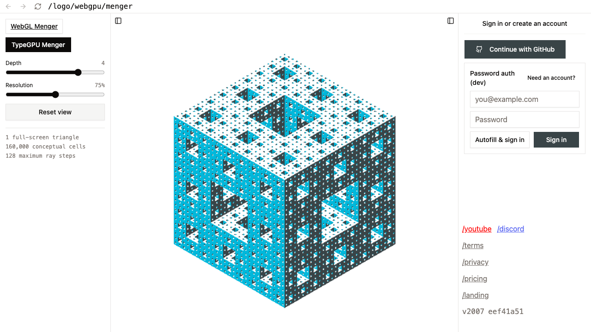

# TypeGPU and Redraw for the Menger sponge

Date: 2026-09-02

## Decision

Keep the current Three.js WebGL Menger renderer in production. Continue the TypeGPU ray-march
experiment in the isolated `/logo/webgpu/menger` lab. Do not use Redraw for this 3D Menger work.

The useful change is the rendering method, not only the GPU API. The lab represents the complete
sponge as a signed distance function. It draws one full-screen triangle and finds the sponge surface
for each pixel. It does not create or send one cube for each retained cell.

## Current renderer baseline

The current Menger renderer uses generated voxel geometry and Three.js instancing. The depth-four
research budget test records these values:

- 2,457 hover channels
- 40,000 bytes of dynamic GPU uploads
- 50,541 visible instances
- 2,813,292 triangles

The TypeGPU lab has one triangle and no voxel instance buffer. At depth four, its distance function
describes 160,000 conceptual cells. At depth five, it describes 3,200,000 conceptual cells. These
cell counts do not increase the draw geometry. Shader work increases with pixel count, ray steps,
and selected fractal depth.

## Redraw

[Redraw](https://redraw.dev/docs/intro/) is a 2D WebGPU drawing library. Its current installation
flow is a private technical preview, and the documentation says that the API can change. It can be
useful for 2D paths, charts, drawing tools, or a flat logo experiment. It does not supply the 3D
camera, distance field, ray marcher, or depth behavior that this Menger sponge needs.

Redraw can stay outside the Menger implementation. Revisit it only for a separate 2D canvas task.

## TypeGPU

[TypeGPU](https://docs.swmansion.com/TypeGPU/) supplies typed WebGPU resources and lets the build
plug-in translate TypeScript shader functions to WGSL. Its
[signed distance field package](https://docs.swmansion.com/TypeGPU/ecosystem/typegpu-sdf/) confirms
that ray-marched 3D scenes are an intended use.

The lab uses TypeGPU directly and keeps its small Menger distance function in the app. It does not
add `@typegpu/sdf`, because the experiment needs only box, cross, and repeated-space operations.

The lab uses TypeGPU 0.12.0 and `unplugin-typegpu` 0.12.1. Plug-in 0.12.0 declares an incompatible
`tinyest-for-wgsl` range. Plug-in 0.12.1 corrects that dependency range and generates valid shader
metadata.

[`@typegpu/three`](https://docs.swmansion.com/TypeGPU/ecosystem/typegpu-three/) is not the first
choice for this work. It changes the current Three.js renderer to WebGPU, but it does not remove the
large cube and triangle counts. The package also makes the route WebGPU-only.

## Lab result

The `/logo/webgpu/menger` route now has these properties:

- Depth controls from one through five
- Render resolution controls at 50, 75, and 100 percent
- The current Samebase face colors and view direction
- Pointer drag rotation
- One full-screen triangle and a maximum of 128 ray steps
- Rays that start and stop at the outer sponge boundary
- At most one submitted render for each browser animation frame
- A static Menger fallback when WebGPU does not start

Manual checks in desktop Chromium confirmed the ready WebGPU state, depth-five rendering, pointer
drag, and the forced no-WebGPU fallback. The default depth is four at 75 percent render resolution.

This lab does not implement the current per-channel hover opening. That behavior needs a procedural
distance-field deformation. It is a separate proof, not a direct port of the instance animation.

## Main risks

- Ray marching moves cost from geometry to pixels. Large canvases and high device pixel ratios can
  cost more than the current renderer.
- Fine depth-five features can be smaller than one pixel. The surface threshold and antialiasing
  need more work before visual comparison.
- Continuous pointer motion can cause power and thermal costs on mobile devices.
- WebGPU support and GPU driver behavior still need tests on the supported browser and device
  matrix. The static fallback keeps the route usable, but it does not preserve interaction.
- The normal calculation evaluates the Menger distance field four additional times at each surface
  hit. Ambient occlusion and shadows would add more work.

## Recommended next experiments

1. Add one procedural hover opening to the distance function. This proves whether the important
   Menger interaction can move from per-instance state to a compact GPU expression.
2. Measure depth four and depth five during continuous drag on desktop Chrome, Safari, an iPhone,
   and one low-power Android device. Record frame time, GPU time when timestamp queries are
   available, resolution, and power behavior.
3. Compare three image-quality settings: current single sample, a small edge-only supersample, and
   temporal accumulation while the view is still.
4. Add an opt-in Linux WebGPU browser job before this route owns a GPU screenshot baseline. Keep a
   separate fallback test for browsers without WebGPU.

## Production gate

Do not replace the production renderer until the ray marcher has the required hover behavior,
matches the logo at normal display sizes, and wins the supported-device measurements. If it passes
those checks, use WebGPU as the enhanced renderer and keep the existing static or WebGL path as the
fallback.

## Sources

- [TypeGPU overview](https://docs.swmansion.com/TypeGPU/)
- [Why TypeGPU](https://docs.swmansion.com/TypeGPU/why-typegpu/)
- [TypeGPU Vite plug-in](https://docs.swmansion.com/TypeGPU/tooling/unplugin-typegpu/)
- [TypeGPU signed distance fields](https://docs.swmansion.com/TypeGPU/ecosystem/typegpu-sdf/)
- [TypeGPU and Three.js](https://docs.swmansion.com/TypeGPU/ecosystem/typegpu-three/)
- [TypeGPU ray-marching example source](https://github.com/software-mansion/TypeGPU/blob/main/apps/typegpu-docs/src/examples/rendering/ray-marching/scene.ts)
- [Redraw introduction](https://redraw.dev/docs/intro/)
- [Redraw installation](https://redraw.dev/docs/installation/)
- [WebGPU support status](https://webgpu.io/)
- [Menger signed distance function explanation](https://lucodivo.github.io/menger_sponge.html)
