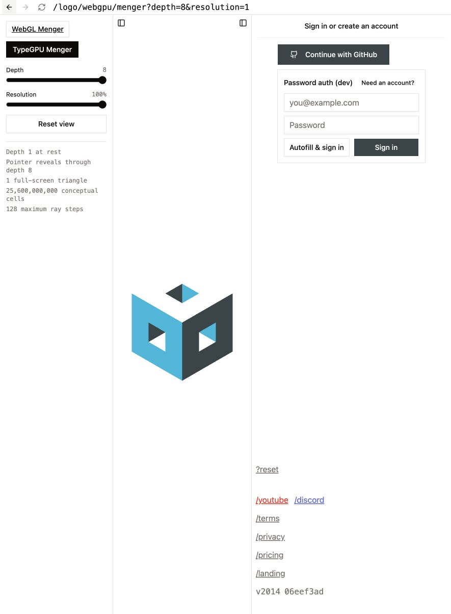
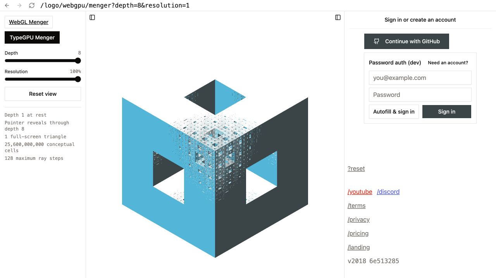
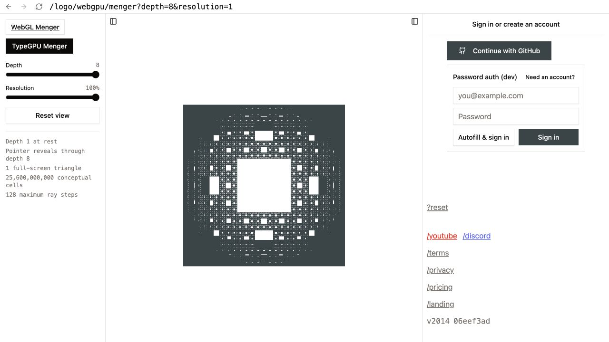
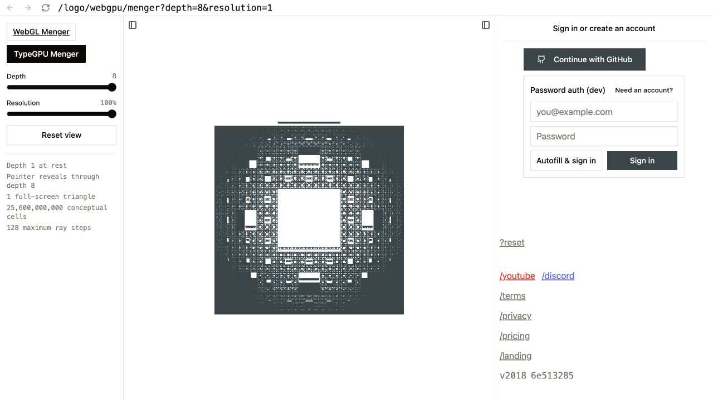

# TypeGPU and Redraw for the Menger sponge

Date: 2026-09-02

## Decision

Use the TypeGPU ray-march renderer by default in the existing `/logo/hover/menger` lab. Keep the
Three.js renderer in the same lab as the `?three` comparison mode. Do not use Redraw for this 3D
Menger work.

This gives both renderers the same route controls, saved view, and automatic probe behavior. It also
removes the separate WebGPU page and its different lab behavior.

The useful change is the rendering method, not only the GPU API. The lab represents the complete
sponge as a signed distance function. It draws one full-screen triangle and finds the sponge surface
for each pixel. It does not create or send one cube for each retained cell.

## Current renderer baseline

The current Menger renderer uses generated voxel geometry and Three.js instancing. The depth-four
research budget test records these values:

- 2,457 hover channels
- 40,000 bytes of dynamic GPU uploads
- 50,541 visible instances
- 2,813,292 triangles

The TypeGPU lab has one triangle and no voxel instance buffer. At depth four, its distance function
describes 160,000 conceptual cells. At depth eight, it describes 25,600,000,000 conceptual cells.
These cell counts do not increase the draw geometry. Shader work increases with pixel count, ray
steps, and selected fractal depth.

## Redraw

[Redraw](https://redraw.dev/docs/intro/) is a 2D WebGPU drawing library. Its current installation
flow is a private technical preview, and the documentation says that the API can change. It can be
useful for 2D paths, charts, drawing tools, or a flat logo experiment. It does not supply the 3D
camera, distance field, ray marcher, or depth behavior that this Menger sponge needs.

Redraw can stay outside the Menger implementation. Revisit it only for a separate 2D canvas task.

## TypeGPU

[TypeGPU](https://docs.swmansion.com/TypeGPU/) supplies typed WebGPU resources and lets the build
plug-in translate TypeScript shader functions to WGSL. Its
[signed distance field package](https://docs.swmansion.com/TypeGPU/ecosystem/typegpu-sdf/) confirms
that ray-marched 3D scenes are an intended use.

The lab uses TypeGPU directly and keeps its small Menger distance function in the app. It does not
add `@typegpu/sdf`, because the experiment needs only box, cross, and repeated-space operations.

The lab uses TypeGPU 0.12.0 and `unplugin-typegpu` 0.12.1. Plug-in 0.12.0 declares an incompatible
`tinyest-for-wgsl` range. Plug-in 0.12.1 corrects that dependency range and generates valid shader
metadata.

[`@typegpu/three`](https://docs.swmansion.com/TypeGPU/ecosystem/typegpu-three/) is not the first
choice for this work. It changes the current Three.js renderer to WebGPU, but it does not remove the
large cube and triangle counts. The package also makes the route WebGPU-only.

## Shared lab result

The default TypeGPU mode on `/logo/hover/menger` has these properties:

- Depth controls from one through eight
- Render resolution controls at 50, 75, and 100 percent
- `depth` and `resolution` query parameters that preserve an exact test view
- The current Samebase face colors and view direction
- Pointer drag rotation
- Depth one at rest, with local Menger channels through the selected depth when the pointer is near
  the sponge
- Finer channels do not cut same-axis parent covers; perpendicular channels stay connected through
  the covers that they cross
- One 3D ray-march path for face-only, shallow, and oblique views
- The same reveal radius and opening response time as the current Three.js renderer
- One full-screen triangle and a maximum of 128 ray steps
- Rays that start and stop at the outer sponge boundary
- A pixel-size cutoff that does not evaluate fractal levels smaller than the rendered surface
  threshold
- At most one submitted render for each browser animation frame
- A static Menger fallback when WebGPU does not start
- The existing automatic probe, including coarse-pointer and mobile use
- A `Use Three.js renderer` checkbox that writes the key-only `?three` query parameter

Manual checks in desktop Chromium confirmed the ready WebGPU state, depth-eight rendering, direct
query loading, pointer drag, pointer reveal, clean dark and cyan face-only views, correct tunnel
continuity at two-degree and five-degree views, close after pointer exit, and the forced no-WebGPU
fallback. A paired depth-four check put the TypeGPU and Three.js probes within 0.004 unit
coordinates of each other. Their settled openings used the same reveal envelope. The default depth
is four at 75 percent render resolution.

The hover opening is a procedural distance-field deformation. The shader finds each repeated channel
from the sample point and opens only channels near the projected pointer. This avoids the CPU and
GPU state of a direct per-channel port. Depths two through eight contain 16,142,517 hover channels
in total, so an RGBA32F state record for each channel would use approximately 246 MiB before
geometry and renderer overhead.

The shader derives the same directional anchor and two-axis rectangular growth as the Three.js
renderer. It uses one shared opening response instead of one saved animation value for each channel.
The settled open shape and a stationary pointer entry are close. During continuous pointer movement,
the Three.js renderer can leave a short closing trail because each channel keeps its prior value.
Keep this difference visible in later comparisons. Do not add the full per-channel state to the
TypeGPU path.

The opening hierarchy follows the current Three.js blocker-link rule. The shader keeps one retained
path for each channel axis. A finer channel cannot cut a coarser cover with the same axis, so a
partly closed face opening does not contain child openings. A finer channel can cut a perpendicular
cover that it crosses. That crossing keeps the finer tunnel empty through the sponge. One global
parent-cell rule is too strict: it blocks the perpendicular crossing and creates a false internal
face.

Each procedural channel stays unbounded along its own axis. A cell-local axial bound creates an
artificial end surface for every repeated channel. A global parent stop creates the same fault where
two perpendicular empty channels meet. At depth eight, these false surfaces appear as hollow
rectangles and colored specks. The shader now returns a conservative travel distance and exact
axis-aware material occupancy from one loop. Face-only and nearby views use the same 3D ray marcher.

The reference Three.js renderer now clears its hover pointer after browser blur. Before this change,
it cleared only the presentation tilt, which could leave the opening active.

## Landing adoption

The large landing hero now lazy-loads the same TypeGPU scene at depth five and full render
resolution. Its existing wrapper still owns the static first paint, view URL, drag snapping,
coarse-pointer automatic probe, off-screen teardown, and failure state. The static mark stays
visible until the first successful GPU draw.

The closing-band and not-found logos stay on the generic cube renderer. Those surfaces animate
rotation and recursive voxel shuffles, which are different from the Menger hover reveal. The Menger
depth-transition lab also stays on its stage-based renderer.

## Main risks

- Ray marching moves cost from geometry to pixels. Large canvases and high device pixel ratios can
  cost more than the current renderer.
- Fine high-depth features can be smaller than one pixel. The lab skips these levels. Edge quality
  and antialiasing still need comparison at larger display sizes.
- Continuous pointer motion can cause power and thermal costs on mobile devices.
- WebGPU support and GPU driver behavior still need tests on the supported browser and device
  matrix. The static fallback keeps the route usable, but it does not preserve interaction.
- The normal calculation evaluates the Menger distance field four additional times at each surface
  hit. Ambient occlusion and shadows would add more work.

## Recommended next experiments

1. Compare the procedural opening with the Three.js opening during slow pointer movement and at
   oblique cube angles. Decide whether the short per-channel closing trail is important.
2. Measure depths four, five, and eight during continuous pointer movement and drag on desktop
   Chrome, Safari, an iPhone, and one low-power Android device. Record frame time, GPU time when
   timestamp queries are available, resolution, and power behavior.
3. Compare three image-quality settings: current single sample, a small edge-only supersample, and
   temporal accumulation while the view is still.
4. Add an opt-in Linux WebGPU browser job only if this route becomes a production candidate.

## Current integration boundary

Use TypeGPU for the large landing Menger hero and as the default `/logo/hover/menger` renderer. Keep
Three.js available through `?three` for direct comparison and automatic fallback in the lab. Do not
route generic voxel editing, recursive shuffle, or depth-transition motion through this fixed Menger
distance field.

## Sources

- [TypeGPU overview](https://docs.swmansion.com/TypeGPU/)
- [Why TypeGPU](https://docs.swmansion.com/TypeGPU/why-typegpu/)
- [TypeGPU Vite plug-in](https://docs.swmansion.com/TypeGPU/tooling/unplugin-typegpu/)
- [TypeGPU signed distance fields](https://docs.swmansion.com/TypeGPU/ecosystem/typegpu-sdf/)
- [TypeGPU and Three.js](https://docs.swmansion.com/TypeGPU/ecosystem/typegpu-three/)
- [TypeGPU ray-marching example source](https://github.com/software-mansion/TypeGPU/blob/main/apps/typegpu-docs/src/examples/rendering/ray-marching/scene.ts)
- [Redraw introduction](https://redraw.dev/docs/intro/)
- [Redraw installation](https://redraw.dev/docs/installation/)
- [WebGPU support status](https://webgpu.io/)
- [Menger signed distance function explanation](https://lucodivo.github.io/menger_sponge.html)
