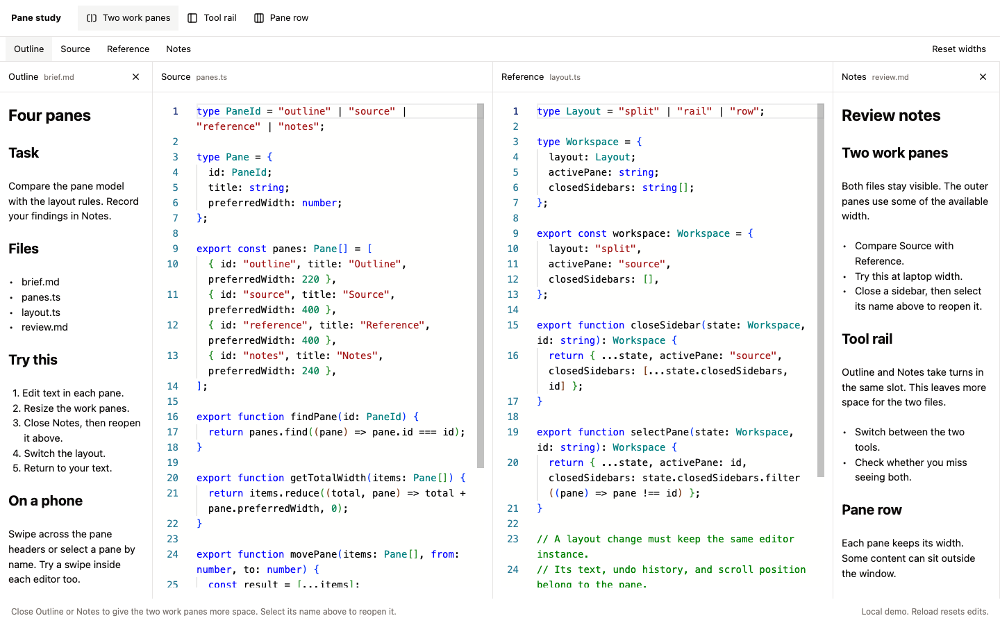
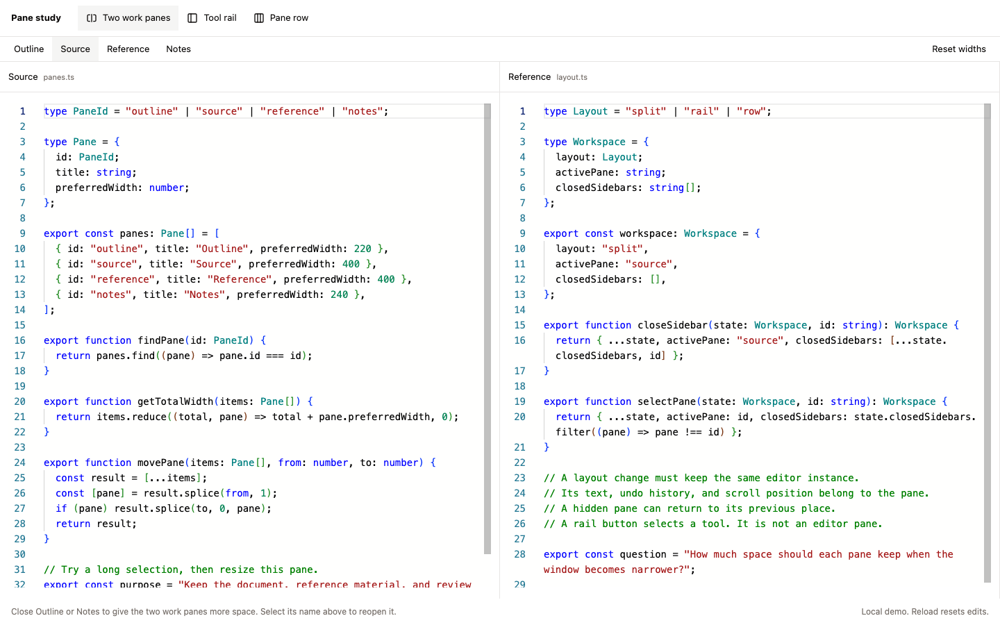
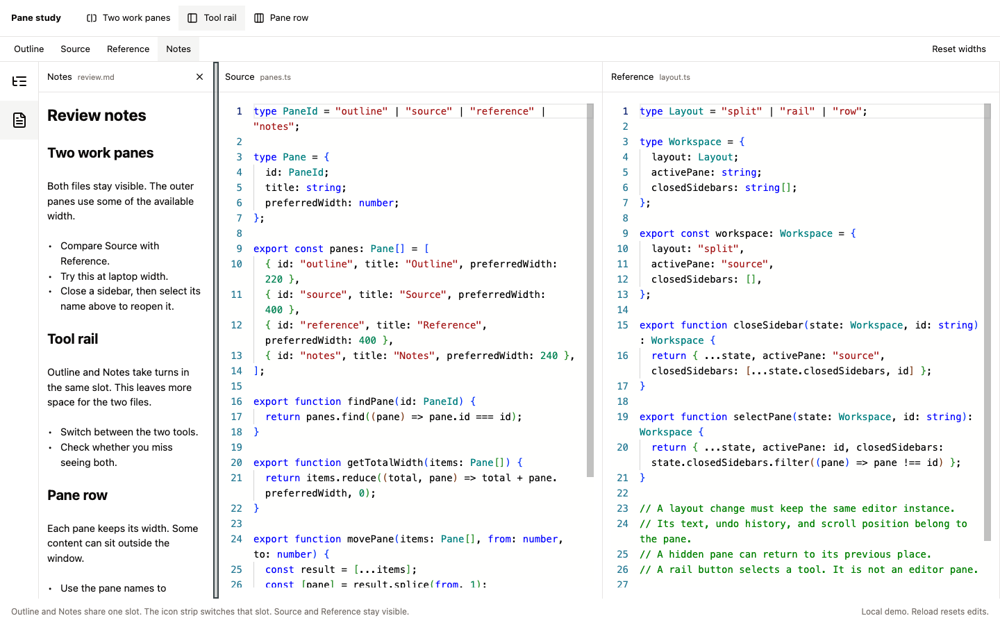
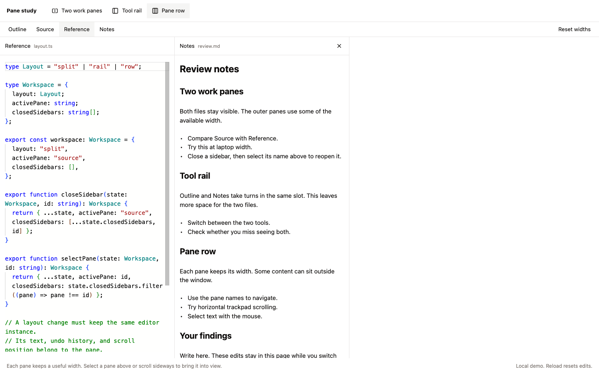
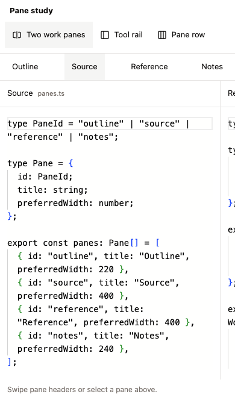

# Four-pane layout study

This is an experiment, not an accepted layout contract. The package already exists as
`@samebase/sidebars`. Its layout API and state still name left, main, and right panes.

## Recommendation

Start with two work panes between two utility panes. Let the user close either utility pane and
reopen it by name. Keep both work panes visible while giving them the released space.

The important distinction is between a pane and its current presentation. A pane keeps its editor,
document, undo history, and identity when the layout gives it less space or hides it.

## Three working options

The fixture is `/visual-fixture?mode=pane-layout-explorer`. It uses the package's `PaneFrame` and
Samebase's real Monaco and CodeMirror/ProseMark components. The experimental row layout lives in the
app fixture. It does not change the package's three-pane layout or its public API.

The same component also has a standalone Vite development entry at `/pane-study.html`. After
worktree setup, run `pnpm --filter samebase exec vp dev --config vite.pane-study.config.ts`. It uses
port 5197 and its own dependency cache. Point a Cloudflare tunnel at that port to compare the
layouts on a phone. It mounts the editors and theme directly, without app routes or backend access.
The app fixture remains local-only.

| Option         | Arrangement                                        | Use                                                                        | Cost                                                                                    |
| -------------- | -------------------------------------------------- | -------------------------------------------------------------------------- | --------------------------------------------------------------------------------------- |
| Two work panes | Outline / Source / Reference / Notes               | Compare two documents while keeping context and notes visible.             | At 1280px, each code pane has about 410px. Close a utility pane for wider work.         |
| Tool rail      | Icon strip / Outline or Notes / Source / Reference | Give the code panes more space when only one utility is needed.            | Outline and Notes cannot appear together. The strip is navigation, not a fourth editor. |
| Pane row       | Four panes, each initially 420px wide              | Keep stable reading widths and navigate by pane name or horizontal scroll. | Some panes sit outside the window. Desktop users need the visible pane selector.        |

Outline and Notes have close buttons. Source and Reference stay open. Select a closed sidebar's name
above, or its rail icon, to reopen it with its editor state and saved width. Closing or reopening a
sidebar balances the two work panes across the available width. In the row model, each pane keeps
its own width. Closed state stays the same across layout changes and on mobile.

Dividers exchange width between adjacent visible panes. In the row model, each divider changes one
pane's width. Arrow keys resize a focused divider by 16px. Shift plus an arrow key uses 64px.

The rail model is an application of the distinction in
[VS Code's layout documentation](https://code.visualstudio.com/docs/configure/custom-layout#_primary-side-bar):
the Activity Bar selects a view in the Primary Side Bar. Editor groups are a separate layout
decision. An icon strip alone does not provide another simultaneous editing area.

## What the earlier attempts tell us

- The
  [peer-pane experiment](https://github.com/samebase/samebase/blob/110124735/apps/samebase/src/components/WorkspacePeerPaneRoutePage.tsx#L22)
  already supported four and five panes with adjacent resizing. Its separate desktop and mobile
  trees mounted each editor twice. This study keeps one tree.
- The
  [trail experiment](https://github.com/samebase/samebase/blob/31f7a82d7/apps/samebase/src/components/workspace-layout-v3/WorkspaceLayoutV3Geometry.ts#L13)
  used collapsed rails and automatic restoration. Those rules add choices about which pane loses
  space. This study uses explicit close and reopen actions so that we can judge the basic layout.
- Nesting two complete `SidebarLayout` instances would leave two active-pane states and two gesture
  handlers. A future four-pane package should use one ordered pane list and one gesture handler for
  the whole workspace.

## Browser findings

Manual Playwright checks ran against the local fixture in Chromium. Desktop checks used the normal
1280px viewport, a 1000px viewport, and a 1440px viewport. Mobile checks used a fresh iPhone 13
touch-emulated context. These images are experiment evidence, not Linux screenshot baselines.

- The same Monaco and CodeMirror DOM instances remain connected across layout switches.
- Monaco edits and undo history survive all three layout choices. CodeMirror edits and undo history
  survive closing and reopening Notes.
- Closing both sidebars after resizing fills the available width with the two work panes. Reopening
  a sidebar restores its saved width. Keyboard focus moves to the Source selector after close.
- Pointer and keyboard resize exchange width between the intended adjacent panes, including Notes
  when it occupies the left tool slot.
- The pane selector brings an off-screen pane into view in the row model.
- At 1000px, resizing the middle pair keeps the outer panes at their previous widths. A resized last
  pane can still align at the start of the row. Separator values match the rendered widths.
- Closing Notes in the row model makes Reference the last pane. It can align at the start without
  adding an extra blank screen. Closing the rail tool leaves both work panes visible.
- Header swipes and pane buttons navigate the mobile row. A swipe from CodeMirror also moves the
  row. Mobile close and reopen use the same pane controls.
- A horizontal swipe from Monaco stays in the editor in this prototype. The mobile caption directs
  users to the pane headers or pane selector. Generalizing the package's existing gesture handling
  remains necessary before adopting this as a replacement layout.

Moving keyed editor subtrees exposed a second constraint. React 19.2.6 development Strict Mode
[replays effects for moved subtrees](https://github.com/facebook/react/blob/v19.2.6/packages/react-reconciler/src/ReactFiberWorkLoop.js#L5007).
The installed `@monaco-editor/react` 4.7.0
[cleanup disposes its editor](https://github.com/suren-atoyan/monaco-react/blob/v4.7.0/src/Editor/Editor.tsx#L246)
but retains its ref and ready state. In the failing experiment, the replay called `setModel` on that
disposed editor. Stable React keys alone did not protect the editor.

The fixture keeps a stable DOM order and uses CSS to place Notes in the left tool slot. It uses
[`reading-flow: flex-visual`](https://developer.mozilla.org/en-US/docs/Web/CSS/Reference/Properties/reading-flow)
to match keyboard order to the visual order. The Chromium keyboard check passes. This CSS feature
has limited browser availability, so this experiment does not prove keyboard order in every browser.
A production package change must resolve both the editor lifecycle and browser support.

At less than 900px, all three options use the same ordered carousel. That threshold and the demo
widths are experiment settings. They are not proposed package limits. Edits and widths are local to
the page, and reload resets them. There is no backend write or persistence change.

## Next package decision

If the two-work-pane model is selected, model panes by stable IDs in an ordered collection. Keep the
active pane, open sidebars, and pane widths separate. Use one renderer for desktop and mobile. Keep
application navigation outside that model. Prove mobile editor gestures, selection, focus, and
resize before replacing the current layout.

The manual path is recorded in [UI-004](../manual-tests/UI-004-four-pane-layout-study.md).

## Captures

Two work panes at 1440px:

Both sidebars closed:

Tool rail with Notes selected:

Pane row after selecting Reference:

Mobile carousel after a header swipe:

