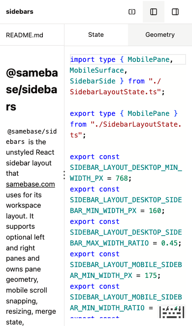

# Four-pane layout study

This is an experiment, not an accepted layout contract. It uses the actual `@samebase/sidebars`
layout, runtime, resize handles, and mobile carousel. The package still has three slots: left, main,
and right. Two editors share the main slot.

## Current composition

The standalone page is `/pane-study.html?prod-ui`. Run `pnpm run dev` for worktree setup, then
`pnpm --filter samebase exec vp dev --config vite.pane-study.config.ts`. The study uses port 5197
and a separate dependency cache. A Cloudflare tunnel can expose that port for phone checks.

`PaneLayoutExplorer` mounts one `SidebarLayoutMemoryProvider` and one `SidebarLayout`. The left slot
contains the package README in CodeMirror. The main slot contains the package state and geometry
files in Monaco. The right slot contains an empty Notes document in CodeMirror. All four editors use
the existing Samebase editor components and `PaneFrame`.

The page uses Samebase's existing package styles, including the three-dot mobile grip. The header
contains the layout menu and persistent left/right sidebar toggles. There is no extra navigation
row, helper footer, reset-width button, X button, or full-screen action.

The study no longer appears inside the app's visual-fixture shell. That shell already owns a
`SidebarLayout`; placing this complete study inside it would create a second layout and gesture
owner. The standalone page has exactly one layout owner.

## Desktop options

| Option         | Arrangement                                                | Tradeoff                                                                                                    |
| -------------- | ---------------------------------------------------------- | ----------------------------------------------------------------------------------------------------------- |
| Two work panes | README / State / Geometry / Notes                          | The two main editors share the remaining width. Collapse a sidebar to make them wider.                      |
| Tool rail      | Icon strip / README / State / Geometry / Notes             | The strip adds persistent README and Notes shortcuts. They toggle the existing left and right slots.        |
| Editor row     | README / horizontally scrolling State and Geometry / Notes | Each main editor keeps at least 420px. The main area scrolls horizontally while the sidebars stay in place. |

The middle divider resizes the two work editors. Arrow keys move it by 24px; Shift plus an arrow
uses 96px. This is the only custom resize control. The outer sidebar controls, width limits,
collapse state, and saved widths come from the package.

The tool rail stays outside the layout's measured width. Its buttons render within the layout's
presentation context. It does not move Notes into the left slot or create a fourth package slot.

## Mobile behavior

The package's 768px breakpoint controls mobile mode. The package supplies its three positions:
README, main, and Notes. In main, State and Geometry tabs select one editor. The inactive editor
stays mounted, so its text, selection, and undo history remain available.

Both native sidebar grips are present after the carousel settles. Dragging a sidebar to its minimum
can merge it with the main pane. The selected main editor fills the reduced main width. Dragging
back out separates the panes again. Sidebar buttons use the package's normal actions. Desktop
collapse state remains separate from mobile selection.

This composition does not prove four independent mobile panes. That requires extending the package's
state, geometry, and gestures to represent a fourth position. A custom four-pane carousel would not
answer whether the existing package supports that behavior.

## Browser checks

Focused manual Playwright checks use the standalone page and the actual package DOM. Captures are
research evidence, not Linux screenshot baselines.

- Chromium with a fresh iPhone 13 touch context: both native grips, saved widths, merge and unmerge
  on both sides, header swipes, editor tabs, keyboard tab navigation, and editor identity and undo.
- Desktop Chromium: sidebar collapse and restore, native keyboard resize, middle pointer resize, all
  three layout choices, row scrolling, and a main area narrower than two normal editor widths.
- Desktop and mobile mode changes keep desktop collapse state separate from mobile selection.
- Native WebKit: mobile rendering, both grip targets, file tabs, and keyboard sidebar resize. The
  scripted touch-resize checks use Chromium's touch input protocol.

The iPhone user agent can report `Canceled` promises from Monaco 0.55.1's
[WebKit clipboard workaround](https://cdn.jsdelivr.net/npm/monaco-editor@0.55.1/esm/vs/platform/clipboard/browser/clipboardService.js).
The identified stack cancels a pending clipboard-write promise on a later click or key press. The
focused check records that exact stack separately and fails on other page errors.

Earlier experiments moved editor subtrees and triggered React development effect replay after Monaco
had disposed an editor. This composition keeps the editors in stable React positions. Layout choices
change CSS and visibility without moving the editor components between parents.

The earlier version used `PaneFrame` but replaced `SidebarLayout` with custom geometry. It omitted
the package's mobile draggers and merge behavior. That version did not test the package and has been
replaced. Edits and widths in this local study reset on reload.

The manual path is [UI-004](../manual-tests/UI-004-four-pane-layout-study.md).

## Captures

Two work panes at the user's 1145px width:

Both sidebars collapsed:

Tool rail:

Editor row:

Native mobile sidebar grip:

Native mobile merge with a complete main editor:

