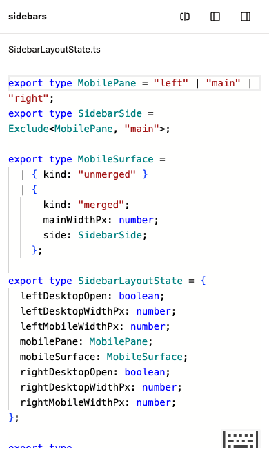
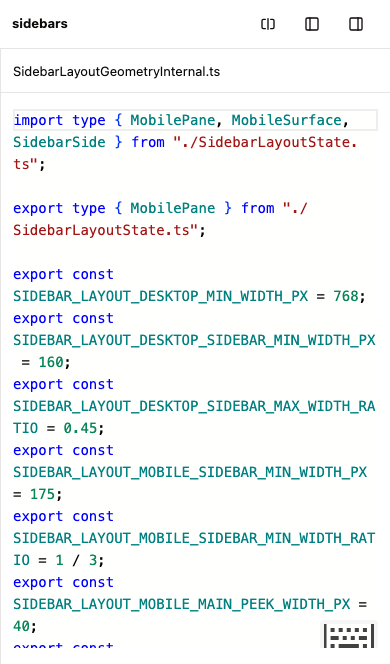

# Four-pane layout study

This is an experiment, not an accepted layout contract. It uses the actual `@samebase/sidebars`
layout, runtime, resize handles, and mobile carousel. The new `mainPanes` input gives each main
editor its own native mobile swipe position.

## Current composition

The standalone page is `/pane-study.html?prod-ui`. Run `pnpm run dev` for worktree setup, then
`pnpm --filter samebase exec vp dev --config vite.pane-study.config.ts`. The study uses port 5197
and a separate dependency cache. A Cloudflare tunnel can expose that port for phone checks.

`PaneLayoutExplorer` mounts one `SidebarLayoutMemoryProvider` and one `SidebarLayout`. The left slot
contains the package README in CodeMirror. Two main panes contain the package state and geometry
files in Monaco. The right slot contains an empty Notes document in CodeMirror. All four editors use
the existing Samebase editor components and `PaneFrame`.

The page uses Samebase's package styles, including the three-dot mobile grip. The header contains
the layout menu and persistent left/right sidebar toggles. There is no extra navigation row, helper
footer, reset-width button, X button, full-screen action, or mobile file tabs.

The study stays outside the app's visual-fixture shell. That shell already owns a `SidebarLayout`.
The standalone page has exactly one layout and gesture owner.

## Desktop options

| Option         | Arrangement                                                | Tradeoff                                                                                        |
| -------------- | ---------------------------------------------------------- | ----------------------------------------------------------------------------------------------- |
| Two work panes | README / State / Geometry / Notes                          | The main editors share the remaining width. Collapse a sidebar to make them wider.              |
| Tool rail      | Icon strip / README / State / Geometry / Notes             | The strip adds README and Notes shortcuts that toggle the existing left and right slots.        |
| Editor row     | README / horizontally scrolling State and Geometry / Notes | Each main editor keeps at least 420px. The main group scrolls while the sidebars stay in place. |

The center divider resizes the two work editors. Arrow keys move it by 24px; Shift plus an arrow
uses 96px. This is the only custom resize control. The outer sidebar controls, width limits,
collapse state, and saved widths come from the package.

The tool rail stays outside the layout's measured width. Its buttons render within the layout's
presentation context. It does not move Notes into the left slot.

## Mobile behavior

The package's 768px breakpoint controls mobile mode. The four positions are README, State, Geometry,
and Notes. Each main editor fills the viewport when selected. All four editors remain mounted as the
user swipes.

Both native sidebar grips appear after the carousel settles. The left sidebar merges with State, and
the right sidebar merges with Geometry. Only the adjacent main pane shrinks. The other editor stays
reachable as a separate swipe position. Entering that separate editor clears the merge and aligns it
to the viewport. Focusing the editor inside a merged pair preserves the pair. Dragging the grip
wider also separates the panes.

The consumer controls the last main pane ID through `mainPanes.activePaneId` and
`onActivePaneChange`. The package uses that ID for swipe selection and sidebar return. The existing
`mobilePane` state still identifies the left, main, or right category. Desktop collapse state
remains separate from mobile selection. Single-main consumers keep using the existing `main` input.
Main editors retain their React positions across desktop and mobile modes.

Earlier versions either used custom outer geometry or placed two editors behind mobile tabs. Both
approaches have been removed. Edits and widths in this local study reset on reload.

## Validation

- Fresh iPhone 13 touch emulation in Chromium passed four native panes, main-to-main header swipes,
  both edge merges, return to the last main, and both Monaco instances and undo histories.
- Desktop Chromium passed center resize, sidebar collapse and restore, all layout choices, narrow
  main widths, editor identity, and undo.
- Native WebKit passed four-pane rendering, main scroll alignment, sidebar return, and both grip
  targets. Scripted touch-resize checks use Chromium's touch input protocol.
- Package tests cover multiple-main offsets, merge exit through the opposite sidebar, a merged
  layout without the opposite sidebar, and alignment before hydration. Existing single-main tests
  pass.
- The focused Linux wrapper passed the existing carousel and resize-to-merge checks in
  `workspace-sidebar-drag.spec.ts`: 2 tests, 6.5 seconds of browser execution.
- Package and app type checks, lint, package build, and packed consumer checks pass. Existing
  package ref warnings remain. The first Linux command selected a `.live.spec.ts` file that the
  default runner excludes; it found no tests. The corrected focused command passed.

The iPhone user agent can report `Canceled` promises from Monaco 0.55.1's
[WebKit clipboard workaround](https://cdn.jsdelivr.net/npm/monaco-editor@0.55.1/esm/vs/platform/clipboard/browser/clipboardService.js).
The focused check records that exact stack separately and fails on other page errors.

The manual path is [UI-004](../manual-tests/UI-004-four-pane-layout-study.md). These captures are
research evidence, not Linux screenshot baselines.

## Captures

Two work panes at the user's 1145px width:

Both sidebars collapsed:

Tool rail:

Editor row:

Native mobile sidebar grip:

Native mobile merge:

State and Geometry have separate mobile positions:

