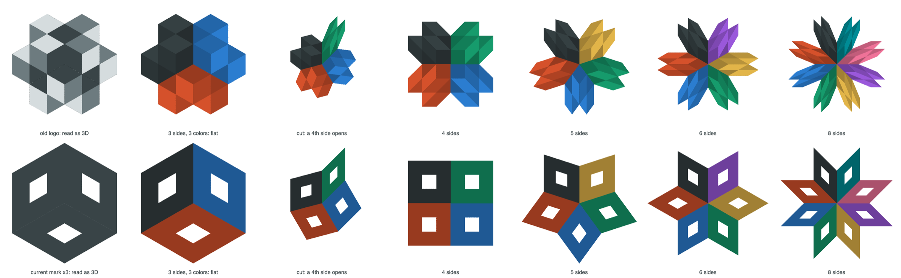

# The mark reshape, 2026-09-26

## Result

The isometric image of a cube is three rhombi around one center point. Three lines from the center,
along the three cube axes, separate them. When each rhombus has its own flat color, the image can be
treated as a flat picture and not as a cube. A cut along one line opens a new rhombus, and the
picture can then have any number of sides around the center.

With 3 sides the eye reads a cube. With 4 or more sides it cannot, because a cube corner has only
three faces. The effect is in the change, not in the still states: the viewer is sure that the
object is 3D, and then it does something that a 3D cube cannot do. This is the operator's idea from
the first logo exploration. It was too hard to show in a static logo, but a film has the time to
show it.



Top row: the old voxel logo. Bottom row: three sheared copies of the current mark. From left to
right: read as 3D, each side one flat color, the cut opens a fourth side, then 4, 5, 6, and 8 sides.
The colors are only there to separate the sides.

## The representation

- A picture is a list of side widths in degrees that add up to 360, in counterclockwise order from
  90 degrees. `[120, 120, 120]` is the isometric cube. `[105, 105, 105, 45]` is the cut while it
  opens. `[90, 90, 90, 90]`, `[72, ...]`, `[60, ...]`, and `[45, ...]` give 4, 5, 6, and 8 sides.
- Side `k` is the rhombus between the unit ray `u` at its start angle and the unit ray `v` at its
  end angle, scaled by the hexagon radius `R`.
- Every side shows the same source rhombus: the isometric sector between the rays at 90 and 210
  degrees. A point with rhombus coordinates `(a, b)` in `[0, 1]` maps to `R * (a * u + b * v)`.
- The outer tip of a side with width `w` is at `2 * R * cos(w / 2)`. Narrow sides reach further out:
  8 sides reach `1.85 * R`.

For each output pixel, find its side from its angle, solve for `(a, b)`, skip the pixel when
`(a, b)` is outside the unit square, and sample the source at the same `(a, b)` in the source
rhombus:

```ts
function sourcePointFor(x: number, y: number, widths: readonly number[], radius: number) {
  let angle = (Math.atan2(y, x) * 180) / Math.PI;
  while (angle < 90) angle += 360;
  let start = 90;
  for (const width of widths) {
    if (angle < start + width) {
      const [u, v] = [ray(start), ray(start + width)];
      const det = u[0] * v[1] - u[1] * v[0];
      const a = (x * v[1] - y * v[0]) / det / radius;
      const b = (u[0] * y - u[1] * x) / det / radius;
      if (a < 0 || b < 0 || a > 1 || b > 1) return undefined;
      const [su, sv] = [ray(90), ray(210)];
      return [radius * (a * su[0] + b * sv[0]), radius * (a * su[1] + b * sv[1])];
    }
    start += width;
  }
  return undefined;
}
```

`ray(d)` is the unit vector at `d` degrees. One source sector is enough because the cube, the old
logo, and the Menger sponge have 3-fold symmetry around the cube diagonal, so the three isometric
sectors are rotations of each other.

## Findings

- The current mark row is cleaner than the old logo row. Three sheared marks read as a cube with
  three openings. Four sides make four marks in a square. Six and eight sides make stars.
- For a change with no visible cut, the source must be the frame that the 3D renderer draws at the
  exact isometric angle, with orthographic projection and one flat color for each face direction. A
  Menger sponge shows inner tunnel walls through its openings, so an ideal drawing of three sheared
  marks would not match the 3D frame.
- The GPU version needs two passes: ray-march the 3D scene into a texture, then warp that texture by
  the side widths. With `[120, 120, 120]` the warp changes nothing, so the 3D camera can move
  freely. The widths change only while the camera holds the isometric view.

## Ways to break the viewer's expectation

- Build the 3D reading first: perspective, light, and rotation. Then ease to the isometric view,
  hold for one beat, and make the impossible move on the next beat.
- Repeat a pattern two times and break it on the third, for example two 120-degree turns and then a
  split in place of the third turn.
- Swap which tone is on top. The same three rhombi then read as a corner that points in, not out.
- Keep the object turning in 3D after it has four sides.
- Let the music meter follow the number of sides: 3/4 for three sides, 4/4 after the cut, then 5/4.

The sketch code was a one-off browser canvas script. The film version belongs in
`apps/remotion-studio` next to the Menger renderer on branch `claude/menger-dive-spike`.
