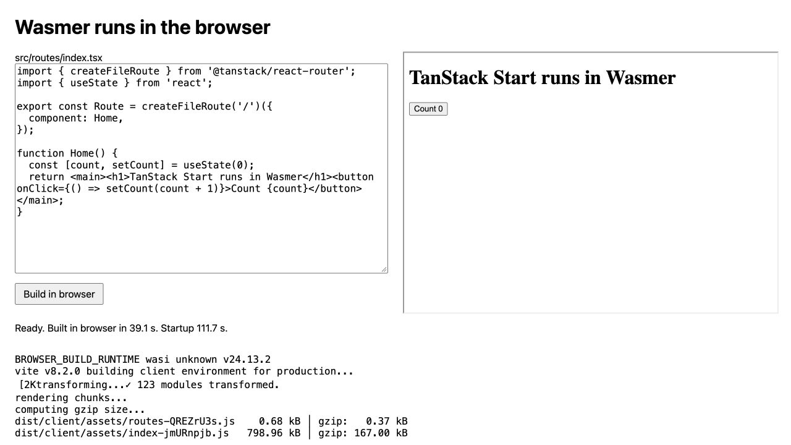
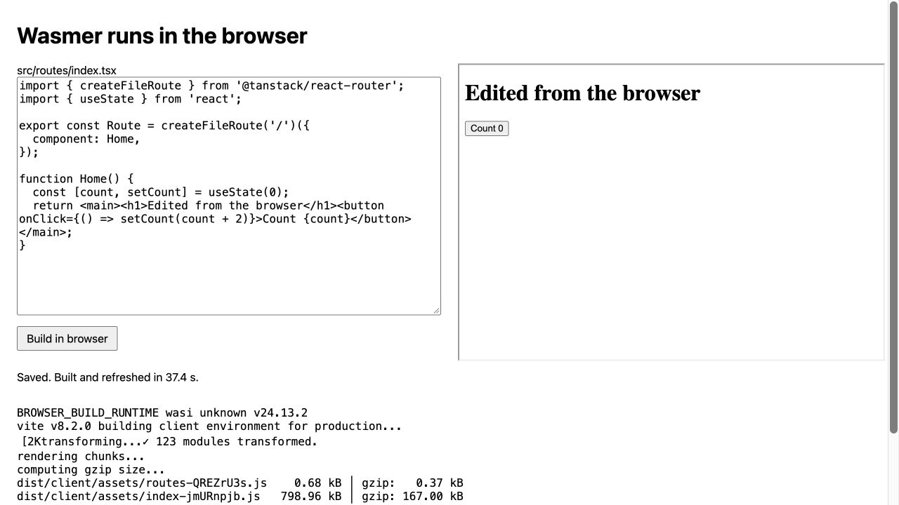

# Wasmer prototype source archive

Experiment dates: September 30 and October 1, 2026.

This directory preserves the source and selected evidence from the Wasmer experiment. The pull
request is an archive for future work. It is intended to remain closed without a merge.

The source is a snapshot of an exploratory workspace. It needs prepared dependencies and local files
that are not in this archive. It is not a supported tool or a complete reproduction package.

## Contents

`source.tar.gz` contains the original scripts and tiny app. The archive keeps these files as
historical source data. They are not active TypeScript files in the Samebase workspace. The paths
below are inside that archive.

- `browser-host.ts` and `browser-edit.ts` in `sdk-runner/` implement the small TanStack browser
  test. The host serves the SDK and source files. Wasmer in the browser builds and serves the app.
- `sdk-runner/edit-preview.ts` implements the same edit cycle with a Node-hosted Wasmer guest.
- The other scripts preserve the base-template build, main-app build, runtime, and Convex probes.
  Some scripts record failed approaches. Their presence does not mean that the approach worked.
- `minimal-tanstack/` contains the small app source and its dependency manifests.
- `evidence/` contains the saved browser build output, Node-hosted edit result, and screenshots.

`evidence/` is outside the source archive so its text and images can be read directly in the PR.

The archive excludes installed packages, package caches, runtime binaries, copied repositories,
environment files, and app build output. It also excludes host result records with absolute local
paths. The copied source files retain their original content.

## Workspace assumptions

The original scripts ran from `.tmp/wasmer-base-check` inside a Samebase worktree. Their relative
paths refer to that layout. The base source was commit
[`e243dafa95b0aecc7e462722858c906ea3d858cf`](https://github.com/samebase/base/commit/e243dafa95b0aecc7e462722858c906ea3d858cf).
The main Samebase source was commit
[`79234efeff00f070afebb94d18cc459f197284a2`](https://github.com/samebase/samebase/commit/79234efeff00f070afebb94d18cc459f197284a2).

`browser-host.ts` also reads Zod from the prepared `samebase-compatible/node_modules` directory. The
main and base scripts need their prepared source trees. The preparation scripts describe those
changes. The local directory names, installed packages, and runtime caches must be restored before
the original commands can run.

The last successful browser setup used SDK 0.19.0 and `syrusakbary/edgejs-quickjs-wasi@=0.1.5`. The
guest reported `wasi unknown v24.13.2`. The scripts set Rolldown's async work pool to zero, skip its
exit listener, and disable minification. Host lifecycle control stops guest processes after the
completion marker.

No runtime tests were repeated when this archive was prepared on October 18, 2026. The saved logs
describe the earlier experiment. Temporary tunnel addresses in old scripts or records are not a
current preview service.

## Saved browser evidence

The initial heading and source before the edit:

The changed source and preview after a full build inside browser Wasmer:

The changed counter after one click in the local browser runtime test:

