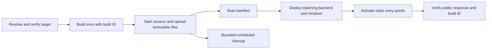

# Convex Hosting production audit

Date: 12 October 2026. Status: research and proposed direction, not an accepted product contract.

## Decision

Own and develop `samebase/convex-hosting`. Keep the component and the separate TanStack Start
adapter. Do not make the current release the default for production Samebase apps.

The fork can become a valid production host for Convex applications. Its current defects are in
deployment target selection, coordination between server code and files, cache policy, and runtime
coverage. Its largest unresolved service questions are edge caching, traffic cost, and abuse
control. More route features alone will not resolve these issues.

Make it the default only after the release protocol and a measured production pilot pass the gates
below. Preserve a provider choice for apps that need another runtime, a different cost model, or
stronger isolation between web traffic and backend work.

## Scope and prior decisions

The requested Claude chat, **Convex hosting fork strategy**, was found. Its session ID is
`537e0b71-230d-4b10-b2f8-d32800fbe107`. The chat approved independent ownership, pnpm, Vite+, the
monorepo, and separate hosting and TanStack packages. It did not approve the large routing redesign.
The last requested fix was to skip root `_headers` and `_redirects` files.

The chat's [explainer](https://claude.ai/artifact/FVYo6fQKTc4SW1aW3n5z4Y) is background. Code is the
audit authority. [PR #7](https://github.com/samebase/convex-hosting/pull/7) was open and unmerged at
review time. It skips those files but does not apply their rules.

Reviewed revisions:

| Source                          | Revision and treatment                                                                                                                                                                                                                                |
| ------------------------------- | ----------------------------------------------------------------------------------------------------------------------------------------------------------------------------------------------------------------------------------------------------- |
| Hosting fork                    | [main at 717a997](https://github.com/samebase/convex-hosting/tree/717a997084343002248e9a34101e16c54388709b). Audited in an isolated copy.                                                                                                             |
| Existing local hosting checkout | `513b32f`, clean. The two newer main commits concern release workflows.                                                                                                                                                                               |
| Open rules-file fix             | [2731845](https://github.com/samebase/convex-hosting/pull/7/changes), reviewed separately from main.                                                                                                                                                  |
| Convex backend                  | Existing local clone at `223e6e4`, used for source navigation. Relevant current files were then fetched from main, whose reported revision was [13731cb](https://github.com/get-convex/convex-backend/tree/13731cb3af48776bed02dbba06b04790b10ee6ec). |
| Upstream static-hosting         | Current revision was `d2d8e02`. The independent fork is the product under review.                                                                                                                                                                     |

Three read-only review lanes covered component behavior, deployment and SSR, and prior context plus
host comparisons. The main review checked platform source and combined the results. Production code
was not changed. No cloud deployment, paid load test, or external security test was run.

## Findings that block default production use

### 1. An explicit preview request can publish to production without showing the warning

Severity: high. Evidence: source plus a local subprocess probe.

Convex gives a deployment-specific `CONVEX_DEPLOY_KEY` precedence over `--preview-name`. The SDK
warns about the ignored selector on standard error. The fork's
[command wrapper](https://github.com/samebase/convex-hosting/blob/717a997084343002248e9a34101e16c54388709b/packages/convex-hosting/src/cli/commands.ts#L26)
discards standard error when the command succeeds. The
[upload log](https://github.com/samebase/convex-hosting/blob/717a997084343002248e9a34101e16c54388709b/packages/convex-hosting/src/cli/upload.ts#L813)
then reports the requested preview name, not the actual target.

Trigger: a CI job inherits a production key and runs `upload --preview-name feature`. The README
mentions key precedence, but that does not make a false success label safe. The local probe returned
production URLs with exit code zero and no visible warning. It used a fake CLI, not real
credentials.

Fix: resolve the actual deployment once before building or writing. Reject a conflict with an
explicit selector. Pass that resolved target to every later operation. Print the actual deployment
identity and preserve successful-command warnings. Apply the rule to production and development too.
Also make `deploy` support preview selection; today only `upload` accepts it and deploy supplies
`--prod` to upload.

### 2. First SSR deployment can fail before building, or publish an old renderer

Severity: high. Evidence: source plus three deterministic CLI orchestration traces.

When the component is absent,
[deploy first pushes the backend](https://github.com/samebase/convex-hosting/blob/717a997084343002248e9a34101e16c54388709b/packages/convex-hosting/src/cli/deploy.ts#L205)
to discover its URLs. The SSR backend imports the generated
[server bundle](https://github.com/samebase/convex-hosting/blob/717a997084343002248e9a34101e16c54388709b/examples/tanstack-ssr/convex/http.ts#L29).
A fresh checkout has no bundle yet. If an old bundle exists, the first backend push can use it. The
CLI then builds the new bundle but skips the second backend push.

A related path
[rebuilds after the mount URL changes](https://github.com/samebase/convex-hosting/blob/717a997084343002248e9a34101e16c54388709b/packages/convex-hosting/src/cli/deploy.ts#L269).
It uploads the new files without deploying the rebuilt renderer. The traces showed both successful
commands leaving different build environments in the backend and uploaded files.

Fix: resolve the build environment before building, build once, and deploy that exact output.
Separate first-time component setup from application release. Convex's `deploy --cmd` environment
handoff can help with build URL selection. It does not by itself solve file publication ordering.

### 3. Static publication is atomic, but a complete SSR release is not

Severity: high. Evidence: source; the outage interval was not measured on a live deployment.

[Backend deployment precedes file upload](https://github.com/samebase/convex-hosting/blob/717a997084343002248e9a34101e16c54388709b/packages/convex-hosting/src/cli/deploy.ts#L249).
During that interval the new renderer can emit URLs for files that are not available. If upload
fails, the new renderer remains deployed. The old static manifest alone cannot restore the app.
Overlapping CI runs can also leave renderer B with manifest A. No deployment-wide generation check
coordinates these separate operations.

Fix: make new immutable files available before server code can reference them. Give the renderer and
manifest the same build identity. Guard incomplete builds, and serialize promotion per target with a
generation check. A readiness guard that returns 503 prevents broken HTML but still causes downtime.
It is an interim safety measure, not a zero-downtime release protocol.

Keeping old files does not preserve old server-function implementations or database schemas. Require
compatibility between the current backend and supported old clients. Do not promise whole-app
rollback from an asset pointer change.

### 4. Filename guessing can cache mutable content for a year

Severity: high for affected URLs. Evidence: a passing probe that asserts the faulty behavior.

[Cache policy](https://github.com/samebase/convex-hosting/blob/717a997084343002248e9a34101e16c54388709b/packages/convex-hosting/src/component/serving.ts#L117)
infers a content hash from a filename suffix. `/sales-20261012.json` receives
`public, max-age=31536000, immutable`, although an operator can change its contents at the same URL.
Some valid all-letter build hashes get the opposite result. An ETag cannot repair a browser that is
still allowed to reuse its fresh immutable response.

Fix: record cache policy as build metadata. Default ordinary public files to revalidation. Use
immutable caching only for URLs whose bytes cannot change. A versioned namespace or a
content-addressed URL whose digest is verified can establish that rule. The `/assets/` directory
alone cannot establish it.

### 5. File deletion and retention have no clear production removal contract

Severity: high when an operator must remove a published file. This is documented behavior, not a
regression against a seven-day deletion promise.

Publication retains old storage files.
[Lookup](https://github.com/samebase/convex-hosting/blob/717a997084343002248e9a34101e16c54388709b/packages/convex-hosting/src/component/lib.ts#L75)
can return retired non-HTML files without checking `expiresAt`.
[Cleanup](https://github.com/samebase/convex-hosting/blob/717a997084343002248e9a34101e16c54388709b/packages/convex-hosting/src/component/lib.ts#L314)
runs through later CLI uploads. A removed PDF, JSON file, source map, or service worker can remain
public indefinitely if no further upload occurs. The docs correctly say "at least seven days".

Fix: distinguish immutable build files from mutable public files. Retain only the former by default.
Define normal removal and urgent revocation separately. Check expiry on reads, schedule bounded
cleanup independently of deployment, and expose cleanup failures. Purging an origin file cannot
erase copies already held in browser caches, so cache policy is part of this contract.

The legacy CDN path has the reverse behavior: old URLs stop resolving at publication. A probe
confirmed a retired lazy chunk returns no asset. The docs explicitly exclude CDN retention. Remove
this legacy option from the supported new-app design, with a deliberate migration for existing
users.

## Other confirmed defects and limits in the fork

| Finding                                                       | Trigger, evidence, and action                                                                                                                                                                                                                                                                                                                                                                                                                                                                                                                                                                                                                                    |
| ------------------------------------------------------------- | ---------------------------------------------------------------------------------------------------------------------------------------------------------------------------------------------------------------------------------------------------------------------------------------------------------------------------------------------------------------------------------------------------------------------------------------------------------------------------------------------------------------------------------------------------------------------------------------------------------------------------------------------------------------- |
| WebAssembly has the wrong MIME type                           | Both MIME tables omit `.wasm`. Upload stores `application/octet-stream`; `WebAssembly.instantiateStreaming` rejects valid bytes. Add `application/wasm` and use one MIME source. [Upload table](https://github.com/samebase/convex-hosting/blob/717a997084343002248e9a34101e16c54388709b/packages/convex-hosting/src/cli/upload.ts#L34).                                                                                                                                                                                                                                                                                                                         |
| Documented SSR integration only handles GET                   | The example registers one GET catch-all. POST server functions and method-specific server routes never reach TanStack. Provide and test the required methods, while keeping static-file handling on GET/HEAD and preserving app auth and webhook routes. This is an integration defect, not a missing Convex method. [Route](https://github.com/samebase/convex-hosting/blob/717a997084343002248e9a34101e16c54388709b/examples/tanstack-ssr/convex/http.ts#L8).                                                                                                                                                                                                  |
| SSR waits for all content and builds one HTML string          | The adapter awaits `stream.allReady`, then calls `.text()`. Suspense cannot send an early shell; a slow loader delays the full response, and HTML occupies memory. This affects latency and the 64 MiB runtime budget. Add a supported streaming path and prove cancellation, headers, and deferred content. Do not claim a measured memory failure yet. [Renderer](https://github.com/samebase/convex-hosting/blob/717a997084343002248e9a34101e16c54388709b/packages/convex-hosting-tanstack-start/src/server.ts#L32).                                                                                                                                          |
| Root `index.html` is mandatory even for SSR                   | Both upload and publication require it, including `--no-spa`. This imposes an SPA requirement on server-rendered or assets-only builds. Validate an entry point according to hosting mode. [Upload check](https://github.com/samebase/convex-hosting/blob/717a997084343002248e9a34101e16c54388709b/packages/convex-hosting/src/cli/upload.ts#L786).                                                                                                                                                                                                                                                                                                              |
| A period changes SPA routing                                  | `/users/jane.doe` is treated as a missing file and returns 404. It can be a valid application route. Use an explicit routing contract, and protect known asset requests from HTML fallback. [Resolution](https://github.com/samebase/convex-hosting/blob/717a997084343002248e9a34101e16c54388709b/packages/convex-hosting/src/component/lib.ts#L75).                                                                                                                                                                                                                                                                                                             |
| Directory-index routing is absent                             | `/about/index.html` does not automatically give `/about/` the same page. Add deliberate directory-index and canonical redirect behavior for static exports. Do not apply a full provider rules language by default. [Exact lookup](https://github.com/samebase/convex-hosting/blob/717a997084343002248e9a34101e16c54388709b/packages/convex-hosting/src/component/lib.ts#L69).                                                                                                                                                                                                                                                                                   |
| Range requests are ignored                                    | A `Range` request receives the entire body with status 200. This is allowed when ranges are unsupported, but limits media seeking and large-file use. Implement 206/416 and `If-Range` only if these files are in the supported product scope. [Response](https://github.com/samebase/convex-hosting/blob/717a997084343002248e9a34101e16c54388709b/packages/convex-hosting/src/component/http.ts#L147).                                                                                                                                                                                                                                                          |
| Stage and publish are not idempotent                          | Repeating a staged chunk inserts duplicates and prevents publication. Repeating a successful publish fails because it consumed staging rows. Local probes confirmed both. The CLI has some lost-response cleanup protection, but no resumable upload-session contract. Add stable operation IDs, chunk identity, and terminal publication results. [Staging](https://github.com/samebase/convex-hosting/blob/717a997084343002248e9a34101e16c54388709b/packages/convex-hosting/src/component/lib.ts#L453), [publish](https://github.com/samebase/convex-hosting/blob/717a997084343002248e9a34101e16c54388709b/packages/convex-hosting/src/component/lib.ts#L718). |
| Publication rewrites the complete manifest                    | The 1,800-file and 2 MiB metadata caps are package limits, not general Convex hosting limits. Each release removes the old live rows, inserts new ones, and inserts retired rows. Use immutable manifests and a small activation transaction when redesigning publication. [Writes](https://github.com/samebase/convex-hosting/blob/717a997084343002248e9a34101e16c54388709b/packages/convex-hosting/src/component/lib.ts#L740).                                                                                                                                                                                                                                 |
| Orphan scans do not guarantee progress                        | Cleanup examines only 2,000 storage rows from either end. Protected rows can hide unreferenced files in the middle. Repeating the same bounded scan is not pagination. Add a persistent cursor and retain reference checks before deletion. This is a source-based scalability finding, not a measured storage incident. [Scan](https://github.com/samebase/convex-hosting/blob/717a997084343002248e9a34101e16c54388709b/packages/convex-hosting/src/component/lib.ts#L543).                                                                                                                                                                                     |
| Every upload sends every file again                           | No content-based reuse avoids unchanged uploads. Identical releases also receive new storage IDs and validators. This adds transfer, storage retention, and revalidation work. Start with safe reuse from the current manifest; add global deduplication only if measurement justifies its reference-management cost. [Upload loop](https://github.com/samebase/convex-hosting/blob/717a997084343002248e9a34101e16c54388709b/packages/convex-hosting/src/cli/upload.ts#L475).                                                                                                                                                                                    |
| Old direct write APIs can delete the object they retain       | Calling `recordAsset` or `recordAssets` with the existing storage ID deletes that object, then writes a row that still refers to it. A probe produced a 503 for the index page. The current CLI does not use these APIs. Remove them after checking supported callers, or fix reference handling. [Write path](https://github.com/samebase/convex-hosting/blob/717a997084343002248e9a34101e16c54388709b/packages/convex-hosting/src/component/lib.ts#L643).                                                                                                                                                                                                      |
| Cleanup can corrupt a fresh manifest that shares a storage ID | Abandoned staging cleanup checks live and retired references, but not another fresh staged manifest. A probe shared one object between old and new staging, cleaned the old entry, and published the new manifest successfully with missing bytes. Current CLI uploads fresh IDs, so fix this before adding content reuse. [Cleanup](https://github.com/samebase/convex-hosting/blob/717a997084343002248e9a34101e16c54388709b/packages/convex-hosting/src/component/lib.ts#L515).                                                                                                                                                                                |
| Root provider rule files are public on main                   | PR #7 addresses disclosure of `_headers` and `_redirects`, but silently ignoring their behavior can still remove redirects and security headers during migration. Fail with an actionable message when unsupported hosting configuration is present, unless the caller explicitly chooses to ignore it. [Pending fix](https://github.com/samebase/convex-hosting/pull/7).                                                                                                                                                                                                                                                                                        |
| Header and error policy is incomplete                         | There is no supported deployment header/redirect policy in component-owned mode. Ordinary static 404 responses omit `no-store`, unlike the SSR missing-asset response. Define error caching, security headers, and service-worker policy in one tested response path. Do not assume an external CDN's negative-cache behavior. [Static miss](https://github.com/samebase/convex-hosting/blob/717a997084343002248e9a34101e16c54388709b/packages/convex-hosting/src/component/http.ts#L73).                                                                                                                                                                        |

The
[update hook](https://github.com/samebase/convex-hosting/blob/717a997084343002248e9a34101e16c54388709b/packages/convex-hosting/src/react/index.tsx#L56)
also takes its initial deployment ID from its first subscription result. A page whose old files were
already loaded before that first result can miss the update. Embed the page's build identity instead
of treating the first observed server state as its build identity. This is source-based. It does not
mean every ordinary reconnect misses an update.

Two smaller API issues need attention during that work. The adapter's
[fetch type](https://github.com/samebase/convex-hosting/blob/717a997084343002248e9a34101e16c54388709b/packages/convex-hosting-tanstack-start/src/server.ts#L22)
accepts only a request, so an app cannot pass TanStack request context through it. Preserve a typed
request-context option for authentication and request-scoped state. The
[upload request](https://github.com/samebase/convex-hosting/blob/717a997084343002248e9a34101e16c54388709b/packages/convex-hosting/src/cli/upload.ts#L530)
also has no explicit timeout or retry policy. Add a bounded policy only together with safe handling
of uploads whose response was lost.

## What the Convex backend does and does not establish

Some earlier explanations were wrong or too broad:

- HEAD works. The
  [TypeScript router](https://github.com/get-convex/convex-backend/blob/13731cb3af48776bed02dbba06b04790b10ee6ec/npm-packages/convex/src/server/router.ts#L33)
  and
  [Rust method conversion](https://github.com/get-convex/convex-backend/blob/13731cb3af48776bed02dbba06b04790b10ee6ec/crates/common/src/types/actions.rs#L85)
  map HEAD to GET. Correct the fork's monitor guidance and add an end-to-end HEAD check.
- `ctx.storage.get` does not by itself prove that a complete file is buffered in JavaScript memory.
  The
  [runtime uses Blob.fromStream](https://github.com/get-convex/convex-backend/blob/13731cb3af48776bed02dbba06b04790b10ee6ec/npm-packages/udf-runtime/src/storage.ts#L38).
  The confirmed buffering concern is the SSR adapter's HTML conversion.
- 4,096 is the transaction limit for index ranges, not scanned documents. Current limits list 32,000
  documents scanned and 16,000 written. Do not simply increase the package's caps without checking
  bytes, reads, writes, and CPU on real deployments.
  [Limits](https://docs.convex.dev/production/state/limits#transactions).
- Upload and management functions remain internal. This audit did not find a public upload auth
  bypass. The preview-target defect uses the operator's existing credential; it does not give an
  unauthenticated visitor access.
- Changing the component instance name creates a different storage namespace. Preserve the existing
  instance during package migration, or use a tested migration that copies and verifies assets.

Current service limits matter even after code fixes. HTTP actions have 64 MiB memory and a 100 MiB
response limit. They do not provide Node.js APIs.
[HTTP runtime](https://docs.convex.dev/functions/http-actions#limits). HTTP actions share the Convex
action concurrency pool, currently 64 on S16 and 512 on S256.
[Concurrency](https://docs.convex.dev/production/state/limits#concurrent-function-executions).
Uncached asset bursts therefore need tests alongside backend actions, not only static throughput
tests.

Convex runs a deployment in a selected region. Treat global origin latency as a measured
requirement. Do not describe the renderer as globally distributed edge compute.
[Regions](https://docs.convex.dev/production/regions).

## Comparison with production web hosts

The target is a dependable option beside Cloudflare Pages/Workers, Netlify, and Vercel. It does not
require feature-for-feature imitation. The user explicitly requested all four comparisons.

| Contract            | Existing host evidence                                                                                                                                                                                                                                                                                                                                                                              | Requirement for this fork                                                                                                                                                        |
| ------------------- | --------------------------------------------------------------------------------------------------------------------------------------------------------------------------------------------------------------------------------------------------------------------------------------------------------------------------------------------------------------------------------------------------- | -------------------------------------------------------------------------------------------------------------------------------------------------------------------------------- |
| Complete deployment | Cloudflare versions include Worker code and assets. Netlify publishes complete deploys. Vercel supports promotion of a tested deployment. [Cloudflare](https://developers.cloudflare.com/workers/versions-and-deployments/), [Netlify](https://docs.netlify.com/deploy/deploy-overview/), [Vercel](https://vercel.com/docs/deployments/environments#verifying-a-production-build-before-promotion). | Specify the backend/file transition and failure behavior. An atomic database manifest update is only one part.                                                                   |
| Old client support  | Hosts have framework-specific skew protection or version affinity. [Netlify](https://docs.netlify.com/deploy/deploy-overview/#skew-protection), [Vercel](https://vercel.com/docs/skew-protection#supported-frameworks), [Cloudflare](https://developers.cloudflare.com/workers/versions-and-deployments/gradual-deployments/version-affinity/).                                                     | Test an old page after a new deployment. Retention alone cannot preserve old server behavior. Do not assume these hosts automatically support every TanStack integration either. |
| CDN behavior        | Cloudflare documents automatic asset caching. Netlify documents invalidation per deploy context. Vercel documents CDN caching and purge tools. [Cloudflare](https://developers.cloudflare.com/workers/static-assets/), [Netlify](https://docs.netlify.com/build/caching/caching-overview/), [Vercel](https://vercel.com/docs/caching/cdn-cache).                                                    | Obtain a documented Convex caching contract or provide a controlled delivery layer. Cache-Control headers alone do not prove shared CDN hits or tenant purge authority.          |
| Previews            | Conventional hosts provide branch and deployment URLs. Convex previews already exist but are beta, with documented expiry of five days on Free/Starter and fourteen days on higher plans. [Convex previews](https://docs.convex.dev/production/multiple-deployments#using-preview-deployments).                                                                                                     | Use the native preview lifecycle. Verify target identity, data reuse/reset behavior, expiry, access policy, noindex, and cleanup.                                                |
| Custom domains      | Direct Convex custom domains require Pro. Convex manages TLS, and the first request can be delayed while a certificate is issued. [Domains](https://docs.convex.dev/production/custom-domains).                                                                                                                                                                                                     | Check plan eligibility, DNS, certificate readiness, canonical URLs, and auth redirects before reporting the app ready.                                                           |
| Static traffic cost | Cloudflare static asset requests are free when they do not invoke a Worker. Convex meters function calls and file egress. [Cloudflare billing](https://developers.cloudflare.com/workers/static-assets/billing-and-limitations/), [Convex limits and charges](https://docs.convex.dev/production/state/limits).                                                                                     | Measure billed origin work for hits, misses, 304 responses, and app-owned routing. Do not infer the exact bill from function nesting alone.                                      |
| Abuse controls      | Convex documents baseline network protection through Cloudflare. Application-level WAF, bot policy, route limits, and traffic controls require an owned edge. [Abuse protection](https://docs.convex.dev/production/abuse-protection).                                                                                                                                                              | Prove origin access controls and a cost limit. A rate limiter inside an HTTP action already consumes origin work.                                                                |

I found no public Convex HTTP hosting guarantee for cache eligibility, publication invalidation, or
tenant-controlled purge in the reviewed documents. This is an unresolved service contract, not proof
that every response is uncached. Public backend code cannot establish private managed-edge behavior.
Confirm cache keys, cookies, authorization, compression, negative caching, and billing with Convex
and with a measured pilot.

An optional Cloudflare delivery layer is a valid way to serve apps that need these controls. Keep
application logic in Convex. Make the extra provider visible in the stack contract. Do not claim
one-provider onboarding if the selected production profile requires that layer.

## Proposed architecture

Keep the runtime small. Separate build and release operations from file serving. Use the existing
GitHub Actions workflow as the build runner instead of creating a second CI service inside Convex.

Use a deployment record with explicit states such as uploading, ready, active, and expired. Keep
asset entries under that deployment, indexed by deployment ID and path. Store the current static
deployment ID in a small site record. Do not copy the complete manifest during activation.

Each manifest needs an expected unique entry count and a digest or equivalent completeness check.
Validate storage and metadata while staging. Seal the manifest so later chunks cannot change it.
Activation must check the expected previous generation and return the same result when retried.
Serialize the whole release sequence for one target, including backend deployment and manifest
activation. A manifest generation check alone cannot stop an older job from replacing newer backend
code. The release runner must stop stale jobs before they change that code. Record the source commit
and resolved Convex deployment identity for diagnosis. Schedule abandoned-upload cleanup when the
session starts, so failures before manifest sealing also receive cleanup.

Make immutable build files reachable through their build namespace before deploying the renderer.
Keep mutable files and HTML behind the active deployment. No new renderer may refer to unpublished
files. Preserve the prior files for supported old clients. For the first install, provision the
component before attempting this sequence, without importing a nonexistent renderer.

This design is proposed to solve publication size, retries, and coordination. It does not require a
release-history UI. Rebuilding a prior Git commit can remain the user-facing rollback method.
Backend and schema compatibility must still be checked before rollback.

Store explicit cache and retention policy with each build file. Reuse unchanged content from the
current manifest when safe. Defer a global content-addressed storage table until its measured
benefit justifies reference counting and concurrent cleanup complexity.

Give the component one asset-resolution contract and one shared response policy. Keep two supported
entry points: direct component HTTP routes for simple static apps, and an app-owned handler for
auth, webhooks, SSR, and custom routes. Add only the redirect and header rules Samebase templates
require. Provider-specific config must never be silently served or silently treated as enforced
policy.

Remove obsolete v1 write APIs, migration branches, and legacy CDN handling only after a verified
migration. Their carrying cost is real, but deleting them during an unplanned production upgrade can
lose access to existing assets. The package boundary is public even when Samebase's app code is not.

Keep the TanStack adapter explicit about supported versions and runtime APIs. Add real deployment
tests for server functions, cookies, auth redirects, Suspense, cancellation, and errors. Preserve
existing app-owned `no-store` policies for dynamic responses until an application deliberately sets
a safe policy. The published adapter itself does not set this header.

## Work order and release gates

1. Fix target selection, warning handling, first-install ordering, and rebuild mismatch. Add the
   deterministic CLI tests to the package. These fixes can ship before the storage redesign.
2. Introduce sealed manifests, retry-safe staging and activation, build identity, and prepublished
   immutable files. Add scheduled cleanup with a cursor and explicit revocation behavior.
3. Correct cache metadata, MIME handling, SSR methods, and mode-specific entry validation. Define
   the small routing and header contract required by Samebase templates.
4. Add real cloud smoke tests from a fresh checkout and from an installed release. Run them against
   supported Convex and TanStack versions and against Windows as well as Linux for CLI behavior.
5. Run a controlled production pilot, then enable the default only for the tested capability set.

The pilot must demonstrate:

- A preview selector cannot modify production, including with an inherited wrong deploy key.
- First deploy, ordinary redeploy, interrupted upload, lost response, and overlapping deploys keep
  the declared release contract. Observe a request stream through each transition.
- An old tab can load a lazy chunk after release and can use the supported backend API. A deleted
  mutable public file becomes unavailable under the declared removal policy.
- SPA navigation, dotted routes, static exports, GET/HEAD/POST, auth cookies, callbacks, 404
  responses, Wasm, and required service-worker behavior pass through real URLs.
- Custom-domain TLS and canonical redirects work before the provider is marked ready. Preview access
  and expiry match the product contract.
- Repeated unchanged deploys and failed uploads do not cause unbounded storage growth. Cleanup
  progresses without another deployment.
- Multi-region latency, origin cache misses, burst traffic, and billed usage are measured against
  the same app on Cloudflare. Select a supported traffic envelope from those results. Do not invent
  a CDN hit ratio or advertise a cost advantage before measuring it.
- Synthetic availability, response status, build identity, deploy failures, cleanup backlog, and
  spending alerts have owners and a documented recovery procedure.

## Verification record

An isolated copy of current main was installed from its lockfile. The existing seven focused
component, HTTP, client, and CLI test files passed: **100 tests, 300 ms runner duration**. An
independent component run with eight additional fault probes also passed: **89 tests, 286 ms**.
These counts overlap and must not be added together. The fault probes assert current faulty
behavior; their passing result does not mean the defects are fixed.

Additional local probes verified:

- The command wrapper drops a successful CLI target warning.
- Fresh SSR deploy order fails before build when the server artifact is absent.
- A first deploy with stale output, and a deploy with a changed mount, do not repush the new
  renderer.
- Valid Wasm bytes fail with the uploaded MIME type and succeed with `application/wasm`.
- Reusing a storage ID through the old direct write API can delete live bytes.
- Abandoned staging cleanup can delete bytes that a fresh staged manifest still needs.

The final audit-only test file passed all 11 tests, including its imported setup test, in 120 ms.

The CLI deployment probes replace external operations with local fakes. They verify orchestration
order, not a completed cloud deployment. No live cache, billing, latency, throughput, custom-domain,
or production rollback result is claimed. The audit is a code and contract review, not an exhaustive
security certification.

The original hosting checkout and Convex backend clone were left unchanged. Temporary tests and
probes were kept outside them. The Samebase worktree setup completed for this research document. No
frontend preview was started.

## Summary

The fork is worth owning. Its current implementation is not ready to be the default production host.
Fix the deployment safety defects first, then implement a small release model and explicit file
policy. Qualify the Convex delivery service with real traffic and cost measurements before enabling
the default.
