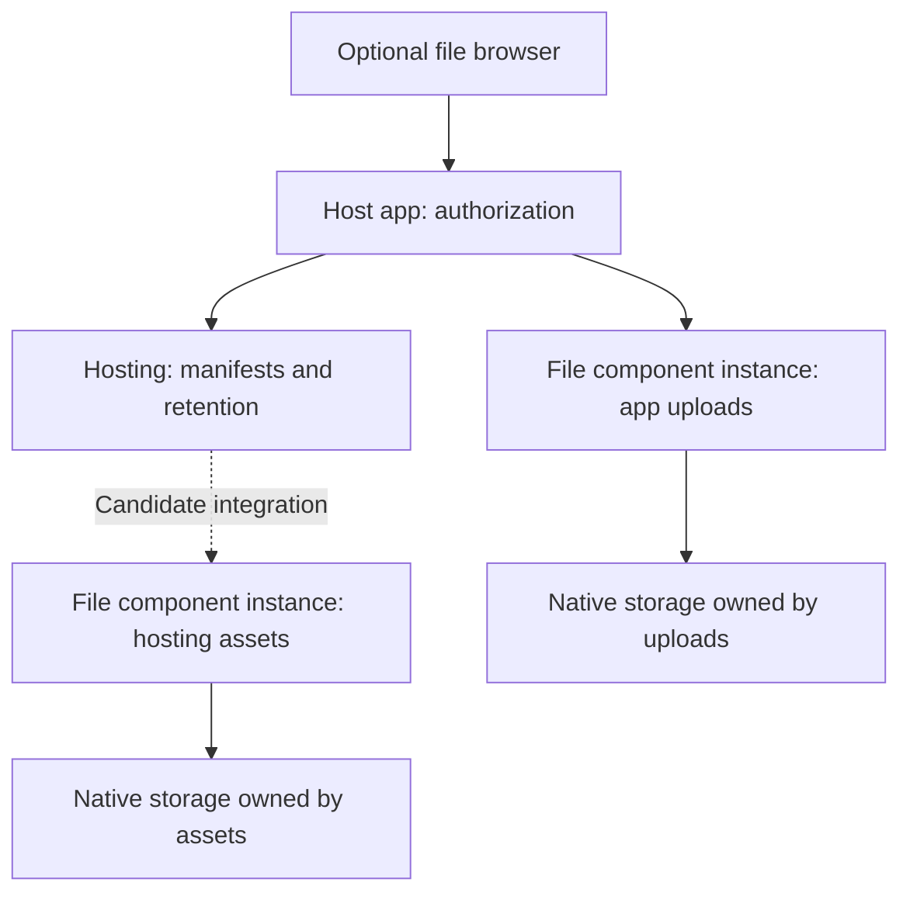

# Named file storage and component file browsers

Date: 2026-10-12

Status: Research complete. This note records evidence and a recommendation, not an accepted
implementation plan.

## Idea

Add a thin Convex component that associates stored blobs with file names and paths. Keep the file
bytes in Convex storage. Give applications and other components a common way to describe and find
files, instead of each component creating its own file metadata tables.

Provide a small file browser with folders, file details, and previews. The file component should be
the default whenever code we own stores a file. Every completed file must have a useful path, so an
operator can browse the files and understand what they are.

The first possible consumers are `@samebase/convex-hosting` and application uploads. Hosting could
use the file component for shared file metadata while retaining its own deployment behavior.

## Clarified intent

The operator clarified that inspection and consistent file handling are the main needs. The first
research pass gave disaster recovery too much weight. A recovery manifest is not a prerequisite for
the proposed component.

The design target is one default way to work with Convex files, with a required, unique path. Any
case that requires bypassing that component should have a concrete explanation. Optional R2 support
is useful if it preserves the same basic file API.

The broader Samebase idea is an admin view of the app's component tree, where selecting a component
opens a suitable management UI. Record that as a separate product idea. It must not expand the
initial file component into a general component-dashboard framework.

## Questions to investigate

- Which Convex components already add paths, file names, or a file browser to native file storage?
- What does native Convex storage preserve, and what can backups and exports recover?
- Which parts of the hosting file model are general, and which belong to deployments and serving?
- Can hosting and applications share a file component without losing component isolation or
  transaction guarantees?
- Can a component include a management UI with a small, explicit authentication boundary?
- What is the smallest useful standard, and what evidence would justify a new component?

## Recommendation

Use one named-file component as the default for files in code we own. For native Convex storage, one
`files` table with required `storageId` and `virtualPath` fields is a sound starting model. Use the
row's existing `_id` as stable file identity. Enforce path uniqueness within each component
instance.

Evaluate Files Control against that small contract before creating another package. Its native
storage and R2 support are relevant, but its access-key model is mandatory today. The decision must
consider the required behavior and operations, not only the number of tables. Resolve the path-move
and native-registration findings below before adoption.

Keep the first browser focused on listing and inspecting files. Validate application uploads and
hosting before calling the component the default. A production hosting migration remains a separate
step because storage ownership, publication, and serving costs need proof.

## What native Convex storage preserves

The documented `_storage` fields are `_id`, `_creationTime`, `sha256`, `size`, and optional
`contentType`. There is no documented filename, path, or arbitrary metadata field. The storage API
accepts a `Blob` and an optional checksum. Its current dashboard lists storage IDs and technical
metadata, rather than application names or folders.

Sources: [storage metadata](https://docs.convex.dev/file-storage/file-metadata),
[storage API](https://github.com/get-convex/convex-js/blob/main/src/server/storage.ts#L256), and
[dashboard file row](https://github.com/get-convex/convex-backend/blob/5a633b42800113d393f0db162f8fc67f5bf01e14/npm-packages/dashboard-common/src/features/files/components/FileStorageListItem.tsx#L94).

R2 stores a caller-selected object key such as `images/photo.png`. Its folders are a view of key
prefixes. They are not separate directory resources. That is a useful model for a thin Convex
registry: one path per file, with folders derived from prefixes.

Source:
[R2 objects and prefixes](https://developers.cloudflare.com/r2/objects/#prefixes-and-folders).

There is an important difference. The R2 key belongs to the stored object. A Convex component would
keep its path in a separate table. It cannot add an intrinsic path field to the native blob with the
current public storage API.

Download names are also separate from stored names. An HTTP action can read the file and return
`Content-Disposition` from the naming table. That changes the download response, not the native
storage metadata. Direct storage URLs permit access to anyone with the URL.

Source:
[serve files through HTTP actions](https://docs.convex.dev/file-storage/serve-files#serving-files-from-http-actions).

## Existing work

This comparison covers primary documentation and source inspected on 2026-10-12. It is not a
complete audit of every Convex package.

| Project                                                                 | Relevant capability                                                                                             | Fit for this idea                                                                                                              |
| ----------------------------------------------------------------------- | --------------------------------------------------------------------------------------------------------------- | ------------------------------------------------------------------------------------------------------------------------------ |
| [Files Control](https://github.com/gilhrpenner/convex-files-control)    | Native Convex or R2 uploads, indexed `virtualPath`, exact path lookup, path moves, access controls, and cleanup | Best starting point for a thin native file registry. The inspected API does not provide a folder browser or recovery manifest. |
| [Convex Filesystem](https://github.com/ozanturksever/convex-filesystem) | Native file storage, named files, folders, versions, trash, and a React file manager                            | Closest complete UI. Its broader data model and UI integration add cost for a small shared component.                          |
| [ConvexFS](https://convexfs.dev/)                                       | Paths, file operations, CDN delivery, delayed deletion, and recovery tools                                      | Useful design reference. Bytes live in Bunny storage.                                                                          |
| [Convex R2](https://github.com/get-convex/r2)                           | Object keys, upload hooks, metadata sync, and pagination                                                        | Fits named object storage when R2 is the chosen provider. It does not provide native Convex storage.                           |
| [Samebase Convex Hosting](https://github.com/samebase/convex-hosting)   | Paths, native storage, deployment manifests, publication, and retention                                         | An existing consumer with a specialized file model. It should retain its deployment policy.                                    |

### Files Control is closer than its README suggests

The inspected commit is
[`54c6c047`](https://github.com/gilhrpenner/convex-files-control/commit/54c6c047b4a085f0d03f7ff8841316a1d0f85bab).
Its changelog records version 0.5.9 on 2026-09-23. The source provides:

- A `virtualPath` field beside `storageId`, with an index for path lookup.
- Component-owned native upload URLs.
- Client upload methods that accept `virtualPath`, and `getFileByVirtualPath` with an optional
  authorization hook.
- Native path moves that update metadata without copying the blob.

Sources:
[schema](https://github.com/gilhrpenner/convex-files-control/blob/54c6c047b4a085f0d03f7ff8841316a1d0f85bab/src/component/schema.ts#L5),
[upload ownership](https://github.com/gilhrpenner/convex-files-control/blob/54c6c047b4a085f0d03f7ff8841316a1d0f85bab/src/component/upload.ts#L37),
[client API](https://github.com/gilhrpenner/convex-files-control/blob/54c6c047b4a085f0d03f7ff8841316a1d0f85bab/src/client/index.ts#L1048),
and
[path moves](https://github.com/gilhrpenner/convex-files-control/blob/54c6c047b4a085f0d03f7ff8841316a1d0f85bab/src/component/transfer.ts#L173).

The reviewed schema and modules did not expose a directory-listing contract, metadata history,
manifest export, or reconstruction API. These are specific evaluation gaps, not a claim that the
package cannot support them.

Two source findings need resolution before adoption:

- The move action checks the target path before calling a separate mutation that updates the row.
  Concurrent moves of different files can therefore assign the same path. Check and update must
  happen in one mutation.
- Native upload registration skips the storage lookup when the caller supplies metadata. That
  metadata then satisfies the existence check. Registration must verify that the bytes exist in the
  component's storage, even when metadata is supplied.

These findings come from source review, not a runtime reproduction. Host authorization also needs
verification for the chosen integration.

Sources:
[move check and update](https://github.com/gilhrpenner/convex-files-control/blob/54c6c047b4a085f0d03f7ff8841316a1d0f85bab/src/component/transfer.ts#L157)
and
[native registration](https://github.com/gilhrpenner/convex-files-control/blob/54c6c047b4a085f0d03f7ff8841316a1d0f85bab/src/component/upload.ts#L240).

### What the extra Files Control table costs

Its `files` row contains `storageId`, `storageProvider`, optional `virtualPath`, and optional
`expiresAt`. The second table, `fileAccess`, associates files with access keys. Registration
requires at least one key, writes an access row per key, and refuses removal of the last key. One
host-owned key therefore adds one row per file even when the app handles all authorization itself.

That table serves access-filtered listing and private download grants. Ordinary listing and path
lookup read `files` directly. A host can leave download grants unused, but cannot avoid the access
row without changing the component. This is a concrete cost to compare with maintaining our own
package. It is not enough by itself to reject reuse.

Required paths can be enforced for our callers through host wrappers. A universal component rule
needs required schema/API fields and validation on every write path. Registration already checks
path conflicts within its mutation; moves need the correction described above. The current file
summaries omit size, checksum, and content type, so inspection also needs a metadata read API.

Sources:
[file schema](https://github.com/gilhrpenner/convex-files-control/blob/54c6c047b4a085f0d03f7ff8841316a1d0f85bab/src/component/schema.ts#L6),
[required access keys and registration](https://github.com/gilhrpenner/convex-files-control/blob/54c6c047b4a085f0d03f7ff8841316a1d0f85bab/src/component/upload.ts#L226),
[last-key rule](https://github.com/gilhrpenner/convex-files-control/blob/54c6c047b4a085f0d03f7ff8841316a1d0f85bab/src/component/accessControl.ts#L114),
[file queries](https://github.com/gilhrpenner/convex-files-control/blob/54c6c047b4a085f0d03f7ff8841316a1d0f85bab/src/component/queries.ts#L36),
and
[summary fields](https://github.com/gilhrpenner/convex-files-control/blob/54c6c047b4a085f0d03f7ff8841316a1d0f85bab/src/component/validators.ts#L33).

### Convex Filesystem is a broader product

The inspected `@fatagnus/convex-filesystem` version is 0.1.0 at
[`8ecf3e2`](https://github.com/ozanturksever/convex-filesystem/commit/8ecf3e2b70ec9947b1357eee7f318617454a4ab9),
dated 2026-01-26. Ordinary file operations can run without Drive or search calls. However, the
mounted schema contains seven tables and an embedding index. The package has a required agent peer
dependency.

Its file API requires organization and user IDs plus file metadata. The host must validate those
values. The supplied React integration uses package-specific API references and a Mantine app shell
with sharing controls. It is a useful browser reference, but not a direct fit for Samebase's small
UI and host-owned authorization.

Sources:
[file operations](https://github.com/ozanturksever/convex-filesystem/blob/8ecf3e2b70ec9947b1357eee7f318617454a4ab9/convex/files.ts#L25),
[package dependencies](https://github.com/ozanturksever/convex-filesystem/blob/8ecf3e2b70ec9947b1357eee7f318617454a4ab9/package.json#L48),
and
[project source](https://github.com/ozanturksever/convex-filesystem/tree/8ecf3e2b70ec9947b1357eee7f318617454a4ab9).

## Backup background, outside the initial scope

Convex can export component tables and file storage together. File bytes are optional, so use
`--include-file-storage` for a complete portable backup. Exported blobs use storage IDs as
filenames, with an optional extension from the content type. A naming table is still needed to
recover the original path.

Backup ZIP imports preserve document IDs, and the file importer also restores storage IDs. Restore
behavior and archive layout must be tested for the chosen component tree. This research did not run
a live export and restore.

Sources: [backup and restore](https://docs.convex.dev/database/backup-restore),
[backup ZIP import](https://docs.convex.dev/database/import-export/import#restore-data-from-a-backup-zip-file),
[component export](https://github.com/get-convex/convex-backend/blob/5a633b42800113d393f0db162f8fc67f5bf01e14/crates/exports/src/lib.rs#L355),
and
[storage export format](https://github.com/get-convex/convex-backend/blob/5a633b42800113d393f0db162f8fc67f5bf01e14/crates/exports/src/export_storage.rs#L114).

If a readable offline export is needed later, include the paths and bytes together. Losing all
copies of the mapping still loses the names. This is backup background, not the reason for the
component or a requirement to build a recovery subsystem now.

## A small default contract

For native Convex, begin with this one-table model:

| Field         | Meaning                                                                 |
| ------------- | ----------------------------------------------------------------------- |
| `_id`         | Convex-generated stable file identity for application references.       |
| `virtualPath` | Required logical path, unique within this component instance.           |
| `storageId`   | Required native storage ID for a completed file owned by this instance. |

Convex also supplies `_creationTime`. Derive the displayed filename from the last path segment and
folders from path prefixes. Rename changes `virtualPath`, leaving `_id` unchanged. A new upload gets
a new file ID. Creating an existing path should fail; replacement must be explicit and must not
silently change bytes used by existing file references.

Uniqueness is an operation rule. Define an index on the path, then check and insert or update inside
the same mutation. An index alone does not enforce it, and `.unique()` is a query assertion that
throws when multiple matches exist.

Sources: [indexes](https://docs.convex.dev/database/reading-data/indexes/),
[query unique](https://docs.convex.dev/api/interfaces/server.Query#unique), and
[transaction guarantees](https://docs.convex.dev/database/advanced/occ).

The operations still need verified upload completion, lookup by ID and path, paginated prefix
listing, metadata reads, download access, rename, and explicit deletion. The host checks application
permissions. A path prefix organizes files; it does not authorize access.

Use native `_storage` metadata where possible. Do not create a second mutable source for size, hash,
or content type merely to render the browser. Export those values when an offline manifest needs
them.

Define case and path normalization rules before data enters the registry. Keep the package focused
on these operations. Extra tables are justified by behavior we need, such as upload state or access
grants, rather than by a target table count.

### Cases the default must cover

- Two uploads named `photo.jpg` can use `uploads/<uploadId>/photo.jpg`. The full path is unique; the
  original filename need not be globally unique.
- Generated or temporary files still get paths, such as `exports/<jobId>/report.csv`. Their owner
  decides when to delete them.
- Hosting can use `deployments/<deploymentId>/index.html` for inspection while serving `/index.html`
  from the selected deployment. The registry path and the public URL path have different jobs.
- Interrupted uploads need explicit handling. Native upload sends the bytes first, then registers
  the returned storage ID in another request. A one-table registry can guarantee names for completed
  files, but cannot eliminate the interval or leftover blobs from an abandoned upload. Decide
  whether the same table tracks pending uploads or whether bounded cleanup handles them.

Source:
[native upload sequence](https://docs.convex.dev/file-storage/upload-files#uploading-files-via-upload-urls).

The practical limit to "always" is storage owned by an existing third-party component. Convex
isolates component storage, so an app cannot transparently intercept its internal file writes. That
component needs to adopt the file API or expose an integration. For components we control, use the
same package with separate instances. Validate the serving cost before applying it to hosting.

Source: [component isolation](https://docs.convex.dev/components/understanding#isolation).

### R2 can fit the same file model

Keep logical file identity and path separate from the provider location. If the component supports
both providers, the storage reference identifies either a Convex storage ID or an R2 object key,
with bucket configuration owned by the instance. Native Convex remains the default. Files Control
already uses a provider field and treats `storageId` as the R2 key for R2 files.

This can still use one `files` table. The added complexity is in operations: R2 work is external to
the Convex transaction, so upload, replacement, and deletion need retry-safe completion. A logical
rename can update only the path when the R2 key stays stable. If R2 object keys must also match the
visible paths, rename requires copying to a new key and deleting the old object. Choose that
behavior explicitly before promising provider-independent rename semantics.

Sources:
[Files Control provider fields](https://github.com/gilhrpenner/convex-files-control/blob/54c6c047b4a085f0d03f7ff8841316a1d0f85bab/src/component/schema.ts#L6)
and
[R2 object operations](https://developers.cloudflare.com/r2/api/s3/api/#implemented-object-level-operations).

## Hosting can reuse the contract without giving up deployment rules

Samebase hosting already stores `path`, storage references, content type, and deployment identity.
It has separate state for staged, live, and retained assets. Its path lookup, SPA fallback, cache
rules, publication, and cleanup serve deployment-specific requirements.

Sources at the inspected clean hosting commit
[`9978f58`](https://github.com/samebase/convex-hosting/commit/9978f58b59b1580187b352810c78016ad22fc93e):
[schema](https://github.com/samebase/convex-hosting/blob/9978f58b59b1580187b352810c78016ad22fc93e/packages/convex-hosting/src/component/schema.ts#L5),
[lookup](https://github.com/samebase/convex-hosting/blob/9978f58b59b1580187b352810c78016ad22fc93e/packages/convex-hosting/src/component/lib.ts#L64),
and
[cache policy](https://github.com/samebase/convex-hosting/blob/9978f58b59b1580187b352810c78016ad22fc93e/packages/convex-hosting/src/component/serving.ts#L126).

A shared registry can own file identity, paths, and storage operations. Hosting must still own its
deployment manifests, atomic publication, and retention decisions. A generic file delete must not
remove bytes that a live, staged, or retained deployment still references. Sharing the component
does not remove the need for hosting's path-to-release mapping.

Use separate component instances for hosting assets and application uploads. Reuse the same contract
and browser, without sharing deletion authority between unrelated owners.

Convex isolates each component's tables and file storage. Nested mutation calls commit with their
caller, so a child file component can participate in atomic publication. Moving publication into
separate action calls would lose that guarantee.

Source:
[component isolation and transactions](https://docs.convex.dev/components/understanding#isolation).

An existing storage ID does not transfer a blob to another component. Normal API migration needs the
original owner's read API, or a copy into the new owner with updated references. An administrative
archive import is another migration path to test. It is not an ordinary attach operation.

Sources:
[storage namespace lookup](https://github.com/get-convex/convex-backend/blob/5a633b42800113d393f0db162f8fc67f5bf01e14/crates/model/src/file_storage/mod.rs#L244)
and
[hosting's existing storage migration boundary](https://github.com/samebase/convex-hosting/blob/9978f58b59b1580187b352810c78016ad22fc93e/packages/convex-hosting/src/component/lib.ts#L162).

There is also a serving cost to measure. Hosting currently reads component-owned bytes directly. A
child owner can require a different retrieval path. Additional records and component calls also
consume publication transaction limits. Check these costs before an extraction.

Sources:
[direct serving](https://github.com/samebase/convex-hosting/blob/9978f58b59b1580187b352810c78016ad22fc93e/packages/convex-hosting/src/component/http.ts#L48)
and
[publication limits](https://github.com/samebase/convex-hosting/blob/9978f58b59b1580187b352810c78016ad22fc93e/packages/convex-hosting/src/component/lib.ts#L698).

## Separate Samebase idea: component navigation and UIs

The wider product idea is to show the app's internal component tree in Samebase and let an admin
select a component to open its management UI. A file browser could be the first example. Discovery,
UI registration, and permission routing need separate product research. They are not prerequisites
for the named-file component.

Package the browser as an optional frontend module. Mount it on a host-app admin route, with
functions that check the current user's access before calling the component. This lets the same
browser inspect several component instances through an explicit host adapter.

Convex components do not inherit `ctx.auth`. A component-specific UI still needs a host-owned
authentication boundary. Do not place a deployment admin key in the browser. A first browser can
provide folder navigation, metadata, previews, and downloads. Writes can follow after the file
lifecycle is proven.

Sources:
[component authentication](https://docs.convex.dev/components/authoring#authentication-via-ctxauth)
and [component HTTP routes](https://docs.convex.dev/components/using#http-routes).

There are precedents for optional component UIs. Agent Playground supplies a separate management UI
with explicit API exposure. Convex Feedback separates its backend from its UI package. The reviewed
documentation did not show an extension mechanism for adding a custom tab inside the hosted Convex
dashboard.

Sources: [Agent Playground](https://docs.convex.dev/agents/playground) and
[Convex Feedback](https://www.convex.dev/components/convex-feedback).

Convex hosting can serve a built admin UI. Keep the file backend independent of the hosting package,
because hosting may later depend on the file backend. The UI and its host integration can use both.

## Suggested next research step

Run a small Files Control evaluation against the default file contract. Check:

1. Every completed file has a required path, with stable identity across rename.
2. Upload registration rejects missing or foreign storage IDs, including when metadata is supplied.
3. Rename and replacement enforce path uniqueness inside one mutation under concurrent requests.
4. Prefix listing is paginated, and metadata can be read for the selected file.
5. Repeated original filenames, generated files, temporary files, and separate deployments fit
   without bypassing the component.
6. Interrupted upload handling and the required access-key row have acceptable cost.
7. R2 can preserve the logical API with explicit retry and rename behavior.

If Files Control can support this contract with small changes, contribute those changes or build a
thin integration around it. Create a new native component only if the evaluation finds a concrete
ownership, lifecycle, or naming conflict that cannot fit its API.

Then test a hosting integration against its existing publication, retry, retention, and serving
contracts. Do not make a production hosting migration part of the initial file-browser experiment.

## Research record

Three read-only research lanes covered existing packages, hosting boundaries, and Convex recovery
and component UIs. Two lanes then checked the operator's clarified default-file goal against the
Files Control access model, minimal schema, and hosting edge cases. The findings above combine those
source checks. No new component, UI, storage migration, provider change, or restore experiment was
implemented for this note.
