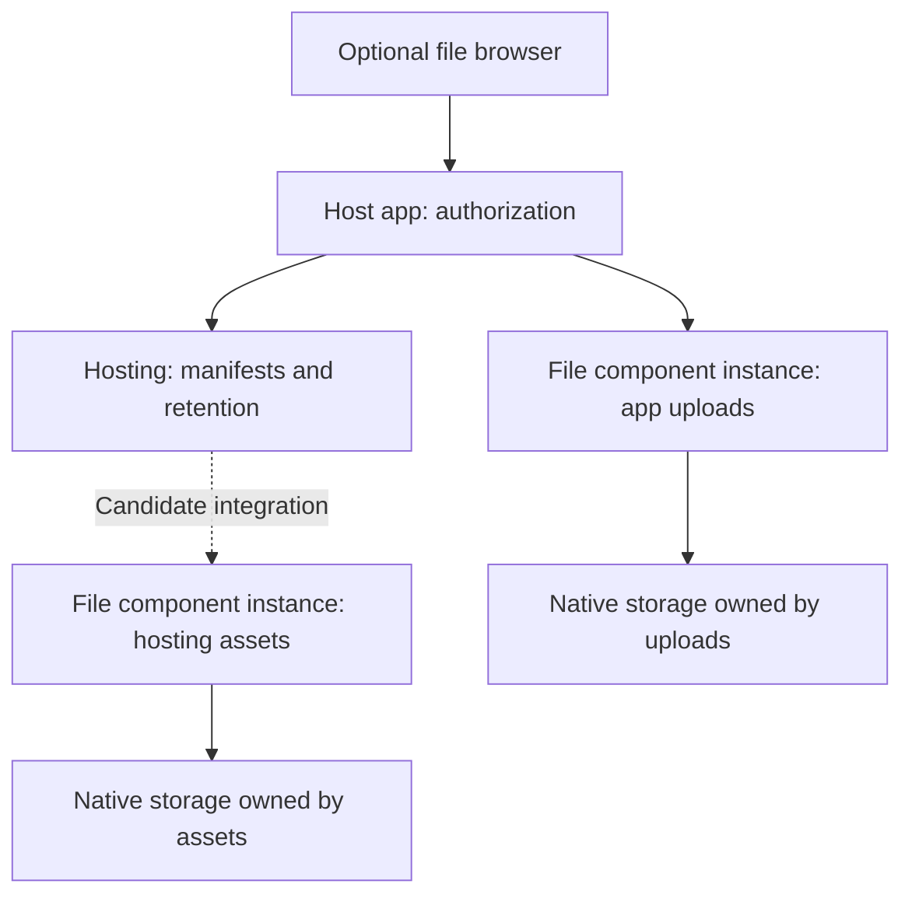

# Named file storage and component file browsers

Date: 2026-10-12

Status: Research complete. This note records evidence and a recommendation, not an accepted
implementation plan.

## Idea

Add a thin Convex component that associates stored blobs with file names and paths. Keep the file
bytes in Convex storage. Give applications and other components a common way to describe and find
files, instead of each component creating its own file metadata tables.

Provide a small file browser with folders, file details, and previews. The browser could ship with
the component and use Convex hosting. This could establish a pattern for components to supply a
useful management UI beside the general Convex dashboard.

The first possible consumers are `@samebase/convex-hosting` and application uploads. Hosting could
use the file component for shared file metadata while retaining its own deployment behavior.

## Main concern

An opaque storage ID does not explain what a blob meant. If application metadata is damaged or lost,
an operator can have file bytes without a useful name, path, or connection to the original record. A
folder browser improves inspection, but the research must determine what preserves that meaning
during backup, export, and recovery.

## Questions to investigate

- Which Convex components already add paths, file names, or a file browser to native file storage?
- What does native Convex storage preserve, and what can backups and exports recover?
- Which parts of the hosting file model are general, and which belong to deployments and serving?
- Can hosting and applications share a file component without losing component isolation or
  transaction guarantees?
- Can a component include a management UI with a small, explicit authentication boundary?
- What is the smallest useful standard, and what evidence would justify a new component?

## Recommendation

The idea is useful. Start with a bounded evaluation of Files Control in native Convex mode before
creating another storage component. Its source already has indexed `virtualPath` values, exact path
lookup, and path moves. The evaluation must resolve two source-level correctness gaps: atomic path
uniqueness and verified native upload registration. The likely additional work is a folder browser,
a consistent export format, and recovery checks.

Keep three requirements separate:

1. A common file registry makes files easier to find and reuse.
2. A file browser makes that registry easier to inspect.
3. A complete backup and a retained name-to-blob mapping make files recoverable.

A component that adds a naming table satisfies the first requirement. It does not, by itself,
preserve names when its own table is lost. This is the main limit to resolve before calling the
result a safer storage standard.

Do not migrate hosting first. Prove the file contract with application uploads, then evaluate
hosting as a second consumer. Hosting already has path metadata and stricter publication and
retention rules.

## What native Convex storage preserves

The documented `_storage` fields are `_id`, `_creationTime`, `sha256`, `size`, and optional
`contentType`. There is no documented filename, path, or arbitrary metadata field. The storage API
accepts a `Blob` and an optional checksum. Its current dashboard lists storage IDs and technical
metadata, rather than application names or folders.

Sources: [storage metadata](https://docs.convex.dev/file-storage/file-metadata),
[storage API](https://github.com/get-convex/convex-js/blob/main/src/server/storage.ts#L256), and
[dashboard file row](https://github.com/get-convex/convex-backend/blob/5a633b42800113d393f0db162f8fc67f5bf01e14/npm-packages/dashboard-common/src/features/files/components/FileStorageListItem.tsx#L94).

R2 stores a caller-selected object key such as `images/photo.png`. Its folders are a view of key
prefixes. They are not separate directory resources. That is a useful model for a thin Convex
registry: one path per file, with folders derived from prefixes.

Source:
[R2 objects and prefixes](https://developers.cloudflare.com/r2/objects/#prefixes-and-folders).

There is an important difference. The R2 key belongs to the stored object. A Convex component would
keep its path in a separate table. It cannot add an intrinsic path field to the native blob with the
current public storage API.

Download names are also separate from stored names. An HTTP action can read the file and return
`Content-Disposition` from the naming table. That changes the download response, not the native
storage metadata. Direct storage URLs permit access to anyone with the URL.

Source:
[serve files through HTTP actions](https://docs.convex.dev/file-storage/serve-files#serving-files-from-http-actions).

## Existing work

This comparison covers primary documentation and source inspected on 2026-10-12. It is not a
complete audit of every Convex package.

| Project                                                                 | Relevant capability                                                                                             | Fit for this idea                                                                                                              |
| ----------------------------------------------------------------------- | --------------------------------------------------------------------------------------------------------------- | ------------------------------------------------------------------------------------------------------------------------------ |
| [Files Control](https://github.com/gilhrpenner/convex-files-control)    | Native Convex or R2 uploads, indexed `virtualPath`, exact path lookup, path moves, access controls, and cleanup | Best starting point for a thin native file registry. The inspected API does not provide a folder browser or recovery manifest. |
| [Convex Filesystem](https://github.com/ozanturksever/convex-filesystem) | Native file storage, named files, folders, versions, trash, and a React file manager                            | Closest complete UI. Its broader data model and UI integration add cost for a small shared component.                          |
| [ConvexFS](https://convexfs.dev/)                                       | Paths, file operations, CDN delivery, delayed deletion, and recovery tools                                      | Useful design reference. Bytes live in Bunny storage.                                                                          |
| [Convex R2](https://github.com/get-convex/r2)                           | Object keys, upload hooks, metadata sync, and pagination                                                        | Fits named object storage when R2 is the chosen provider. It does not provide native Convex storage.                           |
| [Samebase Convex Hosting](https://github.com/samebase/convex-hosting)   | Paths, native storage, deployment manifests, publication, and retention                                         | An existing consumer with a specialized file model. It should retain its deployment policy.                                    |

### Files Control is closer than its README suggests

The inspected commit is
[`54c6c047`](https://github.com/gilhrpenner/convex-files-control/commit/54c6c047b4a085f0d03f7ff8841316a1d0f85bab).
Its changelog records version 0.5.9 on 2026-09-23. The source provides:

- A `virtualPath` field beside `storageId`, with an index for path lookup.
- Component-owned native upload URLs.
- Client upload methods that accept `virtualPath`, and `getFileByVirtualPath` with an optional
  authorization hook.
- Native path moves that update metadata without copying the blob.

Sources:
[schema](https://github.com/gilhrpenner/convex-files-control/blob/54c6c047b4a085f0d03f7ff8841316a1d0f85bab/src/component/schema.ts#L5),
[upload ownership](https://github.com/gilhrpenner/convex-files-control/blob/54c6c047b4a085f0d03f7ff8841316a1d0f85bab/src/component/upload.ts#L37),
[client API](https://github.com/gilhrpenner/convex-files-control/blob/54c6c047b4a085f0d03f7ff8841316a1d0f85bab/src/client/index.ts#L1048),
and
[path moves](https://github.com/gilhrpenner/convex-files-control/blob/54c6c047b4a085f0d03f7ff8841316a1d0f85bab/src/component/transfer.ts#L173).

The reviewed schema and modules did not expose a directory-listing contract, metadata history,
manifest export, or reconstruction API. These are specific evaluation gaps, not a claim that the
package cannot support them.

Two source findings need resolution before adoption:

- The move action checks the target path before calling a separate mutation that updates the row.
  Concurrent moves of different files can therefore assign the same path. Check and update must
  happen in one mutation.
- Native upload registration skips the storage lookup when the caller supplies metadata. That
  metadata then satisfies the existence check. Registration must verify that the bytes exist in the
  component's storage, even when metadata is supplied.

These findings come from source review, not a runtime reproduction. Host authorization also needs
verification for the chosen integration.

Sources:
[move check and update](https://github.com/gilhrpenner/convex-files-control/blob/54c6c047b4a085f0d03f7ff8841316a1d0f85bab/src/component/transfer.ts#L157)
and
[native registration](https://github.com/gilhrpenner/convex-files-control/blob/54c6c047b4a085f0d03f7ff8841316a1d0f85bab/src/component/upload.ts#L240).

### Convex Filesystem is a broader product

The inspected `@fatagnus/convex-filesystem` version is 0.1.0 at
[`8ecf3e2`](https://github.com/ozanturksever/convex-filesystem/commit/8ecf3e2b70ec9947b1357eee7f318617454a4ab9),
dated 2026-01-26. Ordinary file operations can run without Drive or search calls. However, the
mounted schema contains seven tables and an embedding index. The package has a required agent peer
dependency.

Its file API requires organization and user IDs plus file metadata. The host must validate those
values. The supplied React integration uses package-specific API references and a Mantine app shell
with sharing controls. It is a useful browser reference, but not a direct fit for Samebase's small
UI and host-owned authorization.

Sources:
[file operations](https://github.com/ozanturksever/convex-filesystem/blob/8ecf3e2b70ec9947b1357eee7f318617454a4ab9/convex/files.ts#L25),
[package dependencies](https://github.com/ozanturksever/convex-filesystem/blob/8ecf3e2b70ec9947b1357eee7f318617454a4ab9/package.json#L48),
and
[project source](https://github.com/ozanturksever/convex-filesystem/tree/8ecf3e2b70ec9947b1357eee7f318617454a4ab9).

## Recovery is part of the file contract

Convex can export component tables and file storage together. File bytes are optional, so use
`--include-file-storage` for a complete portable backup. Exported blobs use storage IDs as
filenames, with an optional extension from the content type. A naming table is still needed to
recover the original path.

Backup ZIP imports preserve document IDs, and the file importer also restores storage IDs. Restore
behavior and archive layout must be tested for the chosen component tree. This research did not run
a live export and restore.

Sources: [backup and restore](https://docs.convex.dev/database/backup-restore),
[backup ZIP import](https://docs.convex.dev/database/import-export/import#restore-data-from-a-backup-zip-file),
[component export](https://github.com/get-convex/convex-backend/blob/5a633b42800113d393f0db162f8fc67f5bf01e14/crates/exports/src/lib.rs#L355),
and
[storage export format](https://github.com/get-convex/convex-backend/blob/5a633b42800113d393f0db162f8fc67f5bf01e14/crates/exports/src/export_storage.rs#L114).

The proposed file contract should include a versioned manifest with the owner or component instance,
logical file ID, path, storage ID, checksum, size, and content type. An offline export should place
the bytes under readable paths and retain that manifest. A prior export must remain available
outside the live naming table.

This permits an operator to inspect files without the app and to check whether each manifest entry
has the expected bytes. It does not promise that names can be inferred from unidentified blobs. If
all copies of the mapping are gone, a hash can match a known file but cannot recover its former
name. That conclusion follows from the native metadata and archive format.

ConvexFS illustrates the same limit. Its orphan recovery tool can reconnect retained bytes, but the
operator must supply both the blob ID and the lost path.

Source: [ConvexFS recovery tools](https://convexfs.dev/guides/admin-tools/).

## A small shared contract

Evaluate these capabilities before choosing the package:

- A stable logical file ID, independent of the path.
- A path that is unique within one owner or namespace. Derive the filename from the final segment.
- Explicit duplicate-path, rename, replacement, and deletion behavior.
- Upload completion that verifies the stored blob before registering it.
- Exact lookup and paginated prefix listing for a folder view.
- Metadata and download access through host-authorized functions.
- Export and restore of the mapping and bytes.

Use native `_storage` metadata where possible. Do not create a second mutable source for size, hash,
or content type merely to render the browser. Export those values when an offline manifest needs
them.

The first version does not need a POSIX filesystem, empty directories, symlinks, a search service,
Drive sync, or a general permissions system. Application ownership and authorization belong to the
host. Define case and path normalization rules before data enters the registry.

## Hosting can reuse the contract without giving up deployment rules

Samebase hosting already stores `path`, storage references, content type, and deployment identity.
It has separate state for staged, live, and retained assets. Its path lookup, SPA fallback, cache
rules, publication, and cleanup serve deployment-specific requirements.

Sources at the inspected clean hosting commit
[`9978f58`](https://github.com/samebase/convex-hosting/commit/9978f58b59b1580187b352810c78016ad22fc93e):
[schema](https://github.com/samebase/convex-hosting/blob/9978f58b59b1580187b352810c78016ad22fc93e/packages/convex-hosting/src/component/schema.ts#L5),
[lookup](https://github.com/samebase/convex-hosting/blob/9978f58b59b1580187b352810c78016ad22fc93e/packages/convex-hosting/src/component/lib.ts#L64),
and
[cache policy](https://github.com/samebase/convex-hosting/blob/9978f58b59b1580187b352810c78016ad22fc93e/packages/convex-hosting/src/component/serving.ts#L126).

A shared registry can own file identity, paths, and storage operations. Hosting must still own its
deployment manifests, atomic publication, and retention decisions. A generic file delete must not
remove bytes that a live, staged, or retained deployment still references. Sharing the component
does not remove the need for hosting's path-to-release mapping.

Use separate component instances for hosting assets and application uploads. Reuse the same contract
and browser, without sharing deletion authority between unrelated owners.

Convex isolates each component's tables and file storage. Nested mutation calls commit with their
caller, so a child file component can participate in atomic publication. Moving publication into
separate action calls would lose that guarantee.

Source:
[component isolation and transactions](https://docs.convex.dev/components/understanding#isolation).

An existing storage ID does not transfer a blob to another component. Normal API migration needs the
original owner's read API, or a copy into the new owner with updated references. An administrative
archive import is another migration path to test. It is not an ordinary attach operation.

Sources:
[storage namespace lookup](https://github.com/get-convex/convex-backend/blob/5a633b42800113d393f0db162f8fc67f5bf01e14/crates/model/src/file_storage/mod.rs#L244)
and
[hosting's existing storage migration boundary](https://github.com/samebase/convex-hosting/blob/9978f58b59b1580187b352810c78016ad22fc93e/packages/convex-hosting/src/component/lib.ts#L162).

There is also a serving cost to measure. Hosting currently reads component-owned bytes directly. A
child owner can require a different retrieval path. Additional records and component calls also
consume publication transaction limits. Check these costs before an extraction.

Sources:
[direct serving](https://github.com/samebase/convex-hosting/blob/9978f58b59b1580187b352810c78016ad22fc93e/packages/convex-hosting/src/component/http.ts#L48)
and
[publication limits](https://github.com/samebase/convex-hosting/blob/9978f58b59b1580187b352810c78016ad22fc93e/packages/convex-hosting/src/component/lib.ts#L698).

## A component can ship its own UI

Package the browser as an optional frontend module. Mount it on a host-app admin route, with
functions that check the current user's access before calling the component. This lets the same
browser inspect several component instances through an explicit host adapter.

Convex components do not inherit `ctx.auth`. A component-specific UI still needs a host-owned
authentication boundary. Do not place a deployment admin key in the browser. A first browser can
provide folder navigation, metadata, previews, downloads, and manifest export. Writes can follow
after the file lifecycle is proven.

Sources:
[component authentication](https://docs.convex.dev/components/authoring#authentication-via-ctxauth)
and [component HTTP routes](https://docs.convex.dev/components/using#http-routes).

There are precedents for optional component UIs. Agent Playground supplies a separate management UI
with explicit API exposure. Convex Feedback separates its backend from its UI package. The reviewed
documentation did not show an extension mechanism for adding a custom tab inside the hosted Convex
dashboard.

Sources: [Agent Playground](https://docs.convex.dev/agents/playground) and
[Convex Feedback](https://www.convex.dev/components/convex-feedback).

Convex hosting can serve a built admin UI. Keep the file backend independent of the hosting package,
because hosting may later depend on the file backend. The UI and its host integration can use both.

## Suggested next research step

Run a small Files Control evaluation with native storage and a host-owned file browser. Check:

1. Two owners can use the same relative path without sharing access or deletion authority.
2. Upload registration rejects missing or foreign storage IDs, including when metadata is supplied.
3. Rename and replacement enforce path uniqueness inside one mutation under concurrent requests.
4. Prefix listing is paginated and does not scan every file.
5. A named export remains understandable without Convex or the original application.
6. A fresh deployment can restore a full backup with paths, bytes, hashes, and references intact.
7. A missing live naming table can be recovered from a retained mapping.

If Files Control can support this contract with small changes, contribute those changes or build a
thin integration around it. Create a new native component only if the evaluation finds a concrete
ownership, lifecycle, or recovery conflict that cannot fit its API.

Then test a hosting integration against its existing publication, retry, retention, and serving
contracts. Do not make a production hosting migration part of the initial file-browser experiment.

## Research record

Three read-only research lanes covered existing packages, hosting boundaries, and Convex recovery
and component UIs. The findings above combine those source checks. No new component, UI, storage
migration, provider change, or restore experiment was implemented for this note.
