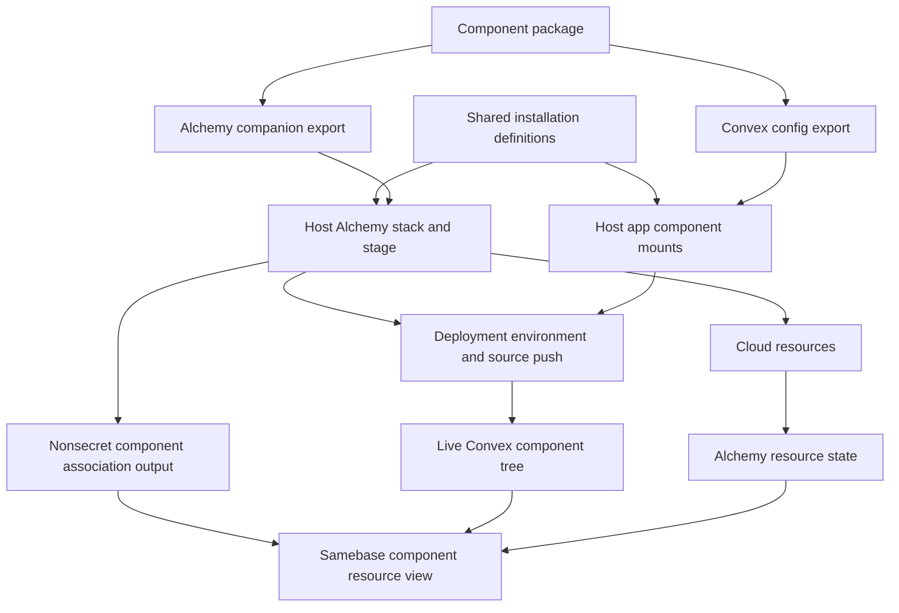

# Convex components with Alchemy resources

Date: 2026-10-22. Updated: 2026-10-23. Status: research, not an accepted implementation contract.

The [follow-up experiments](2026-10-23-component-binding-experiments.md#decision) test three
concrete bindings with a Worker-backed component. They replace the original R2-first pilot
recommendation.

## Recommendation

A Convex component package can include its own infrastructure definition. Declare each installation
once and use that declaration to create its Convex mount and Alchemy resources. Behind this
integration, keep separate exports for Convex config and deployment code. Run the Alchemy code
inside the app's existing stack, under a stable namespace.

Samebase should display the resulting resources under a specific mounted component. To do this, the
deployment must record an explicit association between the Convex deployment, full component path,
and Alchemy resource names. Runtime component inspection supplies the component tree, but it does
not supply this association.

The package pattern already exists in our email component. The new work is to make its instance
wiring reusable and define the record that connects deployment state to Samebase's component view.
Call the package export a **component infrastructure definition** or **Alchemy companion**. It is
part of the host stack unless it has a separate deployment and lifecycle.

Start with a Worker-backed component that calls the Worker and stores its result. This tests the
connection between an installed component and its compute dependency directly. Repeated mounts and
R2 retention are separate cases. The email case adds Worker/Convex deployment ordering and zone-wide
routing effects.

## Refinement: make the installation the authoring unit

The separate `/alchemy` export is a suitable execution boundary. On its own, it is an incomplete
authoring interface: an app author must configure a Convex mount, call a companion, and manually
keep their names and environment mappings aligned. This becomes more fragile with repeated or nested
mounts.

The preferred interface is one declaration for each installed instance. A small integration reads
that same declaration in two environments:

- The Convex adapter imports the actual component definition and calls `app.use` with its mount
  name, environment references, and HTTP prefix where supported.
- The Alchemy adapter imports the infrastructure implementation, creates its resources, supplies the
  matching environment values, and emits the association record.

For example, two installations of an email package, `sales` and `support`, each produce a Convex
mount and their own resource group. The package provides the wiring rules. The host provides real
choices such as provider account, route, and whether an existing resource is shared. The host should
not have to repeat an instance's identity or write the display association by hand.

The shared installation module must remain plain configuration and metadata. It must not import the
actual `convex.config` modules or Alchemy implementations. Each environment imports its own adapter.
A small, explicit adapter for the pilot package is enough to test this; do not build an automatic
package catalog or whole-app generator first. Convex still needs statically discoverable component
imports in its config path.

This is a proposed integration, not an existing Convex API. The actual `app.use` result exposes
component function exports. Its name and definition fields are internal, and it has no public full
mount path, infrastructure handle, or serialization contract. A normal Node import of a config that
mounts components fails because `app.use` expects Convex's synthetic `componentDefinitionPath`. Do
not attach a fake `.resources()` method to that object or read its internal fields as a public
contract.
[Installed component API](https://github.com/get-convex/convex-js/blob/47e2b21fd3b29eb3355163e18c089c5ebe77fe12/src/server/components/index.ts#L352),
[config runtime requirement](https://github.com/get-convex/convex-js/blob/47e2b21fd3b29eb3355163e18c089c5ebe77fe12/src/server/components/index.ts#L425).

The integration can return its own installation handle for authoring. That handle describes the same
intended installation in both processes; it is not the live Convex runtime object. Keep its stable
infrastructure ID distinct from the component mount path so a path rename need not replace cloud
resources.

For nested installations, the parent contributes the child's definition and relative path. Mounting
the parent twice expands two separate child paths, such as `sales/mail` and `support/mail`. Opaque
third-party child mounts do not automatically acquire infrastructure support. Their package needs to
participate in the convention, or the host must provide an explicit adapter.

If ordinary `app.use` must be the sole authoritative declaration, another option is to collect
Convex's analyzed component graph and resolve each definition to a companion. That uses an internal
deployment protocol and still needs a package-to-companion convention. Prefer the shared
installation declaration for the first prototype; an upstream metadata/export hook would be the
better long-term route for transparent support of ordinary Convex configs.

## Evidence and scope

The review used Samebase commit `670b871f59de6f1db53af1b3f4b6f5352990b1f0`, installed dependencies,
current official Convex documentation, pinned upstream source, and an offline Alchemy experiment. No
cloud resources were created or changed. No production data or credentials were read.

| Package                                   | Version checked                               | Relevant result                                                                     |
| ----------------------------------------- | --------------------------------------------- | ----------------------------------------------------------------------------------- |
| `convex`                                  | Installed 1.46.0; current upstream/npm 1.47.0 | Installed version supports typed component environment bindings.                    |
| `alchemy`                                 | 2.0.0-beta.83                                 | Namespaces, resource FQNs, output persistence, rename and removal behavior checked. |
| `@samebase/alchemy-convex`                | 0.8.0                                         | Deployment owns environment setup and source push.                                  |
| `@samebase/convex-cloudflare-email-inbox` | 0.3.0                                         | Already exports `/alchemy`; expects older Alchemy/provider versions.                |
| `@convex-dev/r2`                          | Upstream/npm 0.10.4                           | Expects existing bucket configuration; no Alchemy companion.                        |

The proposed output format below is a Samebase convention. Neither Convex nor Alchemy currently
defines it as a public interoperability standard.

Current Alchemy main still declares beta.83 but has unreleased source changes. The inspected
namespace API is unchanged. This report uses the installed beta's `alchemy/...` imports and
behavior, not newer README examples that use separate provider packages.
[Alchemy source revision](https://github.com/alchemy-run/alchemy/tree/c7ce2bbf2cbe726fe40699a77c68e356c13fa316).

## What already works

### A component package can contain both definitions

The email package publishes `./convex.config.js` and `./alchemy`. Its `EmailInbox(id, props)` helper
uses `Namespace.push`, creates a bridge secret and a Worker, and writes the Worker URL and secret
into Convex. The Worker program declares an R2 bucket. This proves that deployment code and runtime
component code can be shipped together with separate entrypoints.
[Email helper](https://github.com/samebase/convex-cloudflare-email-inbox/blob/d6ccf8475db951cd829eeaa5222694521a1df01f/packages/convex-cloudflare-email-inbox/src/alchemy.ts#L48),
[Worker storage](https://github.com/samebase/convex-cloudflare-email-inbox/blob/d6ccf8475db951cd829eeaa5222694521a1df01f/packages/convex-cloudflare-email-inbox/src/worker/entry.ts#L19).

Its current helper is a precedent, not a ready implementation of the proposed contract:

- It expects `@samebase/alchemy-convex` 0.2.0 and calls `Convex.EnvironmentVariable`, which provider
  0.8.0 no longer exports. Version 0.8.0 manages these values through `Deployment.env`.
- It writes fixed root variables, `MAIL_WORKER_URL` and `MAIL_BRIDGE_SECRET`. Two helper calls would
  contend for those values even with separate Alchemy namespaces.
- Its receiving code uses fixed ingress routes. Each instance needs a distinct route, used by both
  the app and its Worker.
- It changes a zone's email catch-all. Separate Worker names do not isolate production routing from
  a preview.
- It returns only `workerUrl`. That is insufficient to list all associated resources, including the
  bucket declared inside the Worker program.

See the
[package peer versions](https://github.com/samebase/convex-cloudflare-email-inbox/blob/d6ccf8475db951cd829eeaa5222694521a1df01f/packages/convex-cloudflare-email-inbox/package.json#L83),
[receiving routes](https://github.com/samebase/convex-cloudflare-email-inbox/blob/d6ccf8475db951cd829eeaa5222694521a1df01f/packages/convex-cloudflare-email-inbox/src/client/receiving.ts#L71),
and
[current deployment inputs](https://github.com/samebase/alchemy-convex/blob/v0.8.0/src/Deployment.ts#L86).

Samebase currently binds only the email component's sending variables. That does not establish a
fault in its current use. Adding the receiving infrastructure would require explicit bindings for
the additional component variables.

### Alchemy can compose instances within one stack

`Namespace.push(id, effect)` qualifies child resource names. It does not create a separate stack,
state store, or deployment job. The public resource handle exposes its fully qualified name as
`FQN`. A companion can return those exact references for the host's association record.
[Namespace implementation](https://github.com/alchemy-run/alchemy/blob/v2.0.0-beta.83/packages/alchemy/src/Namespace.ts#L1),
[resource handle](https://github.com/alchemy-run/alchemy/blob/v2.0.0-beta.83/packages/alchemy/src/Resource.ts#L91).

An offline experiment registered one inert resource factory twice, then once under a parent
namespace. All provider lifecycle methods were set to fail if called. Stack construction completed
without plan, apply, credentials, or network access:

```text
Stack: OfflineApp    Stage: pr-42
mail/Storage        mail/Worker
support/Storage     support/Worker
billing/mail/Storage billing/mail/Worker
```

All six resources were in one stack resource map. The first instance's output dependency referred to
`mail/Storage`. This verifies namespace composition and output dependency tracking. It does not
verify Cloudflare deployment, Worker expansion, or physical resource naming.

Each installation needs a unique infrastructure ID. In beta.83, registering an existing FQN returns
the first resource, even when the later call supplies different props. Do not rely on Alchemy to
reject two installations that accidentally use the same namespace.
[Duplicate registration behavior](https://github.com/alchemy-run/alchemy/blob/v2.0.0-beta.83/packages/alchemy/src/Resource.ts#L349).

### Convex supports instance-specific configuration

A component definition can be mounted more than once and can mount child components. The public
mount options are `name`, `httpPrefix`, and `env`. Use the full instance path, such as
`notifications/mail`, to distinguish nested instances and repeated leaf names.
[Public component API](https://github.com/get-convex/convex-js/blob/47e2b21fd3b29eb3355163e18c089c5ebe77fe12/src/server/components/index.ts#L163).

Alchemy sets root deployment environment values. The app passes declared references into each
component with `app.use(component, { env: ... })`. A child component can forward its declared values
to its own children. Root values do not automatically become component values.
[Component environment variables](https://docs.convex.dev/components/authoring#environment-variables).

For example, two component instances can both expect a local `BUCKET_NAME` field. The host maps that
field to `MEDIA_BUCKET_NAME` for one instance and `ARCHIVE_BUCKET_NAME` for the other. The companion
produces the values; the host owns the mapping and writes them through `Deployment.env`. Runtime
credentials need the same isolation, with the minimum access needed by each instance.

For the official R2 component, follow its actual API: its host-side client accepts bucket
configuration and credentials. It does not currently declare typed component environment fields. One
mounted R2 component can serve several buckets through separate configured clients. Therefore, one
component must not be assumed to mean one bucket.
[R2 multiple-bucket support](https://github.com/get-convex/r2/blob/ad163baa7a6649a5a331777105e334233a3d91e3/README.md#L101),
[R2 component definition](https://github.com/get-convex/r2/blob/ad163baa7a6649a5a331777105e334233a3d91e3/src/component/convex.config.ts#L1).

## What introspection cannot discover

Samebase already reads each component's ID, full path, active/unmounted state, functions, tables,
and crons. The system component-list API returns no npm package name, package version, or Alchemy
entrypoint. Module `sourcePackageId` values are internal identifiers, not npm package identities.
[Samebase inspection](https://github.com/samebase/samebase/blob/670b871f59de6f1db53af1b3f4b6f5352990b1f0/apps/samebase/convex/repository/convexComponents.ts#L61),
[current Convex component list](https://github.com/get-convex/convex-backend/blob/944a6b40659b14b31649335ebbb5d728c96dece4/npm-packages/system-udfs/convex/_system/frontend/components.ts#L31).

Convex deployment analysis has a `definitionPath`, but it is a source location. It is not a stable
package identifier or an infrastructure declaration. A deployment process with the source checkout
and lockfile could resolve more information. The current runtime observer cannot reconstruct this
reliably.
[Deployment analysis shape](https://github.com/get-convex/convex-js/blob/47e2b21fd3b29eb3355163e18c089c5ebe77fe12/src/cli/lib/deployApi/checkedComponent.ts#L48).

Do not run Alchemy inside `convex.config.ts`. Convex evaluates that file in a restricted backend
environment, rejects asynchronous operations, and requires one default export. Imported child
definitions become synthetic modules. Custom properties attached to the original object do not
provide a supported metadata extension. There is no public component provision/update/destroy hook.
[Config imports and execution restrictions](https://github.com/get-convex/convex-backend/blob/944a6b40659b14b31649335ebbb5d728c96dece4/crates/isolate/src/environment/component_definitions.rs#L589).

The answer to automatic discovery is therefore: **record the relationship during deployment, then
discover that record during inspection**. A future package descriptor could help an installer find
the companion before deployment. It would still need explicit instance configuration and would not
replace the deployed association record.

## Proposed deployment and discovery flow



1. The deployment adapter reads the shared installation declaration and calls the package's
   companion with its stable infrastructure ID. The companion declares resources in that namespace
   and returns their references plus the runtime configuration the app needs.
2. The same installation declaration supplies the full mount path. A package can be mounted under
   any parent; it cannot infer this path from its own package/default name. The adapter keeps this
   mapping out of manual per-instance configuration.
3. The host deploys resources and Convex with explicit dependencies. It returns an allowlisted
   association record as part of the stack output.
4. Samebase reads that output from the existing team Alchemy state project. It validates the record
   and joins it to the inspected deployment's component tree and resource rows.
5. The component view displays matching resources with their existing type presentation, such as the
   orange R2 icon. The repository resource inventory remains available.

The host remains responsible for provider credentials, account selection, stage policy, and shared
resources. A package declares its requirements; installing it does not itself run cloud
provisioning. Samebase does not import or execute package code during inspection.

## Proposed association record

Use a versioned key in ordinary stack output, next to the existing `samebase.run` record. The name
and shape below are a proposal. Example values are illustrative:

```json
{
  "samebase.components": {
    "version": 1,
    "bindings": [
      {
        "deployment": {
          "fqn": "Site",
          "projectId": 123,
          "name": "example-deployment-123"
        },
        "componentPath": "media",
        "resources": [{ "fqn": "Media/Storage", "type": "Cloudflare.R2.Bucket" }]
      }
    ]
  }
}
```

The enclosing state record already supplies stack and stage. `deployment.fqn` comes from the
deployment handle; `projectId` and `name` come from its resolved attributes. Resource FQNs come from
actual handles or verified expanded declarations, not strings derived from UI labels or folders. The
output contains no environment values, secrets, deploy keys, or raw resource props.

Samebase should require the following matches before grouping a resource under a live component:

- The stack run belongs to the current repository and authorized team.
- The deployment resource has type `Convex.Deployment` and the recorded project/deployment identity.
- The inspection target is that deployment, and its full component path matches exactly.
- Each referenced resource exists in the same stack/stage with the recorded type.

The deployment name matters. A logical `Site` resource can later point at a different physical
deployment. The provider can also recover a preview or a changed default production deployment
without a new logical resource name.
[Deployment target attributes](https://github.com/samebase/alchemy-convex/blob/v0.8.0/src/Deployment.ts#L121),
[target refresh behavior](https://github.com/samebase/alchemy-convex/blob/v0.8.0/src/Deployment.ts#L591).

Missing or mismatched records leave resources at stack level. An unmounted component must retain its
unmounted state in the view; an association does not imply that the component is active. Unknown
record versions do not trigger provider writes or resource removal.

### Freshness is part of the contract

Alchemy updates resource rows during an apply. It writes the stack output only after a full apply
succeeds. Selected-resource applies do not update that output. Thus a failed or partial run can
leave newer resource rows beside an older association record.
[Apply and output persistence](https://github.com/alchemy-run/alchemy/blob/v2.0.0-beta.83/packages/alchemy/src/Apply.ts#L241).

Display the association as recorded by the last successful full deployment, using the existing
`samebase.run` commit and time. Even a matching resource FQN and type does not prove that its
current physical generation came from that run. The pilot must not describe the join as an atomic
live snapshot. A stronger guarantee would need resource-generation/run information from the state
store.

Alchemy stores an `instanceId` for replacement generations, but the public resource handle does not
expose it. Adding that field alone would also not replace the resolved Convex target check. Keep
this stronger protocol out of the first display pilot.
[Resource state generation](https://github.com/alchemy-run/alchemy/blob/v2.0.0-beta.83/packages/alchemy/src/State/ResourceState.ts#L42).

## Deployment order and lifecycle

### One-way dependencies and bidirectional Worker wiring

An R2-only flow can have a one-way dependency: create the bucket and runtime access configuration,
set Convex environment values, then push the component. Provider 0.8.0 explicitly applies
`Deployment.env` before its source push.
[Environment and push inputs](https://github.com/samebase/alchemy-convex/blob/v0.8.0/src/Deployment.ts#L95).

The email flow has two directions: the Worker needs the Convex site URL, while the Convex component
needs the Worker URL and bridge secret. If both are inputs to resources that wait for each other,
the graph has a cycle. Changing namespaces or splitting files does not resolve it.

Alchemy has a mechanism that may resolve this specific cycle. Its Worker provider can publish a
stable URL during `precreate`, before full deployment. The planner can use that early output to
release dependent resources. Standard workers.dev or resolved custom-domain URLs are supported by
this path; version and preview URLs can remain unresolved. This does not establish that every
Worker/Convex cycle works.
[Worker early URL output](https://github.com/alchemy-run/alchemy/blob/v2.0.0-beta.83/packages/alchemy/src/Cloudflare/Workers/WorkerProvider.ts#L4964),
[cycle planning](https://github.com/alchemy-run/alchemy/blob/v2.0.0-beta.83/packages/alchemy/src/Plan.ts#L1978).

The current email helper uses the older separate environment-resource API. It cannot be copied
unchanged onto provider 0.8.0. First test the supported early-URL/circular-binding pattern with this
exact provider pair on a fresh deployment. This may avoid a provider change. The existing email
example starts from an existing production URL and does not prove that fresh-deployment sequence. Do
not hide a failed bootstrap by making required configuration permanently optional.
[Existing email stack](https://github.com/samebase/convex-cloudflare-email-inbox/blob/d6ccf8475db951cd829eeaa5222694521a1df01f/apps/mail/alchemy.run.ts#L50),
[Alchemy circular bindings](https://alchemy.run/infrastructure-as-effects/circular-bindings/).

### Association does not control deletion

Alchemy declarations and removal policies continue to control cloud resource lifecycle. Removing a
component mount from Convex config alone must not silently delete an external bucket. Removing the
companion from the host stack is a separate infrastructure change.

Use these rules for the pilot:

| Change                                | Required behavior                                                                                         |
| ------------------------------------- | --------------------------------------------------------------------------------------------------------- |
| Mount the same package twice          | Separate namespaces, runtime configuration, and routes where needed.                                      |
| Mount a child component               | Record its complete parent/child path; parent and child resource sets can differ.                         |
| Rename only a component mount         | Keep infrastructure IDs stable; update the association. Convex data migration remains a separate concern. |
| Rename an infrastructure ID           | Use Alchemy's explicit `renamedFrom` migration and inspect the plan for replacement.                      |
| Share a bucket or route               | Keep it app-owned in the first pilot. A consumer relationship is not a second lifecycle owner.            |
| Remove a component with retained data | Transfer the resource to an app-owned declaration if it must remain managed.                              |
| Deploy a preview                      | Use isolated cloud targets and explicit cleanup policy. Do not change production zone routing.            |

Alchemy `retain` preserves the physical cloud object but removes its state row when the declaration
is removed. A retained bucket can therefore disappear from the managed inventory. This is why
retained-data handoff needs an explicit declaration; a retained object is not automatically a
managed object.
[Removal policy](https://github.com/alchemy-run/alchemy/blob/v2.0.0-beta.83/packages/alchemy/src/RemovalPolicy.ts#L4),
[rename support](https://github.com/alchemy-run/alchemy/blob/v2.0.0-beta.83/packages/alchemy/src/Resource.ts#L146).

Do not infer ownership from a Worker binding or namespace prefix. The email Worker declares storage
inside its program, and expanded declarations can include routing resources with wider scope.
Inspect the actual plan and return exact resource references before assigning them.

## Changes needed in Samebase

The existing reader already returns stack output with marked secret values removed, plus the run
record. It does not detect secrets stored as unmarked strings. The first implementation needs a
validated association parser, a join with component observations, and a resource section in the
existing component tree/details view. It does not need a second durable resource database.
[State output transport](https://github.com/samebase/samebase/blob/670b871f59de6f1db53af1b3f4b6f5352990b1f0/apps/samebase/convex/repository/alchemyState.ts#L155).

Current resource placement uses stack/source folders. Keep that fallback for app-level and
unassigned resources. Component association is an additional explicit relationship, not a new
meaning for the Worker build root directory.
[Current placement](https://github.com/samebase/samebase/blob/670b871f59de6f1db53af1b3f4b6f5352990b1f0/apps/samebase/shared/alchemyState.ts#L104).

The current component observer authorizes production deployments. Preview component display would
need a deliberate extension of the same repository/team ownership checks. Also, component inspection
uses a data-view key, while reading Alchemy state uses an internal-query scope. Calling an arbitrary
component `describeInfrastructure` function would change the execution and permission boundary, so
it is unnecessary for this design.
[Production target checks](https://github.com/samebase/samebase/blob/670b871f59de6f1db53af1b3f4b6f5352990b1f0/apps/samebase/convex/repository/convexComponents.ts#L139),
[inspection scopes](https://github.com/samebase/samebase/blob/670b871f59de6f1db53af1b3f4b6f5352990b1f0/apps/samebase/convex/repository/convexDeploymentInspection.ts#L43).

This proposal adds resource relationships. It does not by itself add live subscriptions to another
Convex deployment. The existing observation mechanism can display the first pilot; subscription
transport can be addressed separately without changing resource identity.

## Options assessed

| Approach                                               | Assessment                                                                                                                                     |
| ------------------------------------------------------ | ---------------------------------------------------------------------------------------------------------------------------------------------- |
| Shared installations, companion exports, output record | Recommended. Declares each instance once and uses existing provisioning and state mechanisms.                                                  |
| Separate stack for every component                     | Use only for an independently managed lifecycle. Adds state, deployment order, output references, and cleanup coordination to ordinary mounts. |
| Alchemy inside `convex.config.ts`                      | No supported execution or metadata hook for this.                                                                                              |
| Infer infrastructure from package or component names   | Cannot establish the instance, configured resources, shared uses, or physical deployment.                                                      |
| A runtime component query that reports infrastructure  | Requires a new execution/auth contract and still needs provisioning-time data.                                                                 |
| A package descriptor for automatic installation        | Possible later as an explicit convention. It does not prove what was deployed.                                                                 |

## Follow-up experiments

Three isolated local experiments now test explicit registration, a shared installation declaration,
and discovery from Convex's analyzed graph. Each uses a component action, an HTTP Worker, a
component-owned result table, and a host query. See the
[results and next implementation boundary](2026-10-23-component-binding-experiments.md#results).

These probes establish local runtime connections. They do not establish cloud lifecycle behavior or
the Samebase display contract. A later display test still needs the exact resolved deployment and
resource identities, failed-apply freshness checks, secret-free output, and the existing production
authorization checks. Preview display requires its own authorization extension.
