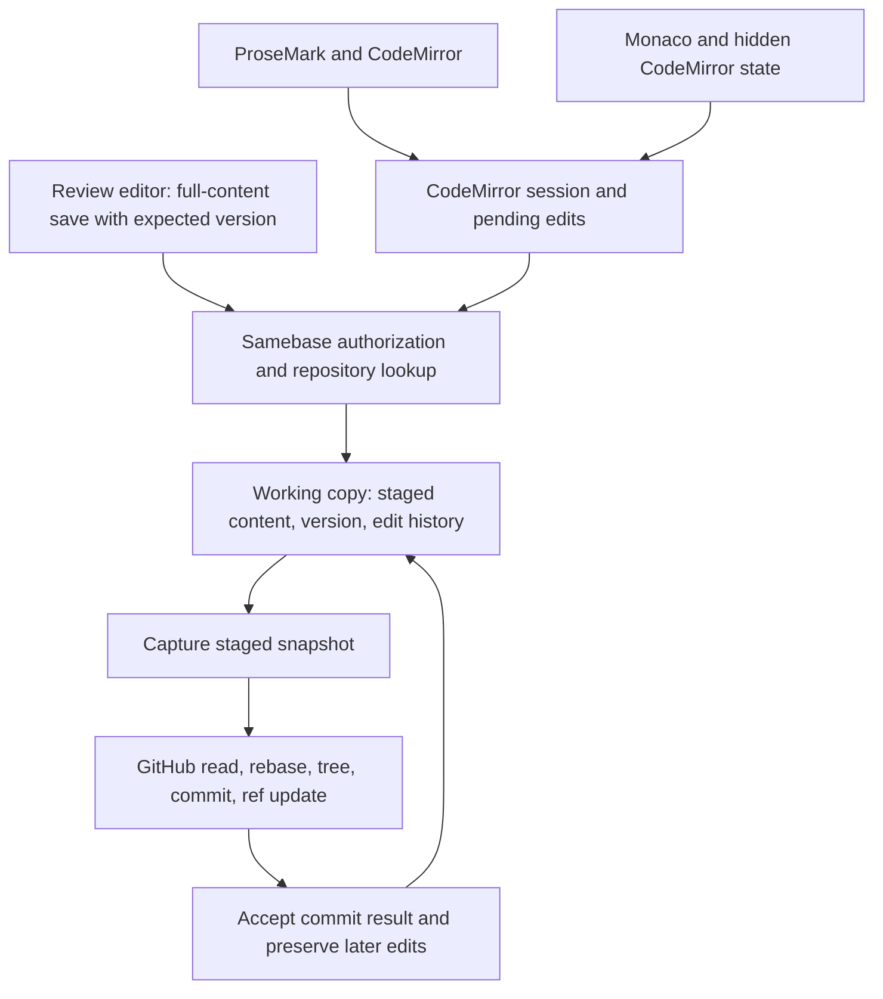

# Collaborative Git editing extraction

Date: 2026-10-26. Status: research and recommendation, not an accepted implementation contract.
Source baseline: `a02af8314f7eb4d6389f1ee83d019c1845d5a09c`.

## Recommendation

Fix the data-safety defects, then create two internal modules: one server document writer and one
shared client sync loop. Keep the current tables during this work.

If reuse in another deployment becomes a firm requirement, extract a **collaborative Git working
copy**. Its owner must control staged files, versions, history and commit acknowledgement. A Convex
component is a good conditional target for that state. Moving only `collaborative.ts` would split
one consistency rule across two owners. Moving the whole file screen would pull most of Samebase
into the package.

Start with an internal boundary. If an independent consumer needs this capability, prove one private
package named `@samebase/git-workspace`. Keep one version for the backend protocol and its editor
bindings. Use separate import paths for the Convex component, React, CodeMirror, and Monaco. Do not
create two release processes yet.

This investigation reproduced a late-open overwrite, a stale-content commit retry and a prose CRLF
sync failure. Source review found other gaps in save acknowledgement and document identity. These
rules need to be clear before they become an external API. A file move alone does not solve them.

This is a sound reuse boundary. It is not yet evidence for a separate business. A small independent
consumer should prove that another app can use it without Samebase's organization, billing, route,
and deployment model. Keep that proof separate from a public release or license change.

## What exists now

The synchronization protocol is CodeMirror operational transformation (OT). Clients send serialized
`ChangeSet` values. The server accepts a batch only at the current file version, applies the
changes, and advances that version. Both the prose editor and Monaco use this protocol. Monaco keeps
a CodeMirror state behind its visible model. This is not a Yjs or CRDT system. [B1] [F1] [F2]



`fileStagingActions.ts` has 3,885 lines. The frontend `FileView.tsx` has 2,760 lines. These counts
describe the current code, not the proposed package. Large parts of those files belong to the host
app. The eight backend modules involved in state ownership are listed after the failure map.

| Area              | Current responsibility                                                                                           | Extraction consequence                                                     |
| ----------------- | ---------------------------------------------------------------------------------------------------------------- | -------------------------------------------------------------------------- |
| Staged files      | Initial/current path and text, blob base SHA, version, delete state, last actor, binary metadata. [B2]           | Move the state and its write rules together.                               |
| Edit history      | Repository, branch, path, version, client ID, change JSON, actor, time. [B2]                                     | Tie history to the document instance, not only its path.                   |
| Open              | Read staging, fetch GitHub when absent, fill blob cache, create staging. Opening alone creates a row. [B3] [B22] | Initialization must not replace a row created while the fetch was pending. |
| Edit              | Version check, history insert, content/version update in one mutation. [B1]                                      | Preserve one atomic operation.                                             |
| Full-content save | Review edits and GitHub rebases become OT updates; review saves check `expectedVersion`. [B4]                    | Keep the stale-write check across all edit paths.                          |
| Commit            | Read snapshot, rebase, create Git objects, update ref, refresh caches, conditionally clear staging. [B5]         | Preserve the snapshot contract across the external call.                   |
| Branch/PR         | Copy a snapshot to a new branch, commit, create/recover a draft PR, conditionally clear source rows. [B6]        | Keep PR policy in Samebase. Reuse working-copy operations.                 |
| Pull              | Rebase changed staging, preserve work on deleted branches, update base observations and trees. [B7]              | Do not move the tree cache into the component by accident.                 |
| Binary data       | Staging and observed blob cache can share a host storage ID. Cleanup checks both. [B8]                           | Define both byte and reference ownership before moving this state.         |
| Other readers     | Dashboard summaries, media reads, repository deletion, account deletion. [B9]                                    | The extraction must update these callers, not only editor code.            |
| Frontend session  | Push/pull, pending changes, debounce, unmount flush, page-leave guard. [F1] [F2] [F3]                            | Expose confirmed/unsent state and a real flush result.                     |
| File screen       | Routes, branch tree, upload, rename/delete, comparison, Push/PR controls, sidebars. [F4]                         | Keep the product screen in Samebase.                                       |

There is an unused active-user query based on edits in the last 30 seconds. There is no shared
cursor or awareness protocol in the reviewed editor bindings. The current MCP action catalog has no
file-edit tool. `getDocument`, `getActiveEditors` and `pushSerializedChangeSetUpdate` have no
production callers in the reviewed tree. Check external consumers before deleting public endpoints.
Do not invent a presence service or agent transport to preserve integrations that are not currently
connected. [B10] [B11]

File read/write access is currently staff-only. Making editing available to other users is a
separate product decision. Exact repository and branch isolation is an existing contract. [B12] [D1]

## Options considered

| Option                                                 | Benefit                                                                               | Cost or failure                                                                          | Decision                                                    |
| ------------------------------------------------------ | ------------------------------------------------------------------------------------- | ---------------------------------------------------------------------------------------- | ----------------------------------------------------------- |
| Keep app code as it is                                 | No extraction or data transfer.                                                       | Unclear ownership persists; another app cannot reuse it.                                 | Suitable only if reuse is abandoned.                        |
| Internal module with current tables                    | Proves ownership with small changes and no data transfer.                             | Does not enforce database isolation or make installation possible.                       | First step. Delete direct table access as callers move.     |
| One package with a Convex component and editor exports | One protocol version; real table boundary; backend and browser imports stay separate. | Requires data cutover and packed-consumer checks.                                        | Conditional target after a second consumer proves the need. |
| Separate backend and React packages                    | Independent releases and installation dependencies.                                   | More version combinations and release work with no demonstrated need.                    | Split only after an actual consumer needs it.               |
| Move the complete GitHub editor screen                 | Fast apparent extraction.                                                             | Host routes, policy, UI, credentials and caches become package configuration.            | Reject.                                                     |
| Replace OT with Yjs or ProseMirror sync                | Different collaboration capabilities.                                                 | Protocol, data and editor migration, unrelated to package ownership.                     | Reject for this extraction.                                 |
| Separate hosted editing service                        | Independent service operation.                                                        | New auth, network, persistence and failure boundaries; loses local mutation composition. | No current evidence supports it.                            |

The [official Convex component template][E1] already puts backend helpers and React exports in one
package. Samebase also consumes separate email-inbox backend and UI packages, so the repository has
both patterns. Here, the tightly coupled edit protocol and lack of a separate UI consumer favor one
package. Recheck this choice against installation cost. [P4]

The [ProseMirror sync component][E2] is useful prior art, but it exchanges ProseMirror steps and
document structures. It cannot directly replace this plain-text CodeMirror protocol.

## Proposed ownership

| Owner                                                      | State and behavior                                                                                                                                                                           |
| ---------------------------------------------------------- | -------------------------------------------------------------------------------------------------------------------------------------------------------------------------------------------- |
| Working-copy component                                     | Staged documents, identity, versions, updates, rename/delete/restore, changed-file summaries, commit snapshots and conditional acknowledgement, bounded history/data cleanup.                |
| Samebase public wrappers                                   | Sign-in, staff access, organization membership, billing/resource policy, connected/deleting repository checks, actor and repository identity.                                                |
| Samebase GitHub actions initially                          | Credential selection, remote reads and writes, branch protection errors, PR policy, branch tree/blob observations.                                                                           |
| Reusable package code later, if a second consumer needs it | Concrete GitHub read/rebase/commit helpers with a supplied authorized client. These can be ordinary TypeScript functions. They do not require a second service or a generic provider system. |
| Frontend package exports                                   | OT session, typed Convex function references, CodeMirror binding, Monaco binding, explicit save state.                                                                                       |
| Samebase frontend                                          | Routes, authentication screens, tree navigation, review/Push controls, dashboard, product copy, theme integration, project-file loading.                                                     |

The GitHub adapter being outside the **component runtime** does not mean it must stay outside the
**npm package**. Those are different boundaries. First leave it in Samebase. For an independent
GitHub editing consumer, include the concrete snapshot/rebase/ref-update/acknowledgement helpers in
the package's server path. Do not make every consumer reimplement the most dangerous commit logic.
Authorization and credential selection still belong to the host.

Keep one installed component. Repository and branch identities are runtime data. A component mount
per repository would turn routine app data into deployment configuration.

### Small contract, no framework

The following operations describe responsibilities, not a frozen exported API:

| Operation                          | Required result                                                                       |
| ---------------------------------- | ------------------------------------------------------------------------------------- |
| Open from a base observation       | Return the existing document if another opener already created it.                    |
| Read/pull                          | Return current content/version or the missing updates; detect a retained-history gap. |
| Push changes                       | Validate the document instance and base version; update content and history together. |
| Replace content from review/rebase | Check the expected version and generate the corresponding edit update.                |
| Rename/delete/restore              | Keep document identity and path uniqueness correct; define what active clients see.   |
| Capture a commit snapshot          | Return the exact staged state to send to GitHub.                                      |
| Accept a commit result             | Update bases or remove only the committed state; preserve later edits.                |
| Summarize/remove repository state  | Support current dashboard and deletion callers without direct table access.           |

Use the existing staged document ID as the first candidate for stable session identity. A new row
after discard/reopen already has a new ID. Test whether that is sufficient before adding another
generation counter. Path is a mutable name. Version is an edit position within one document
instance. All related cleanup jobs must identify that same instance.

The host must derive the repository key and actor after authorization. A key sent by a browser is
not permission. The component accepts host-owned identities as opaque strings and validates its own
document identities inside its namespace. Do not build a second organization or permission model.
The component must also check that each document belongs to the host-authorized repository and
branch. Test an actor authorized for repository A submitting a document ID from repository B.

Before Push, flush the initiating editor and wait for its acknowledgement. Then capture server
state. This does not require every connected editor to stop. Edits that arrive after the captured
snapshot must remain staged. A global collaborator barrier or branch lock is not needed for this
contract.

### Conditional binary storage choice

For the first data extraction, keep file bytes and observed blob cache in host storage. Move staged
metadata with the rest of the working copy, and treat its blob reference as an opaque host key. The
component must not call its own storage API with that key. The host owns read/delete operations and
checks both cache references and component references before removal.

This splits byte ownership from reference ownership. Every component operation that removes or
replaces a binary reference must run through a host mutation and return the released keys. This
includes discard, commit acknowledgement, replacement and repository cleanup. The component needs an
indexed reference query across all repositories, not only the current branch. Host code validates
the key in the host storage namespace. Reference removal, surviving-reference checks in both owners,
and `ctx.storage.delete` must run in one host mutation. Separate action calls can race.

Component-scheduled work must not remove binary references without this host cleanup path. Keep that
cleanup scheduled by the host. If this contract becomes awkward, move bytes and all references
together. Do not split text and binary versions into competing staging stores. None of these cross-
component rules is needed for the immediate internal-module work.

## Frontend package shape

If the second-consumer gate opens, use `packages/git-workspace/` in this monorepo and keep it
private during the experiment. This answers the packaging question; it is not a request to scaffold
these directories now:

```text
src/component/       Convex schema and functions
src/client/          server helpers and consumer types
src/react/           session and Convex binding
src/codemirror/      existing prose editor binding
src/monaco/          existing Monaco binding
```

Expose `./convex.config`, `./_generated/component`, `./react`, `./codemirror`, `./monaco`, and
`./test` only as their real consumers appear. The backend entry point must not import React, DOM,
Monaco, TanStack Router, or Samebase generated APIs.

Subpath exports isolate imports, not dependency installation. Use optional peers for editor-specific
dependencies where required. Verify backend-only installation and browser imports from a packed
tarball. Also check that one compatible CodeMirror runtime is resolved: duplicate state packages can
break extension identity. Use the existing Sidebars packed-consumer workflow as the local pattern.
[P1] [E1]

Pass the small typed Convex function-reference surface from the host to the session. Do not add a
transport plugin framework. Leave `useProjectFiles` in Samebase first and supply its file data to
the Monaco binding. Keep tree SHA, repository and branch in cache/model identity. [F5]

Do not move `FileView` or introduce a configurable `RepositoryEditor` shell. Keep app styling
outside the first session extraction. If editor surfaces move later, ship their required CSS
deliberately. Tailwind scanning, theme variables, `corner-notch-1`, SSR client-only loading,
outer-page scrolling, selection, undo and mobile focus are current contracts that need tests. [F6]
[F7]

## Failure map

Evidence labels: **reproduced** means a focused executable probe demonstrated the behavior;
**source** means the relevant control flow is present but its full user flow was not run; **gate**
means a required extraction check, not a claim that the current app is broken.

Immediate priorities are the reproduced C1, G1 and U10 defects, then focused reproductions for U1/U2
and stale-session reuse C3. The remaining rows are the requested full boundary map, not a
requirement to implement every safeguard now. Priority describes the consequence for data integrity
or access, not a measured incident rate. No usage volume was read.

### Content, history and identity

| ID  | Priority and evidence | Failure and required check                                                                                                                                                                                   |
| --- | --------------------- | ------------------------------------------------------------------------------------------------------------------------------------------------------------------------------------------------------------ |
| C1  | High, reproduced      | A delayed `saveToStaging` overwrites newer text without advancing version/history. Make open initialization preserve existing state. Reproduction below. [B3]                                                |
| C2  | High, source          | Rename changes path while history remains indexed by the old path. Run two clients while one renames; old and new names must not address different histories for one document. [B13]                         |
| C3  | High, source          | Discard/commit/reopen starts a new row at version zero, but pushes identify only repository/branch/path/version. Reject old-instance pushes even when the number matches. [B1] [B3]                          |
| C4  | High, source          | Version-based prune jobs can reach a reopened path. Test pruning after reopen. Timestamp-based deletion already protects newer updates; preserve its cutoff and test its boundary and scope. [B14] [B23]     |
| C5  | High, source          | Only 200 recent updates are intended to remain; pull returns an array without a retained-base marker. A client outside that window must preserve unsent edits and receive an explicit recovery result. [B14] |
| C6  | Medium, source        | Pruning is scheduled only when the final batch version is divisible by 50. Batches can skip those numbers indefinitely. Test a sequence that never lands on the boundary. [B1]                               |
| C7  | High, source          | Full-content save rejects binary/deleted rows; direct OT push does not enforce the same checks. Put the invariant in the shared write owner. [B1] [B4]                                                       |
| C8  | Medium, source        | Branch copy can insert snapshots beside unchanged existing target rows. Test copying into a branch with open unchanged files; enforce one document per current path. [B15]                                   |

### Commit and remote state

| ID  | Priority and evidence                       | Failure and required check                                                                                                                                                                                                                                                 |
| --- | ------------------------------------------- | -------------------------------------------------------------------------------------------------------------------------------------------------------------------------------------------------------------------------------------------------------------------------- |
| G1  | High, reproduced with a provider simulation | Rebase occurs before the GitHub ref retry loop. A retry reads a new HEAD but reuses old file content. Rebase against the exact attempted parent, or stop with a conflict. Reproduction below. [B5]                                                                         |
| G2  | High, gate                                  | Ref update succeeds but its response is lost, or finalization fails. Reconcile remote state before retry/cleanup. For draft PR creation, preserve source staging until PR confirmation and check branch HEAD before removing a temporary branch after an ambiguous commit. |
| G3  | High, existing protection                   | Conditional commit cleanup preserves edits made during remote work. Retain it for edits, rename/delete, undo to committed text, and newly staged files. Do not replace it with clear-branch. [B16]                                                                         |
| G4  | High, gate                                  | Access is revoked or repository deletion begins during an action. Define the effect on already-started remote writes and recheck at the last practical boundary.                                                                                                           |
| G5  | Medium, source                              | Commit entries use mode `100644`. Editing executable files or symlinks can change semantics. Preserve supported modes or reject unsupported entries before claiming general Git support. [B5]                                                                              |
| G6  | Medium, source                              | A failed pull can update base SHA without initial text. Later hashing currently compensates. Preserve that relationship or change both paths together. [B7]                                                                                                                |
| G7  | High, gate                                  | Branch deletion, recreation, force push, renamed repository, or installation change invalidates old identity/base assumptions. Test exact branch identity and do not use display names as durable ownership. [D1]                                                          |
| G8  | Medium, gate                                | Protected branches, missing workflow permission, rate limits and provider errors can leave remote objects without an accepted ref. Return actionable failure; do not mark the snapshot committed.                                                                          |

`force: false` on GitHub's update-ref call protects fast-forward ancestry. It does not merge file
contents for a commit that the app already built on the new HEAD. This distinction is why G1 needs
its own test. [E3]

### Frontend save and runtime

| ID  | Priority and evidence                      | Failure and required check                                                                                                                                                                                                                                             |
| --- | ------------------------------------------ | ---------------------------------------------------------------------------------------------------------------------------------------------------------------------------------------------------------------------------------------------------------------------- |
| U1  | High, source                               | Push calls `commitStaging` without waiting for the editor's 500 ms delayed push. Edit and immediately Push while another change keeps the button enabled. [F4]                                                                                                         |
| U2  | High, source                               | Final flush retries three times, catches errors and returns `void`; both editors then release the leave guard. Expose failure/unsent state and do not treat it as acknowledgement. [F3]                                                                                |
| U3  | High, source                               | Review uses a separate 350 ms full-content save with version checks. Test review/code editing together and switching modes during save. [F8]                                                                                                                           |
| U4  | High, gate                                 | Two clients, remote arrival before mount, local edit during in-flight push and unmount must preserve text without duplicate sends. Existing owner tests cover parts, not the complete two-client route. [T1]                                                           |
| U5  | High, existing protection                  | Monaco/CodeMirror offset conversion must preserve CRLF and selection. Keep the existing CRLF regression when moving the binding. [T1]                                                                                                                                  |
| U6  | Medium, source                             | Monaco compiler defaults, ATA caches and extra-library tracking are global. A new tree can be loaded while a URI-based set suppresses updated content. Test two projects and an updated file at the same URI. [F2] [F5]                                                |
| U7  | High, gate                                 | Browser-only ATA/TypeScript code enters the server bundle after extraction. Current code uses a client-only boundary for SSR in a Convex HTTP action. Test the packed server import. [F10]                                                                             |
| U8  | Medium, gate                               | Changed extension identity remounts CodeMirror; package CSS or layout changes break undo, focus, page scroll or pane swipe. Use current real-surface owners. [F6] [T2]                                                                                                 |
| U9  | Medium, gate                               | Package DOM changes bypass recording masks or keyboard exclusions. Preserve `.cm-editor`/`.monaco-editor` integration or update host protections. [F9]                                                                                                                 |
| U10 | High, reproduced in a component simulation | The prose surface normalizes CRLF while the server retains CR characters. A real CodeEditor component probe failed to send an edit because change-set lengths differed. Align line separation and initial selection; retain the existing Monaco protection. [F2] [F11] |

### Ownership, scale and distribution

| ID  | Priority and evidence | Failure and required check                                                                                                                                                                                                         |
| --- | --------------------- | ---------------------------------------------------------------------------------------------------------------------------------------------------------------------------------------------------------------------------------- |
| O1  | High, gate            | Public wrappers trust a component key or actor from the client. Test outsider, removed member, deleting user/repository and denied plan/access states. [B12]                                                                       |
| O2  | High, source          | Binary blobs are shared by staging/cache and sometimes other repositories. Deleting one reference must not delete live bytes. Host and component reference checks must compose. [B8]                                               |
| O3  | High, gate            | Moving tables leaves dashboard/media/deletion paths reading old state. Update the eight state-related modules listed below and their callers. Media reads use staged lookup functions as well. [B9] [B20]                          |
| O4  | High, existing policy | Account deletion preserves organization work; repository deletion owns repository data removal. Do not delete shared edits merely because the last actor is deleted. [B21] [B8]                                                    |
| O5  | High, source          | A row stores initial and current text. The 900,000-byte fetch threshold is not proof that the pair fits Convex's 1 MiB document limit. Test actual stored bytes and update batches. [B2] [B17] [E4]                                |
| O6  | Medium, source        | List, summary and commit paths collect complete staged sets. Cross-component calls can add repeated scans, payloads and invalidation. Measure a large fixture and return purpose-specific summaries. [B18]                         |
| O7  | High, gate            | Data copy occurs while old clients/actions/jobs still write. Use one authoritative cutover with a write pause and action drain, not default dual writes.                                                                           |
| O8  | High, gate            | Component mount rename/removal is mistaken for data transfer/deletion. Keep the mount name durable and rehearse restore separately. [E5]                                                                                           |
| O9  | High, gate            | Workspace aliases hide imports of Samebase types, private packages, generated APIs or CSS. A packed consumer must build without those aliases. [P1]                                                                                |
| O10 | Medium, gate          | Codegen/build order or duplicate peers breaks consumers. Generate component API, build package, then generate/check the consuming app.                                                                                             |
| O11 | High, gate            | Public export includes proprietary source, private fixtures, credentials, internal URLs or app-specific assets. Audit the selected package tree and use the existing export process. No publication is part of this research. [P2] |

This map covers the source paths reviewed. It is not proof that all possible failures have been
found. Concurrency, capacity, deletion and package-consumer gates remain necessary.

Modules that define, access, orchestrate or classify working-copy state: `collaborative.ts`,
`fileStaging.ts`, `fileStagingActions.ts`, `gitOperations.ts`, `repository/editorModel.ts`,
`repository/dashboard.ts`, `repository/deletion/cleanup.ts`, and `accountDeletion/cleanup.ts`. All
paths are under `apps/samebase/convex/`. Follow their callers as well; a table-name search does not
find every consumer.

## Current Convex facts that affect this decision

Some local skill text predates the installed Convex 1.48 behavior. Current official documentation
and the app configuration take precedence for this research:

- Components have no `ctx.auth`. Host IDs cross the component API as strings. Component public
  functions become internal references in the host. Keep authenticated public wrappers. [E6]
- Typed component environment values, component `http.ts` mounted by `httpPrefix`, and native
  pagination across components are supported. One paginated call is allowed across a full query.
  None requires this editor to have a new HTTP surface or its own credential store. [E6] [B19]
- Nested host/component mutations share a transaction. A caught child failure can roll back only its
  subtransaction. Keep required multi-owner writes in one uncaught transactional path. [E7]
- Actions make separate database calls and external writes are outside that transaction. Moving
  GitHub orchestration into a component does not repair retry or acknowledgement behavior. [E8]
- Component file storage and scheduled work are separate resources. A host storage ID is not a
  component storage ID. [E9]

The installed CLI supports `import --component <path>`. Export has no corresponding component-only
selector and file storage inclusion is explicit. These flags are not proof that a root-table
transfer preserves IDs or all references. Test transfer and restore in a disposable deployment.
[E10]

## Experiments and evidence limits

Three sub-agents mapped backend state, frontend state, and current Convex/package constraints. The
manager reviewed the joins between those maps and ran focused checks in an isolated worktree. Claude
Opus 5.5 was invoked through the local Claude CLI for an independent design review. Its reported
model ID was `claude-opus-5-5`.

### Existing tests

This focused command passed 51 tests in four files, runner duration 736 ms:

```sh
pnpm exec vp test run \
  apps/samebase/src/components/CodeEditor.test.tsx \
  apps/samebase/src/components/MonacoEditor.test.tsx \
  apps/samebase/convex/stagingRebase.test.ts \
  apps/samebase/convex/fileStagingActions.test.ts
```

`pnpm test:convex apps/samebase/convex/fileStaging.convex.test.ts` also passed all five existing
tests, runner duration 380 ms. It covers edit-during-commit, pull cleanup, deleted remote branches
and shared upload references. Thus 56 existing tests passed. This confirms baseline coverage, not a
future extraction. No full suite or live-browser test was run. No GitHub file/branch mutation was
used for the probes. [T3]

### Delayed-open probe

A temporary test used the real registered `getByOriginalPath`, `saveToStaging` and
`pushContentUpdate` functions with the existing Convex test backend:

1. Read no staged row before the simulated remote fetch completes.
2. Initialize `notes.md` with `base\n`.
3. Apply an edit to produce `base\nconcurrent edit\n`, version 1.
4. Complete the older open with `saveToStaging` and `base\n`.
5. Assert that the newer content and its matching history remain.

```text
Expected content: "base\nconcurrent edit\n"
Received content: "base\n"
Version: 1
Update versions: [1]
```

Command:
`pnpm test:convex apps/samebase/convex/fileStaging.convex.test.ts -t 'preserves a concurrent edit when a delayed open finishes'`.
One intentional failing assertion, five skipped tests. Test duration 207 ms; runner duration 466 ms.
This proves the mutation interleaving, not browser/network timing. The temporary test was removed
after the result, and the source file was restored byte-for-byte. No production code changed.

### GitHub ref retry probe

A temporary test called the actual `createCommitWithMultipleFiles` helper with its normal initial
rebase, without `skipRebase: true`. A stateful GitHub simulation advanced the remote branch with a
same-file insertion before the first ref update and returned 422. It accepted only a non-force child
of the current HEAD on retry.

The helper published a child of the newer HEAD with this content:

```text
Title
local changed

Footer
```

The expected content also contained the remote `upstream addition` line. The newer parent was
preserved, but its file content was overwritten by the stale prepared tree entry.

Command:
`pnpm exec vp test run --project unit apps/samebase/convex/fileStagingActions.test.ts -t 'research probe: preserves upstream same-file edits when a ref retry observes a newer head'`.
One intentional failing assertion, 42 skipped tests. Test duration 512 ms. This proves helper
behavior with a mocked provider, not a live GitHub incident. The temporary test file was restored
exactly. The ref rejection and fast-forward acceptance follow GitHub's documented behavior. [E3]

### Prose CRLF probe

An Opus review raised a line-ending mismatch. A third temporary test mounted the real `CodeEditor`
in jsdom and used the existing test server's real CodeMirror change application. Its Convex calls
were simulated.

For `\r\na\r\nb\r\n`, the prose client had length 5 while the server document had length 8. Typing
`!` failed with `Applying change set to a document with the wrong length`. Server content stayed
unchanged. Final flush also failed. Monaco already preserves this line-separator behavior.

Command:
`pnpm exec vp test run --project unit apps/samebase/src/components/CodeEditor.test.tsx -t 'research probe: prose edits preserve CRLF content and reach the server'`.
One failing assertion, one skipped test, 125 ms test duration. The source file was restored exactly.
This is a component simulation, not a live browser/Convex reproduction.

A first input without the leading blank line, `a\r\nb\r\n`, also exposed a mount failure:
`Selection points outside of document`. Initial selection was calculated from raw text while
CodeMirror normalized line breaks. The retained patch uses the leading blank line to isolate the
sync failure. Both observations point to inconsistent line-ending handling.

### Reproduce the probes

The [probe patch](2026-10-26-collaborative-git-editing-probes.patch) contains the exact temporary
tests. Copy it into a disposable checkout of the source baseline, complete `pnpm run dev --once`,
apply it with `git apply research/2026-10-26-collaborative-git-editing-probes.patch`, and run the
three commands above. All three assertions are expected to fail on that baseline. Remove the
temporary tests with `git apply -R research/2026-10-26-collaborative-git-editing-probes.patch`. Do
not apply this patch as a production fix or include it in a normal passing test run.

### Opus review and decision

The first Opus 5.5 review read source with read-only tools. It recommended two internal TypeScript
modules now, one server document writer and one shared client sync loop. It opposed a component or
published package until a second consumer or a firm separate-deployment decision exists. It also
identified the unused endpoints, duplicated push loops, email-inbox packaging precedent, and the
prose CRLF hypothesis.

Accepted: start with those small modules, remove proven dead code, consolidate the existing sync
behavior, and make a second consumer the package gate. Do not extract a generic Markdown UI just
because the prose editor exists. Identity and recovery changes must follow concrete failing cases.

Qualified: Opus suggested that total line count must fall. Line count is useful evidence of a bad
abstraction, but is not a hard safety criterion. An honest acknowledgement result or a regression
test can add lines while reducing risk. Component isolation is useful for persistent-state ownership
even without a secret to isolate; it is still insufficient reason for immediate data migration here.

A second Opus 5.5 pass reviewed this report. Accepted changes: state the conditional component
target consistently, put current defects ahead of extraction gates, specify released binary
references and atomic host deletion, and include commit orchestration in a future GitHub package. It
also proposed a drain-to-empty cutover. This is simpler when all pending work can be deliberately
committed or discarded, but staff-only access does not prove that there are few users or no valuable
staged edits. No production inventory was taken. Do not assume that data can be dropped.

The report keeps the detailed failure map and packaging comparison because the user explicitly asked
for those. These are research findings, not approval to build each mechanism.

### What remains unproved

There is no extracted package or migrated production data in this change. The component
recommendation is based on source boundaries, current platform behavior and focused probes. Packed
installation, real two-client editing, data cutover, binary-reference composition, large-file limits
and browser save-before-commit behavior still need executable proof. Do not describe this research
as a finished component or a production incident count.

## Proposed work sequence and stop conditions

1. **Repair data safety in place.** Add focused regressions for C1, G1 and U10; preserve existing
   staging when initialization arrives late, align commit content with its attempted parent, and use
   consistent line endings in the prose client/server protocol. Reproduce save-before-Push and
   failed-flush behavior before changing acknowledgement. Keep fixes separate from file/package
   moves.
2. **Establish working-copy ownership.** Start with one server document writer and one shared client
   sync loop. Route existing callers through these small modules while the tables stay in place.
   Preserve existing behavior and conditional commit acknowledgement. Use focused failure cases to
   decide the required identity, history-gap and rename changes. Delete direct writers as they move.
   Do not keep forwarding layers after extraction.
3. **If a second consumer is real, prove one private package.** Move the owned state into a
   component in an isolated experiment. Use host wrappers, host storage for the first binary
   boundary, and the existing OT protocol. Install the packed output in a minimal second host. Move
   the shared frontend session and bindings only after its contract works. Avoid UI redesign in this
   change.
4. **Switch Samebase to the proved package before publication.** Do not maintain a copied second
   implementation. First inventory pending edits and actions. Prefer a cutover with no pending work
   after users deliberately commit or discard it. If work must remain uncommitted, preserve it with
   a tested transfer; do not silently empty tables. Pause old editing entry points, drain remote
   actions, preserve unsent client edits and switch all writers together. Reopen clients against new
   document IDs before writes resume. Do not build transfer machinery until the inventory proves it
   is needed.

These are proposed review units, not an accepted phase plan. Each can be split only where its tests
or data boundary require it. Do not make every risk its own package, service or configuration layer.

The independent consumer must authenticate a user, open two editors, edit concurrently, rename,
discard/reopen, reject stale sessions, recover from a history gap, and preserve a later edit during
commit finalization. For product proof, also connect one authorized GitHub test repository and
commit through the real action path. No production repository is needed. Use the required temporary
repository prefix and cleanup flow.

Stop the extraction if it needs a large callback configuration object, copies Samebase permissions,
duplicates working-copy state, or requires a new provider platform to support its first consumer.
Keep the improved internal module instead. Split React into its own package only if measured install
cost or an independent release need outweighs one shared version.

## Product and open-source decision

There are two different deliverables:

- An embeddable working-copy library for Convex apps. This has a clear technical boundary and can
  reuse the current protocol.
- A hosted GitHub editing product. This also needs onboarding, GitHub installation permissions,
  supported Git object rules, access policy, conflict UX, operating limits and support ownership.

The second deliverable is a product decision, not an automatic result of the first. No customer
interviews, demand study or willingness-to-pay test was done. Use the independent consumer and one
actual external integration to test the need before committing to a separate product.

For open source, keep the monorepo as the source and use the existing directory export process when
publication is approved. Sidebars is the relevant precedent. The root repository is proprietary;
this research does not change its license. Decide the selected package's license and public support
scope before release, audit its complete exported tree, and avoid publishing private monorepo
history. [P2] [P3]

## Summary

Fix data safety and consolidate two internal modules now. A component that owns the whole working
copy is a good conditional next step when another deployment needs it. Use one package and a packed
independent-consumer test at that point. A broad editor/product extraction now would freeze too many
current assumptions and defects into a public interface.

## Source index

Local source links are pinned to the reviewed commit. Web sources were checked on 2026-10-26.

[B1]:
  https://github.com/samebase/samebase/blob/a02af8314f7eb4d6389f1ee83d019c1845d5a09c/apps/samebase/convex/collaborative.ts#L161
[B2]:
  https://github.com/samebase/samebase/blob/a02af8314f7eb4d6389f1ee83d019c1845d5a09c/apps/samebase/convex/repository/editorModel.ts#L8
[B3]:
  https://github.com/samebase/samebase/blob/a02af8314f7eb4d6389f1ee83d019c1845d5a09c/apps/samebase/convex/fileStaging.ts#L1381
[B4]:
  https://github.com/samebase/samebase/blob/a02af8314f7eb4d6389f1ee83d019c1845d5a09c/apps/samebase/convex/fileStaging.ts#L1332
[B5]:
  https://github.com/samebase/samebase/blob/a02af8314f7eb4d6389f1ee83d019c1845d5a09c/apps/samebase/convex/fileStagingActions.ts#L3393
[B6]:
  https://github.com/samebase/samebase/blob/a02af8314f7eb4d6389f1ee83d019c1845d5a09c/apps/samebase/convex/fileStagingActions.ts#L2320
[B7]:
  https://github.com/samebase/samebase/blob/a02af8314f7eb4d6389f1ee83d019c1845d5a09c/apps/samebase/convex/fileStagingActions.ts#L2537
[B8]:
  https://github.com/samebase/samebase/blob/a02af8314f7eb4d6389f1ee83d019c1845d5a09c/apps/samebase/convex/repository/deletion/cleanup.ts#L118
[B9]:
  https://github.com/samebase/samebase/blob/a02af8314f7eb4d6389f1ee83d019c1845d5a09c/apps/samebase/convex/repository/dashboard.ts#L832
[B10]:
  https://github.com/samebase/samebase/blob/a02af8314f7eb4d6389f1ee83d019c1845d5a09c/apps/samebase/convex/collaborative.ts#L503
[B11]:
  https://github.com/samebase/samebase/blob/a02af8314f7eb4d6389f1ee83d019c1845d5a09c/apps/samebase/convex/toolRuntime/actionCatalog.ts#L39
[B12]:
  https://github.com/samebase/samebase/blob/a02af8314f7eb4d6389f1ee83d019c1845d5a09c/apps/samebase/shared/accessModel.ts#L54
[B13]:
  https://github.com/samebase/samebase/blob/a02af8314f7eb4d6389f1ee83d019c1845d5a09c/apps/samebase/convex/fileStaging.ts#L1618
[B14]:
  https://github.com/samebase/samebase/blob/a02af8314f7eb4d6389f1ee83d019c1845d5a09c/apps/samebase/convex/collaborative.ts#L461
[B15]:
  https://github.com/samebase/samebase/blob/a02af8314f7eb4d6389f1ee83d019c1845d5a09c/apps/samebase/convex/fileStaging.ts#L637
[B16]:
  https://github.com/samebase/samebase/blob/a02af8314f7eb4d6389f1ee83d019c1845d5a09c/apps/samebase/convex/fileStaging.ts#L802
[B17]:
  https://github.com/samebase/samebase/blob/a02af8314f7eb4d6389f1ee83d019c1845d5a09c/apps/samebase/convex/gitOperationsActions.ts#L3
[B18]:
  https://github.com/samebase/samebase/blob/a02af8314f7eb4d6389f1ee83d019c1845d5a09c/apps/samebase/convex/fileStaging.ts#L533
[B19]:
  https://github.com/samebase/samebase/blob/a02af8314f7eb4d6389f1ee83d019c1845d5a09c/apps/samebase/convex/convex.config.ts#L41
[B20]:
  https://github.com/samebase/samebase/blob/a02af8314f7eb4d6389f1ee83d019c1845d5a09c/apps/samebase/convex/github.ts#L1200
[B21]:
  https://github.com/samebase/samebase/blob/a02af8314f7eb4d6389f1ee83d019c1845d5a09c/apps/samebase/convex/accountDeletion/cleanup.ts#L61
[B22]:
  https://github.com/samebase/samebase/blob/a02af8314f7eb4d6389f1ee83d019c1845d5a09c/apps/samebase/convex/fileStagingActions.ts#L1914
[B23]:
  https://github.com/samebase/samebase/blob/a02af8314f7eb4d6389f1ee83d019c1845d5a09c/apps/samebase/convex/fileStaging.ts#L1077
[F1]:
  https://github.com/samebase/samebase/blob/a02af8314f7eb4d6389f1ee83d019c1845d5a09c/apps/samebase/src/components/CodeEditor.tsx#L295
[F2]:
  https://github.com/samebase/samebase/blob/a02af8314f7eb4d6389f1ee83d019c1845d5a09c/apps/samebase/src/components/MonacoEditor.tsx#L175
[F3]:
  https://github.com/samebase/samebase/blob/a02af8314f7eb4d6389f1ee83d019c1845d5a09c/apps/samebase/src/lib/collaborativeUpdates.ts#L15
[F4]:
  https://github.com/samebase/samebase/blob/a02af8314f7eb4d6389f1ee83d019c1845d5a09c/apps/samebase/src/repository/editor/FileView.tsx#L1549
[F5]:
  https://github.com/samebase/samebase/blob/a02af8314f7eb4d6389f1ee83d019c1845d5a09c/apps/samebase/src/repository/editor/useProjectFiles.ts#L101
[F6]:
  https://github.com/samebase/samebase/blob/a02af8314f7eb4d6389f1ee83d019c1845d5a09c/apps/samebase/src/components/CodeMirrorFileSurface.tsx#L167
[F7]:
  https://github.com/samebase/samebase/blob/a02af8314f7eb4d6389f1ee83d019c1845d5a09c/apps/samebase/src/components/MonacoEditorSurface.tsx#L51
[F8]:
  https://github.com/samebase/samebase/blob/a02af8314f7eb4d6389f1ee83d019c1845d5a09c/apps/samebase/src/repository/editor/useFileViewInlinePreview.ts#L118
[F9]:
  https://github.com/samebase/samebase/blob/a02af8314f7eb4d6389f1ee83d019c1845d5a09c/apps/samebase/src/lib/posthogClient.ts#L173
[F10]:
  https://github.com/samebase/samebase/blob/a02af8314f7eb4d6389f1ee83d019c1845d5a09c/apps/samebase/src/components/MonacoEditor.tsx#L31
[F11]:
  https://github.com/samebase/samebase/blob/a02af8314f7eb4d6389f1ee83d019c1845d5a09c/apps/samebase/src/components/CodeMirrorFileSurface.tsx#L96
[T1]:
  https://github.com/samebase/samebase/blob/a02af8314f7eb4d6389f1ee83d019c1845d5a09c/apps/samebase/src/components/MonacoEditor.test.tsx#L156
[T2]:
  https://github.com/samebase/samebase/blob/a02af8314f7eb4d6389f1ee83d019c1845d5a09c/apps/samebase/e2e/file-view-prosemark-height.spec.ts#L285
[T3]:
  https://github.com/samebase/samebase/blob/a02af8314f7eb4d6389f1ee83d019c1845d5a09c/apps/samebase/convex/fileStaging.convex.test.ts#L208
[D1]:
  https://github.com/samebase/samebase/blob/a02af8314f7eb4d6389f1ee83d019c1845d5a09c/specs/045_REPOSITORY_MULTI_BRANCH_DASHBOARD_AND_EDITOR_SPEC.md#L18
[P1]:
  https://github.com/samebase/samebase/blob/a02af8314f7eb4d6389f1ee83d019c1845d5a09c/packages/sidebars/package.json#L79
[P2]:
  https://github.com/samebase/samebase/blob/a02af8314f7eb4d6389f1ee83d019c1845d5a09c/docs/repository-exports.md#L5
[P3]:
  https://github.com/samebase/samebase/blob/a02af8314f7eb4d6389f1ee83d019c1845d5a09c/LICENSE.md#L1
[P4]:
  https://github.com/samebase/samebase/blob/a02af8314f7eb4d6389f1ee83d019c1845d5a09c/apps/samebase/package.json#L74
[E1]: https://github.com/get-convex/templates/blob/main/template-component/package.json#L39
[E2]: https://github.com/get-convex/prosemirror-sync#readme
[E3]: https://docs.github.com/en/rest/git/refs#update-a-reference
[E4]: https://docs.convex.dev/production/state/limits#documents
[E5]:
  https://github.com/convex/convex-backend/blob/bb31399c8704ceb6c19003936f6e144375b2c3bc/crates/model/src/components/config.rs#L694
[E6]: https://docs.convex.dev/components/authoring#key-differences-from-regular-convex-development
[E7]: https://docs.convex.dev/components/using#transactions
[E8]: https://docs.convex.dev/functions/actions#error-handling
[E9]: https://docs.convex.dev/components/understanding#isolation
[E10]:
  https://github.com/convex/convex-backend/blob/bb31399c8704ceb6c19003936f6e144375b2c3bc/npm-packages/convex/src/cli/lib/command.ts#L519
