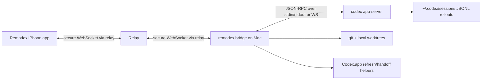

# 072 Remodex Remote Control Research

## Status

- Research
- Last updated: 2026-03-27

## Question

How does [Remodex](https://github.com/Emanuele-web04/remodex), the project
behind
[Emanuele Di Pietro's 2026-03-26 launch post](https://x.com/emanueledpt/status/2037167701940900339),
actually work?

This document focuses on the implementation mechanics behind the claim:

- "Codex runs on your Mac"
- "Your iPhone controls it"
- "Pair with one QR scan"
- "E2EE"
- "Git actions and more"
- "Open source"

## Executive Summary

Remodex is not "Codex on iPhone." It is a local-first remote control system for
Codex that keeps execution on the Mac and turns the iPhone into a secure remote
client.

At a high level:

1. The Mac runs a small Node bridge (`remodex`) plus `codex app-server`.
2. The iPhone talks to that bridge over a relay-backed WebSocket connection.
3. The first pairing happens by scanning a QR code that contains the relay URL,
   an ephemeral session id, the Mac device id, the Mac identity public key, and
   an expiry.
4. After the socket is up, the iPhone and Mac perform their own signed handshake
   and derive end-to-end encryption keys.
5. Once the secure channel exists, the relay only forwards ciphertext for app
   payloads. Codex execution, git commands, file operations, and thread storage
   all remain on the Mac.
6. Trusted reconnect works because the relay keeps a temporary index from the
   stable Mac device id to the current live session id, and the iPhone proves it
   still holds the trusted phone key before the relay returns that current
   session id.

The "open source" claim is materially true for the core product shape. The
public repo contains the iOS app source, the Node bridge, the relay, and
self-hosting docs. What it intentionally does not contain are private production
defaults such as the deployed relay hostname, APNs credentials, or release-time
package overrides.

## Verified Current State

As of 2026-03-27, the verified public state is:

- The launch post says the product is "Remodex" and describes it as "The first
  Codex Remote Control for iOS" with QR pairing, subagents, skills, E2EE, and
  git actions.
- The public repository is `Emanuele-web04/remodex`.
- The repository is public and ISC-licensed.
- The latest repo commit observed during this research is
  `fed641cc700b13db729662138cef856ac0378e0d`.
- The bridge package in `phodex-bridge/package.json` is version `1.3.7`.
- The public repo contains:
  - an iOS app target under `CodexMobile/`
  - a bridge/CLI package under `phodex-bridge/`
  - a self-hostable relay under `relay/`
  - explicit self-hosting docs

Important framing from the repo itself:

- the bridge is local-first and keeps Codex on the Mac
- the public repo does not hardcode a public production relay
- trusted reconnect exists, but the built-in daemon/background path is currently
  macOS-only
- App Store builds can differ at release time from the raw GitHub checkout

## What Runs Where



The boundaries are important:

- The relay is a transport hop, not the execution environment.
- The Mac bridge is the system boundary that can reach:
  - `codex app-server`
  - local git
  - local workspace paths
  - optional desktop deep-link/refresh helpers
- The iPhone app is a client that renders state and issues RPC requests. It does
  not run Codex locally.

## Architecture Breakdown

### 1. Mac bridge process

The bridge is the core runtime on the Mac.

What it does:

- loads or creates a persistent Mac device identity
- generates a fresh relay session id for each bridge launch
- prints the pairing QR
- spawns `codex app-server` unless a Codex endpoint is configured explicitly
- opens a WebSocket to the relay
- performs the secure handshake with the iPhone
- forwards JSON-RPC traffic between the phone and Codex
- intercepts bridge-owned methods such as git, notifications, desktop handoff,
  workspace routing, and voice helpers

The important implementation choice is that the bridge does not reimplement
Codex logic. It is mostly an adapter between:

- a secure remote mobile client
- Codex's existing app-server protocol
- local machine capabilities that only the Mac should perform

### 2. iPhone app

The iPhone app is a native SwiftUI client that:

- stores trusted Mac records
- scans the QR payload
- connects to the relay
- performs the secure handshake
- calls app-server methods such as `thread/start`, `turn/start`, and
  `model/list`
- exposes mobile controls for:
  - plan mode / collaboration mode
  - reasoning selection
  - access mode / approval policy
  - git actions
  - subagent-oriented UI
  - queued prompts
  - attachments / images
  - run completion notifications

This is why the app can feel "full featured" without running Codex locally: it
is effectively a mobile frontend for a local bridge + app-server already running
on the Mac.

### 3. Relay

The relay is intentionally thin.

What it does:

- accepts WebSocket connections at `/relay/{sessionId}`
- distinguishes `x-role: mac` vs `x-role: iphone`
- creates an in-memory room per live session
- keeps one live Mac and one live iPhone socket per session
- keeps a second in-memory index from stable `macDeviceId` to current live
  session metadata
- forwards secure control messages and encrypted envelopes
- exposes an authenticated trusted-session resolve endpoint
- optionally exposes push-registration and completion-notify endpoints

What it explicitly does not do:

- run Codex
- execute git
- store the repo checkout
- decrypt application payloads after the secure handshake completes

## Detailed Flow

### 1. Pairing bootstrap

When `remodex up` starts on the Mac:

1. the bridge loads or creates a persistent Mac identity in
   `~/.remodex/device-state.json`
2. it generates a fresh `sessionId`
3. it constructs a pairing payload with:
   - QR payload version
   - relay URL
   - session id
   - Mac device id
   - Mac identity public key
   - expiry timestamp
4. it prints that payload as a QR code
5. it connects to the relay as the `mac` role

Important detail:

- the device identity is stable across runs
- the relay session id is intentionally ephemeral per run

That split is what makes trusted reconnect possible without keeping one public,
long-lived session id alive forever.

### 2. First iPhone connection

After the QR scan, the iPhone saves the relay details and opens a WebSocket to
the relay using the scanned session id.

If the Mac session is not live yet, the relay rejects the iPhone connection. If
the Mac session is live, the relay binds the phone socket to that session.

The QR is only bootstrap metadata. It is not the full secure session.

### 3. End-to-end encryption handshake

The real security boundary is the post-QR handshake.

The bridge and the iPhone implement a custom handshake with:

- long-lived Ed25519 identity keys for Mac and phone
- fresh X25519 ephemeral keys per secure session
- HKDF-SHA256 for key derivation
- AES-256-GCM for message encryption
- per-direction counters for replay protection

The rough sequence is:

1. iPhone sends `clientHello`
2. Mac validates the session, mode, expiry, and trusted-phone conditions
3. Mac returns `serverHello` with its ephemeral key and a signature over the
   transcript
4. iPhone verifies the Mac signature against the expected Mac identity key
5. iPhone sends `clientAuth`, signing the transcript extension
6. Mac verifies the phone signature
7. both sides derive:
   - `phoneToMacKey`
   - `macToPhoneKey`
8. Mac sends `secureReady`
9. iPhone sends `resumeState` for replay/catch-up

The repo also implements a replay buffer for bridge-to-phone outbound messages:

- up to 500 buffered outbound application messages
- up to 10 MB total buffered plaintext
- bridge replay resumes from the highest phone-acknowledged
  `lastAppliedBridgeOutboundSeq`

That is how reconnect can survive temporary relay drops without blindly losing
the live stream.

### 4. Trusted reconnect after the first QR scan

This is the part that makes the UX feel like "scan once, reuse later."

Key implementation facts:

- the bridge stores exactly one trusted phone public key at a time
- the relay stores a live session index keyed by `macDeviceId`
- the iPhone stores the trusted Mac record locally
- every reconnect still authenticates cryptographically; it does not rely only
  on possession of an old session id

Trusted reconnect works like this:

1. the Mac starts later with a new relay `sessionId`
2. the bridge registers its stable `macDeviceId`, identity public key, and
   trusted-phone metadata with the relay
3. the iPhone does not know the new session id yet
4. the iPhone calls `POST /v1/trusted/session/resolve`
5. that request includes:
   - `macDeviceId`
   - `phoneDeviceId`
   - `phoneIdentityPublicKey`
   - timestamp
   - nonce
   - phone signature
6. the relay verifies:
   - the request is fresh
   - the nonce is unused
   - the live session exists for that Mac
   - the trusted phone identity matches
   - the phone signature is valid
7. only then does the relay return the current live session id and Mac identity
   public key
8. the iPhone reconnects to that session and runs the secure handshake again in
   `trusted_reconnect` mode

This is a strong design choice. The relay never needs to decrypt messages, but
it can still safely answer "which current session belongs to the Mac you trust?"

### 5. JSON-RPC bridge to Codex

Once the secure channel is active, the iPhone is mostly speaking JSON-RPC that
the bridge forwards to Codex.

If no external endpoint is configured, the bridge launches:

```text
codex app-server
```

and talks to it over stdin/stdout. If an endpoint is configured, it can instead
connect over WebSocket.

This means Remodex is not scraping the UI of Codex.app. It is speaking to an
actual Codex runtime transport.

### 6. Git and workspace actions stay local

Git actions are not proxied to the relay and are not executed on the phone. They
are bridge-owned RPC methods that run local `git` commands on the Mac.

The bridge handles methods such as:

- `git/status`
- `git/diff`
- `git/commit`
- `git/push`
- `git/pull`
- `git/checkout`
- `git/createBranch`
- `git/createWorktree`
- `git/removeWorktree`

This is why the product can honestly say "git actions from your phone" while
still keeping the local repo as the source of truth.

The same pattern exists for other bridge-owned capabilities:

- desktop handoff
- workspace routing
- thread-context helpers
- notifications push registration

### 7. Shared history with Codex.app

Remodex is not a perfect bidirectional live mirror of Codex desktop state.
Instead, it piggybacks on the same thread/session files that Codex writes under
`~/.codex/sessions`.

The bridge has multiple helpers built around those rollout files:

- file lookup for the right thread rollout
- usage/token tracking from rollout lines
- live mirroring for resumed desktop-origin runs
- desktop refresh/handoff heuristics

The repo is explicit that `Codex.app` can read the same thread history from
disk, but it is not a true live mirror unless optional refresh workarounds are
enabled.

That workaround currently includes:

- AppleScript-based app refresh/relaunch helpers
- deep-linking to `codex://threads/{threadId}`
- tracking the last active thread for handoff

So the "shared thread history" claim is true, but the synchronization model is
"shared persisted session data plus refresh helpers," not "both clients are
subscribed to one canonical real-time state server."

### 8. Plan mode, reasoning, and subagents

These are mostly UI/runtime configuration features layered on top of the
existing Codex runtime.

What the code shows:

- the iPhone app exposes `collaborationMode`, including plan mode
- the composer exposes reasoning-effort selection based on `model/list`
  capabilities
- the UI has explicit subagent models, views, and `/subagents` command support
- thread history parsing recognizes collaboration/subagent events and renders
  them in the mobile timeline

The important takeaway is that Remodex is not inventing a separate agent system.
It is surfacing Codex runtime capabilities through a mobile client and then
normalizing the resulting history for mobile presentation.

### 9. Notifications

Push notifications are optional and not part of the minimum self-host story.

The push pipeline is:

1. iPhone gets an APNs device token
2. iPhone sends `notifications/push/register` to the bridge
3. bridge forwards that to a configured push service URL
4. relay-side push endpoints only accept registration or completion events when
   the session id and notification secret still correspond to a live Mac session
5. push service stores session-scoped device registrations and dedupes run
   completion alerts

Important boundary:

- public self-hosting works without push
- push is disabled by default in the public relay
- APNs credentials stay outside the repo

### 10. macOS daemon path

On macOS, `remodex up` does not just run a foreground bridge. It can install and
manage a `launchd` service (`com.remodex.bridge`) so the bridge survives
terminal closure and trusted reconnect can feel background-native.

That daemon flow:

- writes config/state under a Remodex state directory
- writes a launch agent plist
- restarts the service
- waits for a fresh pairing session when needed
- keeps QR rendering as a foreground CLI concern while the real bridge runs in
  the background

On non-macOS platforms, the bridge works, but this daemon-backed background
service path is not built in.

## Why This Design Works

Remodex works because it picks the right split of responsibilities:

- execution stays where the repo, credentials, git checkout, and Codex runtime
  already live: the Mac
- transport can be remote because the phone only needs a secure control/data
  channel, not a local coding runtime
- trust is anchored in stable device identity keys rather than a permanent
  session id
- relay state is thin enough to self-host and audit
- Codex history reuse avoids re-implementing a separate thread store

From a product perspective, the system feels "mobile native" because the user
sees:

- pairing QR
- trusted reconnect
- live streaming of turns
- thread list and history
- local git controls
- desktop handoff

But under the hood it is much closer to "secure mobile client for a local Codex
runtime" than "cloud IDE in an app."

## What Is Actually Open Source

The core claim appears substantively accurate:

- iOS app source is in the repo
- bridge source is in the repo
- relay source is in the repo
- self-host docs are in the repo
- security-sensitive transport code is inspectable

The repo also clearly documents what remains private:

- deployed production relay URL
- APNs credentials
- private package publish defaults
- private App Store/release configuration

One subtle but important nuance:

- the public repo is self-hostable
- official builds and npm packages may be configured differently at release time

So "open source" here means the transport, client, bridge, and self-host path
are public, not that every production convenience used by the shipped App Store
experience is hardcoded into the repository.

## Constraints and Caveats

The implementation has some important tradeoffs:

- one trusted phone per Mac, not a many-device trust graph
- one live iPhone socket per session
- relay sessions are in-memory and disappear if the relay restarts
- trusted reconnect still depends on the relay being reachable
- QR bootstrap expires quickly and is per-session
- desktop continuity depends partly on rollout-file observation and app refresh
  workarounds, not on a first-class multi-client realtime model inside Codex
- the daemon/background path is currently macOS-only
- push is optional and more operationally complex than the base product

The relay also still sees:

- connection metadata
- session lifecycle
- secure control messages used during handshake
- device registration metadata if push is enabled

What it should not see after the secure session is live:

- plaintext prompts
- plaintext assistant responses
- local repo contents
- git execution results in plaintext form before endpoint decryption

## Notes Relevant to Noter

If we ever want a similar "control Codex on your machine from somewhere else"
experience, Remodex suggests a practical architecture:

1. Keep Codex and the repo on the operator machine.
2. Introduce a very small bridge that speaks app-server plus local machine
   actions.
3. Use stable machine identity plus ephemeral session ids.
4. Make the relay transport-only and self-hostable.
5. Reuse existing Codex session/rollout storage where possible instead of
   inventing a second canonical thread store.

The places where we would probably diverge:

- multi-device trust rather than one trusted iPhone
- stronger multi-user / multi-operator semantics
- richer device inventory and presence state
- less dependence on desktop refresh hacks if Codex eventually offers better
  live multi-client thread sync

## Source Links

Primary sources used for this research:

- Launch post:
  [x.com/emanueledpt/status/2037167701940900339](https://x.com/emanueledpt/status/2037167701940900339)
- Repo:
  [github.com/Emanuele-web04/remodex](https://github.com/Emanuele-web04/remodex)
- Repo README:
  [README.md](https://github.com/Emanuele-web04/remodex/blob/fed641cc700b13db729662138cef856ac0378e0d/README.md)
- Self-hosting model:
  [SELF_HOSTING_MODEL.md](https://github.com/Emanuele-web04/remodex/blob/fed641cc700b13db729662138cef856ac0378e0d/SELF_HOSTING_MODEL.md)
- Self-hosting guide:
  [Docs/self-hosting.md](https://github.com/Emanuele-web04/remodex/blob/fed641cc700b13db729662138cef856ac0378e0d/Docs/self-hosting.md)
- Bridge entrypoint:
  [phodex-bridge/src/bridge.js](https://github.com/Emanuele-web04/remodex/blob/fed641cc700b13db729662138cef856ac0378e0d/phodex-bridge/src/bridge.js)
- Secure transport:
  [phodex-bridge/src/secure-transport.js](https://github.com/Emanuele-web04/remodex/blob/fed641cc700b13db729662138cef856ac0378e0d/phodex-bridge/src/secure-transport.js)
- Device/trust state:
  [phodex-bridge/src/secure-device-state.js](https://github.com/Emanuele-web04/remodex/blob/fed641cc700b13db729662138cef856ac0378e0d/phodex-bridge/src/secure-device-state.js)
- Codex transport:
  [phodex-bridge/src/codex-transport.js](https://github.com/Emanuele-web04/remodex/blob/fed641cc700b13db729662138cef856ac0378e0d/phodex-bridge/src/codex-transport.js)
- Git bridge handler:
  [phodex-bridge/src/git-handler.js](https://github.com/Emanuele-web04/remodex/blob/fed641cc700b13db729662138cef856ac0378e0d/phodex-bridge/src/git-handler.js)
- Desktop handoff:
  [phodex-bridge/src/desktop-handler.js](https://github.com/Emanuele-web04/remodex/blob/fed641cc700b13db729662138cef856ac0378e0d/phodex-bridge/src/desktop-handler.js)
- Desktop refresh / rollout watch:
  [phodex-bridge/src/codex-desktop-refresher.js](https://github.com/Emanuele-web04/remodex/blob/fed641cc700b13db729662138cef856ac0378e0d/phodex-bridge/src/codex-desktop-refresher.js),
  [phodex-bridge/src/rollout-live-mirror.js](https://github.com/Emanuele-web04/remodex/blob/fed641cc700b13db729662138cef856ac0378e0d/phodex-bridge/src/rollout-live-mirror.js),
  [phodex-bridge/src/rollout-watch.js](https://github.com/Emanuele-web04/remodex/blob/fed641cc700b13db729662138cef856ac0378e0d/phodex-bridge/src/rollout-watch.js)
- macOS daemon:
  [phodex-bridge/src/macos-launch-agent.js](https://github.com/Emanuele-web04/remodex/blob/fed641cc700b13db729662138cef856ac0378e0d/phodex-bridge/src/macos-launch-agent.js)
- Relay server:
  [relay/server.js](https://github.com/Emanuele-web04/remodex/blob/fed641cc700b13db729662138cef856ac0378e0d/relay/server.js),
  [relay/relay.js](https://github.com/Emanuele-web04/remodex/blob/fed641cc700b13db729662138cef856ac0378e0d/relay/relay.js),
  [relay/README.md](https://github.com/Emanuele-web04/remodex/blob/fed641cc700b13db729662138cef856ac0378e0d/relay/README.md)
- Push registration / delivery:
  [phodex-bridge/src/notifications-handler.js](https://github.com/Emanuele-web04/remodex/blob/fed641cc700b13db729662138cef856ac0378e0d/phodex-bridge/src/notifications-handler.js),
  [phodex-bridge/src/push-notification-service-client.js](https://github.com/Emanuele-web04/remodex/blob/fed641cc700b13db729662138cef856ac0378e0d/phodex-bridge/src/push-notification-service-client.js),
  [relay/push-service.js](https://github.com/Emanuele-web04/remodex/blob/fed641cc700b13db729662138cef856ac0378e0d/relay/push-service.js)
- iPhone connection and secure transport:
  [CodexMobile/CodexMobile/Services/CodexService+Connection.swift](https://github.com/Emanuele-web04/remodex/blob/fed641cc700b13db729662138cef856ac0378e0d/CodexMobile/CodexMobile/Services/CodexService%2BConnection.swift),
  [CodexMobile/CodexMobile/Services/CodexService+SecureTransport.swift](https://github.com/Emanuele-web04/remodex/blob/fed641cc700b13db729662138cef856ac0378e0d/CodexMobile/CodexMobile/Services/CodexService%2BSecureTransport.swift),
  [CodexMobile/CodexMobile/Services/CodexService+ThreadsTurns.swift](https://github.com/Emanuele-web04/remodex/blob/fed641cc700b13db729662138cef856ac0378e0d/CodexMobile/CodexMobile/Services/CodexService%2BThreadsTurns.swift),
  [CodexMobile/CodexMobile/Services/CodexService+RuntimeConfig.swift](https://github.com/Emanuele-web04/remodex/blob/fed641cc700b13db729662138cef856ac0378e0d/CodexMobile/CodexMobile/Services/CodexService%2BRuntimeConfig.swift),
  [CodexMobile/CodexMobile/Services/CodexService+Notifications.swift](https://github.com/Emanuele-web04/remodex/blob/fed641cc700b13db729662138cef856ac0378e0d/CodexMobile/CodexMobile/Services/CodexService%2BNotifications.swift),
  [CodexMobile/CodexMobile/Services/GitActionsService.swift](https://github.com/Emanuele-web04/remodex/blob/fed641cc700b13db729662138cef856ac0378e0d/CodexMobile/CodexMobile/Services/GitActionsService.swift),
  [CodexMobile/CodexMobile/CodexMobileApp.swift](https://github.com/Emanuele-web04/remodex/blob/fed641cc700b13db729662138cef856ac0378e0d/CodexMobile/CodexMobile/CodexMobileApp.swift)
