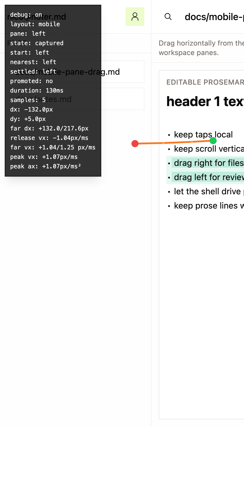
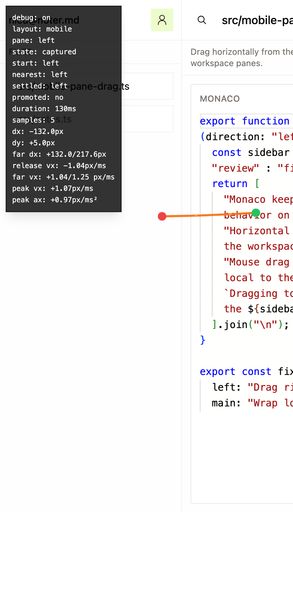

# Editor Sidebar Return Drag Research

## Why

Recent mobile sidebar work added editor-originated drag handoff for ProseMark in
[#374](https://github.com/noter-md/noter/pull/374), reused the same bridge for
Monaco in [#378](https://github.com/noter-md/noter/pull/378), added swipe debug
telemetry in [#379](https://github.com/noter-md/noter/pull/379), and then
removed the mobile main-pane scrim in
[#382](https://github.com/noter-md/noter/pull/382).

That final change intentionally let the visible slice of the main pane receive
touches while a sidebar is open. The regression reported here is that dragging
from that visible slice works when the gesture starts outside the editor, but
does not work when the gesture starts inside ProseMark or Monaco.

## Repro

### Shared symptom

1. Open a mobile FileView shell with both sidebars enabled.
2. Drag from the editor while the shell is centered on `main`.
3. Observe that the shell can open either sidebar from the editor surface.
4. Keep a sidebar open so only a slice of the main editor is still visible.
5. Start the return drag from inside the visible editor slice.
6. Observe that the viewport trace moves, but the shell stays on the open
   sidebar.

### Commands used during research

```bash
cd apps/noter
VITE_PORT=4173 npm run dev:frontend
```

Then visit the fixture routes directly:

- `http://127.0.0.1:4173/visual-fixture.html?mode=fileview-prosemark-drag-editable&swipe-debug`
- `http://127.0.0.1:4173/visual-fixture.html?mode=fileview-monaco-drag&swipe-debug`

The screenshots below were captured after opening the left sidebar and then
attempting the return drag from inside the editor surface.

### ProseMark fixture

Use `/visual-fixture.html?mode=fileview-prosemark-drag-editable&swipe-debug`.

1. Open the left sidebar from the editor.
2. Start a leftward drag inside the visible editor slice on the right edge.
3. Expected: the shell returns toward `main`.
4. Actual: the trace is captured, but `data-mobile-pane` stays `left`.



### Monaco fixture

Use `/visual-fixture.html?mode=fileview-monaco-drag&swipe-debug`.

1. Open the left sidebar from the Monaco surface.
2. Start a leftward drag inside the visible editor slice on the right edge.
3. Expected: the shell returns toward `main`.
4. Actual: the trace is captured, but `data-mobile-pane` stays `left`.



## Findings

### 1. The editor drag bridge only arms while `main` is already active

`useProsemarkMobilePaneDrag` rejects both `pointerdown` and `touchstart` unless
`isMainPaneActive` is true.

That matches the current code in
`apps/noter/src/components/useProsemarkMobilePaneDrag.ts`:

- `handlePointerDownCapture` returns early when `!isMainPaneActive`
- `handleTouchStart` returns early when `!isMainPaneActive`

Because Monaco reuses the same hook through `MonacoEditorSurface`, the same
guard affects both editor stacks.

### 2. The scrim removal exposed an existing assumption

Before [#382](https://github.com/noter-md/noter/pull/382), a dedicated scrim sat
above the visible main-pane slice while a sidebar was open. After that PR,
`WorkspaceSidebarShell` deliberately lets that visible main content receive
touches directly and recenters the shell through click capture instead of a
blocking overlay.

That means the editor can now legitimately receive the return-drag gesture while
the shell state is still `left` or `right`, but the editor bridge still behaves
as if such a gesture can never start there.

### 3. The shell itself still works outside the editor

The regression is scoped to editor-originated gestures. Starting the same drag
from sidebar chrome or from non-editor main-pane content still works because the
outer `WorkspaceSidebarShell` scroll container continues to own those touches.

## Regression Coverage

The regression coverage now lives in the real Playwright fixture specs instead
of a hook-only unit test:

- `apps/noter/e2e/file-view-prosemark-drag.spec.ts`
- `apps/noter/e2e/file-view-monaco-drag.spec.ts`

Each spec opens the left sidebar, starts the return drag from the live editor
surface with `?swipe-debug` enabled, verifies that the debug overlay starts on
`left` and settles on `main`, and then expects sidebar-only content to leave the
viewport before asserting that the shell returns to `main`. These specs now pass
and guard the return-drag regression for both Monaco and ProseMark.

The focused commands are:

```bash
cd apps/noter
PLAYWRIGHT_USE_DEV_SERVER=1 PLAYWRIGHT_REUSE_EXISTING_SERVER=1 PLAYWRIGHT_VITE_PORT=4173 \
  pnpm exec playwright test -c playwright.config.ts e2e/file-view-prosemark-drag.spec.ts \
  e2e/file-view-monaco-drag.spec.ts --grep "return from the open left pane to main"
```

## Fix

The drag bridge needed a visibility-aware gate instead of a strict
`isMainPaneActive` requirement. The important constraint is not "the shell is on
main" but "the gesture started from editor content that should be allowed to
drive the shared shell." The fix removes the editor-side `isMainPaneActive`
precondition and lets the shell decide whether the swipe can actually move.

Any implementation should keep the existing protections that:

- leave mouse and stylus selection local to the editor
- keep blocked drags on the editor when the shell cannot move
- avoid stealing vertical scroll from the editor surface
