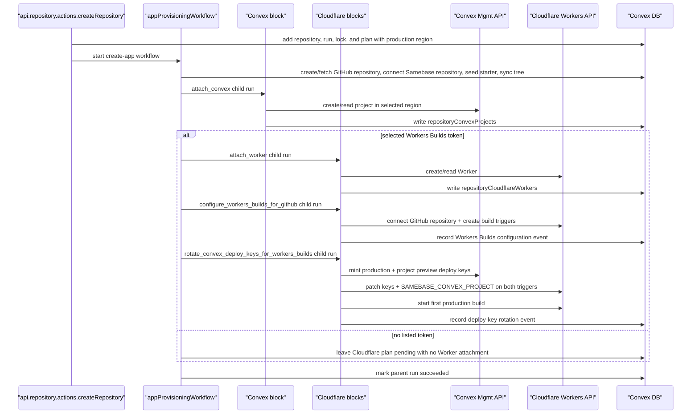

# Repository Infrastructure Auto-Provisioning Specification

## Document Control

- Status: Implemented for MVP
- Owner: Samebase backend/frontend
- Last updated: 2026-08-30
- Related plan: `archive/002_VAULT_INFRA_AUTO_PROVISIONING_AND_AI_PROD_ACCESS_PLAN.md`
- Related repository-first cleanup: `specs/096_INITIALIZING_REPOSITORY_GITHUB_PROVISIONING_SPEC.md`
- Related deletion contract: `specs/098_REPOSITORY_REMOVAL_WORKFLOW_SPEC.md`
- Cloudflare Workers migration: `specs/101_CLOUDFLARE_WORKERS_SINGLE_STACK_MIGRATION_SPEC.md`
- Manual Convex attachment: `specs/106_CONVEX_MANUAL_DEPLOYMENT_CONNECTION_SPEC.md`
- Resource attachment model: `specs/115_REPOSITORY_RESOURCE_ATTACHMENT_MODEL_SPEC.md`
- Organization deployment providers: `specs/120_ORGANIZATION_OWNERSHIP_SPEC.md`

> Note: this spec describes the Workers-only provisioning workflow. Spec 115 defines durable Worker
> identity, approved name and root coordinates, drift, and explicit coordinate updates.

## Summary

For samebase-managed repositories, infrastructure is composed from the same narrow blocks used by
manual resource attachment:

1. create/connect the GitHub source and sync the default-branch tree
2. attach or create the Convex project at the plan's confirmed `convex.json` path
3. when the plan has a selected Workers Builds token, attach or create the Cloudflare Worker named
   by the plan
4. configure the Worker's Workers Builds triggers for GitHub
5. rotate and install the selected Convex project's deploy keys, then start the first production
   build

Provisioning is asynchronous. Retries reuse provider identities that were successfully checkpointed.
Repository creation succeeds even if downstream provisioning partially fails.

New App also admits a confirmed empty Workers Builds token list. In that case, the managed workflow
completes source setup and Convex attachment, then succeeds without creating or attaching a Worker.
After a token becomes available, one explicit Create Worker action creates the Worker, configures
Workers Builds, and changes only Cloudflare freshness. The existing separate deploy-key action
installs keys for one selected attached Convex project and starts the production build.

## Important Behavior

- `api.repository.actions.createRepository` (new Samebase-managed repository) requires a selected
  GitHub user/org owner. It resolves the Convex production region from an optional create override
  or the organization default, with US as the fallback. A Workers Builds token is either one
  selected UUID or `null` when the current account has no listed token. The New App page or MCP
  caller lists the tokens before admission and sends `null` only for an empty list. Samebase
  verifies a selected UUID. It does not repeat the provider read for `null`, which causes no
  Cloudflare write. One admission transaction inserts the initializing repository, the create run,
  the active managed provider lock, and the provisioning plan, then starts the Workflow and stores
  its ID. A Workflow start failure rolls back all admission writes. The Workflow validates the
  organization's provider credentials against the repository destinations and starts provider
  provisioning after source setup succeeds. The Workers Builds block verifies a selected UUID again
  before it writes provider state.
- `api.repository.actions.connectRepository` (existing GitHub repository connection) does **not**
  auto-provision infra. Its `connect_existing_repository` run is source-only and never owns the
  provider lock.
- Existing GitHub repositories can attach or create Convex resources later through the manual Convex
  deployment connection flow in `specs/106_CONVEX_MANUAL_DEPLOYMENT_CONNECTION_SPEC.md`.
- `api.repository.actions.retryInfrastructureProvisioning` uses one admission transaction to create
  the retry run, replace the failed managed lock with its active owner, start the Workflow, and
  store its ID. A Workflow start failure rolls back the new run and lock change. The Workflow
  restarts the composed block sequence for a failed Samebase-managed create flow. Manual provider
  setup failures still reopen the matching provider resource dialog instead of running the managed
  infrastructure retry.

## Source of Truth Files

- `apps/samebase/convex/repository/actions.ts`
- `apps/samebase/convex/repository/dashboard.ts`
- `apps/samebase/convex/repository/records.ts`
- `apps/samebase/convex/infraProvisioning.ts`
- `apps/samebase/convex/repository/convex.ts`
- `apps/samebase/convex/repository/convexMutations.ts`
- `apps/samebase/convex/repository/cloudflare.ts`
- `apps/samebase/convex/repository/cloudflareMutations.ts`
- `apps/samebase/convex/repository/infrastructureOperation.ts`
- `apps/samebase/convex/schema.ts`
- `apps/samebase/src/components/repository-dashboard/RepositoryDashboard.tsx`

## Data Model

### `repositories`

Samebase-managed repository creation requires `convexTeamId` and `cloudflareAccountId` and copies
both values from the organization in the admission transaction. Repositories connected to existing
GitHub repositories copy each destination that is configured, but GitHub source connection requires
neither one. A later provider connection fills that provider's missing repository destination in the
credential transaction. Provider work requires its own fixed repository destination and current
credential, and each attached resource must match that destination.

### `workflow_repositoryProvisioning_plans`

- `repositoryId`
- `convexConfigPath`
- `convex`: `{ state: "planned", projectName, deploymentRegion }`,
  `{ state: "creating", projectName, deploymentRegion }`, or
  `{ state: "created", projectName, deploymentRegion, projectId }`
- `cloudflare`: `{ state: "planned", workerName, rootDirectory, buildTokenUuid: string | null }`,
  `{ state: "creating", workerName, rootDirectory, buildTokenUuid: string }`, or
  `{ state: "created", workerName, workerTag, rootDirectory, buildTokenUuid: string }`
- `createdAt`, `updatedAt`

The plan row records provider resource names, provider configuration input, and stable resource
identities returned after side effects. It does not duplicate the Convex team or Cloudflare account.
The repository stores those destinations, and they do not change during retry. Each attempt resolves
the current organization-owned Convex or Cloudflare credential slot for the repository destination
and verifies that the credential can access it. `creating` means the provider create request started
but Samebase never recorded a confirmed result. Retry checks the exact planned name. If that
provider resource exists, Samebase requires the user to delete it in the provider dashboard before
retrying. If it is absent, Samebase repeats the create request without adding another workflow
state. A same-named resource is never adopted implicitly. `created` is the exact external provider
identity checkpoint used by retry. Samebase writes that checkpoint and its stable `provisioned`
resource attachment in one database transaction. Checkbox-controlled cleanup derives ownership only
from the stable attachment, never from an unattached checkpoint. Current connected resource
identities live in the durable resource tables used by the dashboard.

`deploymentRegion` is the Convex production region selected for this managed create. A retry uses
the region in the plan. The provider create request sends it as `deploymentRegion` with
`deploymentType: "prod"`.

`buildTokenUuid` is an explicit non-secret Workers Builds token choice. The `planned` state accepts
a selected token UUID or `null`. The `creating` and `created` states require a selected token UUID.
The plan keeps a selected UUID because a retry must use the same user choice. Before each trigger
write, Samebase requires Cloudflare to list that UUID for the repository account. Samebase does not
store the token name, the underlying user API token ID, or its secret. If Cloudflare no longer lists
the selected UUID, managed setup tells the user to remove the failed app and create it again with
another token. Retry does not choose a replacement token.

`null` records that the account had no listed token when New App started. It is not a general option
to skip managed Builds setup. The New App page or MCP caller confirms that the provider token list
is empty. The public action accepts `null` without a second provider read. The managed run succeeds
after it attaches the Convex project. It does not start the Worker, Workers Builds, or deploy-key
blocks, and it creates no Worker attachment. A later Create Worker action selects a current token,
creates and attaches the Worker, and configures Builds. The separate deploy-key action selects an
attached Convex project, installs its keys, and starts the production build. The managed plan stays
unchanged and does not persist the later token choice.

After both trigger writes succeed for a selected UUID, Samebase records the UUID as the organization
account's last-used Builds token. That organization default affects only future selections. It never
replaces the plan UUID during a retry.

Indexes:

- `by_repository`

### `workflow_repositoryProvisioning_writeLocks`

This table stores the current or most recent infrastructure write for one repository. Its owner is
one of:

- `{ kind: "managed_run", runId }`
- `{ kind: "manual_provider_write", actionId, action, expiresAt }`

An owner can be `active`, `succeeded`, or `failed`. Only `active` blocks another infrastructure
write. A manual owner stores one manual action name from a fixed list. The action maps to the
provider observation times that can change:

- `create_convex_project`: Convex
- `connect_cloudflare_worker`, `create_cloudflare_worker`, and
  `configure_workers_builds_for_github`: Cloudflare
- `rotate_convex_deploy_keys_for_workers_builds`: Convex and Cloudflare

Only create and retry runs can own a managed lock. The transaction that creates either run also
creates its active lock. The lock stays active during source and provider setup. A terminal run
transition makes the matching lock terminal. A source setup failure marks the matching lock failed
but does not change a provider write time. A `connect_existing_repository` run is source-only and
never creates or owns this lock.

A manual owner does not store provider targets or replay input. It stores one expiry at 10 minutes.
The action derives a 5-minute call limit from that expiry. After 5 minutes, it must not start
another provider call. An in-flight provider call can return and record its result before the owner
expires at 10 minutes. There is no second stored expiry.

`lastWriteAt.convex` and `lastWriteAt.cloudflare` are independent optional times. Samebase updates
one of these times when the matching provider state can have changed. A write to one provider must
not clear the other provider time.

The provisioning plan is durable retry input. It is not an active operation and does not block a
manual write by itself. When a user or agent starts an explicit manual provider action, it replaces
an old managed setup failure, and the dashboard removes the old managed Retry action and plan-only
rows.

Deployment has two destructive preconditions. The target deployment must contain zero rows in
`workflow_repositoryProvisioning_writeLocks` and zero rows in
`workflow_repositoryProvisioning_plans`. The operator must stop the deployment and clear these rows
first. Product code has no compatibility reader, data migration, or fallback for an older row shape.

### `repositoryConvexProjects`

- `repositoryId`, `organizationId`
- `teamId`, `projectId`, `convexConfigPath`
- `origin: "provisioned" | "selected_existing"`

This table is the durable attachment between a repository and a Convex project. It stores stable
provider coordinates, the user-confirmed repository config path, and provenance. Convex
`_creationTime` records when the attachment was created. Current project slugs, team slugs,
production and preview deployments, URLs, and deploy keys are provider state and must not be
mirrored into this row. `projectId` is globally exclusive. Several projects may intentionally share
one `convexConfigPath`.

Indexes:

- `by_repository`
- `by_organization`
- `by_project` (global attachment exclusivity)

### `repositoryCloudflareWorkers`

- `repositoryId`, `organizationId`
- `accountId`, `workerName`, `workerTag`, `rootDirectory`
- `origin: "provisioned" | "selected_existing"`

This table is the durable attachment between a repository and a Cloudflare Worker. It stores the
stable `workerTag` identity and the approved `workerName` and `rootDirectory` coordinates that spec
115 defines. Current workers.dev URLs, domains, Worker existence, Workers Builds triggers,
repository configuration, build status, token data, and Convex deploy keys remain provider state.
Convex `_creationTime` records when the attachment was created.

### Worker-to-Convex build relationship

`SAMEBASE_CONVEX_PROJECT` is a non-secret Cloudflare Workers Builds variable with the value
`version=1&teamId=<teamId>&projectId=<projectId>`.

Samebase writes the same marker to the production and preview Builds triggers together with the
secret variables `CONVEX_DEPLOY_KEY` and `PREVIEW_CONVEX_DEPLOY_KEY`. The current readable marker is
the authoritative declaration of which Convex project the Worker is configured to deploy. It is
user-controlled provider configuration, not cryptographic proof that the hidden secret values belong
to that project. A user who changes the keys directly in Cloudflare must also update or remove the
marker.

Samebase does not persist a Worker-to-project dependency row or attachment field. The selected
project may exist as active workflow input while an explicit provider operation runs, but completed
relationship state is read from Cloudflare. Multiple Workers may declare the same Convex project.
One Worker has one observable target only when its production and preview markers agree.

The live observation reports these states without guessing:

- the same valid marker and both secret names on both triggers: configured for that project
- matching markers with missing secret names: incomplete, with repair available
- secret names with no marker: target unknown
- different valid markers or a valid marker on only one trigger: inconsistent
- a malformed marker on either trigger: invalid
- a marker naming a project that is not attached to the repository: externally configured project
- a provider read failure: unknown, without inferring that configuration is missing

### Provider observation boundary

Provider-owned state is observed directly from Convex and Cloudflare for one requested repository.
Cloudflare Worker axes return explicit `available`, `missing`, or `failed` results where those
states apply. Each Convex attachment returns source placement as `valid`, `missing`,
`unavailable_partial`, or `unavailable`, and provider continuity as `current`, `moved`,
`missing_ambiguous`, or `unavailable`. Every result carries an observation timestamp. The dashboard
may cache those results in the browser for a short bounded interval, but the actions do not write
them to Convex tables. Stable attachment rows remain unchanged when a provider resource changes or
disappears.

The Convex production deployment observation supplies the displayed region after attachment.
`repositoryConvexProjects` does not copy it.

Each provider observation query uses the matching `lastWriteAt` value in its query key. When that
value changes, the dashboard makes one new read and shows `Checking` until the read returns. An
older result must not create attention or repair UI during this check. The first new result becomes
the normal state, including a provider read failure. Samebase does not continuously poll for this
write-safety check.

Cloudflare uses three independently loading observation axes:

1. Worker identity, current name, existence, domains, and workers.dev availability.
2. Workers Builds repository configuration, production/preview trigger identifiers, and each
   trigger's build-token UUID, including the current normalized root used for drift detection.
3. Convex marker and deploy-key classification for the connected trigger identifiers.

The dashboard starts the first two reads concurrently. A confirmed Worker and its links become
available without waiting for Builds or trigger variables. The third read starts only after the
second read proves that both Builds triggers exist. Trigger identifiers are short-lived input for
that browser request, not durable Samebase data; the server revalidates that every requested Worker
belongs to the repository and derives its Cloudflare account from the attachment before reading
trigger variables. Provider secret values never leave the action.

Workers Builds token names come from the current account token list. A listed record is not proof
that its underlying user token can run a new build. The dashboard reports only the observed binding:
the same listed UUID on both triggers, a bound UUID that is not listed, different production and
preview UUIDs, or an unavailable read. It does not persist the name or label a listed record
healthy.

Provisioning and repair actions re-read the provider state they require before acting. Durable run
events record that an explicit operation succeeded or failed; they are operation evidence, not a
claim that the provider still has the same state later.

Convex build-access rotation derives exact Samebase-owned names from the full repository and Worker
attachment ids. The provider-visible v2 contract is
`samebase-workers-builds-v2-<repositoryId>-<workerId>-production` and
`samebase-workers-builds-v2-<repositoryId>-<workerId>-preview`. The names are computed when an
operation runs and are not stored in a Samebase table. Changing the format requires a new explicit
version; existing versions must not be edited in place. A rotation deletes those exact names
directly in Convex before minting replacements. Samebase does not store deploy-key names, ids, or
secrets in its database.

Indexes:

- `by_repository`
- `by_organization`
- `by_account_and_worker` (global attachment exclusivity)
- `by_account_and_worker_tag` (global attachment exclusivity)

The default workers.dev URL and custom routes are read from Cloudflare when needed. Samebase does
not copy provider domain or URL state into a Convex table.

## Runtime Configuration

Cloudflare `oauth` and `api_key` credentials call `api.cloudflare.com` directly. Only legacy
`mcp_oauth` credentials call the Cloudflare MCP server.

For Cloudflare, `api_key` stores a user API token, not a global API key or an account-owned token.
Workers Builds currently accepts only user API tokens as build credentials.

Required env vars (OAuth + redirects):

- `PROVIDER_CONVEX_OAUTH_CLIENT_ID`
- `PROVIDER_CONVEX_OAUTH_CLIENT_SECRET`
- `PROVIDER_CONVEX_OAUTH_REDIRECT_URL`
- `PROVIDER_CLOUDFLARE_OAUTH_CLIENT_ID`
- `PROVIDER_CLOUDFLARE_OAUTH_CLIENT_SECRET`
- `PROVIDER_CLOUDFLARE_OAUTH_REDIRECT_URL`

Legacy Cloudflare MCP OAuth route, kept for existing rows only:

- `PROVIDER_CLOUDFLARE_MCP_REDIRECT_URL`

Repository default branch:

- Use the connected repository's GitHub `defaultBranch` for Cloudflare production branch
  configuration. Do not reintroduce an `INFRA_DEFAULT_BRANCH` override; repositories can use `main`,
  `master`, or any custom default branch.

## API/Function Contracts

### Public

1. `api.repository.actions.createRepository`

- Args can include `convexDeploymentRegion` as a create-only override.
- Returns: `{ repositoryId: Id<"repositories">, runId: Id<"workflow_repositoryProvisioning_runs"> }`
- Side effect: starts async infra provisioning through Convex Workflow

2. `api.repository.actions.retryInfrastructureProvisioning`

- Args: `{ repositoryId: Id<"repositories"> }`
- Returns: `null`
- Behavior: validates organization membership and Samebase management, then replaces the failed
  managed write with one managed provisioning retry. The write must name a failed managed run for
  the same repository. The new run records the current member as its actor. The failed create run
  must have reached provider setup. A source setup failure, successful run, or later manual provider
  action does not permit provider retry.

3. `api.repository.dashboard.getUserRepositories`

- Returns: stable attachments, the managed `providerPlan`, and the repository `providerWrite`
  summary for the organizations of the authenticated member
- An active `providerWrite` returns `status`, the owner `kind`, and the independent provider write
  times. A manual owner also returns the affected providers. An idle summary returns `status` and
  the provider write times. The public result does not expose run IDs, action IDs, manual action
  names, expiry times, or lock update times. The dashboard projects terminal lock rows as idle
  because they are fencing and refresh evidence, not current provider state.

4. `api.repository.providerObservations.observeCloudflareWorkers`

- Args: `{ repositoryId: Id<"repositories"> }`
- Returns: bounded live Worker identity, existence, and workers.dev observations

5. `api.repository.providerObservations.observeCloudflareWorkerBuilds`

- Args: `{ repositoryId: Id<"repositories"> }`
- Returns: bounded live repository configuration and production/preview Builds trigger identifiers

6. `api.repository.providerObservations.observeCloudflareWorkerConvexBuildAccess`

- Args:
  `{ repositoryId: Id<"repositories">, targets: { workerId, productionTriggerUuid, previewTriggerUuid }[] }`
- Returns: bounded live Convex marker and deploy-key classification without provider secret values

7. `api.repository.providerObservations.observeConvexProjects`

- Args: `{ repositoryId: Id<"repositories"> }`
- Returns: live source-placement and provider-continuity observations for every attached project,
  including the actual region when its default production deployment is available

8. `api.repository.cloudflare.discoverWorkers` and `api.repository.cloudflare.attachWorkers`

- Discover returns Workers connected to the GitHub repository with their current verified roots.
- Attach accepts several selected Worker identities and commits each verified name and root in the
  whole atomic selection.

9. `api.repository.cloudflare.createWorker` and `api.repository.cloudflare.detachWorker`

- Create records a provisioned attachment with its approved root before later provider configuration
  can fail. It configures Builds and requests an initial build. It does not require or change a
  Convex attachment.
- Detach changes only the organization's attachment intent and never deletes a selected existing
  Worker.

10. `api.repository.convex.discoverProjects` and `api.repository.convex.attachProjects`

- Discover returns provider projects plus exact discovered `convex.json` or default-layout
  `package.json` and sibling `convex/` candidates.
- Attach requires one verified code location per selected project and commits the batch atomically.

11. `api.repository.convex.createProject` and `api.repository.convex.detachProject`

- Create records the provider checkpoint and provisioned attachment before metadata refresh.
- Detach changes only the organization's attachment intent.

12. `api.repository.convex.changeProjectCodeLocation`

- This is an explicit provider-verified compare-and-swap repair of the attachment code location.

### Internal

- `appProvisioningRuns.createRetryForRepository({ userId, repositoryId })`
- `repository/records.createInitializingSamebaseManagedRepositoryForUser(...)`
- `appProvisioningWorkflow.provisionRepositoryInfrastructure({ repositoryId, runId })`
- `appProvisioningWorkflow.provisionApp(...)`
- `repository/convex.ensureConvexProjectConnection(...)`
- `repository/cloudflare.ensureCloudflareWorkerConnection(...)`
- `repository/cloudflare.configureWorkersBuildsForGitHubForUser(...)`
- `repository/cloudflare.rotateConvexDeployKeysForWorkersBuildsForUser(...)`

## Provisioning Flow

## State Machine

- `repositoryConvexProjects` exists when `attach_convex` has attached the plan's exact project and
  config path.
- Every Convex plan state keeps the selected production region. Retry uses that value.
- `repositoryCloudflareWorkers` exists when `attach_worker` has attached the plan's exact Worker.
- `configure_workers_builds_for_github` and `rotate_convex_deploy_keys_for_workers_builds` do not
  change either attachment row. Their provider writes are observed live when a caller next requests
  current state.
- A plan with `buildTokenUuid: null` reaches terminal success after `attach_convex`. It does not
  attempt `attach_worker`, `configure_workers_builds_for_github`, or
  `rotate_convex_deploy_keys_for_workers_builds`. Its Cloudflare plan stays `planned`, and no
  `repositoryCloudflareWorkers` row exists.
- After first-time token setup, the user uses the normal Create Worker action. That action creates
  the Worker and configures Builds. The existing deploy-key action then installs keys for the
  selected attached Convex project and starts a production build.
- One shared infrastructure-state reader checks the deletion gate and the write-lock row.
- Only one operation can change a provider attachment or provider resource in one repository at one
  time.
- The transaction that creates a create or retry run also creates its active managed lock. The
  source-only `connect_existing_repository` run never gets this lock.
- A source setup failure makes the matching managed lock failed without changing provider freshness.
- A managed provider write advances only the matching provider write time.
- A database-only attachment change checks the operation and changes the attachment in one
  transaction.
- An external provider write claims the manual owner before its first provider call. The action
  records success or error and affected provider times before it ends the block.
- A bookkeeping error must not replace the provider error. If a create call starts but the local
  resource checkpoint fails, the error tells the user that the provider resource can exist and names
  the normal inspect and attach action.
- A manual action stops starting provider calls 5 minutes after it claims the owner. The owner
  expires 10 minutes after the claim. This gap lets an in-flight provider call return and record its
  result before expiry. Only the 10-minute expiry is stored and scheduled.
- The scheduled mutation checks the exact action ID, expiry, and `active` state. If they still
  match, it marks the action `failed` and advances the provider times mapped from the stored action.
  A replaced or terminal owner does not change.
- Expiry never calls a provider. It does not replay an action, adopt a resource, run compensation,
  or create another recovery state. After the fresh provider observations return, the user or agent
  uses the normal create, attach, configure, or repair action for the observed state.
- A late action result cannot change an expired or replaced owner.
- `workflow_repositoryProvisioning_runs` and `workflow_repositoryProvisioning_events` record managed
  app creation and retry progress. Explicit manual provider attachment does not create a Workflow
  run.

The dashboard derives control state from `getUserRepositories`. Backend mutations use the shared
reader to reject conflicts. There is no separate command-availability API, generic provider
framework, resource-level lock, manual-action Workflow run, manual-action history table, manual
replay API, or manual Retry API.

## UI Surface

In `RepositoryDashboard`:

- Infra status label per repository
- Production URL when available
- Infra setup progress/log surface while Samebase-managed infra is preparing, provisioning, failed,
  or partially complete
- Failed Samebase-managed Convex or Cloudflare setup shows a `Retry` action that calls
  `api.repository.actions.retryInfrastructureProvisioning`.
- Missing or inaccessible provider resources remain attached and surface attention. Removal is an
  explicit change to organization attachment intent and never follows automatically from provider
  absence. A Convex 404 under the stored team is ambiguous because the project may have transferred.
- An attached Cloudflare Worker whose Builds connection is missing shows
  `Cloudflare is not connected to this GitHub repository.` with a
  `Configure Workers Builds for GitHub` action.
- An attached Cloudflare Worker with connected Builds can receive deploy keys for one explicitly
  selected attached Convex project through `Use <project> for Workers Builds`. If the Worker's live
  marker already names an attached project but the access needs repair, the UI offers only
  `Repair keys for <project>`. The action patches `CONVEX_DEPLOY_KEY`, `PREVIEW_CONVEX_DEPLOY_KEY`,
  and `SAMEBASE_CONVEX_PROJECT` into both triggers. The selected project is operation input, not a
  persisted Samebase dependency row.
- The dashboard derives the current deploy-key configuration state from the two live Cloudflare
  triggers. Loading, configured, not configured, incomplete, target unknown, inconsistent, invalid,
  externally configured, and provider-read failure are distinct states.
- Worker, Builds, and Convex build-access observations load independently. A confirmed Worker link
  remains usable while later facts show a quiet loading pulse. Reload actions retry only the failed
  observation axis.

In `NewAppPage`:

- New App requires a Convex production region and initializes it from the organization default.
- Selecting EU shows this disclosure:
  `EU usage costs 1.3 times US usage. Included usage for Starter and Professional plans does not apply to EU deployments.`
  The disclosure links to Convex pricing.
- A confirmed empty Workers Builds token list is a non-error notice and does not block New App after
  the repository and Convex project names are valid. Samebase does not validate the generated Worker
  name or read its availability in this mode because the managed workflow will not create a Worker.
- Token-list loading and token-list read failure remain distinct from a confirmed empty result.
- New App submits one selected token UUID when tokens exist and explicit `null` when none exist.

Dashboard external links:

- Samebase-managed repositories with infrastructure metadata render a compact service-link row near
  the repository title.
- The row includes the GitHub repository link and only renders when at least one managed-infra link
  is available.
- The Cloudflare link targets the specific Worker by its current observed name:
  `https://dash.cloudflare.com/?to=/<accountId>/workers/services/view/<workerName>/production/settings`.
- A live Convex observation provides the `Project settings` link for the project-scoped settings
  page: `https://dashboard.convex.dev/t/<teamSlug>/<projectSlug>/settings`.
- The durable default branch renders as its own surface above the open pull request list. It remains
  visible when provider observations are loading, failed, or yield no production links; it is never
  represented as a pull request.
- The default-branch surface links the exact branch to its GitHub tree and to the branch editor at
  `/repo/:owner/:repository/fs/:branch` without compare mode.
- Live workers.dev URLs render in the surface's production resource group after the direct Worker
  attachment joins a matching Worker identity observation. The stored root selects the resource
  group. No provider URL is copied into another Samebase model.
- The production Convex link renders on the default-branch surface, not in the repository-title
  service row, because the production deployment follows that branch.
- The production Convex link uses the observed team slug, project slug, and deployment name:
  `https://dashboard.convex.dev/t/<teamSlug>/<projectSlug>/<deploymentName>`.
- Project and production deployment rows show the live observed production region. A plan-only row
  can show the requested region until the attachment and live observation replace it.
- Service links are mobile-friendly text links with service icons. Labels should stay concise; the
  default-branch Convex deployment link uses `Production: <deploymentName>`.

## MVP Notes

- Uses the organization's singleton Convex and Cloudflare credential slots. Any active organization
  member can run authorized provider work through those backend-only credentials.
- Cloudflare provisioning requires the repository's `cloudflareAccountId` and an organization
  credential that can access it. It must not inventory accounts and choose one during provisioning.
- A null-token managed run does not create a Worker. Samebase's normal Create Worker action requires
  a Workers Builds token and configures Builds. The separate deploy-key action installs keys for an
  attached Convex project and starts the production build.
- Workers Builds repository connection uses the connected repository's stored GitHub repository
  database ID and a required owner ID read from the GitHub repository response. The response GitHub
  repository database ID must match the repository before Cloudflare receives the connection
  request.
- If Workers Builds repository connection returns Cloudflare error code `8000008`, surface this as:
  `Cloudflare Workers and Pages GitHub App is not authorized for <owner>/<repo>. Follow Cloudflare's recovery steps at https://developers.cloudflare.com/pages/configuration/git-integration/github-integration/#reinstall-the-cloudflare-github-app: uninstall the GitHub App first, then reinstall/connect GitHub from Workers & Pages and include <owner>/<repo>, then retry.`
  Provisioning failure recording stores this normalized message on the run `lastError`. The
  dashboard may summarize that stored provider failure into shorter recovery copy. The recovery copy
  must link to Cloudflare's reinstall recovery steps, tell the user to uninstall the Cloudflare
  Workers and Pages GitHub App first, then reconnect GitHub from Workers & Pages before retrying.
  The dashboard shows this sequence as three numbered steps. The first step links to the Cloudflare
  Workers and Pages GitHub App and tells the user to uninstall it for the repository owner. The
  second step links to Workers & Pages and tells the user to start the GitHub connection there and
  include the failed repository. The third step tells the user to return to Samebase and select
  `Retry`. A separate link opens Cloudflare's current recovery guide.
- Managed provisioning reuses confirmed provider checkpoints and does not auto-teardown resources on
  repository deletion unless explicitly requested. After an unconfirmed provider create outcome,
  retry stops when the same-named resource exists and tells the user to delete it in the provider
  dashboard. Once the name is absent, retry repeats the create request. Samebase never adopts or
  deletes the resource automatically. A confirmed checkpoint and its stable provider attachment are
  recorded atomically.

## Deferred

- Automatic teardown/orphan cleanup
- Branch custom domains and routing automation
- Budget/usage alerting

## Acceptance Checklist

- [x] New samebase-managed repository creation schedules infra provisioning automatically.
- [x] Every Convex plan state stores the selected region, and the create request uses it.
- [x] A confirmed empty Workers Builds token list admits New App with explicit `null` input.
- [x] The public create action accepts explicit `null` without a second Cloudflare provider read.
- [x] A no-token managed run attaches source and Convex, creates no Worker attachment, skips all
      Cloudflare blocks, and succeeds with manual Worker setup pending.
- [x] After first-time token setup, the normal Create Worker action configures Builds and the normal
      deploy-key action installs Convex keys and starts a production build.
- [x] Existing-repository connect flow does not auto-provision infrastructure.
- [x] Create and retry own the managed provider lock from run creation.
- [x] Existing-repository source setup never owns the provider lock.
- [x] A source setup failure ends its matching managed lock without changing provider freshness.
- [x] Retry path exists and is guarded to samebase-managed repositories.
- [x] Failed Samebase-managed provider setup rows expose the guarded retry path.
- [x] Infra status + URL are visible in dashboard query/UI surfaces.
- [x] Managed repository dashboard cards expose direct Cloudflare project and Convex deployment
      links when the stored infrastructure metadata is available.
- [x] A plan without an active managed run does not block a manual provider action.
- [x] Managed setup, active manual writes, and deletion reject conflicting repository infrastructure
      writes in the backend.
- [x] An old manual action ID cannot complete or clear a newer owner.
- [x] One fenced expiry ends a silent manual action and requests fresh affected-provider
      observations without replay.
- [x] Provider-specific write times cause one fresh observation read without continuous polling.
