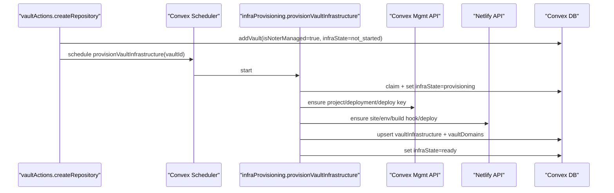

# Vault Infrastructure Auto-Provisioning Specification

## Document Control

- Status: Implemented for MVP
- Owner: Noter backend/frontend
- Last updated: 2026-02-18
- Related plan: `specs/002_VAULT_INFRA_AUTO_PROVISIONING_AND_AI_PROD_ACCESS_PLAN.md`

## Summary

For noter-managed vaults, infrastructure is provisioned automatically after vault creation:

1. Convex project/deployment resources (user-scoped)
2. Netlify site + environment setup (user-scoped)
3. Main-domain tracking in Convex tables

Provisioning is asynchronous and resumable. Vault creation succeeds even if downstream provisioning partially fails.

## Important Behavior

- `vaultActions.createRepository` (new noter-managed repo) requires GitHub + Convex + Netlify connections and schedules `internal.infraProvisioning.provisionVaultInfrastructure` automatically.
- `vaultActions.connectRepository` (existing GitHub repo connection) does **not** auto-provision infra.
- `vaultActions.retryInfrastructureProvisioning` allows manual retries for noter-managed vaults.

## Source of Truth Files

- `apps/noter/convex/vaultActions.ts`
- `apps/noter/convex/infraProvisioning.ts`
- `apps/noter/convex/infraProviders.ts`
- `apps/noter/convex/vault.ts`
- `apps/noter/convex/schema.ts`
- `apps/noter/src/components/VaultDashboard.tsx`

## Data Model

### `vaults` additions

- `infraState: "not_started" | "provisioning" | "ready" | "failed" | "partial"`
- `infraLastError?: string`
- `infraLastProvisionedAt?: number`
- `infraProvisioningStartedAt?: number`

### `vaultInfrastructure`

- `vaultId`
- `status`, `lastError`, `provisioningVersion`, `lastProvisionedAt`
- Convex fields: `convexProjectId`, `convexProjectSlug`, `convexDeploymentName`, `convexDeploymentType`, `convexCloudUrl`, `convexSiteUrl`, `convexDeployKeyId`
- Netlify fields: `netlifySiteId`, `netlifySiteName`, `netlifyTeamId`, `netlifyDefaultUrl`, `netlifyProductionUrl`, `netlifyBuildHookId`

Indexes:
- `by_vault`
- `by_status`

### `vaultDomains`

- `vaultId`, `branch`, `kind`, `url`, `source`, `active`, `lastSyncedAt`

Indexes:
- `by_vault`
- `by_vault_and_branch`

## Runtime Configuration

Required env vars (OAuth + redirects):

- `CONVEX_OAUTH_CLIENT_ID`
- `CONVEX_OAUTH_CLIENT_SECRET`
- `CONVEX_OAUTH_REDIRECT_URL`
- `NETLIFY_OAUTH_CLIENT_ID`
- `NETLIFY_OAUTH_CLIENT_SECRET`
- `NETLIFY_OAUTH_REDIRECT_URL`

Optional:

- `INFRA_DEFAULT_BRANCH` (defaults to `main`)

## API/Function Contracts

### Public

1. `vaultActions.createRepository`
- Returns: `{ vaultId: string }`
- Side effect: schedules async infra provisioning

2. `vaultActions.retryInfrastructureProvisioning`
- Args: `{ vaultId: Id<"vaults"> }`
- Returns: `null`
- Behavior: validates ownership + noter-managed, schedules forced provisioning retry

3. `vault.getVaultInfrastructure`
- Args: `{ vaultId: Id<"vaults"> }`
- Returns: vault infra state + infrastructure snapshot + domain mappings (or `null` if not accessible)

### Internal

- `infraProvisioning.provisionVaultInfrastructure({ vaultId, force? })`
- `infraProvisioning.claimProvisioning({ vaultId, force? })`
- `infraProvisioning.setProvisioningState(...)`
- `infraProvisioning.upsertInfrastructureRecord(...)`
- `infraProvisioning.upsertDomainRecord(...)`

## Provisioning Flow

## State Machine

- `not_started` -> initial vault state
- `provisioning` -> active run (with stale-lock handling)
- `ready` -> full success
- `partial` -> at least one provider succeeded but run failed before completion
- `failed` -> run failed before any provider success

## UI Surface

In `VaultDashboard`:

- Infra status label per vault
- Production URL when available
- `Provision infra` (not started)
- `Retry infra` (failed/partial)

## MVP Notes

- Uses user-scoped OAuth tokens for Convex and Netlify (no operator fallback).
- Provisioning is idempotent/resumable and does not auto-teardown resources on vault deletion unless explicitly requested.

## Deferred

- Automatic teardown/orphan cleanup
- Branch custom domains and routing automation
- Budget/usage alerting

## Acceptance Checklist

- [x] New noter-managed vault creation schedules infra provisioning automatically.
- [x] Existing-repo connect flow does not auto-provision infra.
- [x] Retry path exists and is guarded to noter-managed vaults.
- [x] Infra status + URL are visible in dashboard query/UI surfaces.
