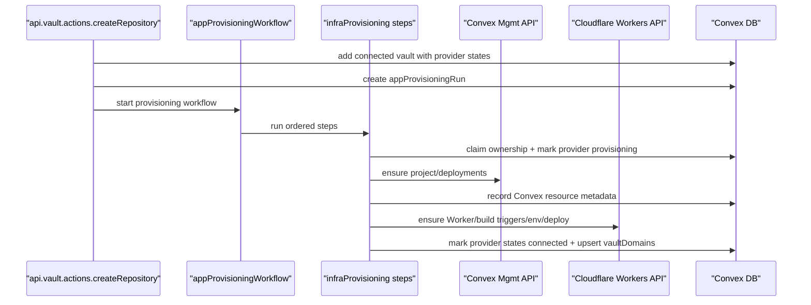

# Vault Infrastructure Auto-Provisioning Specification

## Document Control

- Status: Implemented for MVP
- Owner: Noter backend/frontend
- Last updated: 2026-05-08
- Related plan: `specs/002_VAULT_INFRA_AUTO_PROVISIONING_AND_AI_PROD_ACCESS_PLAN.md`
- Related vault-first cleanup: `specs/096_INITIALIZING_VAULT_GITHUB_PROVISIONING_SPEC.md`
- Cloudflare Workers migration: `specs/101_CLOUDFLARE_WORKERS_SINGLE_STACK_MIGRATION_SPEC.md`

> Note: this spec describes the original MVP implementation. Its Cloudflare Pages-specific sections
> are superseded by the Workers-only direction in
> `specs/101_CLOUDFLARE_WORKERS_SINGLE_STACK_MIGRATION_SPEC.md`.

## Summary

For noter-managed vaults, infrastructure is provisioned automatically after vault creation:

1. Convex project/deployment resources (user-scoped)
2. Cloudflare Worker + Workers Builds setup (user-scoped)
3. Main-domain tracking in Convex tables

Provisioning is asynchronous and resumable. Vault creation succeeds even if downstream provisioning
partially fails.

## Important Behavior

- `api.vault.actions.createRepository` (new noter-managed repo) requires a selected GitHub user/org
  owner and starts the create-app Workflow after inserting the initializing vault and run. The
  Workflow validates provider connections and starts infrastructure provisioning after source setup
  succeeds.
- `api.vault.actions.connectRepository` (existing GitHub repo connection) does **not**
  auto-provision infra.
- `api.vault.actions.retryInfrastructureProvisioning` still exists as a backend action, but the
  dashboard no longer exposes `Provision infra` or `Retry infra` as the normal Noter-managed
  create-app path. Manual provider retry UI belongs to a later vault-first phase.

## Source of Truth Files

- `apps/noter/convex/vault/actions.ts`
- `apps/noter/convex/vault/dashboard.ts`
- `apps/noter/convex/vault/records.ts`
- `apps/noter/convex/infraProvisioning.ts`
- `apps/noter/convex/infraProviders.ts`
- `apps/noter/convex/schema.ts`
- `apps/noter/src/components/vault-dashboard/VaultDashboard.tsx`

## Data Model

### `vaults` provider states

- `convex: { state: "not_configured" | "provisioning" | "connected" | "failed", ... }`
- `cloudflare: { state: "not_configured" | "provisioning" | "connected" | "failed", ... }`

Provider progress belongs on these provider-specific vault states. Do not add a coarse
infrastructure aggregate that can disagree with the Convex or Cloudflare state.

### `vaultInfrastructure`

- `vaultId`
- Convex fields: `convexProjectId`, `convexTeamSlug`, `convexProjectSlug`, `convexDeploymentName`,
  `convexDeploymentType`, `convexCloudUrl`, `convexSiteUrl`
- `convexDeployKey`: either `{ state: "not_created" }` or `{ state: "created", id }`
- No provider readiness, error, or hosting state. Product readiness lives on `vaults.convex` and
  `vaults.cloudflare`; active writer state lives on `vaultInfrastructureOwnership`; run errors live
  on `appProvisioningRuns` and `appProvisioningEvents`.

Indexes:

- `by_vault`

### `vaultInfrastructureTargets`

- `vaultId`
- `convex`: either `{ state: "planned", projectName }` or
  `{ state: "created", projectName, projectId }`
- `cloudflare`: either `{ state: "planned", workerName }` or
  `{ state: "created", accountId, workerName, workerTag, productionUrl }`
- `createdAt`, `updatedAt`

The target row records user-selected provider names before side effects happen and exact provider
identities after a provider resource has been created. Do not model created identities as optional
sibling fields; the `planned`/`created` variant must say which identifiers exist.

Indexes:

- `by_vault`

### `vaultDomains`

- `vaultId`, `branch`, `kind`, `url`, `source`, `active`, `lastSyncedAt`

Indexes:

- `by_vault`
- `by_vault_and_branch`

## Runtime Configuration

Required env vars (OAuth + redirects):

- `PROVIDER_CONVEX_OAUTH_CLIENT_ID`
- `PROVIDER_CONVEX_OAUTH_CLIENT_SECRET`
- `PROVIDER_CONVEX_OAUTH_REDIRECT_URL`
- `PROVIDER_CLOUDFLARE_MCP_REDIRECT_URL`

Repository default branch:

- Use the connected vault's GitHub `defaultBranch` for Cloudflare production branch configuration.
  Do not reintroduce an `INFRA_DEFAULT_BRANCH` override; repositories can use `main`, `master`, or
  any custom default branch.

## API/Function Contracts

### Public

1. `api.vault.actions.createRepository`

- Returns: `{ vaultId: string }`
- Side effect: starts async infra provisioning through Convex Workflow

2. `api.vault.actions.retryInfrastructureProvisioning`

- Args: `{ vaultId: Id<"vaults"> }`
- Returns: `null`
- Behavior: validates ownership + noter-managed, starts a forced provisioning retry

3. `api.vault.dashboard.getVaultInfrastructure`

- Args: `{ vaultId: Id<"vaults"> }`
- Returns: vault infra state + infrastructure snapshot + domain mappings (or `null` if not
  accessible)

### Internal

- `appProvisioningWorkflow.startVaultInfrastructureProvisioning({ vaultId, runId, force })`
- `appProvisioningWorkflow.provisionVaultInfrastructure({ vaultId, runId, force })`
- `infraProvisioning.claimWorkflowProvisioning({ vaultId, runId, force })`
- `infraProvisioning.recordConvexInfrastructure(...)`
- `infraProvisioning.recordConvexDeployKey(...)`
- `infraProvisioning.upsertDomainRecord(...)`

## Provisioning Flow

## State Machine

- `vault.convex` and `vault.cloudflare` each move through
  `not_configured -> provisioning -> connected` or `failed`.
- `vaultInfrastructureOwnership` records the active/succeeded/failed writer run.
- `appProvisioningRuns` and `appProvisioningEvents` record workflow progress and user-visible
  failures.

## UI Surface

In `VaultDashboard`:

- Infra status label per vault
- Production URL when available
- Infra setup progress/log surface while Noter-managed infra is preparing, provisioning, failed, or
  partially complete

Dashboard external links:

- Noter-managed vaults with infrastructure metadata render a compact service-link row near the
  repository title.
- The row includes the GitHub repository link and only renders when at least one managed-infra link
  is available.
- The Cloudflare link targets the specific Worker:
  `https://dash.cloudflare.com/?to=/<accountId>/workers/services/view/<workerName>/production/deployments`.
- The `Project settings` Convex link targets the project-scoped settings page:
  `https://dashboard.convex.dev/t/<teamSlug>/<projectSlug>/settings`.
- The production Convex link renders on the default branch row, not in the repository-title service
  row, because the production deployment follows that branch.
- The production Convex link targets the deployment dashboard from the connected team slug, managed
  project slug, and deployment name:
  `https://dashboard.convex.dev/t/<teamSlug>/<projectSlug>/<deploymentName>`.
- Non-default branch rows with a current Cloudflare branch preview render a `Preview deploy` Convex
  link for the matching preview deployment reference:
  `https://dashboard.convex.dev/t/<teamSlug>/<projectSlug>/preview/<branchName>`.
- Service links are mobile-friendly text links with service icons. Labels should stay concise; the
  default-branch Convex deployment link uses `Production deploy`, and branch preview Convex
  deployment links use `Preview deploy`.

## MVP Notes

- Uses user-scoped provider connections for Convex and Cloudflare (no operator fallback).
- Cloudflare provisioning requires the selected account id already stored on the Cloudflare provider
  connection. It must not inventory accounts and choose one during provisioning.
- Workers Builds repository connection uses the connected vault's stored GitHub repo id and a
  required owner id read from the GitHub repository response. The response repo id must match the
  vault before Cloudflare receives the connection request.
- Provisioning is idempotent/resumable and does not auto-teardown resources on vault deletion unless
  explicitly requested.

## Deferred

- Automatic teardown/orphan cleanup
- Branch custom domains and routing automation
- Budget/usage alerting

## Acceptance Checklist

- [x] New noter-managed vault creation schedules infra provisioning automatically.
- [x] Existing-repo connect flow does not auto-provision infra.
- [x] Retry path exists and is guarded to noter-managed vaults.
- [x] Infra status + URL are visible in dashboard query/UI surfaces.
- [x] Managed vault dashboard cards expose direct Cloudflare project and Convex deployment links
      when the stored infrastructure metadata is available.
