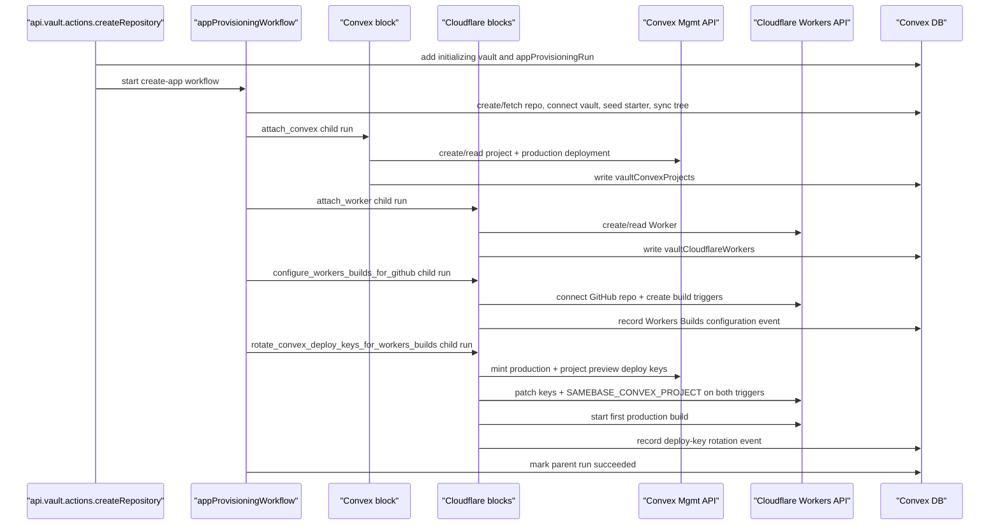

# Vault Infrastructure Auto-Provisioning Specification

## Document Control

- Status: Implemented for MVP
- Owner: Samebase backend/frontend
- Last updated: 2026-07-29
- Related plan: `archive/002_VAULT_INFRA_AUTO_PROVISIONING_AND_AI_PROD_ACCESS_PLAN.md`
- Related vault-first cleanup: `specs/096_INITIALIZING_VAULT_GITHUB_PROVISIONING_SPEC.md`
- Related deletion contract: `specs/098_VAULT_DELETION_WORKFLOW_SPEC.md`
- Cloudflare Workers migration: `specs/101_CLOUDFLARE_WORKERS_SINGLE_STACK_MIGRATION_SPEC.md`
- Manual Convex attachment: `specs/106_CONVEX_MANUAL_DEPLOYMENT_CONNECTION_SPEC.md`
- Resource attachment model: `specs/115_VAULT_RESOURCE_ATTACHMENT_MODEL_SPEC.md`

> Note: this spec describes the Workers-only provisioning workflow. Durable resource attachment
> identity and read-time root projection are defined in spec 115.

## Summary

For samebase-managed vaults, infrastructure is composed from the same narrow blocks used by manual
resource attachment:

1. create/connect the GitHub source and sync the default-branch tree
2. attach or create the Convex project at the plan's confirmed `convex.json` path
3. attach or create the Cloudflare Worker named by the plan
4. configure the Worker's Workers Builds triggers for GitHub
5. rotate and install the selected Convex project's deploy keys, then start the first production
   build

Provisioning is asynchronous. Retries reuse provider identities that were successfully checkpointed.
Vault creation succeeds even if downstream provisioning partially fails.

## Important Behavior

- `api.vault.actions.createRepository` (new samebase-managed repo) requires a selected GitHub
  user/org owner and starts the create-app Workflow after inserting the initializing vault and run.
  The Workflow validates provider connections and starts infrastructure provisioning after source
  setup succeeds.
- `api.vault.actions.connectRepository` (existing GitHub repo connection) does **not**
  auto-provision infra.
- Existing GitHub vaults can attach or create Convex resources later through the manual Convex
  deployment connection flow in `specs/106_CONVEX_MANUAL_DEPLOYMENT_CONNECTION_SPEC.md`.
- `api.vault.actions.retryInfrastructureProvisioning` restarts the composed block sequence for a
  failed Samebase-managed create flow. Manual provider setup failures still reopen the matching
  provider connection dialog instead of running the managed infrastructure retry.

## Source of Truth Files

- `apps/samebase/convex/vault/actions.ts`
- `apps/samebase/convex/vault/dashboard.ts`
- `apps/samebase/convex/vault/records.ts`
- `apps/samebase/convex/infraProvisioning.ts`
- `apps/samebase/convex/vault/convex.ts`
- `apps/samebase/convex/vault/convexMutations.ts`
- `apps/samebase/convex/vault/cloudflare.ts`
- `apps/samebase/convex/vault/cloudflareMutations.ts`
- `apps/samebase/convex/vault/infrastructureOperation.ts`
- `apps/samebase/convex/schema.ts`
- `apps/samebase/src/components/vault-dashboard/VaultDashboard.tsx`

## Data Model

### `workflow_vaultProvisioning_plans`

- `vaultId`, `userId`
- `convexConfigPath`
- `convex`: `{ state: "planned", projectName }`, `{ state: "creating", projectName, teamId }`, or
  `{ state: "created", projectName, teamId, projectId }`
- `cloudflare`: `{ state: "planned", accountId, workerName, build }`,
  `{ state: "creating", accountId, workerName, build }`, or
  `{ state: "created", accountId, workerName, workerTag, build }`
- `createdAt`, `updatedAt`

The plan row records user-selected provider names before side effects happen so retries use the same
configuration. `creating` means the provider create request started but Samebase never recorded a
confirmed result. Retry checks the exact planned name. If that provider resource exists, Samebase
requires the user to delete it in the provider dashboard before retrying. If it is absent, Samebase
repeats the create request without adding another workflow state. A same-named resource is never
adopted implicitly. `created` is the exact provider identity checkpoint used by retry. Samebase
writes that checkpoint and its stable `provisioned` resource attachment in one database transaction.
Checkbox-controlled cleanup derives ownership only from the stable attachment, never from an
unattached checkpoint. Current connected resource identities live in the durable resource tables
used by the dashboard.

Indexes:

- `by_vault`

### `workflow_vaultProvisioning_writeLocks`

This table stores the current or most recent infrastructure write for one vault. Its owner is one
of:

- `{ kind: "managed_run", runId }`
- `{ kind: "manual_provider_write", actionId, target, expiresAt }`

A managed owner can be `active`, `succeeded`, or `failed`. A manual owner can also be
`recovery_required` or `recovering`. Only an active managed owner or a manual owner in `active`,
`recovery_required`, or `recovering` state blocks another infrastructure write.

`lastWriteAt.convex` and `lastWriteAt.cloudflare` are independent optional times. Samebase updates
one of these times only when the matching provider write gets a known result. A write to one
provider must not clear the other provider time.

The provisioning plan is durable retry input. It is not an active operation and does not block a
manual write by itself.

### `vaultConvexProjects`

- `vaultId`, `userId`
- `teamId`, `projectId`, `convexConfigPath`
- `origin: "provisioned" | "selected_existing"`

This table is the durable attachment between a vault and a Convex project. It stores stable provider
coordinates, the user-confirmed repository config path, and provenance. Convex `_creationTime`
records when the attachment was created. Current project slugs, team slugs, production and preview
deployments, URLs, and deploy keys are provider state and must not be mirrored into this row.
`projectId` is globally exclusive. Several projects may intentionally share one `convexConfigPath`.

Indexes:

- `by_vault`
- `by_user`
- `by_project` (global attachment exclusivity)

### `vaultCloudflareWorkers`

- `vaultId`, `userId`
- `accountId`, `workerName`, `workerTag`
- `origin: "provisioned" | "selected_existing"`

This table is the durable attachment between a vault and a Cloudflare Worker. Current workers.dev
URLs, Worker existence, Workers Builds triggers, repository configuration, root directory, and
Convex deploy keys are provider state and must not be mirrored into this row. Convex `_creationTime`
records when the attachment was created.

### Worker-to-Convex build relationship

`SAMEBASE_CONVEX_PROJECT` is a non-secret Cloudflare Workers Builds variable with the value
`version=1&teamId=<teamId>&projectId=<projectId>`.

Samebase writes the same marker to the production and preview Builds triggers together with the
secret variables `CONVEX_DEPLOY_KEY` and `PREVIEW_CONVEX_DEPLOY_KEY`. The current readable marker is
the authoritative declaration of which Convex project the Worker is configured to deploy. It is
user-controlled provider configuration, not cryptographic proof that the hidden secret values belong
to that project. A user who changes the keys directly in Cloudflare must also update or remove the
marker.

Samebase does not persist a Worker-to-project dependency row or attachment field. The selected
project may exist as active workflow input while an explicit provider operation runs, but completed
relationship state is read from Cloudflare. Multiple Workers may declare the same Convex project.
One Worker has one observable target only when its production and preview markers agree.

The live observation reports these states without guessing:

- the same valid marker and both secret names on both triggers: configured for that project
- matching markers with missing secret names: incomplete, with repair available
- secret names with no marker: target unknown
- different valid markers or a valid marker on only one trigger: inconsistent
- a malformed marker on either trigger: invalid
- a marker naming a project that is not attached to the vault: externally configured project
- a provider read failure: unknown, without inferring that configuration is missing

### Provider observation boundary

Provider-owned state is observed directly from Convex and Cloudflare for one requested vault.
Cloudflare Worker axes return explicit `available`, `missing`, or `failed` results where those
states apply. Each Convex attachment returns source placement as `valid`, `missing`,
`unavailable_partial`, or `unavailable`, and provider continuity as `current`, `moved`,
`missing_ambiguous`, or `unavailable`. Every result carries an observation timestamp. The dashboard
may cache those results in the browser for a short bounded interval, but the actions do not write
them to Convex tables. Stable attachment rows remain unchanged when a provider resource changes or
disappears.

Each provider observation query uses the matching `lastWriteAt` value in its query key. When that
value changes, the dashboard makes one new read and shows `Checking` until the read returns. An
older result must not create attention or repair UI during this check. The first new result becomes
the normal state, including a provider read failure. Samebase does not continuously poll for this
write-safety check.

Cloudflare uses three independently loading observation axes:

1. Worker identity, existence, and workers.dev availability.
2. Workers Builds repository configuration and production/preview trigger identifiers.
3. Convex marker and deploy-key classification for the connected trigger identifiers.

The dashboard starts the first two reads concurrently. A confirmed Worker and its links become
available without waiting for Builds or trigger variables. The third read starts only after the
second read proves that both Builds triggers exist. Trigger identifiers are short-lived input for
that browser request, not durable Samebase data; the server revalidates that every requested Worker
belongs to the vault and derives its Cloudflare account from the attachment before reading trigger
variables. Provider secret values never leave the action.

Provisioning and repair actions re-read the provider state they require before acting. Durable run
events record that an explicit operation succeeded or failed; they are operation evidence, not a
claim that the provider still has the same state later.

Convex build-access rotation derives exact Samebase-owned names from the full vault and Worker
attachment ids. The provider-visible v2 contract is
`samebase-workers-builds-v2-<vaultId>-<workerId>-production` and
`samebase-workers-builds-v2-<vaultId>-<workerId>-preview`. The names are computed when an operation
runs and are not stored in a Samebase table. Changing the format requires a new explicit version;
existing versions must not be edited in place. A rotation deletes those exact names directly in
Convex before minting replacements. Samebase does not store deploy-key names, ids, or secrets in its
database.

Indexes:

- `by_vault`
- `by_user`
- `by_account_and_worker` (global attachment exclusivity)
- `by_account_and_worker_tag` (global attachment exclusivity)

The default workers.dev URL and custom routes are read from Cloudflare when needed. Samebase does
not copy provider domain or URL state into a Convex table.

## Runtime Configuration

Cloudflare `oauth` and `api_key` connections call `api.cloudflare.com` directly. Only legacy
`mcp_oauth` connections call the Cloudflare MCP server.

Required env vars (OAuth + redirects):

- `PROVIDER_CONVEX_OAUTH_CLIENT_ID`
- `PROVIDER_CONVEX_OAUTH_CLIENT_SECRET`
- `PROVIDER_CONVEX_OAUTH_REDIRECT_URL`
- `PROVIDER_CLOUDFLARE_OAUTH_CLIENT_ID`
- `PROVIDER_CLOUDFLARE_OAUTH_CLIENT_SECRET`
- `PROVIDER_CLOUDFLARE_OAUTH_REDIRECT_URL`

Legacy Cloudflare MCP OAuth route, kept for existing rows only:

- `PROVIDER_CLOUDFLARE_MCP_REDIRECT_URL`

Repository default branch:

- Use the connected vault's GitHub `defaultBranch` for Cloudflare production branch configuration.
  Do not reintroduce an `INFRA_DEFAULT_BRANCH` override; repositories can use `main`, `master`, or
  any custom default branch.

## API/Function Contracts

### Public

1. `api.vault.actions.createRepository`

- Returns: `{ vaultId: string }`
- Side effect: starts async infra provisioning through Convex Workflow

2. `api.vault.actions.retryInfrastructureProvisioning`

- Args: `{ vaultId: Id<"vaults"> }`
- Returns: `null`
- Behavior: validates ownership + samebase-managed, starts a managed provisioning retry

3. `api.vault.dashboard.getUserVaults`

- Returns: stable attachments, the managed `providerPlan`, and the vault `providerWrite` summary for
  the authenticated user
- `providerWrite` returns its status, owner, affected providers, update time, and independent
  provider write times. Its idle variant returns the provider write times only.

4. `api.vault.providerObservations.observeCloudflareWorkers`

- Args: `{ vaultId: Id<"vaults"> }`
- Returns: bounded live Worker identity, existence, and workers.dev observations

5. `api.vault.providerObservations.observeCloudflareWorkerBuilds`

- Args: `{ vaultId: Id<"vaults"> }`
- Returns: bounded live repository configuration and production/preview Builds trigger identifiers

6. `api.vault.providerObservations.observeCloudflareWorkerConvexBuildAccess`

- Args:
  `{ vaultId: Id<"vaults">, targets: { workerId, productionTriggerUuid, previewTriggerUuid }[] }`
- Returns: bounded live Convex marker and deploy-key classification without provider secret values

7. `api.vault.providerObservations.observeConvexProjects`

- Args: `{ vaultId: Id<"vaults"> }`
- Returns: live source-placement and provider-continuity observations for every attached project

8. `api.vault.cloudflare.discoverWorkers` and `api.vault.cloudflare.attachWorkers`

- Discover returns Workers connected to the vault repository with their current verified roots.
- Attach accepts several selected provider identities and commits the whole selection atomically.

9. `api.vault.cloudflare.createWorker` and `api.vault.cloudflare.detachWorker`

- Create records a provisioned attachment before later provider configuration can fail.
- Detach changes only Samebase user intent and never deletes a selected existing Worker.

10. `api.vault.convex.discoverProjects` and `api.vault.convex.attachProjects`

- Discover returns provider projects plus exact discovered `convex.json` or default-layout
  `package.json` and sibling `convex/` candidates.
- Attach requires one verified code location per selected project and commits the batch atomically.

11. `api.vault.convex.createProject` and `api.vault.convex.detachProject`

- Create records the provider checkpoint and provisioned attachment before metadata refresh.
- Detach changes only Samebase user intent.

12. `api.vault.convex.changeProjectCodeLocation` and `api.vault.convex.reconcileProjectTeam`

- Both are explicit provider-verified compare-and-swap repairs of one attachment field.

### Internal

- `appProvisioningWorkflow.startVaultInfrastructureProvisioning({ vaultId, runId })`
- `appProvisioningWorkflow.provisionVaultInfrastructure({ vaultId, runId })`
- `appProvisioningWorkflow.provisionApp(...)`
- `vault/convex.ensureConvexProjectConnection(...)`
- `vault/cloudflare.ensureCloudflareWorkerConnection(...)`
- `vault/cloudflare.configureWorkersBuildsForGitHubForUser(...)`
- `vault/cloudflare.rotateConvexDeployKeysForWorkersBuildsForUser(...)`

## Provisioning Flow

## State Machine

- `vaultConvexProjects` exists when `attach_convex` has attached the plan's exact project and config
  path.
- `vaultCloudflareWorkers` exists when `attach_worker` has attached the plan's exact Worker.
- `configure_workers_builds_for_github` and `rotate_convex_deploy_keys_for_workers_builds` do not
  change either attachment row. Their provider writes are observed live when a caller next requests
  current state.
- One shared infrastructure-state reader checks the deletion gate, queued or running managed runs,
  and the write-lock row.
- Only one operation can change a provider attachment or provider resource in one vault at one time.
- A database-only attachment change checks the operation and changes the attachment in one
  transaction.
- An external provider write claims the manual owner before its first provider call. The action
  records the known result and affected provider times before it releases the block.
- A manual action has a five-minute action deadline and a ten-minute owner expiry. At owner expiry,
  Samebase starts one leased `recovering` attempt for the same action ID. A user can also start one
  leased attempt from `recovery_required` with Retry. The attempt has a five-minute action deadline
  and an eleven-minute lease. An error or an expired lease returns the exact attempt to
  `recovery_required`. A late, concurrent, or replaced attempt cannot call a later provider, record
  a checkpoint, or complete.
- `workflow_vaultProvisioning_runs` and `workflow_vaultProvisioning_events` record managed app
  creation and retry progress. Explicit manual provider attachment does not create a Workflow run.

The dashboard derives control state from `getUserVaults`. Backend mutations use the shared reader to
reject conflicts. There is no separate command-availability API, generic provider framework,
resource-level lock, manual-action Workflow run, or manual-action history table.

## UI Surface

In `VaultDashboard`:

- Infra status label per vault
- Production URL when available
- Infra setup progress/log surface while Samebase-managed infra is preparing, provisioning, failed,
  or partially complete
- Failed Samebase-managed Convex or Cloudflare setup shows a `Retry` action that calls
  `api.vault.actions.retryInfrastructureProvisioning`.
- Missing or inaccessible provider resources remain attached and surface attention. Removal is an
  explicit change to user intent and never follows automatically from provider absence. A Convex 404
  under the stored team is ambiguous because the project may have transferred.
- An attached Cloudflare Worker whose Builds connection is missing shows
  `Cloudflare is not connected to this GitHub repository.` with a
  `Configure Workers Builds for GitHub` action.
- An attached Cloudflare Worker with connected Builds can receive deploy keys for one explicitly
  selected attached Convex project through `Use <project> for Workers Builds`. If the Worker's live
  marker already names an attached project but the access needs repair, the UI offers only
  `Repair keys for <project>`. The action patches `CONVEX_DEPLOY_KEY`, `PREVIEW_CONVEX_DEPLOY_KEY`,
  and `SAMEBASE_CONVEX_PROJECT` into both triggers. The selected project is operation input, not a
  persisted Samebase dependency row.
- The dashboard derives the current deploy-key configuration state from the two live Cloudflare
  triggers. Loading, configured, not configured, incomplete, target unknown, inconsistent, invalid,
  externally configured, and provider-read failure are distinct states.
- Worker, Builds, and Convex build-access observations load independently. A confirmed Worker link
  remains usable while later facts show a quiet loading pulse. Reload actions retry only the failed
  observation axis.

Dashboard external links:

- Samebase-managed vaults with infrastructure metadata render a compact service-link row near the
  repository title.
- The row includes the GitHub repository link and only renders when at least one managed-infra link
  is available.
- The Cloudflare link targets the specific Worker:
  `https://dash.cloudflare.com/?to=/<accountId>/workers/services/view/<workerName>/production/settings`.
- A live Convex observation provides the `Project settings` link for the project-scoped settings
  page: `https://dashboard.convex.dev/t/<teamSlug>/<projectSlug>/settings`.
- The durable default branch renders as its own surface above the open pull request list. It remains
  visible when provider observations are loading, failed, or yield no production links; it is never
  represented as a pull request.
- The default-branch surface links the exact branch to its GitHub tree and to the branch editor at
  `/vault/:owner/:repo/fs/:branch` without compare mode.
- Live workers.dev URLs render in the surface's production resource group only after the direct
  Worker attachment joins matching Worker identity and Builds-root observations. No provider URL or
  repository root is copied into another Samebase model.
- The production Convex link renders on the default-branch surface, not in the repository-title
  service row, because the production deployment follows that branch.
- The production Convex link uses the observed team slug, project slug, and deployment name:
  `https://dashboard.convex.dev/t/<teamSlug>/<projectSlug>/<deploymentName>`.
- Service links are mobile-friendly text links with service icons. Labels should stay concise; the
  default-branch Convex deployment link uses `Production: <deploymentName>`.

## MVP Notes

- Uses user-scoped provider connections for Convex and Cloudflare (no operator fallback).
- Cloudflare provisioning requires the selected account id already stored on the Cloudflare provider
  connection. It must not inventory accounts and choose one during provisioning.
- Workers Builds repository connection uses the connected vault's stored GitHub repo id and a
  required owner id read from the GitHub repository response. The response repo id must match the
  vault before Cloudflare receives the connection request.
- If Workers Builds repository connection returns Cloudflare error code `8000008`, surface this as:
  `Cloudflare Workers and Pages GitHub App is not authorized for <owner>/<repo>. Follow Cloudflare's recovery steps at https://developers.cloudflare.com/pages/configuration/git-integration/github-integration/#reinstall-the-cloudflare-github-app: uninstall the GitHub App first, then reinstall/connect GitHub from Workers & Pages and include <owner>/<repo>, then retry.`
  Provisioning failure recording stores this normalized message on the run `lastError`. The
  dashboard may summarize that stored provider failure into shorter recovery copy. The recovery copy
  must link to Cloudflare's reinstall recovery steps, tell the user to uninstall the Cloudflare
  Workers and Pages GitHub App first, then reconnect GitHub from Workers & Pages before retrying.
- Managed provisioning reuses confirmed provider checkpoints and does not auto-teardown resources on
  vault deletion unless explicitly requested. After an unconfirmed provider create outcome, retry
  stops when the same-named resource exists and tells the user to delete it in the provider
  dashboard. Once the name is absent, retry repeats the create request. Samebase never adopts or
  deletes the resource automatically. A confirmed checkpoint and its stable provider attachment are
  recorded atomically.

## Deferred

- Automatic teardown/orphan cleanup
- Branch custom domains and routing automation
- Budget/usage alerting

## Acceptance Checklist

- [x] New samebase-managed vault creation schedules infra provisioning automatically.
- [x] Existing-repo connect flow does not auto-provision infra.
- [x] Retry path exists and is guarded to samebase-managed vaults.
- [x] Failed Samebase-managed provider setup rows expose the guarded retry path.
- [x] Infra status + URL are visible in dashboard query/UI surfaces.
- [x] Managed vault dashboard cards expose direct Cloudflare project and Convex deployment links
      when the stored infrastructure metadata is available.
- [x] A plan without an active managed run does not block a manual provider action.
- [x] Managed setup, manual writes, recovery, and deletion reject conflicting vault infrastructure
      writes in the backend.
- [x] An old manual action ID cannot complete or clear a newer owner.
- [x] Provider-specific write times cause one fresh observation read without continuous polling.
