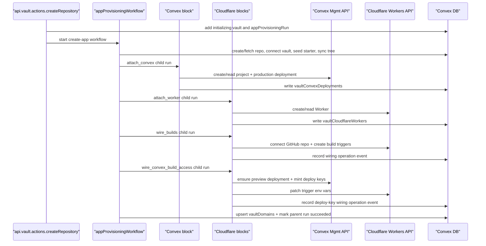

# Vault Infrastructure Auto-Provisioning Specification

## Document Control

- Status: Implemented for MVP
- Owner: Samebase backend/frontend
- Last updated: 2026-07-05
- Related plan: `archive/002_VAULT_INFRA_AUTO_PROVISIONING_AND_AI_PROD_ACCESS_PLAN.md`
- Related vault-first cleanup: `specs/096_INITIALIZING_VAULT_GITHUB_PROVISIONING_SPEC.md`
- Cloudflare Workers migration: `specs/101_CLOUDFLARE_WORKERS_SINGLE_STACK_MIGRATION_SPEC.md`
- Manual Convex attachment: `specs/106_CONVEX_MANUAL_DEPLOYMENT_CONNECTION_SPEC.md`

> Note: this spec now describes the Workers-only, app-root-scoped provisioning model. Older
> Cloudflare Pages and `vaultInfrastructure` aggregate models are superseded.

## Summary

For samebase-managed vaults, infrastructure is composed from the same narrow blocks used by manual
resource attachment:

1. create/connect the GitHub source and sync the default-branch tree
2. attach or create the Convex production deployment for the target app root
3. attach or create the Cloudflare Worker for the target app root
4. wire the Worker to GitHub through Workers Builds
5. wire Workers Builds to Convex deploy keys when the app root has Convex
6. record the default Cloudflare Worker URL in `vaultDomains`

Provisioning is asynchronous and resumable. Vault creation succeeds even if downstream provisioning
partially fails.

## Important Behavior

- `api.vault.actions.createRepository` (new samebase-managed repo) requires a selected GitHub
  user/org owner and starts the create-app Workflow after inserting the initializing vault and run.
  The Workflow validates provider connections and starts infrastructure provisioning after source
  setup succeeds.
- `api.vault.actions.connectRepository` (existing GitHub repo connection) does **not**
  auto-provision infra.
- Existing GitHub vaults can attach or create Convex resources later through the manual Convex
  deployment connection flow in `specs/106_CONVEX_MANUAL_DEPLOYMENT_CONNECTION_SPEC.md`.
- `api.vault.actions.retryInfrastructureProvisioning` restarts the composed block sequence for a
  failed Samebase-managed create flow. Manual provider setup failures still reopen the matching
  provider connection dialog instead of running the managed infrastructure retry.

## Source of Truth Files

- `apps/samebase/convex/vault/actions.ts`
- `apps/samebase/convex/vault/dashboard.ts`
- `apps/samebase/convex/vault/records.ts`
- `apps/samebase/convex/infraProvisioning.ts`
- `apps/samebase/convex/vault/convex.ts`
- `apps/samebase/convex/vault/convexMutations.ts`
- `apps/samebase/convex/vault/cloudflare.ts`
- `apps/samebase/convex/vault/cloudflareMutations.ts`
- `apps/samebase/convex/schema.ts`
- `apps/samebase/src/components/vault-dashboard/VaultDashboard.tsx`

## Data Model

### `vaultApps`

- `vaultId`, `userId`, `appRoot`, `createdAt`

The vault owns the repository. App-root-specific provider resources attach to `vaultApps` by
`vaultId` + `appRoot`; `"."` is an explicit repository-root app, not a fallback.

Indexes:

- `by_vault`
- `by_user`
- `by_vault_and_appRoot`

### `workflow_vaultProvisioning_plans`

- `vaultId`
- `appRoot`
- `convex`: either `{ state: "planned", projectName }` or
  `{ state: "created", projectName, projectId }`
- `cloudflare`: either `{ state: "planned", accountId, workerName, build }` or
  `{ state: "created", accountId, workerName, workerTag, workersDevUrl?, build }`
- `createdAt`, `updatedAt`

The plan row records user-selected provider names before side effects happen so retries use the same
configuration. The `created` variants remain readable for earlier provider-identity checkpoints;
current connected resource identities live in the durable resource tables used by the dashboard.

Indexes:

- `by_vault`
- `by_vault_and_appRoot`

### `vaultConvexDeployments`

- `vaultId`, `userId`, `appRoot`
- `projectId`, `deploymentName`
- `origin: "provisioned" | "selected_existing"`, `connectedAt`

This table is the durable attachment between a vault app root and a Convex deployment. It stores
only stable provider coordinates, provenance, and the time of attachment. Current project slugs,
team slugs, URLs, deployment existence, preview deployments, and deploy keys are provider state and
must not be mirrored into this row.

Indexes:

- `by_vault`
- `by_user`
- `by_vault_and_appRoot`
- `by_vault_and_project`

### `vaultCloudflareWorkers`

- `vaultId`, `userId`, `appRoot`
- `accountId`, `workerName`, `workerTag`
- `origin: "provisioned" | "selected_existing"`, `connectedAt`

This table is the durable attachment between a vault app root and a Cloudflare Worker. Current
workers.dev URLs, Worker existence, Workers Builds triggers, repository wiring, and Convex deploy
keys are provider state and must not be mirrored into this row.

### Provider observation boundary

Provider-owned state is observed directly from Convex and Cloudflare for one requested vault. The
observation action returns explicit `available`, `missing`, or `failed` results with an observation
timestamp. The dashboard may cache those results in the browser for a short bounded interval, but
the action does not write them to Convex tables. Stable attachment rows remain unchanged when a
provider resource changes or disappears.

Provisioning and repair actions re-read the provider state they require before acting. Durable run
events record that an explicit operation succeeded or failed; they are operation evidence, not a
claim that the provider still has the same state later.

Convex build-access rotation uses exact Samebase-owned key names derived from the full vault id. A
rotation lists and deletes matching keys directly in Convex before minting replacements. Samebase
does not store deploy-key ids or secrets in its database.

Indexes:

- `by_vault`
- `by_user`
- `by_vault_and_appRoot`
- `by_vault_and_account_and_worker`

### `vaultDomains`

- `vaultId`, `branch`, `kind`, `url`, `source`, `active`, `lastSyncedAt`

Indexes:

- `by_vault`
- `by_vault_and_branch`

## Runtime Configuration

Required env vars (OAuth + redirects):

- `PROVIDER_CONVEX_OAUTH_CLIENT_ID`
- `PROVIDER_CONVEX_OAUTH_CLIENT_SECRET`
- `PROVIDER_CONVEX_OAUTH_REDIRECT_URL`
- `PROVIDER_CLOUDFLARE_OAUTH_CLIENT_ID`
- `PROVIDER_CLOUDFLARE_OAUTH_CLIENT_SECRET`
- `PROVIDER_CLOUDFLARE_OAUTH_REDIRECT_URL`

Legacy Cloudflare MCP OAuth route, kept for existing rows only:

- `PROVIDER_CLOUDFLARE_MCP_REDIRECT_URL`

Repository default branch:

- Use the connected vault's GitHub `defaultBranch` for Cloudflare production branch configuration.
  Do not reintroduce an `INFRA_DEFAULT_BRANCH` override; repositories can use `main`, `master`, or
  any custom default branch.

## API/Function Contracts

### Public

1. `api.vault.actions.createRepository`

- Returns: `{ vaultId: string }`
- Side effect: starts async infra provisioning through Convex Workflow

2. `api.vault.actions.retryInfrastructureProvisioning`

- Args: `{ vaultId: Id<"vaults"> }`
- Returns: `null`
- Behavior: validates ownership + samebase-managed, starts a managed provisioning retry

3. `api.vault.dashboard.getVaultInfrastructure`

- Args: `{ vaultId: Id<"vaults"> }`
- Returns: vault infra state + infrastructure snapshot + domain mappings (or `null` if not
  accessible)

### Internal

- `appProvisioningWorkflow.startVaultInfrastructureProvisioning({ vaultId, runId })`
- `appProvisioningWorkflow.provisionVaultInfrastructure({ vaultId, runId })`
- `appProvisioningWorkflow.provisionApp(...)`
- `vault/convexMutations.claimConvexDeploymentConnection(...)`
- `vault/convex.ensureConvexDeploymentConnection(...)`
- `vault/convexMutations.finishConvexDeploymentConnection(...)`
- `vault/cloudflareMutations.claimCloudflareWorkerConnection(...)`
- `vault/cloudflare.ensureCloudflareWorkerConnection(...)`
- `vault/cloudflareMutations.finishCloudflareWorkerConnection(...)`
- `vault/cloudflareMutations.claimCloudflareBuildsWiring(...)`
- `vault/cloudflare.wireCloudflareWorkerBuilds(...)`
- `vault/cloudflareMutations.finishCloudflareBuildsWiring(...)`
- `vault/cloudflareMutations.claimCloudflareConvexBuildAccessWiring(...)`
- `vault/cloudflare.wireCloudflareWorkerConvexBuildAccess(...)`
- `vault/cloudflareMutations.finishCloudflareConvexBuildAccessWiring(...)`
- `infraProvisioning.upsertDomainRecord(...)`

## Provisioning Flow

## State Machine

- `vaultConvexDeployments` exists when `attach_convex` has attached the app root's production
  deployment.
- `vaultCloudflareWorkers` exists when `attach_worker` has attached the app root's Worker.
- `wire_builds` and `wire_convex_build_access` do not change either attachment row. Their provider
  writes are observed live when a caller next requests current state.
- `workflow_vaultProvisioning_writeLocks` records the active/succeeded/failed writer run.
- `workflow_vaultProvisioning_runs` and `workflow_vaultProvisioning_events` record workflow progress
  and user-visible failures.

## UI Surface

In `VaultDashboard`:

- Infra status label per vault
- Production URL when available
- Infra setup progress/log surface while Samebase-managed infra is preparing, provisioning, failed,
  or partially complete
- Failed Samebase-managed Convex or Cloudflare setup shows a `Retry` action that calls
  `api.vault.actions.retryInfrastructureProvisioning`.
- Failed manual Convex or Cloudflare setup reopens the matching `?add-convex` or `?add-cloudflare`
  provider dialog for the app root.
- An attached Cloudflare Worker whose Builds connection is missing shows
  `Cloudflare is not connected to this GitHub repository.` with a `Connect GitHub repo` action.
- An attached Cloudflare Worker for an app root that also has Convex, connected Builds, and missing
  Convex build access shows `Cloudflare does not have this Convex deployment's deploy keys.` with a
  `Set Convex deploy keys` action. The action patches both `CONVEX_DEPLOY_KEY` and
  `PREVIEW_CONVEX_DEPLOY_KEY` into the production and preview Workers Builds triggers. The live
  observation treats Convex build access as missing unless both deploy-key names exist on both live
  triggers; split-by-trigger layouts are repaired by the same action.

Dashboard external links:

- Samebase-managed vaults with infrastructure metadata render a compact service-link row near the
  repository title.
- The row includes the GitHub repository link and only renders when at least one managed-infra link
  is available.
- The Cloudflare link targets the specific Worker:
  `https://dash.cloudflare.com/?to=/<accountId>/workers/services/view/<workerName>/production/deployments`.
- A live Convex observation provides the `Project settings` link for the project-scoped settings
  page: `https://dashboard.convex.dev/t/<teamSlug>/<projectSlug>/settings`.
- The production Convex link renders on the default branch row, not in the repository-title service
  row, because the production deployment follows that branch.
- The production Convex link uses the observed team slug, project slug, and deployment name:
  `https://dashboard.convex.dev/t/<teamSlug>/<projectSlug>/<deploymentName>`.
- Service links are mobile-friendly text links with service icons. Labels should stay concise; the
  default-branch Convex deployment link uses `Production: <deploymentName>`.

## MVP Notes

- Uses user-scoped provider connections for Convex and Cloudflare (no operator fallback).
- Cloudflare provisioning requires the selected account id already stored on the Cloudflare provider
  connection. It must not inventory accounts and choose one during provisioning.
- Workers Builds repository connection uses the connected vault's stored GitHub repo id and a
  required owner id read from the GitHub repository response. The response repo id must match the
  vault before Cloudflare receives the connection request.
- If Workers Builds repository connection returns Cloudflare error code `8000008`, surface this as:
  `Cloudflare Workers and Pages GitHub App is not authorized for <owner>/<repo>. Follow Cloudflare's recovery steps at https://developers.cloudflare.com/pages/configuration/git-integration/github-integration/#reinstall-the-cloudflare-github-app: uninstall the GitHub App first, then reinstall/connect GitHub from Workers & Pages and include <owner>/<repo>, then retry.`
  Provisioning failure recording stores this normalized message on the run `lastError`. The
  dashboard may summarize that stored provider failure into shorter recovery copy. The recovery copy
  must link to Cloudflare's reinstall recovery steps, tell the user to uninstall the Cloudflare
  Workers and Pages GitHub App first, then reconnect GitHub from Workers & Pages before retrying.
- Provisioning is idempotent/resumable and does not auto-teardown resources on vault deletion unless
  explicitly requested.

## Deferred

- Automatic teardown/orphan cleanup
- Branch custom domains and routing automation
- Budget/usage alerting

## Acceptance Checklist

- [x] New samebase-managed vault creation schedules infra provisioning automatically.
- [x] Existing-repo connect flow does not auto-provision infra.
- [x] Retry path exists and is guarded to samebase-managed vaults.
- [x] Failed Samebase-managed provider setup rows expose the guarded retry path, while failed manual
      provider setup rows reopen the manual provider dialog.
- [x] Infra status + URL are visible in dashboard query/UI surfaces.
- [x] Managed vault dashboard cards expose direct Cloudflare project and Convex deployment links
      when the stored infrastructure metadata is available.
