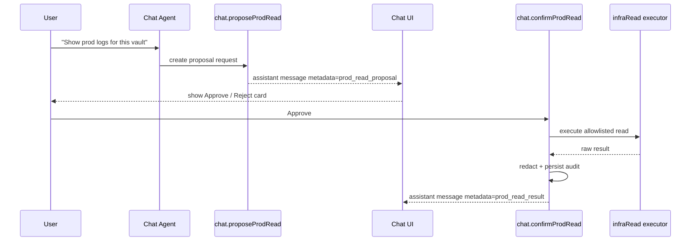

# AI Production Access Policy Specification

## Document Control

- Status: Implemented for MVP owner mode (with follow-ups)
- Owner: Noter chat/agent + platform security
- Last updated: 2026-02-13
- Related plan: `specs/002_VAULT_INFRA_AUTO_PROVISIONING_AND_AI_PROD_ACCESS_PLAN.md`

## Summary

Define how the main Noter AI can inspect production infrastructure, logs, and data in a way that is
auditable and gated by explicit user approval for each request.

This spec is intentionally approval-first and read-only for MVP.

## Implementation Snapshot (2026-02-13)

- Proposal -> explicit approval -> execution flow is live in `chat.ts` + `chat/actions.ts`.
- Request/audit persistence is live via `aiProdAccessRequests` and `aiProdAccessAudit`.
- Admin-only enforcement is active via `isAdminUser`.
- Request expiration (TTL) is active.
- Redaction is active through `infraReadPolicy.ts` with default mode `MVP_OWNER_MODE`.
- Global kill switch is still a follow-up (not currently wired as a runtime gate).

## Goals

- Allow AI-assisted debugging of prod infra/logs/data.
- Require explicit approval for every prod read operation.
- Record immutable audit trail for proposal, approval, execution, and outcome.
- Enforce role checks and global kill switch.
- Redact high-risk data before model exposure and before persistence.

## Non-Goals

- Direct write/mutate access to production providers.
- Fully automated, no-human-loop prod investigations.
- Fine-grained enterprise RBAC model beyond admin-only gate.

## Policy Modes

### 1. `MVP_OWNER_MODE`

- Intended while only trusted owner uses the system.
- Approval required per request.
- Redaction default on.
- Raw payload fallback allowed after explicit approval if needed.

### 2. `MULTI_USER_MODE`

- Required before external users.
- Approval required per request.
- Strict redaction always enforced.
- Raw payload fallback disabled.
- Additional access scoping required by tenant/user.

Runtime configuration:

- MVP defaults to owner mode behavior.
- Production reads are enabled in MVP and always require explicit per-request approval.

## Threat Model

Primary risks:

- Secret leakage (API keys, tokens, auth headers).
- PII exposure through logs and records.
- Over-broad read operations (large unbounded queries).
- Missing attribution of who approved/ran what.

Mitigations in this spec:

- Request-level approval UI.
- Allowlisted tools/endpoints only.
- Redaction pipeline.
- Bounded query/log window constraints.
- Mandatory audit rows and actor attribution.

## Data Model

### 1. `aiProdAccessRequests`

Stores request lifecycle from proposal to execution.

Fields:

- `threadId: string`
- `requesterUserId: Id<"users">`
- `vaultId?: Id<"vaults">`
- `scope: "vault" | "global"`
- `provider: "convex" | "cloudflare"`
- `resourceKind: "deployment_status" | "logs" | "data_query" | "project_inventory" | "account_inventory" | "workers_inventory"`
- `toolName: string`
- `paramsJson: string`
- `status: "proposed" | "approved" | "rejected" | "executed" | "failed" | "expired"`
- `redactionLevel: "default" | "strict" | "raw_fallback"`
- `approvedBy?: Id<"users">`
- `approvedAt?: number`
- `executedAt?: number`
- `expiresAt?: number`
- `error?: string`

Indexes:

- `by_threadId`
- `by_requester`
- `by_status`
- `by_vault`

### 2. `aiProdAccessAudit`

Immutable event log for each request state/action.

Fields:

- `requestId: Id<"aiProdAccessRequests">`
- `actorUserId: Id<"users">`
- `action: "proposed" | "approved" | "rejected" | "executed" | "failed" | "expired"`
- `toolName: string`
- `endpoint: string`
- `argumentHash: string`
- `rowCount?: number`
- `logLineCount?: number`
- `createdAt: number`
- `error?: string`

Indexes:

- `by_request`
- `by_actor`
- `by_action`

### 3. Schema snippet

```ts
const ProdReadStatus = v.union(
  v.literal("proposed"),
  v.literal("approved"),
  v.literal("rejected"),
  v.literal("executed"),
  v.literal("failed"),
  v.literal("expired"),
);

aiProdAccessRequests: defineTable({
  threadId: v.string(),
  requesterUserId: v.id("users"),
  vaultId: v.optional(v.id("vaults")),
  scope: v.union(v.literal("vault"), v.literal("global")),
  provider: v.union(v.literal("convex"), v.literal("cloudflare")),
  resourceKind: v.union(
    v.literal("deployment_status"),
    v.literal("logs"),
    v.literal("data_query"),
    v.literal("project_inventory"),
    v.literal("account_inventory"),
    v.literal("workers_inventory"),
  ),
  toolName: v.string(),
  paramsJson: v.string(),
  status: ProdReadStatus,
  redactionLevel: v.union(v.literal("default"), v.literal("strict"), v.literal("raw_fallback")),
  approvedBy: v.optional(v.id("users")),
  approvedAt: v.optional(v.number()),
  executedAt: v.optional(v.number()),
  expiresAt: v.optional(v.number()),
  error: v.optional(v.string()),
})
  .index("by_threadId", ["threadId"])
  .index("by_requester", ["requesterUserId"])
  .index("by_status", ["status"])
  .index("by_vault", ["vaultId"]);

aiProdAccessAudit: defineTable({
  requestId: v.id("aiProdAccessRequests"),
  actorUserId: v.id("users"),
  action: v.union(
    v.literal("proposed"),
    v.literal("approved"),
    v.literal("rejected"),
    v.literal("executed"),
    v.literal("failed"),
    v.literal("expired"),
  ),
  toolName: v.string(),
  endpoint: v.string(),
  argumentHash: v.string(),
  rowCount: v.optional(v.number()),
  logLineCount: v.optional(v.number()),
  createdAt: v.number(),
  error: v.optional(v.string()),
})
  .index("by_request", ["requestId"])
  .index("by_actor", ["actorUserId"])
  .index("by_action", ["action"]);
```

## Agent Tool Surface

Add proposal-only tool entries in `TOOL_CATALOG`:

- `request_convex_status_read`
- `request_convex_logs_read`
- `request_cloudflare_status_read`
- `request_cloudflare_logs_read`
- `request_convex_projects_read`
- `request_cloudflare_accounts_read`
- `request_cloudflare_workers_inventory_read`
- `request_convex_data_read`

Policy requirements:

- Tool calls create request proposals only.
- Tool calls must not directly execute provider reads.
- Execution happens only in `chat.confirmProdRead` mutation after approval.

## Execution APIs and Contracts

### 1. Propose request

`chat.proposeProdRead`

```ts
args: {
  threadId: string;
  vaultId?: Id<"vaults">;
  provider: "convex" | "cloudflare";
  resourceKind:
    | "deployment_status"
    | "logs"
    | "data_query"
    | "project_inventory"
    | "account_inventory"
    | "workers_inventory";
  toolName: string;
  paramsJson: string;
}
returns: { requestId: Id<"aiProdAccessRequests"> }
```

Behavior:

- Validate thread ownership.
- Validate admin status (`isAdminUser`).
- Validate global kill switch enabled.
- Insert `aiProdAccessRequests(status=proposed)`.
- Insert audit `action=proposed`.

### 2. Confirm request

`chat.confirmProdRead`

```ts
args: {
  requestId: Id<"aiProdAccessRequests">;
  threadId: string;
}
returns: null;
```

Behavior:

- Validate ownership and admin gate.
- Validate request status is `proposed` and not expired.
- Set status `approved` and write audit event.
- Execute bounded read via allowlisted executor.
- Redact result per mode/policy.
- Save assistant response with `metadata.type="prod_read_result"`.
- Finalize status `executed` or `failed` with audit row.

### 3. Executors (read only)

- `infraRead.getConvexDeploymentStatus`
- `infraRead.getConvexLogs`
- `infraRead.getCloudflareWorkerStatus`
- `infraRead.getCloudflareLogs`
- `infraRead.getConvexProjectInventory`
- `infraRead.getCloudflareAccountInventory`
- `infraRead.getCloudflareWorkersInventory`
- `infraRead.getConvexDataQuery`

Executor constraints:

- Hard allowlist per provider endpoint.
- Log fetch window limit (for example last 15 minutes, max 500 lines).
- Data query cap (for example max 100 rows).
- Timeout and output size cap with truncation marker.

## Approval UX Flow



UI requirements:

- New card type in chat for `prod_read_proposal`.
- Display provider, resource kind, scope summary, and sanitized params preview.
- Buttons: `Approve`, `Reject`.
- Disable buttons while pending.

## Authorization and Safety Gates

1. Admin-only gate using `isAdminUser`.
2. Optional scope check:

- For vault scope, requester must own the vault.

3. No direct executor exposure to LLM tool runtime.

## Redaction Policy

Always redact before model response persistence:

- Tokens, secrets, API keys, bearer values.
- Cookie/header auth material.
- Full env var values for sensitive names.

Default PII redaction:

- Email addresses.
- Phone numbers.
- Access token-like strings.

Mode behavior:

- `MVP_OWNER_MODE`: allow `raw_fallback` only after explicit approval and warning banner.
- `MULTI_USER_MODE`: force `strict`, block raw fallback.

Reference redaction pipeline order:

1. Structural parsing (JSON/log line tokenization).
2. Key-based masking (`token`, `secret`, `password`, `authorization`, `cookie`).
3. Pattern masking (email, phone, key formats).
4. Length trimming and line cap.

## Observability and Audit

- Every request lifecycle transition emits `aiProdAccessAudit`.
- Include argument hash (not raw arguments) in audit.
- Capture counts and truncated flags, not full payload copy in audit rows.
- Add admin query for recent prod-read activity and failures.

## Expiration and Replay Protection

- Proposal requests expire after configurable TTL (default 10 minutes).
- Expired requests cannot be approved/executed.
- Approvals are one-time use; executed request cannot be re-run.

## Rollout Plan

1. Ship tables and backend plumbing with tool surface hidden.
2. Enable proposal cards in UI for admin only.
3. Enable confirm execution in `MVP_OWNER_MODE`.
4. Before external users, switch to `MULTI_USER_MODE` and strict redaction.

## Acceptance Criteria

- AI cannot execute prod reads without explicit approval.
- Approved requests execute via allowlisted read-only executors.
- Result shown in chat is redacted per policy mode.
- Every step is audit logged with actor and action.
- Kill switch disables all prod-read capabilities immediately.

## Test Matrix

| Scenario                     | Type             | Expected Result                         |
| ---------------------------- | ---------------- | --------------------------------------- |
| Propose request happy path   | Unit/integration | request row + `proposed` audit created  |
| Confirm without admin        | Integration      | blocked with authorization error        |
| Confirm with kill switch off | Integration      | blocked before executor call            |
| Confirm expired request      | Integration      | request marked `expired`, no execution  |
| Confirm approved request     | Integration      | executor called once, status `executed` |
| Executor failure             | Integration      | status `failed`, error audit row        |
| Secret redaction             | Unit             | sensitive fields masked in output       |
| Multi-user strict mode       | Unit/integration | raw fallback denied                     |

## Deferred Work

- Extended RBAC beyond admin check.
- Customer-facing policy settings UI.
- Cross-provider correlation dashboards.
- Automated anomaly detection on prod-read volume.

## Flip to Multi-User Safe Mode Checklist

- [ ] Reintroduce explicit runtime mode config for `MULTI_USER_MODE`.
- [ ] Disable raw fallback path entirely.
- [ ] Enforce vault-to-tenant scope checks for all data queries.
- [ ] Add user-visible privacy disclosure and policy docs.
- [ ] Add retention limits for request/result payloads.
- [ ] Add alerting for unusual request frequency or wide scope reads.
