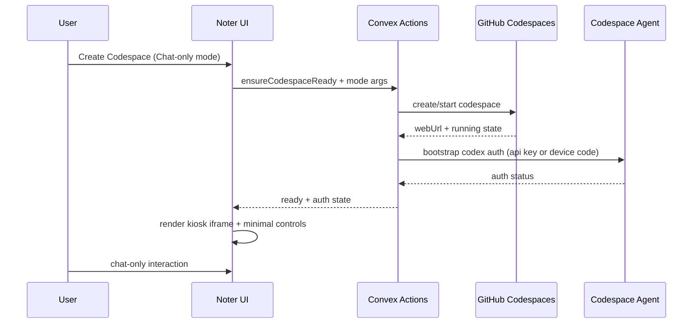

# Chat-only Codespace Mode Specification

## Document Control
- Status: Proposed
- Owner: Noter frontend/backend
- Date: 2026-02-14
- Related specs:
  - `specs/001_CODESPACE_CONNECTION_SPEC.md`
  - `specs/003_VAULT_INFRA_PROVISIONING_SPEC.md`
  - `specs/004_AI_PROD_ACCESS_POLICY_SPEC.md`
- Related code:
  - `apps/noter/src/components/CodespaceIframe.tsx`
  - `apps/noter/src/components/CodespaceStatus.tsx`
  - `apps/noter/src/components/VaultDashboard.tsx`
  - `apps/noter/src/App.tsx`
  - `apps/noter/convex/codespaces.ts`
  - `apps/noter/convex/codespacesMutations.ts`
  - `apps/noter/convex/vaultCodespaceIntegration.ts`
  - `apps/noter/convex/codespacesExecutor.ts`
  - `apps/noter/convex/schema.ts`
  - `.devcontainer/devcontainer.json`
  - `.codespace-agent/server.js`

## Summary
Add a new "Chat-only Codespace mode" in Noter where:
1. Noter still launches a full GitHub Codespace / VS Code web runtime.
2. Noter renders that runtime in a kiosk-like shell that hides non-chat VS Code chrome as much as possible.
3. User interaction is centered on Codex chat, not the full editor UX.
4. Authentication does not require manual localhost callback URL edits.

This spec treats the current in-app `ChatFab` as temporary and out of scope for final chat UX.

## Problem Statement
Current behavior launches Codespaces and can embed VS Code, but does not provide:
1. A reliable chat-only presentation mode.
2. A no-manual-intervention auth flow for Codex login when localhost callback behavior appears.
3. A hardened fallback strategy for iframe/cookie/mobile constraints.

## Goals
1. Keep full Codespace launch behavior intact.
2. Present a chat-first, kiosk-style surface in Noter.
3. Remove manual URL editing from auth workflows.
4. Support desktop and mobile web without browser extensions or local setup.
5. Keep Codespace lifecycle state and health visible in Noter.

## Non-Goals
1. Building a custom replacement for VS Code or Codex extension internals.
2. Guaranteeing true "extension-only render" if the platform does not expose it.
3. Removing ability to open full VS Code in a separate tab as fallback.

## Key Clarification
The temporary Noter chat UI (`ChatFab`) is not the target end-state.  
Target is embedding Codex/VS Code surfaces in Noter with a chat-only user experience.

## Feasibility Assessment

### A. True extension-only rendering inside VS Code web
Result: Not currently feasible as a hard guarantee.

Reasoning:
1. Codespaces browser UX is a full VS Code workbench.
2. There is no stable public contract to expose only one extension surface and hard-disable all other chrome for all devices.
3. Even with custom layout settings, users can still hit edge cases where parts of workbench appear.

### B. Closest practical kiosk mode
Result: Feasible.

Approach:
1. Use full Codespace runtime.
2. Apply VS Code layout/profile settings and startup commands to collapse sidebars, panel, editor tabs, and non-chat affordances by default.
3. Embed in Noter iframe with a narrow wrapper UI (status, reconnect, fallback).

### C. Automatic OAuth callback without localhost URL edits
Result: Partially feasible depending on auth method.

1. ChatGPT OAuth localhost callback path is currently tied to local callback semantics (`localhost:1455` pattern).
2. Fully automatic no-touch login is feasible with API key bootstrap.
3. Device-code auth is feasible without URL edits, but still requires a short user confirmation step.

## Options Ranked (Reliability + UX)

### Option 1 (Recommended MVP): Kiosk embed + API key bootstrap
1. Reliability: High.
2. UX: Best no-manual-edit path.
3. Tradeoff: Requires secure API key provisioning strategy.

### Option 2: Kiosk embed + device-code bootstrap
1. Reliability: High.
2. UX: Good, one user step to enter/confirm code.
3. Tradeoff: Not zero-touch.

### Option 3: External-tab fallback to full Codespace
1. Reliability: Highest when iframe breaks.
2. UX: Lower than in-Noter embed.
3. Tradeoff: Breaks strict single-surface interaction, but preserves task completion.

### Option 4: Depend on localhost callback forwarding (`1455`) for browser users
1. Reliability: Low for this product goal.
2. UX: Poor, often manual.
3. Tradeoff: Conflicts with "no local machine setup" requirement.

## Proposed Architecture

### Control Plane (Noter + Convex)
1. Owns create/start/stop/delete Codespace.
2. Stores mode, auth bootstrap state, and health.
3. Orchestrates bootstrap and fallback.

### Runtime Plane (Codespace)
1. Runs VS Code web + Codex extension tooling.
2. Runs `.codespace-agent` HTTP service on port `3000`.
3. Runs auth bootstrap commands (`codex login ...`) and status checks.

### Presentation Plane (Noter UI)
1. Full-screen chat-only shell route.
2. Embedded Codespace iframe in kiosk mode.
3. Minimal overlay for state/auth/fallback actions.

## Data Model Changes (Convex)

Extend `codespaces` table (`apps/noter/convex/schema.ts`) with:
1. `uiMode`: `"full"` | `"chat_only"` (optional, default `"full"` behavior).
2. `codexAuthState`: `"not_started"` | `"pending"` | `"ready"` | `"failed"` (optional).
3. `codexAuthMethod`: `"api_key"` | `"device_code"` | `"chatgpt_oauth"` (optional).
4. `codexAuthLastError`: string (optional).
5. `codexVerificationUrl`: string (optional, for device code flow).
6. `codexUserCode`: string (optional, short-lived display only).
7. `chatOnlyKioskReadyAt`: number (optional).

Indexes:
1. Keep existing indexes.
2. Optional new index by auth state if operationally needed.

## Backend Changes (Convex)

### `apps/noter/convex/codespaces.ts`
1. Extend `createCodespace` args with optional `uiMode` and `authBootstrapMode`.
2. Persist mode/auth intent when record is created.
3. After running state is reached, trigger bootstrap action.

### `apps/noter/convex/codespacesMutations.ts`
1. Add internal mutation(s) to update codex auth status fields.
2. Expose these fields in `getActiveCodespace`.

### `apps/noter/convex/vaultCodespaceIntegration.ts`
1. Extend `ensureCodespaceReady` input to include target mode.
2. Ensure bootstrap runs when mode is `chat_only`.
3. Return richer readiness payload (`codespaceId`, `ready`, `authState`).

### `apps/noter/convex/codespacesExecutor.ts`
1. Add actions for:
   - bootstrap with API key (`codex login --with-api-key`)
   - bootstrap with device code (`codex login --device-auth`)
   - check auth status (`codex login status`)
2. Parse device-code output and write verification URL/code to DB.

### New action module (recommended)
Create `apps/noter/convex/codespacesAuthBootstrap.ts` to orchestrate:
1. Method selection (api-key first, then device-code fallback).
2. retries/timeouts.
3. DB status updates and error handling.

## Frontend Changes

### `apps/noter/src/App.tsx`
1. Add dedicated route for chat-only surface, for example:
   - `/vault/:owner/:repoName/:branch/chat`
2. Hide temporary `ChatFab` on this route.

### New component: `apps/noter/src/components/CodespaceChatOnlyView.tsx`
1. Host full-page shell for chat-only mode.
2. Query active codespace and auth state.
3. Render:
   - kiosk iframe
   - lightweight status/auth overlay
   - fallback controls

### `apps/noter/src/components/CodespaceIframe.tsx`
1. Add explicit kiosk mode prop.
2. Remove unused workspace derivation variable.
3. Improve error detection and emit structured fallback states.
4. Keep `Open in New Tab` as first-class fallback.

### `apps/noter/src/components/CodespaceStatus.tsx`
1. Add "Enter Chat-only Mode" action.
2. Trigger ensure/bootstrapping with mode args.
3. Surface auth state in tooltip/card.

### `apps/noter/src/components/VaultDashboard.tsx`
1. Add CTA for chat-only launch path.
2. Keep full-editor path available for debug/admin workflows.

### `apps/noter/src/components/ChatFab.tsx`
1. Keep temporary behavior unchanged for existing routes.
2. Explicitly mark as non-authoritative chat surface for long-term direction.

## Devcontainer and Runtime Changes

### `.devcontainer/devcontainer.json`
1. Ensure required extension(s) are installed for Codex chat surface.
2. Add kiosk-oriented VS Code defaults where stable.
3. Keep `forwardPorts` including `3000` and `1455`.
4. Keep `1455` private/silent to avoid accidental exposure.

### `apps/noter/convex/vaultCodespaceIntegration.ts` (generated devcontainer config)
Mirror the same settings as `.devcontainer/devcontainer.json` so runtime-generated configs stay aligned.

### `.codespace-agent/server.js`
1. Keep current API endpoints.
2. Add optional endpoint(s) only if needed for structured bootstrap status.
3. Continue strict token auth and workspace path validation.

## Authentication Strategy

### Primary path (MVP): API key bootstrap
1. Noter securely injects key material to bootstrap action.
2. Codespace runs `codex login --with-api-key`.
3. Mark auth state `ready` when status confirms success.

### Secondary path: Device-code bootstrap
1. Codespace runs `codex login --device-auth`.
2. Noter displays verification URL + one-time code in a compact card.
3. Poll until `codex login status` becomes authenticated.

### Explicitly deferred for MVP
Attempting to force ChatGPT OAuth browser callback away from localhost in this flow.

## UX Behavior Contract
1. User clicks "Create Codespace" or "Open Chat-only Mode".
2. Noter ensures running codespace and starts auth bootstrap.
3. While pending, user sees concise status only.
4. On success, iframe enters kiosk chat mode.
5. On iframe/auth failure, show deterministic fallback actions:
   - Retry bootstrap
   - Reopen codespace
   - Open in new tab

## Mobile and Cross-device Requirements
1. Do not require local CLI, browser extension, or port forwarding.
2. If iframe behavior degrades on mobile, auto-offer top-level tab fallback.
3. Preserve codespace state regardless of surface transitions.

## Risks and Mitigations

### Risk 1: VS Code UI chrome cannot be perfectly hidden
Mitigation:
1. Define kiosk as "best-effort with strong defaults".
2. Track user-visible leaks and iterate settings/commands.

### Risk 2: Embedded auth/cookie restrictions in iframe
Mitigation:
1. Detect load/auth failures quickly.
2. Promote one-click external tab fallback.

### Risk 3: Localhost callback semantics for ChatGPT OAuth
Mitigation:
1. Use API key/bootstrap or device-code as default auth methods.
2. Keep callback-port forwarding as optional operator workflow only.

### Risk 4: Secret handling for API key bootstrap
Mitigation:
1. Redact logs and responses.
2. Store secrets using existing secure env/secrets patterns.
3. Never return raw secrets to client state.

### Risk 5: Drift between root devcontainer and generated config
Mitigation:
1. Define one canonical config builder and reuse in both paths.
2. Add validation tests comparing critical fields.

## Implementation Plan

### Phase 1: Mode plumbing
1. Add schema and mutations for mode/auth state.
2. Add route + shell component for chat-only mode.
3. Add dashboard/status actions.

### Phase 2: Auth bootstrap
1. Add bootstrap orchestration actions.
2. Implement API key path.
3. Implement device-code fallback and UI card.

### Phase 3: Kiosk hardening + fallback
1. Add kiosk defaults in devcontainer configs.
2. Add iframe failure detection and external-tab fallback.
3. Add mobile-specific behavior checks.

### Phase 4: Validation
1. Manual matrix: desktop Chrome/Safari/Firefox, mobile Safari/Chrome.
2. Validate create/start/resume/retry/delete lifecycle.
3. Validate auth state transitions and recovery behavior.

## Acceptance Criteria
1. User can create/start a codespace in chat-only mode from Noter.
2. User can interact through a chat-first surface without manual localhost URL edits.
3. API-key bootstrap is fully automatic when configured.
4. Device-code fallback works with clear guidance and no URL editing.
5. If iframe fails, user can continue via deterministic fallback path.
6. Desktop and mobile web are both functional with documented caveats.

## Open Questions
1. Final extension command/view identifiers for forcing chat focus in kiosk startup.
2. Product decision on API key ownership model:
   - per-user secret
   - workspace/shared secret
3. Whether to retain legacy `ChatFab` during migration or hide immediately on vault routes.

## References
1. VS Code custom layout: https://code.visualstudio.com/docs/editor/custom-layout
2. VS Code remote extensions callbacks and URI handlers: https://code.visualstudio.com/api/advanced-topics/remote-extensions#callbacks-and-uri-handlers
3. GitHub Codespaces port forwarding: https://docs.github.com/en/codespaces/developing-in-a-codespace/forwarding-ports-in-your-codespace
4. GitHub Codespaces auth troubleshooting: https://docs.github.com/en/codespaces/troubleshooting/troubleshooting-authentication-to-a-repository-in-codespaces
5. Codex app-server auth API (login modes and localhost callback examples): https://github.com/openai/codex/blob/main/codex-rs/app-server/README.md
6. Codex login server localhost callback/port behavior: https://github.com/openai/codex/blob/main/codex-rs/login/src/server.rs
7. Codex CLI auth flags (`--device-auth`, `--with-api-key`): https://github.com/openai/codex/blob/main/codex-rs/cli/src/main.rs
