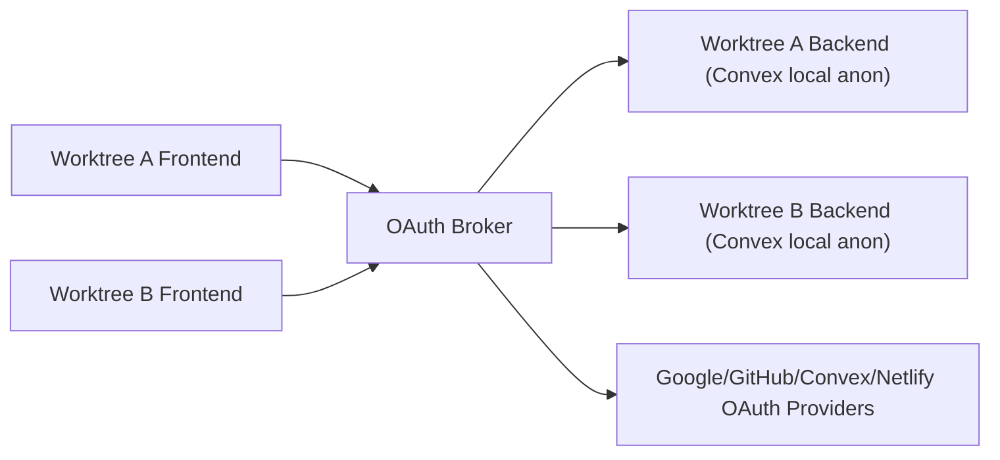

# 025 Multi-Worktree OAuth Broker Spec

## Document Control

- Status: Proposed
- Owner: Noter dev workflow + auth
- Last updated: 2026-02-25
- Related specs:
  - `specs/012_DEV_ENV_ORIGIN_SITE_URL_SYNC_SPEC.md`
  - `specs/013_WORKTREE_AUTO_PROVISIONING_SPEC.md`
  - `specs/015_BYO_CONVEX_OAUTH_AND_WORKTREE_PROVISIONING_SPEC.md`
  - `specs/017_NETLIFY_OAUTH_AND_TEAM_SELECTION_SPEC.md`
  - `specs/019_NOTER_CLI_WORKTREE_PREVIEW_PROVISIONING_SPEC.md`

## Summary

Introduce a single OAuth broker with a fixed callback origin so OAuth works
across many local worktrees (and sandbox previews) without per-worktree redirect
URI changes.

This broker terminates and routes all OAuth HTTP entry points:

- `/api/auth/signin/*`
- `/api/auth/callback/*`
- `/oauth/convex/start|callback`
- `/oauth/netlify/start|callback`

Primary local target: developer can create a worktree, run `make anon`, and use
full OAuth (Google + GitHub + Convex + Netlify) without manual redirect URL
edits.

## Problem Statement

Current worktree flow is mostly good, but OAuth is not worktree-safe because
providers require exact redirect URIs while worktree frontend origins are
dynamic (different ports/hosts).

Current repo behavior confirms this:

- Convex Auth callback URL is derived from
  `CUSTOM_AUTH_SITE_URL ?? CONVEX_SITE_URL`.
- Convex Auth currently does not implement built-in redirect proxy support.
- Existing sign-in calls do not pass `redirectTo`.
- Anonymous predev mode skips `sync-site-url.mjs`.
- Convex/Netlify custom OAuth flows depend on fixed backend env redirect URLs.

Result: a single fixed callback URL is required at provider level, and
callback-only proxying is insufficient. Start and callback both must be
brokered.

## Goals

1. Full OAuth inside dev worktrees with one fixed provider callback origin.
2. Keep provider redirect registrations stable while frontend/backend origins
   vary per worktree.
3. Remove dependency on `sync-site-url.mjs` for OAuth correctness.
4. Make `make anon` bootstrapping include OAuth readiness automatically.
5. Reuse the same broker pattern in sandbox/cloud preview environments.

## Non-Goals

1. Replacing Convex Auth internals.
2. Changing production auth architecture.
3. Supporting arbitrary non-registered callback origins.
4. Implementing monthly/yearly credential rotation policies in this spec.

## Locked Decisions

1. Local broker origin is fixed to `http://localhost:4700`.
2. OAuth providers are configured to callback to broker URLs, not per-worktree
   URLs.
3. Broker must handle both authorization start and callback routes.
4. Broker routes callback requests by OAuth `state` bound during start.
5. `sync-site-url.mjs` is removed after broker rollout.

## Provider Callback Registration

Register one callback per provider for local development:

- Google: `http://localhost:4700/api/auth/callback/google`
- GitHub: `http://localhost:4700/api/auth/callback/github`
- Convex OAuth: `http://localhost:4700/oauth/convex/callback`
- Netlify OAuth: `http://localhost:4700/oauth/netlify/callback`

For sandbox/cloud, use the same technique with a fixed broker origin for that
environment and register provider callbacks to that broker.

## High-Level Architecture

Core idea: broker is the stable public callback surface. It forwards to the
right backend instance based on a stateful transaction map.

## Broker Responsibilities

1. Maintain worktree registration map: frontend origin -> backend origin.
2. Proxy auth start requests to the correct backend.
3. Capture provider `state` on outbound authorize redirect and bind it to
   backend+frontend.
4. Receive provider callback and route it to the bound backend.
5. Forward cookies and redirect responses so browser flow remains intact.
6. Enforce strict allowlists to prevent open redirect and SSRF abuse.

## Broker Route Contract

### Control routes

- `POST /__broker/register`

  - Registers or refreshes mapping for a worktree.
  - Body: `{ frontendOrigin, backendOrigin, worktreeId, expiresAt? }`
  - Auth: shared token in header (required).

- `GET /__broker/health`
  - Health endpoint for bootstrap checks.

### OAuth pass-through routes

- `GET /api/auth/signin/:provider`
- `GET /api/auth/callback/:provider`
- `POST /api/auth/callback/:provider`
- `GET /oauth/convex/start`
- `GET /oauth/convex/callback`
- `GET /oauth/netlify/start`
- `GET /oauth/netlify/callback`

## Routing Model

### Start route handling

1. Broker receives start request.
2. Broker identifies frontend origin from `redirectTo` query parameter (required
   for broker mode).
3. Broker resolves backend origin from registration map.
4. Broker proxies request to backend start route.
5. If backend returns provider redirect with `state`, broker stores:
   - `state`
   - provider
   - backend origin
   - frontend origin
   - flow type (`convexAuth`, `convexOAuth`, `netlifyOAuth`)
   - TTL (15 minutes)
6. Broker returns proxied response headers/body to browser.

### Callback route handling

1. Broker receives callback with `state`.
2. Broker loads and validates transaction by `state`.
3. Broker proxies callback to bound backend callback route.
4. Broker forwards response to browser.
5. Broker invalidates transaction record (one-time use).

If callback arrives with unknown/expired state: return `400`.

## Convex Auth and RedirectTo Contract

Broker mode requires all OAuth sign-in calls to pass `redirectTo`.

Frontend requirement:

- `signIn("google", { redirectTo: window.location.href })`
- `signIn("github", { redirectTo: window.location.href })`

Backend requirement:

- Add `callbacks.redirect` in Convex Auth config to allow only expected dev
  preview origins and reject all others.
- This replaces hard coupling to a single `SITE_URL` destination for post-auth
  redirect.

## Env Contract

In broker mode, each dev backend deployment must use:

- `CUSTOM_AUTH_SITE_URL=http://localhost:4700`
- `SITE_URL=http://localhost:4700`
- `CONVEX_OAUTH_REDIRECT_URL=http://localhost:4700/oauth/convex/callback`
- `NETLIFY_OAUTH_REDIRECT_URL=http://localhost:4700/oauth/netlify/callback`

Frontend:

- `VITE_AUTH_BROKER_ORIGIN=http://localhost:4700`

Broker:

- `AUTH_BROKER_TOKEN=<shared-secret>`
- `AUTH_BROKER_ALLOWED_BACKEND_HOSTS=<allowlist>`
- `AUTH_BROKER_ALLOWED_FRONTEND_HOSTS=<allowlist>`

## Local Workflow Integration (`make anon`)

`make anon` path should include:

1. Ensure broker is running (start if absent).
2. Register current worktree mapping with broker.
3. Ensure backend env values above are set on current anonymous deployment.
4. Start backend + frontend as today.

Expected outcome: worktree OAuth works without manual provider or `SITE_URL`
edits.

## Sandbox/Cloud Workflow

Use the same broker technique:

1. Run broker at a stable sandbox-facing origin.
2. Register each ephemeral preview frontend/backend pair at startup.
3. Keep provider callbacks fixed to broker origin.
4. Route callbacks by `state` binding.

This removes need to mutate backend `SITE_URL` for every new ephemeral preview
URL.

## Changes to Existing Local Scripts

1. Remove `apps/noter/sync-site-url.mjs` from predev flow.
2. Remove docs and setup assumptions that OAuth relies on runtime `SITE_URL`
   mutation.
3. Add broker registration/bootstrap step to existing predev/bootstrap scripts.

## Security Model

1. Registration endpoint requires shared secret.
2. Broker proxies only to registered/allowlisted backend origins.
3. OAuth transaction records are one-time, short TTL, provider-bound.
4. Redirect targets are validated; no wildcard external redirects.
5. Broker strips sensitive debug output from logs.
6. Callback replay with reused state is rejected.

## Failure Behavior

- Broker unavailable: fail fast in predev with clear message.
- Missing registration for redirect origin: `400` with remediation hint.
- Unknown or expired state: `400` and safe abort.
- Backend callback failure: propagate safe error and clear transaction.

## Rollout Plan

### Phase 1: Broker foundation + Convex Auth routes

1. Implement broker service and registration API.
2. Route `/api/auth/signin/*` and `/api/auth/callback/*` through broker.
3. Update frontend sign-in calls to pass `redirectTo`.
4. Add redirect allowlist callback in Convex Auth config.

### Phase 2: Convex + Netlify custom OAuth routes

1. Route `/oauth/convex/start|callback` through broker.
2. Route `/oauth/netlify/start|callback` through broker.
3. Update frontend connection flows to start at broker endpoints.

### Phase 3: Remove legacy `SITE_URL` sync

1. Delete `sync-site-url.mjs`.
2. Remove predev invocation.
3. Update docs/spec references.

## Testing Plan

### Unit

1. Registration map lifecycle and TTL eviction.
2. State transaction creation/lookup/one-time invalidation.
3. Redirect origin validation and rejection paths.

### Integration

1. Two worktrees active concurrently, both Google sign-in successful.
2. Two worktrees active concurrently, both GitHub sign-in successful.
3. Convex OAuth connect flow succeeds through broker.
4. Netlify OAuth connect flow succeeds through broker.
5. Callback with unknown state fails safely.

### Manual

1. Fresh worktree -> `make anon` -> sign in via Google/GitHub.
2. Open second worktree concurrently -> sign in there too.
3. Verify no per-worktree provider callback edits are needed.

## Acceptance Criteria

1. OAuth works in multiple concurrent worktrees with one provider callback
   config.
2. `make anon` is sufficient to boot a new worktree with OAuth ready.
3. `sync-site-url.mjs` is no longer required for dev OAuth.
4. Convex Auth, Convex OAuth, and Netlify OAuth all function via broker.
5. Sandbox preview environments can use the same broker pattern.

## Open Questions

1. Should sandbox and local share one broker implementation binary with env-only
   behavior changes, or separate deploy targets?
2. Should broker transaction state be in-memory only for dev, or persisted
   (SQLite/Redis) for sandbox HA?
3. Should we keep legacy frontend Netlify callback component after broker
   migration, or remove it immediately?
