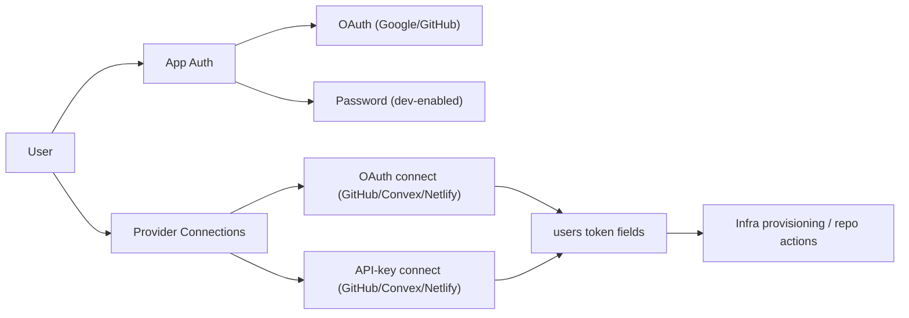

# 025 Password Auth + API-Key Connection Mode Spec

## Document Control

- Status: Proposed
- Owner: Noter auth + dev workflow
- Last updated: 2026-02-26
- Supersedes: Previous `025 Multi-Worktree OAuth Broker Spec`
- Related specs:
  - `specs/015_BYO_CONVEX_OAUTH_AND_WORKTREE_PROVISIONING_SPEC.md`
  - `specs/017_NETLIFY_OAUTH_AND_TEAM_SELECTION_SPEC.md`
  - `specs/018_AUTH_ALLOWLIST_PRELOGIN_ENFORCEMENT_SPEC.md`

## Summary

Replace the broker-first OAuth direction with a simpler dual-mode model:

1. Keep OAuth flows (Google/GitHub/Convex/Netlify) as-is.
2. Add email/password app login support for development on the existing root
   sign-in screen.
3. Add API-key connection mode for GitHub, Convex, and Netlify in addition to
   OAuth.
4. Auto-seed one worktree password account from fixed development credentials in
   code.
5. Optionally auto-seed provider API keys onto the user profile from env.

This keeps onboarding fast for the single local developer while preserving OAuth
for normal user paths.

## Problem Statement

OAuth callback complexity for per-worktree and preview environments adds
operational overhead. For local development, the requirement is practical
velocity with minimal setup friction.

Current needs:

1. Fast login in fresh worktrees.
2. Fast provider connectivity without repeated OAuth handshakes.
3. No dependency on introducing and maintaining a broker service.

## Goals

1. Support password sign-in/sign-up as an additional auth mode in development.
2. Keep current OAuth providers fully functional.
3. Support API-key connect flow for GitHub/Convex/Netlify in all environments.
4. Support fixed-credential seeding for local worktree convenience.
5. Keep existing allowlist enforcement model intact.

## Non-Goals

1. Replacing OAuth provider integrations.
2. Implementing a broker/proxy-based redirect system.
3. Building key rotation automation in this spec.
4. Changing core vault provisioning architecture.

## Locked Product Decisions

1. The current root sign-in page displays the password login UI.
2. This password login UI is restricted to development.
3. Credentials are not prefilled in the password form.
4. Worktree password seeding uses fixed development credentials: `nicu@noter.md`
   / `pass1234`.
5. Sign-in and sign-up flows are both supported by the password provider.
6. Existing allowlist policy remains enforced for password flows too.
7. Production keeps API-key connection mode available as an option.
8. OAuth connection mode remains available in parallel.

## High-Level Architecture

## Auth Model

### App Login Providers

1. Google OAuth remains enabled when configured.
2. GitHub OAuth remains enabled when configured.
3. Password provider is enabled automatically on Convex development deployments.
4. Production password-provider enablement remains opt-in via
   `AUTH_ENABLE_PASSWORD` until we remove the gate.

### Password Flows

Use Convex Auth Password provider with:

1. `flow: "signUp"`
2. `flow: "signIn"`

### Allowlist Policy

Allowlist checks remain enforced in `createOrUpdateUser`. Implication: password
sign-up and sign-in are also restricted to allowlisted emails.

## Provider Connection Model

Each provider supports both OAuth and API-key modes:

1. GitHub
2. Convex
3. Netlify

API-key mode validates credentials server-side before storing them on `users`.

## Data Model

No schema migration required.

Existing fields in `users` are reused:

1. GitHub: `githubAccessToken`, `githubUsername`, refresh/expiry fields.
2. Convex: `convexAccessToken`, `convexTeamId`, `convexTeamSlug`, related
   fields.
3. Netlify: `netlifyAccessToken`, `netlifyTeamId`, `netlifyTeamSlug`, related
   fields.

## Backend Changes

### `apps/noter/convex/auth.ts`

1. Add Password provider wiring.
2. Enable password provider by default in Convex dev deployments.
3. Keep existing OAuth provider setup.
4. Keep allowlist check in `createOrUpdateUser`.
5. Add optional env-based provider-key auto-seed helper, gated by
   `AUTH_AUTO_SEED_PROVIDER_KEYS`.

### New action: `apps/noter/convex/devAuth.ts`

Add `seedPasswordAccount` action:

1. Uses fixed development seed credentials in code (`nicu@noter.md` /
   `pass1234`).
2. Creates or updates password account idempotently.
3. Applies allowlist check.

### `apps/noter/predev.js`

In anonymous mode:

1. Keep current bootstrap behavior.
2. Run seeding action after backend bootstrap for local worktrees.

### `apps/noter/convex/users.ts`

Add API-key connect mutations:

1. `connectGithubWithApiKey({ token })`
2. `connectConvexWithApiKey({ token })`
3. `connectNetlifyWithApiKey({ token })`

Each mutation:

1. Validates token with provider API.
2. Stores normalized fields on current user.
3. Clears incompatible stale refresh/expiry fields where needed.

### Admin access compatibility

Password-authenticated users may not have `githubUsername`. Admin checks
currently tied only to username must be updated to include allowlisted admin
email fallback where required (chat/prod-read approval paths).

## Frontend Changes

### `apps/noter/src/SignInForm.tsx`

1. Keep Google and GitHub OAuth buttons.
2. Add dev-only password block when `import.meta.env.DEV`.
3. Support sign-in and sign-up password submissions via
   `signIn("password", params)`.

### `apps/noter/src/components/VaultDashboard.tsx`

For each provider connection row:

1. Keep OAuth connect button.
2. Add API-key connect option and input dialog.
3. Reuse existing status and disconnect surfaces.

## Environment Contract

### Password auth and seeding

1. Password UI is shown automatically in frontend dev builds
   (`import.meta.env.DEV`).
2. Password provider is enabled automatically for Convex dev deployments.
3. Production can still opt in with `AUTH_ENABLE_PASSWORD=true` during rollout.
4. Local dev seeding uses fixed credentials:
   - Email: `nicu@noter.md`
   - Password: `pass1234`

### Optional auto-seed of provider keys

1. `AUTH_AUTO_SEED_PROVIDER_KEYS=true`
2. GitHub source:
   - `GITHUB_TOKEN`
   - `GITHUB_USERNAME` (optional but recommended)
3. Convex source:
   - `CONVEX_MANAGEMENT_TOKEN`
   - `CONVEX_TEAM_ID`
4. Netlify source:
   - `NETLIFY_ACCESS_TOKEN`
   - `NETLIFY_TEAM_ID`

If `AUTH_AUTO_SEED_PROVIDER_KEYS` is off, users connect providers manually via
OAuth or API key.

## Security Notes

1. Provider tokens stay server-side only in Convex.
2. Token validation is mandatory before persistence for API-key mode.
3. Do not log raw tokens or seeded passwords.
4. Keep allowlist enforcement as auth gate.
5. Keep existing Convex Auth sign-in rate-limit defaults or tighten explicitly.

## Rollout Plan

### Phase 1: Password auth foundation

1. Introduce password provider support with dev-default enablement.
2. Wire seeded password account action into predev integration.
3. Ship the dev-only password UI.

### Phase 2: API-key provider connections

1. Implement backend connect mutations with validation.
2. Surface UI dialogs/actions in the Connections panel.
3. Preserve existing OAuth connect flows unchanged.

### Phase 3: Hardening and compatibility

1. Update admin-check paths for password-authenticated admin users.
2. Document the env contract and local workflow.
3. Validate behavior across anon worktree, normal dev, and prod.

## Testing Plan

### Unit

1. Password provider enabled-by-default behavior on dev deployments.
2. Seed action create/update idempotency.
3. API-key validation failure and success paths per provider.
4. Allowlist behavior for password sign-up/sign-in.

### Integration

1. Fresh anon worktree: seeded account can sign in with password.
2. Existing OAuth sign-in still works.
3. GitHub/Convex/Netlify connection via OAuth still works.
4. GitHub/Convex/Netlify connection via API-key mode works.
5. Repo creation works with API-key-only provider connections.

### Manual

1. `make anon` then password sign-in with `nicu@noter.md` / `pass1234`.
2. Connect each provider with API key from dashboard.
3. Disconnect and reconnect via OAuth to confirm both modes coexist.

## Acceptance Criteria

1. Spec 25 no longer requires an OAuth broker architecture.
2. Dev can sign in through password on root sign-in page without extra feature
   flags.
3. API-key connection mode works for GitHub, Convex, and Netlify.
4. OAuth connection mode remains supported.
5. Allowlist enforcement remains active across auth modes.
