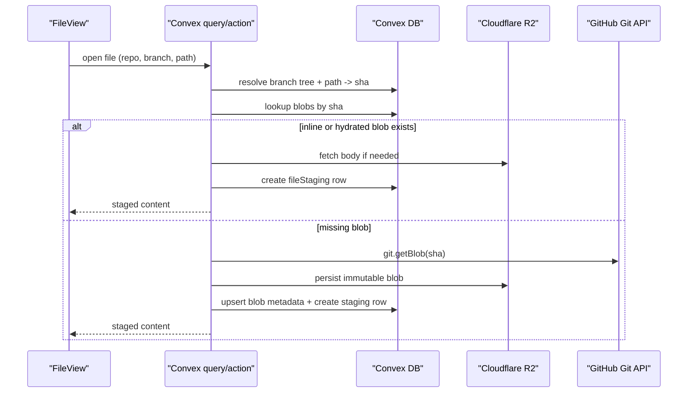

# Cloudflare SHA Blob Storage Specification

## Document Control

- Status: Proposed RFC
- Owner: Noter editor/storage pipeline
- Last updated: 2026-03-20
- Related files: `apps/noter/src/components/FileView.tsx`,
  `apps/noter/convex/fileStagingActions.ts`, `apps/noter/convex/vault.ts`,
  `apps/noter/convex/gitOperations.ts`,
  `apps/noter/convex/gitOperationsActions.ts`, `apps/noter/convex/schema.ts`

## Summary

Noter should support an immutable blob store for repository file contents keyed
by Git blob SHA, with Cloudflare R2 as the primary object store for hydrated
blob bodies.

The immediate goal is to reduce uncached file-open latency without changing the
existing branch/tree source of truth in Convex. The file tree remains
path-addressed in Convex, while file bodies become SHA-addressed and
cacheable/hydratable independently.

This RFC intentionally separates two decisions:

1. Remove the avoidable extra GitHub lookup in the cold-open path.
2. Add optional background hydration into Cloudflare R2 for immutable blob
   bodies.

## Problem Statement

Today, opening an uncached editable file does more work than necessary:

1. Frontend selects a file and calls `fileStagingActions.getFileForEditing`.
2. The action resolves the repo/branch, then calls `repos.getContent`.
3. The action uses the returned SHA to check the local blob cache.
4. On a miss, the action calls `git.getBlob`.
5. The action persists the blob into Convex `blobs`.
6. The action inserts a `fileStaging` record so the editor can render.

That path is correct, but the first GitHub request is often redundant because
the selected branch tree already contains `path -> sha` for the file being
opened. This adds latency on the critical path and reduces the value of the
existing SHA cache.

Separately, connected repositories currently store the Git tree metadata up
front but do not hydrate all blob bodies during connect. A background hydrator
already exists in code, but it is not currently scheduled from the connect flow.

## Current Implementation Snapshot (2026-03-20)

- `vaults.treeData` and `vaultBranchTrees.treeData` store GitHub tree entries,
  including blob SHA per path.
- `blobs` is already a SHA-keyed dedup table in Convex.
- Small text files are stored inline in `blobs.text`.
- Large or non-text files are stored in Convex storage via `storageId`.
- The editor path does not yet support loading text back from storage-backed
  blobs; those requests throw `File is in storage, not implemented yet`.
- Existing repository connect stores the tree snapshot but does not schedule
  full blob hydration.

## Goals

- Reduce uncached file-open latency for editable repository files.
- Preserve Convex as the source of truth for branch selection and tree metadata.
- Use immutable SHA-addressed storage so blob invalidation is trivial.
- Keep private repository content non-public by default.
- Reuse the existing `blobs` table and staging model instead of replacing them.

## Non-Goals

- Replacing Convex tree metadata with Cloudflare-managed tree metadata.
- Serving private repository blobs from a public unauthenticated bucket.
- Reworking collaborative editing away from staged Convex documents.
- Solving partial-file or range-based editing in this RFC.

## Design Principles

- Path resolution stays in Convex because Noter already uses Convex queries to
  resolve branch selection and tree state.
- Blob bodies are immutable and keyed by SHA, so storage should optimize for
  cheap reads and no invalidation.
- File-open latency improvements should land in phases, with the lowest-risk
  fast path first.
- Auth stays explicit. Private GitHub repository contents must not become
  anonymously enumerable.

## Proposed Design

### Phase 1: Fast path without storage migration

Update the editor cold-open path to use existing tree metadata first:

1. Resolve the selected branch tree from Convex.
2. Find the file entry by path and read its blob SHA directly from the tree.
3. Query `blobs` by SHA.
4. If cached inline text exists, stage immediately with no GitHub content call.
5. If the blob is missing, call `git.getBlob` directly by SHA.
6. Persist the blob and create the staging record.

This removes the redundant `repos.getContent` lookup for the common editable
path and reduces GitHub round trips from two to one on a cache miss.

### Phase 2: Background SHA hydration into Cloudflare R2

Introduce a private Cloudflare R2 bucket for hydrated blob bodies.

Hydration behavior:

- Trigger after repository connect and after branch tree refreshes when new SHAs
  appear.
- Read branch trees from Convex, determine missing SHAs, and upload missing
  blobs into R2.
- Continue recording blob metadata in Convex `blobs`.
- Treat R2 as the canonical object body store for hydrated blobs while keeping
  inline text support for small hot text blobs.

Object identity:

- Initial key shape: `<ghRepoId>/<sha>`
- Metadata captured in Convex: `sha`, `size`, `mime`, optional inline `text`,
  optional storage locator

The repo-scoped key keeps cleanup simple and avoids introducing cross-repo
reference counting in the first version. Global cross-repo SHA dedupe can be a
later optimization if needed.

### Phase 3: Storage-backed text read path

Implement editor reads for storage-backed text blobs.

Requirements:

- If a text blob is stored out-of-line, the editor path must fetch the body and
  stage it without error.
- Storage-backed text reads must work the same whether the object lives in
  Convex storage or R2 during migration.
- The editor should not care which backing store produced the bytes.

This phase is required before moving all text blobs out of inline Convex text.

## Data Model Direction

This RFC does not require an immediate schema migration, but the intended shape
is:

- Keep `vaults.treeData` and `vaultBranchTrees.treeData` as the branch/tree
  source of truth.
- Keep `blobs` as the SHA-keyed index and metadata table.
- Extend blob locator semantics so a blob can resolve to:
  - inline text
  - Convex storage
  - Cloudflare R2

During rollout, dual-read support is acceptable. Dual-write should only exist
while migrating existing cached blobs.

## Request Flow

## Security Model

- R2 bucket remains private.
- Browser access to blob bodies should be mediated by trusted server runtime,
  not raw public bucket URLs.
- If a Cloudflare Worker is introduced later for direct blob serving, it must
  enforce Noter auth before returning private repository content.
- Blob keys are immutable identifiers, not authorization boundaries.

## Why R2

- Blob bodies are object storage, not configuration records.
- Immutable SHA keys align naturally with R2 object semantics.
- Cloudflare edge delivery can improve repeated read latency once objects are
  hydrated.
- R2 avoids the consistency and payload-shape tradeoffs of KV for this use case.

## Alternatives Considered

### 1. Stay entirely on current lazy Convex blob caching

Pros:

- Lowest implementation surface area
- No new storage provider in the read path

Cons:

- Does not fix the redundant GitHub lookup
- Does not provide a separate edge-oriented blob body store
- Leaves first-open latency tied to GitHub for every uncached SHA

### 2. Hydrate everything into Convex storage only

Pros:

- Uses existing primitives
- Minimal auth and routing changes

Cons:

- Does not align with the operator preference for Cloudflare-first architecture
- Gives up the main reason to add Cloudflare here: durable immutable blob
  storage close to the edge

### 3. Use Workers KV for blob bodies

Rejected because this workload is immutable object storage, not small
eventually-consistent key/value state.

## External Reference Notes

- GitHub REST contents API: <https://docs.github.com/en/rest/repos/contents>
- GitHub REST blob API: <https://docs.github.com/en/rest/git/blobs>
- Cloudflare Workers storage options:
  <https://developers.cloudflare.com/workers/platform/storage-options/>
- Cloudflare R2 public buckets and cache behavior:
  <https://developers.cloudflare.com/r2/buckets/public-buckets/>
- Cloudflare R2 presigned URL behavior:
  <https://developers.cloudflare.com/r2/api/s3/presigned-urls/>
- Cloudflare Cache Reserve limitations:
  <https://developers.cloudflare.com/cache/advanced-configuration/cache-reserve/>

## Rollout Plan

1. Implement Phase 1 fast path using tree SHA lookup before any storage
   migration.
2. Implement storage-backed text read support.
3. Add R2-backed hydrator for repository connect and tree refresh flows.
4. Add observability around cold-open latency, blob cache hit rate, and GitHub
   blob fetch rate.
5. Decide whether inline small-text storage in Convex should remain as a hot
   path optimization or become migration-only.

## Operational Notes

- Repository connect should stay responsive. Full blob hydration must be
  asynchronous.
- Tree refreshes should hydrate only new SHAs, not re-upload known objects.
- Cleanup is simpler with repo-scoped keys. Vault teardown can delete the repo
  prefix in R2 if desired.
- Metrics should distinguish:
  - tree cache hit
  - blob metadata hit
  - inline text hit
  - hydrated object hit
  - GitHub miss requiring fetch

## Open Questions

- Should small text blobs remain inline in Convex permanently as a hot path, or
  should all text eventually move to R2-backed bodies?
- Should the first R2 version be read-through only, or should connect-time
  hydration be mandatory for noter-managed repositories?
- Does the eventual Worker-based direct blob serving path need to exist for the
  first rollout, or is Convex-mediated R2 access sufficient?

## Acceptance Checklist

- [ ] Cold-open editable text files no longer require `repos.getContent` before
      SHA cache lookup.
- [ ] Storage-backed text files can be opened in the editor.
- [ ] Repository connect or tree refresh can hydrate missing SHAs into R2.
- [ ] Private repository blobs remain non-public by default.
- [ ] Metrics exist for file-open latency and blob cache hit rate.
