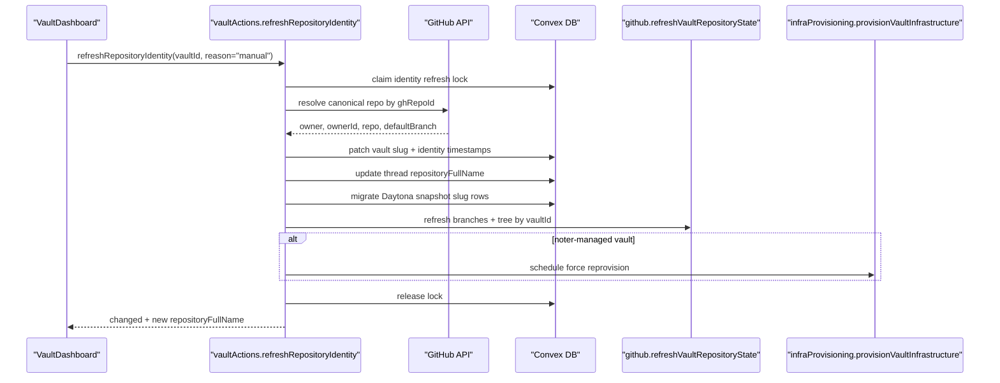

# 062 Vault Repository Identity Refresh Spec

## Document Control

- Status: Proposed
- Owner: Vault dashboard + GitHub integration + Daytona/runtime
- Last updated: 2026-03-19
- Related specs:
  - `specs/003_VAULT_INFRA_PROVISIONING_SPEC.md`
  - `specs/010_DAYTONA_SANDBOX_INTEGRATION_SPEC.md`
  - `specs/026_PROVIDER_CONNECTIONS_SPEC.md`
  - `specs/041_DAYTONA_COMMIT_PINNED_SNAPSHOT_SPEC.md`
  - `specs/045_VAULT_MULTI_BRANCH_DASHBOARD_AND_EDITOR_SPEC.md`
  - `specs/048_DASHBOARD_REMOTE_BRANCH_DELETE_SPEC.md`

## Summary

Noter must support GitHub repository rename and transfer without requiring the
user to disconnect and reconnect a vault.

This spec introduces a single repository-identity refresh flow that:

1. Repairs one specific vault in place from the stored stable GitHub repository
   ID (`ghRepoId`)
2. Updates the vault slug (`ghRepoOwner` / `ghRepoName`) to the canonical
   current GitHub value
3. Reconciles dependent Noter state that currently still depends on the old slug
4. Reuses existing infrastructure reconciliation where possible instead of
   inventing a second provider-sync system
5. Starts with an explicit dashboard button and later reuses the same action for
   automatic repair

The first rollout is intentionally explicit and scoped:

1. Add a `Refresh repo` button for one vault
2. Keep the mutation path centralized in one action
3. Use that exact same action later for background freshness checks and
   GitHub-error-triggered retries

## Motivation

Concrete motivating example:

1. A repository moves from `nicu-chiciuc/noter` to `noter-md/noter`
2. GitHub web and Git remotes may continue redirecting for some paths
3. Noter still stores and uses the old owner/name in many runtime paths
4. Existing vault UI, tree refresh, chat context, Daytona state, and hosting
   reconciliation continue operating against stale slug data

Today the user can update Git remotes outside Noter, but the vault inside Noter
remains stale.

## Background Constraints

Relevant provider behavior from current docs:

1. GitHub repository transfers preserve webhooks and deploy keys, and old web or
   Git URLs redirect to the new location, but old slug-based API requests are
   not a safe long-term contract.
2. GitHub organization rename keeps repository redirects, but old
   organization-name API requests can return `404`.
3. GitHub Codespaces creation already supports `repository_id`, which is
   rename-safe.
4. Netlify supports changing the repository linked to an existing site.
5. Cloudflare Pages project source config can be updated with GitHub `owner`,
   `owner_id`, `repo_id`, and `repo_name`.

References:

1. [GitHub repository transfer docs](https://docs.github.com/en/repositories/creating-and-managing-repositories/transferring-a-repository)
2. [GitHub organization rename docs](https://docs.github.com/en/organizations/managing-organization-settings/renaming-an-organization)
3. [GitHub Codespaces REST docs](https://docs.github.com/en/rest/codespaces/codespaces)
4. [Netlify repo linking docs](https://docs.netlify.com/build/git-workflows/repo-permissions-linking/)
5. [Cloudflare Pages project update API](https://developers.cloudflare.com/api/resources/pages/subresources/projects/methods/edit/)

## Current Runtime State

### What is already correct

1. Vaults already persist `ghRepoId` in `schema.ts`.
2. Existing repo connect dedupes by `ghRepoId`, not by slug. That is the right
   long-term identity invariant.
3. Codespace creation already uses `repository_id`, so new Codespaces are mostly
   protected from rename drift.
4. File staging and collaborative editing are keyed by `vaultId` and branch, not
   by repository slug.

### What is currently broken or fragile

1. When `connectRepository` finds an existing vault by `ghRepoId`, it returns
   the existing vault without updating `ghRepoOwner` or `ghRepoName`.
2. Tree refresh, branch sync, and many GitHub API reads still start from
   slug-based vault lookup or slug-based API arguments.
3. Dashboard links and routes derive `repositoryFullName` directly from the
   stale vault slug.
4. `agentThreadContext.repositoryFullName` stores a copy of the slug and is not
   updated automatically.
5. `daytonaSnapshots` are keyed by `ghRepoOwner` and `ghRepoName`, so rename
   leaves old records under the previous slug.
6. Daytona runtime paths derive the repo workdir from `vault.ghRepoName`, which
   can break existing active sandboxes if the slug changes but the sandbox
   filesystem path does not.
7. Add Repository duplicate filtering currently compares
   `vault.repositoryFullName` to GitHub `repo.full_name`, so a renamed repo can
   appear as connectable even when the vault already exists.
8. Existing noter-managed infra reprovisioning expects current owner/name when
   patching Netlify or Cloudflare repo linkage.

## Product Decisions

1. `ghRepoId` is the canonical repository identity for vault repair.
2. Owner/name remains the canonical display and routing slug after refresh, but
   it is no longer the primary durable identifier.
3. There must be one mutation path for repo identity refresh. Manual and
   automatic modes both call the same action.
4. We patch the vault slug first, then reconcile downstream systems. We do not
   keep stale slug data simply because downstream provider repair is still in
   progress.
5. If GitHub cannot resolve the stored `ghRepoId` with the current user token,
   refresh fails closed with a clear error. Noter must not guess.
6. The first UX surface is a button in `VaultDashboard`, not an invisible
   background mutation.
7. Automatic refresh later must be debounced and best-effort. It must not block
   initial dashboard rendering.
8. Route aliasing for old slugs is valuable, but it is deferred from the first
   rollout unless implementation needs force it earlier.

## Goals

1. Refresh one specific vault after a GitHub rename or transfer.
2. Preserve the existing vault, staging state, chat history, infra records, and
   provider resources instead of creating a duplicate vault.
3. Reconcile current user-visible slug in dashboard and future API calls with
   the canonical GitHub slug.
4. Repair dependent records that currently copy the slug.
5. Keep noter-managed provider linkage repair inside the existing infra
   provisioning flow.
6. Allow future automatic refresh by reusing the same action.
7. Avoid destructive sandbox or provider teardown as part of simple slug repair.

## Non-Goals

1. Bulk refresh of every vault in one action.
2. Cross-user operator tooling for org-wide rename migration.
3. Automatic redirect of every historical old route in the first rollout.
4. Replacing every slug-derived display string in one patch unrelated to vault
   identity.
5. Rebuilding or deleting active Codespaces as part of a pure slug refresh.
6. Introducing fallback env vars or speculative migration paths.
7. Solving this repository's own hardcoded `nicu-chiciuc/noter` references.
   Those are a separate cleanup task from vault identity repair.

## Scope

1. Vault schema additions for identity refresh state and Daytona repo-dir
   stability
2. One public action for manual repo identity refresh
3. Internal helpers for canonical identity lookup and dependent-record updates
4. Dashboard button and pending/error UX
5. Existing repo connect-flow hardening for `ghRepoId` duplicates
6. Automatic refresh follow-up design using the same action
7. Validation, migration, and rollout plan

## Proposed Architecture

### 1. Canonical identity lookup by `ghRepoId`

Add an internal GitHub helper that resolves current repository metadata from
stored `ghRepoId`.

Required fields from GitHub:

1. repository ID
2. owner login
3. owner ID
4. repo name
5. default branch
6. archived / disabled flags if available

Preferred implementation:

1. Use a direct repo-by-ID GitHub request
2. If Octokit method coverage is awkward, use a raw GitHub REST request with the
   existing auth token

Validation rules:

1. The returned GitHub repository ID must exactly match `vault.ghRepoId`.
2. If the repo is inaccessible or missing, fail with a user-facing error:
   `Repository is no longer accessible with the current GitHub connection.`
3. Do not infer a replacement repo from name similarity.

Output shape:

```ts
type CanonicalRepositoryIdentity = {
  ghRepoId: string
  ghRepoOwner: string
  ghRepoOwnerId?: string
  ghRepoName: string
  repositoryFullName: string
  defaultBranch: string
}
```

### 2. Manual refresh action

Add public action:

- `vaultActions.refreshRepositoryIdentity({ vaultId, reason? })`

Args:

```ts
{
  vaultId: Id<"vaults">;
  reason?: "manual" | "automatic_stale" | "automatic_github_error";
}
```

Returns:

```ts
{
  changed: boolean;
  previousRepositoryFullName: string;
  repositoryFullName: string;
  defaultBranch?: string;
  threadContextsUpdated: number;
  daytonaSnapshotsMigrated: number;
  reprovisionQueued: boolean;
}
```

Behavior:

1. Validate vault ownership.
2. Validate GitHub provider connection.
3. Claim a repo-identity refresh lock on the vault.
4. Resolve canonical GitHub identity from `ghRepoId`.
5. If owner/name changed:
   - patch vault slug
   - patch copied slug fields in dependent records
   - migrate Daytona snapshot records to the new slug
6. Refresh remote branches and branch tree using the canonical slug.
7. If the vault is noter-managed, schedule forced infrastructure reprovisioning.
8. Release the refresh lock and record timestamps.

Important behavior:

1. If the canonical slug is unchanged, the action may still refresh branches and
   tree caches and clear stale identity errors.
2. The action should be idempotent. Multiple repeated calls against an already
   refreshed vault should be safe.
3. The action must not create a second vault.

### 3. One internal refresh path, not many ad hoc repairs

Do not scatter slug-patching logic across:

1. dashboard button handlers
2. `connectRepository`
3. infra provisioning
4. GitHub tree refresh
5. Daytona actions

Instead:

1. Centralize slug repair in `vaultActions.refreshRepositoryIdentity`
2. Call that action from other flows that detect staleness

This avoids the failure mode where dashboard, GitHub, and provider state repair
slightly differently.

### 4. Prefer `vaultId` for internal refresh follow-ups

Current internal GitHub refresh logic still resolves the vault by
`repositoryFullName`. That is fragile during rename repair.

Add a vault-ID-based internal helper:

- `internal.github.refreshVaultRepositoryState({ vaultId, branch?, includeAheadBehind, includePullRequestLinks })`

Behavior:

1. Load the vault directly by `vaultId`
2. Use the current canonical `ghRepoOwner` / `ghRepoName` from that row
3. Refresh remote branches and branch trees without re-looking-up the vault by
   slug

Public route-oriented actions can keep their owner/repo signatures, but after
they resolve the vault they should delegate to this vault-ID-based internal
path.

This keeps the rename-refresh action and normal tree refresh logic on the same
core mechanism.

## Data Model Changes

### `vaults`

Add additive fields:

1. `repositoryIdentityLastCheckedAt?: number`
2. `repositoryIdentityRefreshStartedAt?: number`
3. `repositoryIdentityLastError?: string`
4. `repositoryIdentityLastChangedAt?: number`
5. `daytonaSandboxRepoDir?: string`

Rationale:

1. `repositoryIdentityLastCheckedAt` enables background staleness checks.
2. `repositoryIdentityRefreshStartedAt` provides a lock and pending UI signal.
3. `repositoryIdentityLastError` surfaces actionable failures without
   overloading tree-refresh errors.
4. `repositoryIdentityLastChangedAt` helps debugging and optional UI messaging.
5. `daytonaSandboxRepoDir` decouples an active sandbox workdir from current
   `ghRepoName`.

No new table is required for the first rollout.

### `daytonaSnapshots`

No schema migration is required in the first rollout.

Instead:

1. Existing rows are migrated in place from old slug to new slug during refresh.
2. Query behavior remains unchanged after migration.

Deferred future hardening:

1. Add `ghRepoId` to `daytonaSnapshots`
2. Move snapshot lookups to repo-ID-based indexing

That follow-up is not required for the first manual or automatic rollout as long
as refresh performs slug migration.

## Dependent State Reconciliation

### 1. Vault slug patch

When canonical identity differs from current vault slug:

1. record `previousRepositoryFullName`
2. if `vault.daytonaSandboxId` is set and `daytonaSandboxRepoDir` is empty,
   first set `daytonaSandboxRepoDir` to the pre-refresh `ghRepoName`
3. patch `ghRepoOwner` and `ghRepoName`
4. patch `repositoryIdentityLastChangedAt`
5. clear `repositoryIdentityLastError`

### 2. Chat thread context

`agentThreadContext.repositoryFullName` is copied state and must be updated for
all rows belonging to the vault.

Required behavior:

1. Update every thread context row for that `vaultId`
2. Preserve thread ID, branch, file path, and draft fields
3. Return the count of patched rows in the action result for observability

### 3. Daytona snapshot record migration

If the vault slug changed, patch `daytonaSnapshots` rows from the previous slug
to the new slug.

Migration key:

1. previous `ghRepoOwner`
2. previous `ghRepoName`

Patched fields:

1. `ghRepoOwner`
2. `ghRepoName`
3. `updatedAt`

Conflict handling:

1. If no target row exists for the same `branch + commitSha`, patch in place.
2. If a target row already exists under the new slug for the same
   `branch + commitSha`, keep one row deterministically:
   - prefer higher-priority status:
     `active > building > queued > failed > removing`
   - tie-break by latest `updatedAt`
3. Merge missing `snapshotId`, `snapshotName`, `logs`, and `lastError` from the
   loser into the winner only when the winner is missing that field.
4. Delete the loser row after merge.

### 4. Daytona sandbox repo-dir stability

Current Daytona actions derive runtime paths from `vault.ghRepoName`. That is
unsafe for already-running sandboxes created before a repo rename.

Required change:

1. All Daytona runtime path construction must use:
   `vault.daytonaSandboxRepoDir ?? vault.ghRepoName`
2. New sandbox creation sets `daytonaSandboxRepoDir` to the current canonical
   repo name
3. Sandbox deletion clears `daytonaSandboxRepoDir`
4. Repo identity refresh must not rename the filesystem path inside an active
   sandbox

Result:

1. Existing active sandboxes keep working through their original checkout path
2. Newly created sandboxes after refresh use the new canonical repo name

### 5. Codespaces

No first-rollout codespace schema change is required.

Rationale:

1. Codespace creation already uses `repository_id`
2. Existing codespaces are associated with the underlying GitHub repo, not with
   Noter's copied slug
3. Future UI renders automatically pick up the new slug from the refreshed vault

### 6. Hosting / infrastructure

For noter-managed vaults, repo identity refresh must schedule:

- `internal.infraProvisioning.provisionVaultInfrastructure({ vaultId, force: true })`

Rationale:

1. Current provider reconciliation already knows how to patch Netlify site repo
   linkage and Cloudflare Pages source config.
2. We should reuse that existing logic rather than invent a second "repo rename
   repair" path inside hosting providers.

Important behavior:

1. Vault slug refresh succeeds even if reprovision later fails.
2. Infra failures are surfaced through existing infra-state UI and
   `repositoryIdentityLastError` should remain clear if the identity repair
   itself succeeded.

### 7. Add Repository and connect flow hardening

Supporting fixes required in the same rollout:

1. When `internal.vault.addVault` finds an existing vault by `ghRepoId`, it must
   patch `ghRepoOwner` and `ghRepoName` if they changed.
2. `AddRepository` duplicate filtering must prefer repository ID over
   `full_name`.
3. `connectRepository` returning an existing vault after repo transfer should
   behave as a repair, not a silent no-op.

This ensures the common "I tried reconnecting it" path actually helps instead of
preserving stale slugs.

## UI Surface

### First rollout: dashboard button

Add a `Refresh repo` button to each vault card under Developer tools in
`VaultDashboard`.

Button behavior:

1. Visible for all owned vaults
2. Disabled while refresh is in flight for that vault
3. Label changes to `Refreshing...` while pending
4. On success:
   - card title/link updates in place if slug changed
   - no chatty success banner is required
5. On failure:
   - show a concise inline error near the button or within the developer-tools
     section

Suggested copy:

1. Idle: `Refresh repo`
2. Pending: `Refreshing...`
3. Error example:
   `Repository is no longer accessible with the current GitHub connection.`

### Future UI follow-up

Potential later surfaces:

1. File view header
2. ChatFab vault tools panel
3. Provider troubleshooting cards

These are out of scope for the first rollout.

## Automatic Refresh Follow-Up

Automatic mode reuses the exact same action.

### 1. Background stale-check mode

Add a debounced freshness threshold:

- `REPOSITORY_IDENTITY_REFRESH_INTERVAL_MS = 24 * 60 * 60 * 1000`

Behavior:

1. Dashboard load or focus may schedule background refresh for visible vaults
   whose `repositoryIdentityLastCheckedAt` is older than the threshold.
2. The action runs best-effort and must not block first paint.
3. The vault-level lock prevents duplicate refresh storms.

### 2. GitHub-error-triggered mode

If a GitHub operation fails because the stored slug appears stale:

1. run
   `refreshRepositoryIdentity({ vaultId, reason: "automatic_github_error" })`
2. retry the original operation once

Initial candidates:

1. repository tree refresh
2. remote branch sync
3. branch read for Codespace rebuild
4. commit refresh follow-up actions that already know `vaultId`

Guardrails:

1. Retry only once per original operation
2. Do not recurse infinitely on repeated GitHub failures

### 3. Route aliasing remains deferred

Automatic route repair for old bookmarks or already-open old slug tabs is
deferred.

Reason:

1. Current route parsing resolves vaults by `repositoryFullName`
2. Adding first-class route aliases is useful but orthogonal to the initial
   vault-refresh goal

Possible future direction:

1. add `vaultRepositoryAliases`
2. resolve old slugs to the current vault
3. redirect to the canonical current route while preserving branch, file path,
   and query string

## Execution Flow



## Failure Modes

### 1. Repo inaccessible after transfer

Cause:

1. The user's GitHub token no longer has access to the repo in the new org.

Behavior:

1. Refresh fails closed
2. Existing vault slug remains unchanged
3. `repositoryIdentityLastError` is set
4. No infra reprovision is scheduled

### 2. Identity refresh succeeds, infra reprovision fails

Cause:

1. Netlify or Cloudflare linkage patch fails

Behavior:

1. Vault slug remains updated
2. Infra state transitions through existing provisioning failure flow
3. User sees current repository slug but infra retry may still be needed

### 3. Active Daytona sandbox uses old repo dir

Cause:

1. The sandbox was created before repo rename

Behavior:

1. `daytonaSandboxRepoDir` preserves old path
2. Runtime continues to use that path until sandbox is recreated
3. No forced sandbox teardown is performed during repo identity refresh

### 4. Duplicate Daytona snapshot rows after partial migration

Cause:

1. Some snapshots already exist under the new slug before migration

Behavior:

1. Merge and dedupe by `branch + commitSha`
2. Keep one canonical row using deterministic precedence

## Migration and Rollout

### Phase 1: manual repair

1. Add vault schema fields
2. Add canonical GitHub identity lookup by `ghRepoId`
3. Add `refreshRepositoryIdentity`
4. Add Daytona repo-dir stability field and runtime usage
5. Add thread-context and snapshot migration helpers
6. Add dashboard `Refresh repo` button
7. Harden `addVault` and Add Repository duplicate detection

### Phase 2: automatic freshness

1. Add background stale-check scheduling from dashboard
2. Add GitHub-error-triggered refresh-and-retry for operations that already know
   `vaultId`
3. Keep background checks debounced

### Phase 3: optional route aliasing

1. Add old-slug alias persistence
2. Redirect stale routes to the canonical vault route

## Validation

### Unit and integration coverage

1. Canonical identity resolver returns normalized slug and validates `ghRepoId`
2. Refresh action patches vault slug when canonical slug changed
3. Refresh action updates thread contexts
4. Refresh action migrates Daytona snapshot rows and dedupes conflicts
5. Refresh action schedules infra reprovision only for noter-managed vaults
6. `addVault` patches slug on `ghRepoId` duplicate
7. Add Repository duplicate detection uses repo ID
8. Daytona runtime path uses `daytonaSandboxRepoDir ?? ghRepoName`
9. GitHub-error-triggered refresh retries exactly once

### Manual validation

Primary manual scenario:

1. Connect a repo under old slug
2. Transfer or rename the repo on GitHub
3. Click `Refresh repo` on the vault card
4. Verify dashboard card updates to the new slug
5. Verify GitHub link opens the new location
6. Verify tree refresh still works
7. Verify chat thread remains attached to the same vault
8. Verify noter-managed infra can be retried and reconciles against the new repo
9. If Daytona snapshot rows exist, verify snapshot banner still resolves after
   refresh

## Acceptance Checklist

- [ ] One vault can be refreshed in place by explicit user action
- [ ] Vault owner/name patch derives from `ghRepoId`, not from guessed slug
- [ ] Existing vault is reused; no duplicate vault is created
- [ ] Chat thread contexts update to the new `repositoryFullName`
- [ ] Daytona snapshot records remain discoverable after slug change
- [ ] Existing active Daytona sandboxes remain usable through preserved repo-dir
      path
- [ ] Tree refresh and branch sync operate using the new canonical slug
- [ ] noter-managed infra reprovision can patch provider repo linkage after
      refresh
- [ ] Reconnect-by-`ghRepoId` no longer leaves stale owner/name fields in place
- [ ] Automatic follow-up can reuse the same action without a second repair path

## Recommended Implementation Order

1. Add vault schema fields for refresh timestamps/error and
   `daytonaSandboxRepoDir`
2. Add canonical GitHub lookup by `ghRepoId`
3. Add internal vault patch helpers and refresh lock helpers
4. Add the public refresh action
5. Add thread-context update helper
6. Add Daytona snapshot migration + dedupe helper
7. Switch Daytona runtime path resolution to
   `daytonaSandboxRepoDir ?? ghRepoName`
8. Add vault-ID-based internal GitHub refresh helper
9. Reuse forced infra provisioning for noter-managed vaults
10. Patch `addVault` and Add Repository duplicate detection
11. Add dashboard button and inline error/pending UI
12. Add automatic stale-check and GitHub-error-triggered follow-up later
