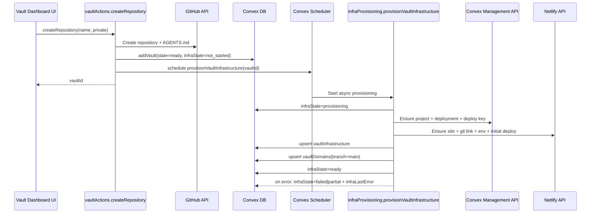

# Vault Infrastructure Auto-Provisioning Specification

## Document Control
- Status: Draft for implementation
- Owner: Noter backend/frontend
- Last updated: 2026-02-12
- Related plan: `specs/VAULT_INFRA_AUTO_PROVISIONING_AND_AI_PROD_ACCESS_PLAN.md`

## Summary
When a noter-managed vault is created, Noter must automatically provision and track infrastructure for that vault:
1. Dedicated Convex project/deployment.
2. Dedicated Netlify site connected to the vault repository.
3. Main-branch production URL registration (`main` only in MVP).

Provisioning is asynchronous, idempotent, and resumable. Vault creation should still succeed even if downstream infrastructure setup fails.

## Goals
- Eliminate manual infrastructure setup per new vault.
- Track infra lifecycle and errors in Convex with explicit states.
- Make retry safe and idempotent.
- Expose operator-facing infra status in dashboard/query surfaces.
- Keep design ready for future per-user credentials and branch domains.

## Non-Goals
- Per-user linked Convex/Netlify accounts.
- Branch domain activation beyond storing branch-ready metadata.
- Automatic external teardown on vault deletion.
- Cost budget automation and spend controls.

## Current Context
- New noter-managed repo creation happens in `apps/noter/convex/vaultActions.ts` (`createRepository`).
- Vault metadata is stored in `apps/noter/convex/schema.ts` (`vaults`).
- Vault card UI is in `apps/noter/src/components/VaultDashboard.tsx`.

## Architecture Overview



## Data Model

### 1. Extend `vaults`
Add fields:
- `infraState`: `"not_started" | "provisioning" | "ready" | "failed" | "partial"`
- `infraLastError`: optional string
- `infraLastProvisionedAt`: optional number

### 2. Add `vaultInfrastructure`
One row per vault with provider identifiers and resolved URLs.

Proposed shape:
- `vaultId: Id<"vaults">`
- `status: "provisioning" | "ready" | "failed" | "partial"`
- `lastError?: string`
- `provisioningVersion: number`
- `lastProvisionedAt?: number`

Convex block:
- `projectId?: string`
- `projectSlug?: string`
- `deploymentName?: string`
- `deploymentType?: "prod" | "dev"`
- `cloudUrl?: string`
- `siteUrl?: string`
- `deployKeyId?: string`

Netlify block:
- `siteId?: string`
- `siteName?: string`
- `teamId?: string`
- `defaultUrl?: string`
- `productionUrl?: string`
- `buildHookId?: string`

Indexes:
- `by_vault` on `vaultId`
- `by_status` on `status`

### 3. Add `vaultDomains`
Branch/domain mapping model (main live now, branch-ready now).

Fields:
- `vaultId: Id<"vaults">`
- `branch: string`
- `kind: "main" | "branch_preview"`
- `url: string`
- `source: "netlify_default" | "netlify_custom"`
- `active: boolean`
- `lastSyncedAt: number`

Indexes:
- `by_vault`
- `by_vault_and_branch`

### 4. Schema snippet (reference)
```ts
// in schema.ts
const InfraState = v.union(
  v.literal("not_started"),
  v.literal("provisioning"),
  v.literal("ready"),
  v.literal("failed"),
  v.literal("partial"),
);

vaults: defineTable({
  // existing fields...
  infraState: v.optional(InfraState),
  infraLastError: v.optional(v.string()),
  infraLastProvisionedAt: v.optional(v.number()),
});

vaultInfrastructure: defineTable({
  vaultId: v.id("vaults"),
  status: InfraState,
  lastError: v.optional(v.string()),
  provisioningVersion: v.number(),
  lastProvisionedAt: v.optional(v.number()),

  projectId: v.optional(v.string()),
  projectSlug: v.optional(v.string()),
  deploymentName: v.optional(v.string()),
  deploymentType: v.optional(v.union(v.literal("prod"), v.literal("dev"))),
  cloudUrl: v.optional(v.string()),
  siteUrl: v.optional(v.string()),
  deployKeyId: v.optional(v.string()),

  siteId: v.optional(v.string()),
  siteName: v.optional(v.string()),
  teamId: v.optional(v.string()),
  defaultUrl: v.optional(v.string()),
  productionUrl: v.optional(v.string()),
  buildHookId: v.optional(v.string()),
})
  .index("by_vault", ["vaultId"])
  .index("by_status", ["status"]);

vaultDomains: defineTable({
  vaultId: v.id("vaults"),
  branch: v.string(),
  kind: v.union(v.literal("main"), v.literal("branch_preview")),
  url: v.string(),
  source: v.union(v.literal("netlify_default"), v.literal("netlify_custom")),
  active: v.boolean(),
  lastSyncedAt: v.number(),
})
  .index("by_vault", ["vaultId"])
  .index("by_vault_and_branch", ["vaultId", "branch"]);
```

## Runtime Configuration
Required environment variables:
- `AUTO_INFRA_PROVISIONING_ENABLED` (`"true" | "false"`)
- `CONVEX_MANAGEMENT_TOKEN`
- `CONVEX_TEAM_ID`
- `NETLIFY_ACCESS_TOKEN`
- `NETLIFY_TEAM_ID`
- `INFRA_DEFAULT_BRANCH` (default `main`)

Optional:
- `NETLIFY_PRIMARY_DOMAIN_SUFFIX` (future custom domain allocation)

## API and Function Contracts

### Public actions/queries
1. `vaultActions.retryInfrastructureProvisioning`
```ts
args: { vaultId: Id<"vaults"> }
returns: { scheduled: boolean }
```
Behavior:
- Validate ownership.
- Schedule internal provisioning action.
- Return whether scheduling happened.

2. `vault.getVaultInfrastructure`
```ts
args: { vaultId: Id<"vaults"> }
returns: {
  infraState: "not_started" | "provisioning" | "ready" | "failed" | "partial";
  infraLastError?: string;
  convex?: {...};
  netlify?: {...};
  domains: Array<{ branch: string; kind: "main" | "branch_preview"; url: string; active: boolean }>;
}
```
Behavior:
- Validate ownership.
- Return normalized view from `vaults`, `vaultInfrastructure`, `vaultDomains`.

### Internal actions/mutations
1. `infraProvisioning.provisionVaultInfrastructure`
```ts
args: { vaultId: Id<"vaults"> }
returns: null
```
Behavior:
- Acquire provisioning lock per vault.
- Set `infraState=provisioning`.
- Resume from existing `vaultInfrastructure` if partial.
- Persist progress after each provider step.
- Set final state (`ready`, `partial`, `failed`).

2. `infraProvisioning.setProvisioningState`
```ts
args: {
  vaultId: Id<"vaults">;
  infraState: "not_started" | "provisioning" | "ready" | "failed" | "partial";
  infraLastError?: string;
  infraLastProvisionedAt?: number;
}
returns: null
```

3. `infraProvisioning.upsertInfrastructureRecord`
```ts
args: { vaultId: Id<"vaults">; patch: Partial<VaultInfrastructureRecord> }
returns: null
```

4. `infraProvisioning.upsertDomainRecord`
```ts
args: {
  vaultId: Id<"vaults">;
  branch: string;
  kind: "main" | "branch_preview";
  url: string;
  source: "netlify_default" | "netlify_custom";
  active: boolean;
}
returns: null
```

## Provider Integration Design
Create module boundary:
- `apps/noter/convex/providers/infrastructure/convexProvider.ts`
- `apps/noter/convex/providers/infrastructure/netlifyProvider.ts`
- `apps/noter/convex/providers/infrastructure/types.ts`

Provider interfaces:
```ts
interface ConvexProvisioner {
  ensureProject(input: { repoOwner: string; repoName: string; vaultId: string }): Promise<{
    projectId: string;
    projectSlug: string;
  }>;
  ensureDeployment(input: { projectId: string }): Promise<{
    deploymentName: string;
    cloudUrl: string;
    siteUrl: string;
  }>;
  ensureDeployKey(input: { projectId: string; deploymentName: string }): Promise<{
    deployKeyId: string;
    deployKey: string;
  }>;
}

interface NetlifyProvisioner {
  ensureSite(input: { repoOwner: string; repoName: string; siteNameHint: string }): Promise<{
    siteId: string;
    siteName: string;
    defaultUrl: string;
  }>;
  ensureSiteEnv(input: { siteId: string; env: Record<string, string> }): Promise<void>;
  triggerInitialDeploy(input: { siteId: string }): Promise<{ productionUrl?: string }>;
}
```

## Provisioning State Machine

States:
- `not_started`
- `provisioning`
- `ready`
- `partial`
- `failed`

Rules:
- New noter-managed vault starts as `not_started`.
- Scheduling sets `provisioning`.
- Any provider success + later error -> `partial`.
- No provider success + error -> `failed`.
- All required resources present and validated -> `ready`.

## Idempotency and Retry
- Each run increments `provisioningVersion`.
- Existing IDs in `vaultInfrastructure` are treated as source of truth.
- Calls must check resource existence before creation.
- Retry action only schedules; no direct provider calls from UI.

Idempotency keys:
- Convex project naming convention: `noter-{ghRepoOwner}-{ghRepoName}-{vaultShortId}`.
- Netlify site naming convention: same slug with truncation and sanitization.

## Failure Handling
- Persist granular step marker in `lastError` payload.
- Do not roll back already-created resources in MVP.
- Surface retry CTA in dashboard when state is `failed` or `partial`.

## UI/UX Changes

### Vault Dashboard
Update vault card to show:
- Infra badge: `Provisioning`, `Ready`, `Partial`, `Failed`.
- Production URL if available.
- `Retry infra setup` button for failed/partial states.

### UX behavior
- No blocking loader after repo creation.
- Vault remains usable even while infra provisioning runs.
- Errors are concise, with optional details popover.

## Security and Access Boundaries
- Provisioning credentials only from backend env vars.
- Never store provider access tokens in Convex tables.
- Store only provider resource IDs and non-secret URLs.
- Avoid writing deploy key plaintext to DB; persist only identifier/fingerprint if available.

## Rollout Plan
1. Ship schema and backend provider modules behind `AUTO_INFRA_PROVISIONING_ENABLED=false`.
2. Enable in dev for noter-managed vaults.
3. Enable in prod for admin account only.
4. Enable for all noter-managed vault creation.

## Migration Plan
- Existing vaults get defaults:
  - `infraState=not_started`
  - no `vaultInfrastructure` row
- Backfill action can schedule provisioning for selected vault IDs.

## Acceptance Criteria
- New vault creation schedules infra provisioning.
- Infra records and main-domain records are written for successful runs.
- Partial failures are recoverable via retry without duplicate resources.
- Dashboard displays infra state and production URL.
- Feature flag can disable provisioning globally without code changes.

## Test Matrix

| Scenario | Type | Expected Result |
|---|---|---|
| Full success path | Integration (mock providers) | `infraState=ready`, IDs and URLs populated |
| Convex ok, Netlify fails | Integration | `infraState=partial`, retry resumes |
| Total provider failure | Integration | `infraState=failed`, `infraLastError` set |
| Duplicate scheduled runs | Integration | No duplicate external resources |
| Retry from partial | Integration | Existing IDs reused, reaches `ready` |
| Ownership violation on retry | Unit/integration | Action throws authorization error |
| Dashboard status rendering | UI test | Correct badge/URL/Retry button by state |

## Deferred Work
- Per-user provider credentials and OAuth account linking.
- Branch domain activation and custom domains.
- External resource teardown on vault deletion.
- Cost and spend telemetry.

## Flip to Multi-User Safe Mode Checklist
- [ ] Replace owner credentials resolver with per-user account-link resolver.
- [ ] Enforce per-vault ownership mapping between user and provider project/site.
- [ ] Add cleanup workflow for orphaned external resources.
- [ ] Add quota/cost controls per user/team.
- [ ] Add customer-facing infra diagnostics page with least-privilege details.

